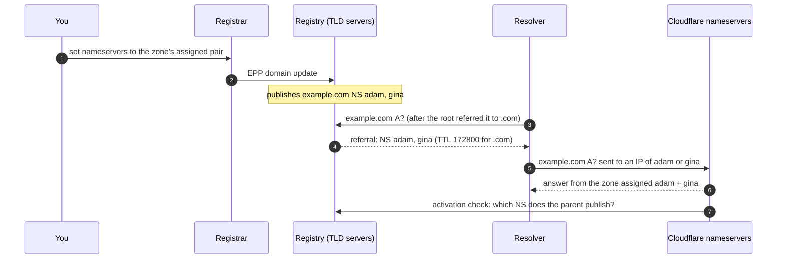
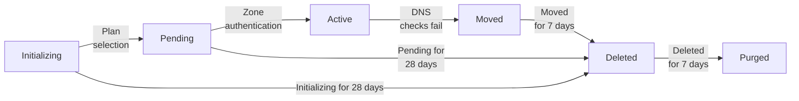

# Zone Activation: Delegation, DNSSEC and Propagation

What has to be true before a Cloudflare zone on a full setup turns `active`, who publishes the delegation Cloudflare checks, why the switch breaks under DNSSEC, and what "propagation" actually waits for.

Verified against Cloudflare's docs source at [`ef83b95`](https://github.com/cloudflare/cloudflare-docs/tree/ef83b95d4849c750001782e70ec04aee900e695c) (2026-10-21), the API v4 schema as generated into [cloudflare-python 5.9.0](https://github.com/cloudflare/cloudflare-python/tree/v5.9.0), [RFC 5731](https://www.rfc-editor.org/rfc/rfc5731), and live queries on 2026-10-21 with dig 9.18.39 and `scripts/check_delegation.py` (dnspython 2.9.0). Every "Source:" link points at a commit, with line numbers.

______________________________________________________________________

## Table of Contents

1. [Registrar, Registry and DNS Host](#1-registrar-registry-and-dns-host)
2. [Zone Status Lifecycle](#2-zone-status-lifecycle)
3. [The Activation Check](#3-the-activation-check)
4. [DNSSEC When Switching](#4-dnssec-when-switching)
5. [Propagation Is TTL Expiry](#5-propagation-is-ttl-expiry)
6. [Copying Records Before the Switch](#6-copying-records-before-the-switch)
7. [Errors When Adding a Domain](#7-errors-when-adding-a-domain)
8. [Cloudflare Registrar, Partial Setup and Zone Holds](#8-cloudflare-registrar-partial-setup-and-zone-holds)

______________________________________________________________________

## 1. Registrar, Registry and DNS Host

Three parties are involved, and only two of them answer DNS queries:

| Party                                  | Role                                                                                                                            | Answers DNS queries  |
| -------------------------------------- | ------------------------------------------------------------------------------------------------------------------------------- | -------------------- |
| Registrar (GoDaddy, Namecheap, ...)    | Sells the domain and sends your nameserver change to the registry over EPP ([RFC 5731](https://www.rfc-editor.org/rfc/rfc5731)) | No                   |
| Registry (Verisign for `.com`)         | Publishes the delegation, the `NS` (and `DS`) records for your domain, in the TLD zone                                          | Yes, with a referral |
| DNS host (Cloudflare after the switch) | Holds the zone with your records                                                                                                | Yes, authoritatively |



The registrar is not in the resolution path: once the registry publishes the change, the registrar can be down, and a later transfer to another registrar normally carries the nameservers along. The registrar comes back only when the domain object changes: nameservers, DS records, renewal, transfer, contacts, or a lock or hold.

The registry record is public. RDAP (the successor of WHOIS) returns the registrar, the EPP status codes and the nameservers; `scripts/check_delegation.py` prints it:

```bash
curl -sL -H 'Accept: application/rdap+json' https://rdap.org/domain/example.com \
  | jq '{status, nameservers: [.nameservers[].ldhName], signed: .secureDNS.delegationSigned}'
```

Some EPP statuses decide whether a nameserver change can happen or whether the delegation exists at all:

Source: [RFC 5731, section 2.3](https://www.rfc-editor.org/rfc/rfc5731#section-2.3)

```text
   -  clientHold, serverHold

      DNS delegation information MUST NOT be published for the object.
```

```text
   -  clientUpdateProhibited, serverUpdateProhibited

      Requests to update the object (other than to remove this status)
      MUST be rejected.
```

So a `clientUpdateProhibited` lock (RDAP spells it `client update prohibited`) makes the registrar's nameserver change fail until the lock is lifted, and `clientHold` or `serverHold` (an unpaid, suspended or unverified domain) removes the delegation, which turns an active zone `moved`. A transfer lock, `clientTransferProhibited`, does not block nameserver changes.

When a zone is created, Cloudflare records what the domain used before. The zone object keeps it, and `activated_on` names the delegation check what it is, a proof of ownership:

Source: [`src/cloudflare/types/zones/zone.py#L122-L123`](https://github.com/cloudflare/cloudflare-python/blob/6106cdaa6bea2143c8a9322708992929812701bc/src/cloudflare/types/zones/zone.py#L122-L123), [`#L149-L159`](https://github.com/cloudflare/cloudflare-python/blob/6106cdaa6bea2143c8a9322708992929812701bc/src/cloudflare/types/zones/zone.py#L149-L159)

```python
    activated_on: Optional[datetime] = None
    """The last time proof of ownership was detected and the zone was made active."""
```

```python
    name_servers: List[str]
    """The name servers Cloudflare assigns to a zone."""

    original_dnshost: Optional[str] = None
    """DNS host at the time of switching to Cloudflare."""

    original_name_servers: Optional[List[str]] = None
    """Original name servers before moving to Cloudflare."""

    original_registrar: Optional[str] = None
    """Registrar for the domain at the time of switching to Cloudflare."""
```

Read them with an API token that has `Zone:Read`:

```bash
curl -s -H "Authorization: Bearer $CLOUDFLARE_API_TOKEN" \
  'https://api.cloudflare.com/client/v4/zones?name=example.com' \
  | jq '.result[] | {status, name_servers, original_name_servers, original_registrar, activated_on}'
```

Activation rests on this public data, not on access to the registrar account: proof of ownership is the parent publishing the nameservers Cloudflare assigned, which only someone who controls the registration can arrange.

## 2. Zone Status Lifecycle

Source: [`src/content/docs/dns/zone-setups/reference/domain-status.mdx#L17-L37`](https://github.com/cloudflare/cloudflare-docs/blob/ef83b95d4849c750001782e70ec04aee900e695c/src/content/docs/dns/zone-setups/reference/domain-status.mdx#L17-L37)



| Status                   | Answers DNS queries                                                               | Ends                                                                                                            |
| ------------------------ | --------------------------------------------------------------------------------- | --------------------------------------------------------------------------------------------------------------- |
| Initializing (dashboard) | No                                                                                | Deleted after 28 days                                                                                           |
| Pending                  | On its assigned nameservers' IPs only                                             | Free: deleted after 28 days. Paid: stays pending                                                                |
| Active                   | On every Cloudflare nameserver IP that no other zone of the same name is assigned | Moved when the parent stops listing its nameservers                                                             |
| Moved                    | Not documented; resolvers stop asking once the parent drops the delegation        | Free: deleted after 7 days. Paid: after 7 days once the plan is removed or another account activates the domain |
| Deleted                  | On its assigned nameservers' IPs, for records that were not deleted               | Purged after 7 days                                                                                             |
| Purged                   | No                                                                                | Final; re-adding starts from scratch                                                                            |

Only an active zone proxies traffic or applies any other setting: "An **active** domain status is a requirement for your application services configurations to be applied" ([`domain-status.mdx#L11`](https://github.com/cloudflare/cloudflare-docs/blob/ef83b95d4849c750001782e70ec04aee900e695c/src/content/docs/dns/zone-setups/reference/domain-status.mdx#L11)). The pending and active rows of the "Answers DNS queries" column come from the experiments in `references/nameservers.md`; the rest is the docs:

Source: [`src/content/docs/dns/zone-setups/reference/domain-status.mdx#L60`](https://github.com/cloudflare/cloudflare-docs/blob/ef83b95d4849c750001782e70ec04aee900e695c/src/content/docs/dns/zone-setups/reference/domain-status.mdx#L60)

```md
Cloudflare responds to DNS queries for pending zones on the assigned Cloudflare nameserver IPs, but your zone is still not active and cannot be used to [proxy traffic to Cloudflare](/dns/proxy-status/limitations/#pending-domains).
```

Source: [`src/content/docs/dns/zone-setups/reference/domain-status.mdx#L111-L117`](https://github.com/cloudflare/cloudflare-docs/blob/ef83b95d4849c750001782e70ec04aee900e695c/src/content/docs/dns/zone-setups/reference/domain-status.mdx#L111-L117)

```md
Your zone has been archived. Cloudflare still responds to DNS queries for deleted zones on the assigned Cloudflare nameserver IPs (for non-deleted DNS records) and you can re-add the domain to Cloudflare by following the [regular onboarding flow](/fundamentals/manage-domains/add-site/).

:::caution[New nameserver assignment]
When you re-add a previously deleted domain, Cloudflare assigns a new nameserver pair as a security measure. If you are not using Cloudflare Registrar, make sure to [update your registrar](/dns/nameservers/update-nameservers/) with the new nameservers after re-adding the domain. Refer to [nameserver assignment](/dns/nameservers/nameserver-options/#assignment-method) for details.
:::

After being deleted for seven days, zones are automatically [purged](#purged).
```

A zone goes `moved` whenever the parent stops listing its nameservers, which also happens without anyone touching the DNS settings: the domain expired and the registrar parked it, a registrar put it on `clientHold`, or someone else's nameservers were set. On Cloudflare Registrar, an unverified registrant email does the same:

Source: [`src/content/docs/registrar/faq.mdx#L37`](https://github.com/cloudflare/cloudflare-docs/blob/ef83b95d4849c750001782e70ec04aee900e695c/src/content/docs/registrar/faq.mdx#L37)

```md
If you registered your domain through Cloudflare Registrar, ICANN requires you to verify the registrant email address. If that email is unverified or the verification link expired, ICANN requires the registrar to place a hold on the domain and Cloudflare temporarily replaces your nameservers with parking nameservers, which is why the site stops resolving. Once you complete verification, your nameservers are automatically restored.
```

## 3. The Activation Check

What the parent must list depends on the setup:

| Setup                                      | Required at the parent                                                     |
| ------------------------------------------ | -------------------------------------------------------------------------- |
| Full, multi-provider DNS off (the default) | Exactly the assigned Cloudflare nameservers; any other provider's NS fails |
| Full with multi-provider DNS, or secondary | The assigned Cloudflare nameservers; other providers' NS allowed           |
| Partial (CNAME)                            | Nothing; the `cloudflare-verify` TXT record at the current DNS host        |

Source: [`src/content/docs/dns/zone-setups/reference/domain-status.mdx#L72-L76`](https://github.com/cloudflare/cloudflare-docs/blob/ef83b95d4849c750001782e70ec04aee900e695c/src/content/docs/dns/zone-setups/reference/domain-status.mdx#L72-L76) (the table above restates it)

The check runs on a schedule that backs off:

Source: [`src/content/docs/dns/zone-setups/reference/domain-status.mdx#L68`](https://github.com/cloudflare/cloudflare-docs/blob/ef83b95d4849c750001782e70ec04aee900e695c/src/content/docs/dns/zone-setups/reference/domain-status.mdx#L68)

```md
After you add your domain, Cloudflare performs checks on a schedule to confirm you have updated your nameservers. The first check occurs after 60 seconds and the following attempts happen at gradually increased intervals. You can re-trigger the check [via API](/api/resources/zones/subresources/activation_check/methods/trigger/) or on the Dashboard, in the respective domain [Overview page](https://dash.cloudflare.com/?to=/:account/:zone/).
```

The trigger is rate-limited per plan, and it only queues a check:

Source: [`src/cloudflare/resources/zones/activation_check.py#L59-L60`](https://github.com/cloudflare/cloudflare-python/blob/6106cdaa6bea2143c8a9322708992929812701bc/src/cloudflare/resources/zones/activation_check.py#L59-L60)

```python
        This can be triggered every
        5 min for paygo/ent customers, every hour for FREE Zones.
```

Source: [`src/content/docs/dns/zone-setups/troubleshooting/pending-nameservers.mdx#L147`](https://github.com/cloudflare/cloudflare-docs/blob/ef83b95d4849c750001782e70ec04aee900e695c/src/content/docs/dns/zone-setups/troubleshooting/pending-nameservers.mdx#L147)

```md
You can request an earlier check from the **Overview** page or by [triggering one via API](/api/resources/zones/subresources/activation_check/methods/trigger/). This endpoint is rate-limited and may return an error if you have requested a check recently. A successful request does not activate the zone immediately — it places your zone in a prioritized queue, and activation can take a few minutes to a few hours, depending both on when the recheck runs and on whether the nameserver change at your registrar has taken effect by then.
```

```bash
curl -s -X PUT -H "Authorization: Bearer $CLOUDFLARE_API_TOKEN" \
  "https://api.cloudflare.com/client/v4/zones/$ZONE_ID/activation_check"
```

The registrar's control panel is not evidence that the change is published. The docs list what goes wrong between the two:

Source: [`src/content/docs/dns/zone-setups/troubleshooting/pending-nameservers.mdx#L107-L114`](https://github.com/cloudflare/cloudflare-docs/blob/ef83b95d4849c750001782e70ec04aee900e695c/src/content/docs/dns/zone-setups/troubleshooting/pending-nameservers.mdx#L107-L114)

```md
If the parent zone does not return the correct Cloudflare nameservers, the registrar has not published your change. Common patterns:

- The nameserver change was entered in the registrar UI but not saved or submitted.
- The change was made on a different domain, on a subdomain, or in a different registrar account.
- The domain is under a **Transfer**, **Registrar Lock**, or **Redemption** state that prevents nameserver changes. Complete or cancel the pending state first.
- The registrar requires an additional confirmation step (email confirmation, admin approval, two-factor prompt).
- The registrar publishes changes on a delay. Ask your registrar's support for their expected propagation window.
- Your domain is at a reseller and the nameserver setting must be changed one level up. Refer to [Update your nameservers at your registrar](/dns/nameservers/update-nameservers/#specific-processes).
```

Ask the parent itself. `dig +trace` follows the referrals from the root; the last referral before your domain is the parent's answer:

```bash
dig +trace +nodnssec example.com NS +noall +authority
dig +norec @a.gtld-servers.net example.com NS +noall +authority
```

The second form asks one `.com` server directly; for another TLD, take a server from `dig +short NS in.` (or the TLD in question). A typo in a nameserver name is easy to miss because the `ns.cloudflare.com` zone answers `NOERROR` with no records for any name, so `dig zzqqxxnotaname.ns.cloudflare.com` looks like a real name that lacks an address; `scripts/check_delegation.py` flags a delegated name without an IPv4 address and names like `ns.cloudfare.com`.

## 4. DNSSEC When Switching

The `DS` record lives in the parent zone and names the key of the old DNS host. After the switch, validating resolvers look for that key at Cloudflare, do not find it, and fail the whole domain:

Source: [`src/content/partials/dns/why-disable-dnssec.mdx#L6-L8`](https://github.com/cloudflare/cloudflare-docs/blob/ef83b95d4849c750001782e70ec04aee900e695c/src/content/partials/dns/why-disable-dnssec.mdx#L6-L8)

```md
When your domain has [DNSSEC enabled](https://www.cloudflare.com/learning/dns/dns-security/#what-is-dnssec), your DNS provider digitally signs all your DNS records. This action prevents anyone else from issuing false DNS records on your behalf and redirecting traffic intended for your domain.

However, having a single set of signed records also prevents Cloudflare from issuing new DNS records on your behalf (which is part of using Cloudflare for your authoritative nameservers). So if you change your nameservers without disabling DNSSEC, DNSSEC will prevent Cloudflare's DNS records from resolving properly.
```

The stale `DS` also keeps the zone pending: the troubleshooting page says such records "will block activation" ([`pending-nameservers.mdx#L130`](https://github.com/cloudflare/cloudflare-docs/blob/ef83b95d4849c750001782e70ec04aee900e695c/src/content/docs/dns/zone-setups/troubleshooting/pending-nameservers.mdx#L130)). The symptom at a validating resolver is `SERVFAIL` that disappears with checking disabled (`+cd`):

Source: [`src/content/docs/dns/dnssec/troubleshooting.mdx#L189-L200`](https://github.com/cloudflare/cloudflare-docs/blob/ef83b95d4849c750001782e70ec04aee900e695c/src/content/docs/dns/dnssec/troubleshooting.mdx#L189-L200)

````md
Confirm whether a `SERVFAIL` response is related to DNSSEC by running `dig` with the `+cd` option. The `+cd` option provides DNS results without any DNSSEC validation in place.

```sh
dig A brokendnssec.net @1.0.0.1 +dnssec +cd +short
```

```sh output
104.20.49.61
104.20.48.61
```

In this example, DNSSEC is misconfigured if a proper DNS response is received when using the `+cd` option but queries using DNSSEC return a `SERVFAIL` response. This issue often happens when authoritative nameservers are changed but `DS` records are not updated. The issue can also occur if an attacker attempts to forge a response to a query.
````

`dnssec-failed.org`, a test domain kept deliberately broken, shows the same pattern, and `scripts/check_delegation.py` reports both halves, the `DS` that matches no served `DNSKEY` and the resolver result:

```text
$ uv run scripts/check_delegation.py dnssec-failed.org --no-rdap
...
DNSSEC
  PROBLEM: no DS at the parent matches a DNSKEY the nameservers serve (stale DS)
  1.1.1.1: SERVFAIL
  PROBLEM: 1.1.1.1 fails validation but answers with +cd: the DNSSEC chain is broken
```

The order that avoids the outage, when the old host cannot publish Cloudflare's keys:

Source: [`src/content/docs/dns/dnssec/index.mdx#L54-L65`](https://github.com/cloudflare/cloudflare-docs/blob/ef83b95d4849c750001782e70ec04aee900e695c/src/content/docs/dns/dnssec/index.mdx#L54-L65)

```md
If your current provider does not support this, use the following approach. This involves a brief window without DNSSEC protection.

1. Remove the DS record at your registrar.
2. Wait for the DS record TTL to fully expire at the parent zone.
   - Verify with `dig DS example.com` — commonly 24–48 hours for most TLDs.
3. Change your nameservers to Cloudflare.
4. Wait for the previous NS record TTL to expire (typically one hour or less).
5. [Enable DNSSEC in Cloudflare](#enable-dnssec) and add the new DS record at your registrar.

:::caution
If you change nameservers before the old DS TTL has fully expired, validating resolvers will return SERVFAIL because the cached DS records will not match Cloudflare's DNSSEC keys.
:::
```

Step 4's "typically one hour or less" does not hold at the parent side for every TLD: `.com`, `.net` and `.uk` publish delegations with a 48-hour TTL (section 5). When the old host can serve Cloudflare's `DNSKEY` too, the [multi-signer migration](https://developers.cloudflare.com/dns/dnssec/dnssec-active-migration/) avoids the unsigned window. Cloudflare adds the new `DS` itself for Cloudflare Registrar domains and for the `.ch` and `.cz` TLDs ([`dnssec-auto-add.mdx#L9`](https://github.com/cloudflare/cloudflare-docs/blob/ef83b95d4849c750001782e70ec04aee900e695c/src/content/partials/dns/dnssec-auto-add.mdx#L9)); for any other domain, copy it from the zone's DNSSEC card to the registrar. Those automatic updates use the CDS and CDNSKEY records of [RFC 8078](https://www.rfc-editor.org/rfc/rfc8078), which Cloudflare publishes for signed zones ([announcement, 2018](https://blog.cloudflare.com/automatically-provision-and-maintain-dnssec/)).

A DS at the parent can be attributed by its key tag: "Cloudflare's DS record always has the key tag set to `2371`" ([`dnssec-active-migration.mdx#L166`](https://github.com/cloudflare/cloudflare-docs/blob/ef83b95d4849c750001782e70ec04aee900e695c/src/content/docs/dns/dnssec/dnssec-active-migration.mdx#L166)). Cloudflare signs zones with a shared key pair by default; a Foundation DNS account can ask for a pair of its own, with its own key tag ([`foundation-dns/dnssec-keys.mdx#L10-L12`](https://github.com/cloudflare/cloudflare-docs/blob/ef83b95d4849c750001782e70ec04aee900e695c/src/content/docs/dns/foundation-dns/dnssec-keys.mdx#L10-L12)). Otherwise, after the switch, any DS with another key tag belongs to the old host and is stale. `example.com`, on Cloudflare since its move, shows the pattern:

```bash
dig +short DS example.com
```

```text
2371 13 2 C988EC423E3880EB8DD8A46FE06CA230EE23F35B578D64E78B29C3E1 C83D245A
```

## 5. Propagation Is TTL Expiry

"Up to 24 hours" in the setup guide is the registrar's processing time ([`full-setup/setup.mdx#L160`](https://github.com/cloudflare/cloudflare-docs/blob/ef83b95d4849c750001782e70ec04aee900e695c/src/content/docs/dns/zone-setups/full-setup/setup.mdx#L160)). After the registry publishes, nothing is pushed anywhere; each resolver keeps the delegation it cached until the TTL runs out, then asks again. The parent's TTL is set by the registry and cannot be lowered by you. Measured on 2026-10-21 by asking one server of each TLD directly:

| TLD            | Parent `NS` TTL | Parent `DS` TTL (for a signed domain) |
| -------------- | --------------- | ------------------------------------- |
| `.com`         | 172800 s (48 h) | 86400 s (24 h)                        |
| `.net`         | 172800 s (48 h) | 86400 s (24 h)                        |
| `.uk`          | 172800 s (48 h) | not measured                          |
| `.de`          | 86400 s (24 h)  | 86400 s (24 h)                        |
| `.dev`, `.app` | 10800 s (3 h)   | not measured                          |
| `.org`         | 3600 s (1 h)    | 3600 s (1 h)                          |
| `.co`, `.xyz`  | 3600 s (1 h)    | not measured                          |
| `.in`          | 900 s (15 min)  | 900 s (15 min)                        |
| `.io`          | 300 s (5 min)   | not measured                          |
| `.ai`          | 300 s (5 min)   | 3600 s (1 h)                          |

```bash
dig +norec @$(dig +short NS com. | head -1) example.com NS +noall +authority
```

Two consequences:

- Some resolvers still ask the old nameservers for up to the parent `NS` TTL after the registry publishes the change, and for as long as the old host's own `NS` TTL if they cached the old host's apex `NS` set. Keep the old zone serving the same records for at least that long; deleting it right after the switch causes an outage for those users. A resolver may keep an apex `NS` set it got from the old host over the parent's new referral, because [RFC 2181, section 5.4.1](https://www.rfc-editor.org/rfc/rfc2181#section-5.4.1) ranks authoritative data above referrals. Cloudflare's own migration guide keeps the old servers "operational as a fallback" and decommissions them "several days to a week after full propagation and successful testing" ([`phase-3.mdx#L15`](https://github.com/cloudflare/cloudflare-docs/blob/ef83b95d4849c750001782e70ec04aee900e695c/src/content/docs/learning-paths/dns-best-practices/concepts/phase-3.mdx#L15), [`phase-4.mdx#L55`](https://github.com/cloudflare/cloudflare-docs/blob/ef83b95d4849c750001782e70ec04aee900e695c/src/content/docs/learning-paths/dns-best-practices/concepts/phase-4.mdx#L55)).
- A name that does not exist is cached as such for the zone's SOA minimum ([`dns-issues.mdx#L65-L78`](https://github.com/cloudflare/cloudflare-docs/blob/ef83b95d4849c750001782e70ec04aee900e695c/src/content/docs/dns/troubleshooting/dns-issues.mdx#L65-L78)). It is 1800 s unless an Enterprise account changed it ([`dns-record-types.mdx#L397-L399`](https://github.com/cloudflare/cloudflare-docs/blob/ef83b95d4849c750001782e70ec04aee900e695c/src/content/docs/dns/manage-dns-records/reference/dns-record-types.mdx#L397-L399), [`#L441-L445`](https://github.com/cloudflare/cloudflare-docs/blob/ef83b95d4849c750001782e70ec04aee900e695c/src/content/docs/dns/manage-dns-records/reference/dns-record-types.mdx#L441-L445)), and active zones returned SOA records ending in `604800 1800` on 2026-10-21. A record you forgot to copy, added after the switch, can stay invisible for 30 minutes at resolvers that already asked for it.

Some registries check the new nameservers before they accept the change. DENIC, the `.de` registry, rejects it unless "All name servers stated in the request must be reachable and authoritative for the requested zone" and "The NS-RRSet must correspond exactly to the list of name servers stated with the request" ([predelegation check](https://docs.denic.de/en/Content/DENIC-23/Nameserver_Predelegation_Check.htm)). A pending zone passes: it answers on its pair, and its apex `NS` set is that pair. A zone still `initializing` in the dashboard (no plan chosen) answers nothing ([`domain-status.mdx#L46-L48`](https://github.com/cloudflare/cloudflare-docs/blob/ef83b95d4849c750001782e70ec04aee900e695c/src/content/docs/dns/zone-setups/reference/domain-status.mdx#L46-L48)), so finish onboarding before changing a `.de` delegation.

Cloudflare's own apex `NS` records have a TTL of 86400 s by default, adjustable from 30 s with the Foundation DNS "Nameserver TTL" option ([`nameserver-options.mdx#L80-L88`](https://github.com/cloudflare/cloudflare-docs/blob/ef83b95d4849c750001782e70ec04aee900e695c/src/content/docs/dns/nameservers/nameserver-options.mdx#L80-L88)).

## 6. Copying Records Before the Switch

The quick scan that runs when a domain is added guesses common names; it does not transfer the zone:

Source: [`src/content/docs/dns/zone-setups/reference/dns-quick-scan.mdx#L59-L67`](https://github.com/cloudflare/cloudflare-docs/blob/ef83b95d4849c750001782e70ec04aee900e695c/src/content/docs/dns/zone-setups/reference/dns-quick-scan.mdx#L59-L67)

```md
## Limitations

Since the DNS records quick scan is not tailored to the specific zone you are adding to Cloudflare, there can be cases where not all records are picked up.

For example, if you have very specific hostnames - such as `my-store1900.example.com` instead of `store.example.com` - or if you have set up a [DKIM record](https://www.cloudflare.com/learning/dns/dns-records/dns-dkim-record/) that uses a more custom name - `this._domainkey` instead of `default._domainkey` - it is expected that the scan will not find the specific DNS records.

:::caution[Important]
```

Export a BIND zone file from the old host and [import it](https://developers.cloudflare.com/dns/manage-dns-records/how-to/import-and-export/), then compare record by record by querying the zone's own nameservers before switching, as `references/nameservers.md` section 4 explains. A wildcard record at the old host answers every name the scan probes, so the scan can import records that never existed; delete them, or remove the wildcard before scanning ([`unexpected-dns-records.mdx#L20-L30`](https://github.com/cloudflare/cloudflare-docs/blob/ef83b95d4849c750001782e70ec04aee900e695c/src/content/docs/dns/manage-dns-records/troubleshooting/unexpected-dns-records.mdx#L20-L30)). Records added at the old host after onboarding must be added again at Cloudflare ([`minimize-downtime.mdx#L33`](https://github.com/cloudflare/cloudflare-docs/blob/ef83b95d4849c750001782e70ec04aee900e695c/src/content/docs/fundamentals/performance/minimize-downtime.mdx#L33)).

## 7. Errors When Adding a Domain

Cloudflare looks the domain up before it creates the zone: it must be registered, one label below a public suffix, and already answer `NS` and `SOA` queries from working nameservers ([`cannot-add-domain.mdx#L45-L71`](https://github.com/cloudflare/cloudflare-docs/blob/ef83b95d4849c750001782e70ec04aee900e695c/src/content/docs/dns/zone-setups/troubleshooting/cannot-add-domain.mdx#L45-L71)). A domain whose delegation points at dead or refusing servers cannot be added until the delegation works.

| Code or message                                               | Meaning                                                                                   |
| ------------------------------------------------------------- | ----------------------------------------------------------------------------------------- |
| `1049` "is not a registered domain"                           | Not registered yet, or a TLD that needs manual handling (`.gov`)                          |
| `1099` "unable to identify ... as a registered domain"        | A subdomain or a name that is not below a [public suffix](https://publicsuffix.org/list/) |
| `1110` "Failed to lookup registrar and hosting information"   | The registrar or DNS lookup failed; try later                                             |
| `1105` "temporarily restricted"                               | Too many attempts to add this domain; wait 3 hours                                        |
| `1093`, `1116`                                                | Usually a subdomain instead of the apex                                                   |
| `1097` "This web property cannot be added"                    | Blocked; Enterprise contacts its account team, others email `abusereply@cloudflare.com`   |
| "subject to a hold which disallows the creation of this zone" | An Enterprise zone hold in another account                                                |

Source: [`src/content/docs/dns/zone-setups/troubleshooting/cannot-add-domain.mdx#L79-L82`](https://github.com/cloudflare/cloudflare-docs/blob/ef83b95d4849c750001782e70ec04aee900e695c/src/content/docs/dns/zone-setups/troubleshooting/cannot-add-domain.mdx#L79-L82)

```md
- **Error 1105**
  - **Message**: `Error with Cloudflare request: [1105] This zone is temporarily restricted and cannot be added to Cloudflare at this time, please contact Cloudflare Support.`
  - **Cause**: We have seen too many attempts to add a domain to Cloudflare
  - **Resolution**: Wait 3 hours before attempting to re-add the domain to Cloudflare. Support cannot speed up this process.
```

## 8. Cloudflare Registrar, Partial Setup and Zone Holds

Cloudflare Registrar ties the registration to Cloudflare DNS in both directions:

Source: [`src/content/docs/registrar/faq.mdx#L27-L33`](https://github.com/cloudflare/cloudflare-docs/blob/ef83b95d4849c750001782e70ec04aee900e695c/src/content/docs/registrar/faq.mdx#L27-L33)

```md
### Can I use my own (third-party) nameservers

No, all domains on Cloudflare Registrar use Cloudflare nameservers, so that we can protect and speed up your content or services.

If you only need a subdomain to be on a different service provider, you can [delegate a subdomain](/dns/manage-dns-records/how-to/subdomains-outside-cloudflare/). Also, if you are on the Business or Enterprise plans, you have the option to set up [custom nameservers](/dns/nameservers/custom-nameservers/), which means you will be using Cloudflare nameservers but with custom-branded nameserver names.

If you still need to use different nameservers, you will have to [move your domain to another Registrar](/registrar/account-options/transfer-out-from-cloudflare/).
```

A transfer in needs an active full-setup zone first, and DNSSEC turned off at the old registrar ("Active DNSSEC at your current registrar will block the transfer", [`registrar/troubleshooting.mdx#L26`](https://github.com/cloudflare/cloudflare-docs/blob/ef83b95d4849c750001782e70ec04aee900e695c/src/content/docs/registrar/troubleshooting.mdx#L26)), so the nameservers are changed at the old registrar before the transfer starts, never after ([`registrar/faq.mdx#L105-L107`](https://github.com/cloudflare/cloudflare-docs/blob/ef83b95d4849c750001782e70ec04aee900e695c/src/content/docs/registrar/faq.mdx#L105-L107)).

A partial (CNAME) setup keeps the current DNS host and proves ownership with a TXT record, `cloudflare-verify.example.com`, instead of the delegation. It is Business or Enterprise only and unavailable for Cloudflare Registrar domains ([`partial-setup/index.mdx#L16-L17`](https://github.com/cloudflare/cloudflare-docs/blob/ef83b95d4849c750001782e70ec04aee900e695c/src/content/docs/dns/zone-setups/partial-setup/index.mdx#L16-L17)), and the TXT record must stay for as long as the zone is active ([`partial-setup-verification-record.mdx#L27`](https://github.com/cloudflare/cloudflare-docs/blob/ef83b95d4849c750001782e70ec04aee900e695c/src/content/partials/dns/partial-setup-verification-record.mdx#L27)). Ownership there goes to whoever verifies last:

Source: [`src/content/docs/dns/zone-setups/partial-setup/index.mdx#L53`](https://github.com/cloudflare/cloudflare-docs/blob/ef83b95d4849c750001782e70ec04aee900e695c/src/content/docs/dns/zone-setups/partial-setup/index.mdx#L53)

```md
Enterprise customers can use [zone holds](/fundamentals/account/account-security/zone-holds/) to prevent other teams in the organization from adding zones that are already active in another Cloudflare account. For CNAME setups (partial), if the same zone is added to different accounts, the last account to complete the setup will gain ownership.
```

Zone holds are Enterprise only and on by default for Enterprise zones ([`zone-holds.mdx#L13-L21`](https://github.com/cloudflare/cloudflare-docs/blob/ef83b95d4849c750001782e70ec04aee900e695c/src/content/docs/fundamentals/account/account-security/zone-holds.mdx#L13-L21)). A hold blocks creating and activating zones of that name in any other account, and optionally every subdomain:

Source: [`src/cloudflare/resources/zones/holds.py#L59-L69`](https://github.com/cloudflare/cloudflare-python/blob/6106cdaa6bea2143c8a9322708992929812701bc/src/cloudflare/resources/zones/holds.py#L59-L69)

```python
        """
        Enforce a zone hold on the zone, blocking the creation and activation of zones
        with this zone's hostname. Zone holds cannot be enabled on CDN-only zones.

        Args:
          zone_id: Identifier.

          include_subdomains: If provided, the zone hold will extend to block any subdomain of the given zone,
              as well as SSL4SaaS Custom Hostnames. For example, a zone hold on a zone with
              the hostname 'example.com' and include_subdomains=true will block 'example.com',
              'staging.example.com', 'api.staging.example.com', etc.
```

Without a hold, nothing stops another account from adding your domain. Its zone stays pending and is reachable only on its own nameservers unless the parent lists them; `scripts/check_delegation.py --scan-pool` lists such zones.
