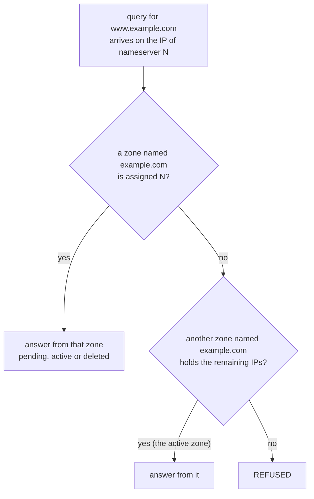

# How Cloudflare Assigns Nameservers and Chooses the Zone That Answers

Why a zone gets the pair it gets, what the pool of standard nameservers looks like, how Cloudflare decides which zone answers when several accounts hold the same domain, and why a pair set at the registrar in advance is never the one assigned.

Verified against Cloudflare's docs source at [`ef83b95`](https://github.com/cloudflare/cloudflare-docs/tree/ef83b95d4849c750001782e70ec04aee900e695c) (2026-10-21), the API v4 schema as generated into [cloudflare-python 5.9.0](https://github.com/cloudflare/cloudflare-python/tree/v5.9.0), and live queries on 2026-10-21 to all 899 standard nameservers with `scripts/check_delegation.py` (dnspython 2.9.0) and dig 9.18.39. Every "Source:" link points at a commit, with line numbers. The other zones observed below belong to accounts outside anyone's control here and can disappear at any time; rerun the scan to see the current state.

______________________________________________________________________

## Table of Contents

1. [Nameservers Belong to the Zone](#1-nameservers-belong-to-the-zone)
2. [Why the Names Exist: the 2013 Post](#2-why-the-names-exist-the-2013-post)
3. [The Pool and Its Addresses](#3-the-pool-and-its-addresses)
4. [Which Zone Answers a Query](#4-which-zone-answers-a-query)
5. [Why a Preset or Reused Pair Is Replaced](#5-why-a-preset-or-reused-pair-is-replaced)
6. [One Domain in Several Accounts](#6-one-domain-in-several-accounts)
7. [Foundation DNS, Secondary and Custom Nameservers](#7-foundation-dns-secondary-and-custom-nameservers)

______________________________________________________________________

## 1. Nameservers Belong to the Zone

Each zone gets its own assignment when it is created. The account only influences which pair is tried first:

Source: [`src/content/docs/dns/nameservers/nameserver-options.mdx#L20-L22`](https://github.com/cloudflare/cloudflare-docs/blob/ef83b95d4849c750001782e70ec04aee900e695c/src/content/docs/dns/nameservers/nameserver-options.mdx#L20-L22)

```md
When you add a domain on a [primary (full)](/dns/zone-setups/full-setup/) or [secondary](/dns/zone-setups/zone-transfers/cloudflare-as-secondary/) DNS setup, Cloudflare automatically assigns your nameservers.

The default assignment method is to use [standard nameservers](/dns/nameservers/#standard-nameservers) and favor consistent nameserver names across all zones within an account. Nonetheless, in case there are conflicts, you may get different nameserver names, even for domains that are within the same account.
```

The conflicts, and what does not help:

Source: [`src/content/docs/dns/faq.mdx#L97-L112`](https://github.com/cloudflare/cloudflare-docs/blob/ef83b95d4849c750001782e70ec04aee900e695c/src/content/docs/dns/faq.mdx#L97-L112)

```md
Cloudflare cannot manually replace the standard or Advanced nameservers assigned during zone creation, even through Cloudflare Support.

A newly added zone can be assigned different nameservers from your other zones for a few reasons:

- The same domain is (or was recently) active on another Cloudflare account.
- The zone was previously deleted from Cloudflare and re-added.
- A parent or child zone in the same account already uses the preferred nameservers.
- The account uses [Foundation DNS advanced nameservers](/dns/foundation-dns/advanced-nameservers/), which use different sets (`blue`, `gold`, `orange`) and rotate to keep [directly descending zones](/dns/foundation-dns/advanced-nameservers/#nameservers-hosting-and-assignment) on different nameservers.

To make future zones share the same nameservers, use one of the following options depending on your plan:

- [Account custom nameservers](/dns/nameservers/custom-nameservers/account-custom-nameservers/) — available on Enterprise (self-serve), or on Business after [contacting Cloudflare Support](/support/contacting-cloudflare-support/) to enable them.
- [Nameserver sets](/dns/nameservers/custom-nameservers/nameserver-sets/) — available in beta on Enterprise. Create a set once, and then assign it to zones in the same account.
- [DNS zone defaults](/dns/additional-options/dns-zone-defaults/) with advanced nameservers or account custom nameservers — available on Enterprise.

Deleting and re-adding the zone does not force a specific nameserver assignment and can produce yet another different set.
```

| Event                                                           | Pair the new zone gets                                                                                                                                                                                             |
| --------------------------------------------------------------- | ------------------------------------------------------------------------------------------------------------------------------------------------------------------------------------------------------------------ |
| First zone in an account                                        | A pair from the pool                                                                                                                                                                                               |
| Another zone in the same account                                | The account's usual pair, unless a conflict below applies                                                                                                                                                          |
| The same domain is (or recently was) active in another account  | A different pair                                                                                                                                                                                                   |
| The zone was deleted and is added again                         | A new pair, even in the same account                                                                                                                                                                               |
| The registrar already delegates the domain to a Cloudflare pair | A pair other than that one (section 5)                                                                                                                                                                             |
| A parent or child zone in the account holds the usual pair      | A different pair                                                                                                                                                                                                   |
| Enterprise zone default "Standard nameservers randomized"       | A random pair every time ([`nameserver-options.mdx#L44`](https://github.com/cloudflare/cloudflare-docs/blob/ef83b95d4849c750001782e70ec04aee900e695c/src/content/docs/dns/nameservers/nameserver-options.mdx#L44)) |

The API returns the assignment as `name_servers` on the zone (`GET /zones/{zone_id}`, [`zone.py#L149-L150`](https://github.com/cloudflare/cloudflare-python/blob/6106cdaa6bea2143c8a9322708992929812701bc/src/cloudflare/types/zones/zone.py#L149-L150)). That list, not the pair of another zone, is what the registrar needs.

## 2. Why the Names Exist: the 2013 Post

Cloudflare's blog post ["What's the story behind the names of CloudFlare's name servers?"](https://blog.cloudflare.com/whats-the-story-behind-the-names-of-cloudflares-name-servers/), published 2013-08-06, explains the names, and the docs still link it for that ([`nameservers/index.mdx#L35-L37`](https://github.com/cloudflare/cloudflare-docs/blob/ef83b95d4849c750001782e70ec04aee900e695c/src/content/docs/dns/nameservers/index.mdx#L35-L37)). Its mechanism still holds; its numbers, 101 names and 2,550 pairs, are from 2013. The quotes are from the post as served on 2026-10-21.

The names exist to tell apart two signups of the same domain, each with its own copy of the records:

> Imagine two people sign up example.com at the same time. We now have two sets of DNS records and it's not clear which one is accurate. We needed a clear way to tell which record is authoritative. What we needed was a way to embed a code in the name server names themselves so that, when we saw the first DNS request on our network, we could test what name servers domains were authoritative for the domain and return the correct DNS records.

The first scheme numbered the servers, `dns1.cloudflare.com`, `dns2.cloudflare.com` and so on, and gave each signup a unique pair:

| Signup of `example.com` | Pair handed out                               |
| ----------------------- | --------------------------------------------- |
| First signup            | `dns7.cloudflare.com`, `dns23.cloudflare.com` |
| Second signup           | `dns3.cloudflare.com`, `dns84.cloudflare.com` |

> When we received our first DNS request for example.com then we'd test what name servers were actually entered at the registrar.

With `dns3` and `dns84` entered at the registrar, the second signup was considered valid and its records became authoritative. The registrar decided nothing itself; the pair it passed to the registry was the evidence, as it still is. Numbers had a flaw: users added more of them, `dns3`, `dns4`, `dns5`, `dns6`, to a pair of `dns3` and `dns84`:

> Not only did this not actually add any benefit, it would cause our verification to fail.

So the numbers were replaced by names:

> Our solution was to come up with domain names where the sequence wasn't obvious. We spent an afternoon generating a list of one hundred common 2- to 4-letter names, like Bob and Lola. We then used them to create the domain names we handed out at signup. Initially there were 50 boys names and 50 girls names. Everyone who signs up gets one of each, allowing for 2,500 unique combinations.

> So we appended a 101st name (51 boys, 50 girls).

> Given the 51 boy name server names and the 50 girl name server names, we have 2,550 unique combinations. This has been more than enough to ensure that the correct DNS records are pushed to our network, even when two people attempt to sign up the same domain.

The pairs never had to cover every zone, only the signups of one domain at a time. Once a signup won, the pair stopped mattering:

> Once the verification step is complete, the names of the name servers lose their technical importance. The servers in CloudFlare's infrastructure are configured to be able to respond to any request for any one of our customers.

| Topic                       | The 2013 post                                     | 2026-10-21                                                                                                                |
| --------------------------- | ------------------------------------------------- | ------------------------------------------------------------------------------------------------------------------------- |
| Pool size                   | 101 names, 2,550 pairs                            | 899 names (section 3); the 2013 names `bob`, `lola`, `stan`, `amy` and `bill` are still among them                        |
| Name length                 | 2 to 4 letters                                    | 305 of the 899; later names are longer (`felicity`, `ryleigh`, `magdalena`)                                               |
| Pair structure              | One name from each of two lists                   | Usually still one name from each of two halves of 450 and 449 names (9,802 of 9,803 zones sampled; section 3)             |
| Who wins a contested domain | The signup whose pair is entered at the registrar | The zone whose pair the parent publishes activates; the others stay pending (section 6)                                   |
| When the pair is checked    | On the first DNS request for the domain           | A scheduled activation check, 60 s after the zone is added and then at growing intervals, or queued through the API       |
| Before activation           | Not described                                     | A pending zone answers on its own pair's addresses only, with proxied records served DNS-only (section 4)                 |
| After activation            | Any server answers for any customer               | The active zone answers on every Cloudflare nameserver except those assigned to another zone of the same name (section 4) |
| Preset or reused pairs      | Not described                                     | Never assigned, to prevent hijacking (section 5)                                                                          |
| Other nameserver types      | Only `*.ns.cloudflare.com`                        | Also `*.secondary.cloudflare.com`, Foundation DNS and custom nameservers (section 7)                                      |

## 3. The Pool and Its Addresses

Standard nameservers are named `<proper_name>.ns.cloudflare.com`. Every name owns IPv4 addresses whose PTR record names it, so the pool can be counted: a PTR lookup of every address in `172.64.32.0/22` on 2026-10-21 returned 899 distinct names, and `108.162.192.0/22` returned the same 899. The 2013 post that introduced the names had 101 (section 2).

```bash
dig +short -x 172.64.35.212
dig +short A felicity.ns.cloudflare.com | sort
dig +short AAAA felicity.ns.cloudflare.com | sort
```

```text
felicity.ns.cloudflare.com.
108.162.195.212
162.159.44.212
172.64.35.212
2606:4700:58::a29f:2cd4
2803:f800:50::6ca2:c3d4
2a06:98c1:50::ac40:23d4
```

The layout, from resolving every name:

```text
<name>.ns.cloudflare.com
  IPv4  108.162.192.0/22     172.64.32.0/22      one of 173.245.58.0/23, 162.159.38.0/24, 162.159.44.0/24
        all three end in the same octet (.212 for felicity)
  IPv6  2803:f800:50::/48    2a06:98c1:50::/48   2606:4700:50::/48 or 2606:4700:58::/48
        each ends in the 32 bits of one of the IPv4 addresses (a29f:2cd4 = 162.159.44.212)
```

All 899 names follow it: each has exactly three IPv4 and three IPv6 addresses, the three IPv4 addresses share their last octet, and every IPv6 address ends in one of the name's IPv4 addresses. The third address splits the pool in two halves, 449 names on `2606:4700:50::/48` (with `173.245.58.0/24` or `162.159.38.0/24`) and 450 on `2606:4700:58::/48` (with `173.245.59.0/24` or `162.159.44.0/24`).

The addresses are fixed ("The IPs assigned to each nameserver are static, meaning they will not change without notification", [`ns-static-ips.mdx#L6`](https://github.com/cloudflare/cloudflare-docs/blob/ef83b95d4849c750001782e70ec04aee900e695c/src/content/partials/dns/ns-static-ips.mdx#L6)). Two details matter when checking names by hand:

- A name that is not in the pool does not return `NXDOMAIN`. `dig zzqqxxnotaname.ns.cloudflare.com` returns `NOERROR` with an empty answer, so `dig` alone does not show that a pair was mistyped; a missing address does.

The two halves are nearly always the two sides of a pair, which is the 2013 rule of one name from each list. Reading the delegations of 40,000 `.com` and `.net` domains from the gTLD servers on 2026-10-21 found 9,803 zones on standard Cloudflare pairs, using 7,240 distinct pairs that between them cover all 899 names. 9,802 of those zones take one name from the `2606:4700:58::/48` half and one from the `2606:4700:50::/48` half; a single zone has `adam` and `john`, both from the `58` half. So the halves are the usual structure, not a guarantee: cross-half pairing allows 450 × 449 = 202,050 pairs and puts a zone's two nameservers on different networks for their third address, but do not infer a zone's second nameserver from its first.

The same sample shows how widely a pair is shared: 5,989 pairs appeared on one of these zones, and the most-used pair on 38 of them. The sample is 40,000 domains out of hundreds of millions, so the real count per pair is far higher.

```bash
for ns in elliott hera; do dig +short AAAA $ns.ns.cloudflare.com | grep '^2606'; done
```

```text
2606:4700:58::a29f:2ce4
2606:4700:50::adf5:3aa2
```

## 4. Which Zone Answers a Query

A DNS query carries the name it asks about, not the nameserver name the resolver picked; that name was only used to find an address. Because every nameserver name has addresses of its own, the destination address of a query tells Cloudflare which nameserver was asked, and so which of several zones with the same name the delegation pointed to. That is the "code" the 2013 post embedded in the names (section 2); the docs state the result for pending and deleted zones:

Source: [`src/content/docs/dns/zone-setups/reference/domain-status.mdx#L60`](https://github.com/cloudflare/cloudflare-docs/blob/ef83b95d4849c750001782e70ec04aee900e695c/src/content/docs/dns/zone-setups/reference/domain-status.mdx#L60)

```md
Cloudflare responds to DNS queries for pending zones on the assigned Cloudflare nameserver IPs, but your zone is still not active and cannot be used to [proxy traffic to Cloudflare](/dns/proxy-status/limitations/#pending-domains).
```

Asking all 899 nameservers for the SOA of a domain, with recursion off, shows the rest. On 2026-10-21:

| Domain                                                         | Parent delegates to | Answers from the 899 standard nameservers                                                                                                   |
| -------------------------------------------------------------- | ------------------- | ------------------------------------------------------------------------------------------------------------------------------------------- |
| `example.com`                                                  | `elliott`, `hera`   | 895 from the active zone (SOA `elliott`, serial 2418004112); `aspen` and `thomas` from a second zone with NS `aspen`, `thomas`; 2 timed out |
| `pages.dev`                                                    | `adi`, `karl`       | 897 from the active zone; 2 timed out                                                                                                       |
| A domain hosted elsewhere, with one pending zone at Cloudflare | its own servers     | 2 from the pending zone (its own pair); 891 `REFUSED`; 6 timed out                                                                          |
| A domain hosted elsewhere, with three zones at Cloudflare      | its own servers     | 2 + 2 from two zones, each on its own pair; 893 from the third, which is not active either                                                  |
| An unregistered name                                           | none                | 897 `REFUSED`; 2 timed out                                                                                                                  |

```bash
dig +norec @aspen.ns.cloudflare.com example.com NS +short
dig +norec @kate.ns.cloudflare.com example.com NS +short
uv run scripts/check_delegation.py example.com --no-rdap --scan-pool
```

```text
aspen.ns.cloudflare.com.
thomas.ns.cloudflare.com.
elliott.ns.cloudflare.com.
hera.ns.cloudflare.com.
...
Standard Cloudflare nameservers answering for example.com
  899 nameserver names found by PTR in 172.64.32.0/22
   895 nameservers: zone with NS elliott.ns.cloudflare.com hera.ns.cloudflare.com, serial 2418004112, answers on every other nameserver  <- the delegation points here
     2 nameservers: zone with NS aspen.ns.cloudflare.com thomas.ns.cloudflare.com, serial 1792594246, answers on its own nameservers only
       (aspen.ns.cloudflare.com, thomas.ns.cloudflare.com)
     2 nameservers: Timeout
```

So, as observed:



The fourth row shows that a zone which is not active can still hold the remaining IPs; its status is not visible from outside, and a zone that was active and turned `moved` would fit. This is the split the 2013 post describes from the other side (section 2): once a zone has won, any server answers for it, and not only the standard pool; the active `example.com` zone also answered at `ns3.cloudflare.com` and `blue.foundationdns.com`. Independent research found the same isolation rule. The USENIX Security 2024 paper ["Cross the Zone"](https://www.usenix.org/conference/usenixsecurity24/presentation/zhang-yunyi-zone) reports that "Cloudflare manages nearly 1k NS within a single nameserver group but implements an isolation strategy to constrain the operation ability of unauthorized users. A user-configured DNS RR can only be queried from the allocated nameservers if domain ownership validation (i.e., NS checking) fails."

What follows from it:

- Test a zone before switching by asking its own nameservers with recursion off, `dig +norec @adam.ns.cloudflare.com www.example.com`. Asked through a resolver, the query follows the old delegation; asked at another Cloudflare nameserver, it reaches another zone or `REFUSED`.
- An authoritative answer from a Cloudflare nameserver proves neither that the domain is delegated to Cloudflare nor that the zone is active. Anyone can add any registered domain to an account, and that zone answers on its own pair.
- Resolvers only ever reach the zone whose pair the parent lists, so other accounts' zones are invisible to users. They are not private: anyone who knows or scans their pair reads their records, which for a pending zone include the origin addresses of records meant to be proxied (`references/proxy-status.md`, section 5).

## 5. Why a Preset or Reused Pair Is Replaced

Source: [`src/content/docs/dns/nameservers/nameserver-options.mdx#L24-L26`](https://github.com/cloudflare/cloudflare-docs/blob/ef83b95d4849c750001782e70ec04aee900e695c/src/content/docs/dns/nameservers/nameserver-options.mdx#L24-L26)

```md
:::caution
To prevent domain hijacking, you can no longer preset Cloudflare nameservers at your registrar before creating the respective zone in Cloudflare. If you preset your nameservers and then add the domain, your domain will be assigned a new set of nameservers.
:::
```

Source: [`src/content/docs/dns/zone-setups/troubleshooting/pending-nameservers.mdx#L34-L36`](https://github.com/cloudflare/cloudflare-docs/blob/ef83b95d4849c750001782e70ec04aee900e695c/src/content/docs/dns/zone-setups/troubleshooting/pending-nameservers.mdx#L34-L36)

```md
:::note
If the assigned nameservers do not match what you expected, the delegation at your registrar most likely already pointed to Cloudflare when the zone was created. To prevent domain hijacking, Cloudflare assigns a different set in that case. Re-adding a previously deleted domain triggers the same reassignment. Always update the delegation at your registrar after creating the zone in Cloudflare, using the values shown on this zone's **Overview** page.
:::
```

The hijack this prevents needs a dangling delegation: a domain whose delegation already points at a Cloudflare pair while no zone uses that pair. Only the owner of the registration can change the delegation, so the attacker does not set anything at the registrar. That happens when an owner removes the zone from Cloudflare but leaves its nameservers at the registrar, or sets a pair at the registrar before any zone uses it. If Cloudflare handed that pair to the next account that adds the domain, that account's zone would match the delegation, activate, and serve the domain to every user.

This is the attack class published as ["The Orphaned Internet"](https://thehackerblog.com/the-orphaned-internet-taking-over-120k-domains-via-a-dns-vulnerability-in-aws-google-cloud-rackspace-and-digital-ocean/) (2016-12-05) and, in 2024, as "Sitting Ducks" ([Infoblox](https://blogs.infoblox.com/threat-intelligence/who-knew-domain-hijacking-is-so-easy/) and [Eclypsium](https://eclypsium.com/blog/ducks-now-sitting-dns-internet-infrastructure-insecurity/), both 2024-07-31). Neither names Cloudflare as affected. The 2016 post proposed the fix Cloudflare now applies:

> For any future zones created for this domain the cloud provider will only return nameservers which do not match the stored list of nameservers.

The 2024 research describes the providers that resisted the attack the same way:

> To claim a domain name, the best practice providers gave the account holder random name server names that required a change at the registrar. The best practice providers used various mechanisms to ensure that the newly assigned name server hosts did not match previous name server assignments.

The caution entered Cloudflare's docs on 2023-09-14 ([commit `aa5e6c4`](https://github.com/cloudflare/cloudflare-docs/commit/aa5e6c4f27bd362ee51d79e7267cef0b45312859)); its "no longer" marks the change, since a preset pair could be the one assigned before.

Cloudflare closes it twice. A new zone never gets the pair its domain is already delegated to, so it cannot match the delegation and stays pending. And in every case observed, a pending zone answered only on its own pair's addresses (section 4), so resolvers following the dangling delegation get `REFUSED`, not the newcomer's records. The cost lands on the legitimate owner, who must create the zone first and set the registrar afterwards, every time.

## 6. One Domain in Several Accounts

Nothing prevents several accounts from adding the same domain; each zone gets a different pair. The zone whose pair the parent publishes passes the activation check and turns `active`. Every other zone:

- stays `pending` and answers on its own pair only; on the Free plan it is deleted after 28 days, on a paid plan it stays until removed ([`domain-status.mdx#L80-L82`](https://github.com/cloudflare/cloudflare-docs/blob/ef83b95d4849c750001782e70ec04aee900e695c/src/content/docs/dns/zone-setups/reference/domain-status.mdx#L80-L82));
- turns `moved` if it was the active one, and is deleted 7 days later on the Free plan, or 7 days after another account activates the domain on a paid plan ([`domain-status.mdx#L100-L105`](https://github.com/cloudflare/cloudflare-docs/blob/ef83b95d4849c750001782e70ec04aee900e695c/src/content/docs/dns/zone-setups/reference/domain-status.mdx#L100-L105));
- after deletion, still answers on its pair for 7 days until it is purged ([`domain-status.mdx#L111-L121`](https://github.com/cloudflare/cloudflare-docs/blob/ef83b95d4849c750001782e70ec04aee900e695c/src/content/docs/dns/zone-setups/reference/domain-status.mdx#L111-L121)).

Because zones of one name are told apart by their pairs, the pool limits how many zones of one name can coexist, not how many zones Cloudflare hosts. Repeated attempts to add one domain are rate-limited: error 1105, "We have seen too many attempts to add a domain to Cloudflare", with a 3-hour wait ([`cannot-add-domain.mdx#L79-L82`](https://github.com/cloudflare/cloudflare-docs/blob/ef83b95d4849c750001782e70ec04aee900e695c/src/content/docs/dns/zone-setups/troubleshooting/cannot-add-domain.mdx#L79-L82)). Only Enterprise zone holds stop other accounts from creating or activating a zone of that name, and a partial (CNAME) setup is owned by whichever account verified last (`references/activation.md`, section 8). `--scan-pool` lists every zone of a name with the pair it answers on, which shows leftovers from an agency's or a previous owner's account.

## 7. Foundation DNS, Secondary and Custom Nameservers

| Type                       | Names                                                                      | Per zone | Plan                                                                                                                                                                                                                                      |
| -------------------------- | -------------------------------------------------------------------------- | -------- | ----------------------------------------------------------------------------------------------------------------------------------------------------------------------------------------------------------------------------------------- |
| Standard                   | `<proper_name>.ns.cloudflare.com`                                          | 2        | All                                                                                                                                                                                                                                       |
| Secondary DNS              | `<proper_name>.secondary.cloudflare.com`                                   | 2        | Enterprise ([`cloudflare-as-secondary/index.mdx#L31`](https://github.com/cloudflare/cloudflare-docs/blob/ef83b95d4849c750001782e70ec04aee900e695c/src/content/docs/dns/zone-setups/zone-transfers/cloudflare-as-secondary/index.mdx#L31)) |
| Advanced (Foundation DNS)  | `<color>.foundationdns.com`, `.net` and `.org`; `blue`, `gold` or `orange` | 3        | Enterprise                                                                                                                                                                                                                                |
| Zone custom nameservers    | your own names, for example `ns1.example.com`                              | 2 to 5   | Business, Enterprise                                                                                                                                                                                                                      |
| Account custom nameservers | your own names, shared by the account's zones                              | 2 to 5   | Enterprise, or Business through Support                                                                                                                                                                                                   |
| Nameserver sets (beta)     | your own names, assigned per zone                                          | -        | Enterprise, API only                                                                                                                                                                                                                      |

Source: [`src/content/docs/dns/foundation-dns/advanced-nameservers.mdx#L57-L77`](https://github.com/cloudflare/cloudflare-docs/blob/ef83b95d4849c750001782e70ec04aee900e695c/src/content/docs/dns/foundation-dns/advanced-nameservers.mdx#L57-L77)

```md
## Nameservers hosting and assignment

While standard Cloudflare nameservers are hosted under `ns.cloudflare.com` or `secondary.cloudflare.com`, advanced nameservers use different domains:

- `foundationdns.com`
- `foundationdns.net`
- `foundationdns.org`

Using the different TLDs (`.com`, `.net`, and `.org`) and making these available only to enterprise accounts allows for better predictability and consistency in nameserver assignment.

There should also be less conflicts when guaranteeing that directly descending zones do not have the same nameserver set.

<Details header="Descending zones example">

Consider the domain `example.com`, and subdomains `abc.example.com` and `123.example.com`:

- `abc.example.com` and `123.example.com` directly descend from `example.com` and cannot have the same nameservers as `example.com`.
- `abc.example.com` and `123.example.com` are sibling domains and can have the same nameservers.
- `new.abc.example.com` directly descends from both `abc.example.com` and `example.com`, and cannot have the same nameservers as them, but can have the same nameservers as `123.example.com`.

</Details>
```

Each of the three Foundation DNS names now has addresses of its own: on 2026-10-21, `blue.foundationdns.com`, `.net` and `.org` ended in `.1`, `.31` and `.61` in `108.162.198.0/24`, `162.159.60.0/24` and `172.64.40.0/24`, while the [launch post](https://blog.cloudflare.com/foundation-dns-launch/) (2024-04-12) showed all three on the same three addresses. Colours beyond the documented `blue`, `gold` and `orange` resolve too (`red`, `green`), with no documentation of their use.

```bash
for tld in com net org; do dig +short A blue.foundationdns.$tld | sort | tr '\n' ' '; echo; done
```

All three Foundation DNS names must be set at the registrar ([`pending-nameservers.mdx#L28`](https://github.com/cloudflare/cloudflare-docs/blob/ef83b95d4849c750001782e70ec04aee900e695c/src/content/docs/dns/zone-setups/troubleshooting/pending-nameservers.mdx#L28)), and their addresses are split into three anycast groups so a resolver can fall back to another data center ([`advanced-nameservers.mdx#L24-L44`](https://github.com/cloudflare/cloudflare-docs/blob/ef83b95d4849c750001782e70ec04aee900e695c/src/content/docs/dns/foundation-dns/advanced-nameservers.mdx#L24-L44); the [Foundation DNS launch post](https://blog.cloudflare.com/foundation-dns-launch) explains the design). Custom nameserver availability is listed in [`custom-nameservers/index.mdx#L28-L35`](https://github.com/cloudflare/cloudflare-docs/blob/ef83b95d4849c750001782e70ec04aee900e695c/src/content/docs/dns/nameservers/custom-nameservers/index.mdx#L28-L35); a custom nameserver gets one IPv4 and one IPv6 address from Cloudflare ([`nameservers/index.mdx#L51`](https://github.com/cloudflare/cloudflare-docs/blob/ef83b95d4849c750001782e70ec04aee900e695c/src/content/docs/dns/nameservers/index.mdx#L51)), and the registrar must also hold those addresses as glue records, or lookups fail ([`zone-custom-nameservers.mdx#L57-L58`](https://github.com/cloudflare/cloudflare-docs/blob/ef83b95d4849c750001782e70ec04aee900e695c/src/content/docs/dns/nameservers/custom-nameservers/zone-custom-nameservers.mdx#L57-L58)).
