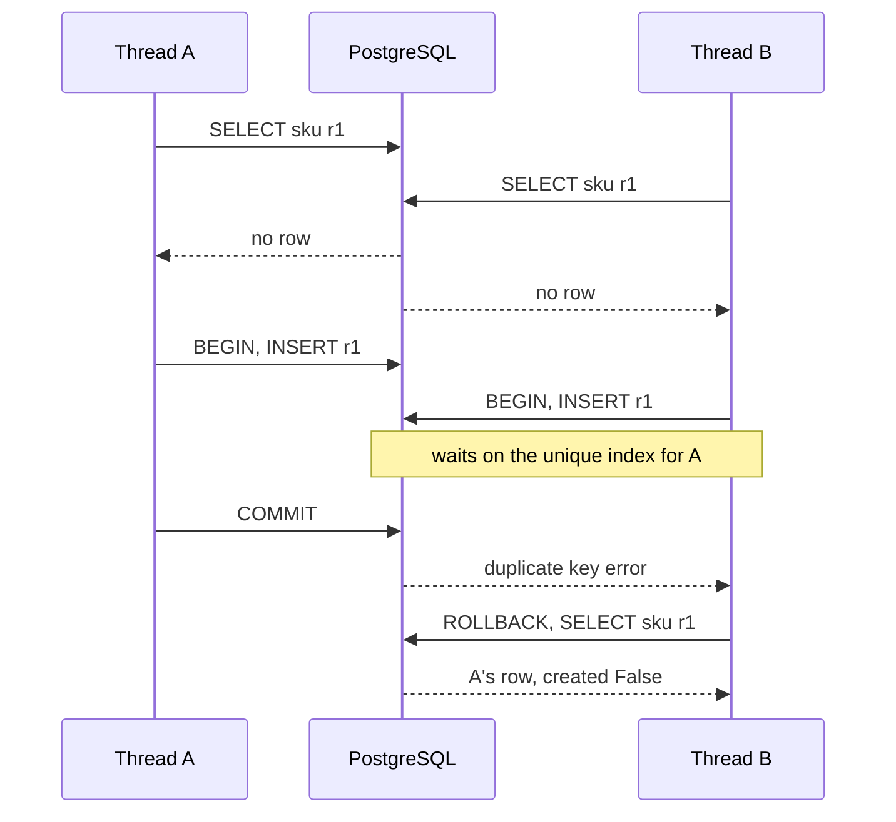
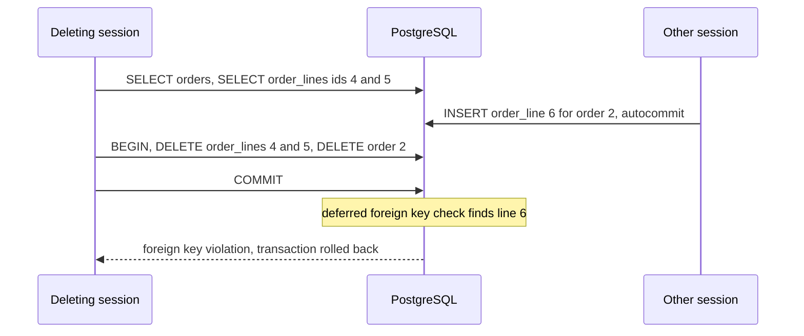

# Bulk Operations and Upserts on PostgreSQL

What `bulk_create()`, `bulk_update()`, `QuerySet.update()`, `get_or_create()` and `QuerySet.delete()` send to PostgreSQL, what they skip (`save()`, signals, `auto_now`), and where they fail: conflict targets, duplicate keys in a batch, and races with other sessions.

Verified against Django [6.1.2](https://github.com/django/django/tree/6.1.2) source, run with psycopg 3.3.6 (`psycopg[binary]==3.3.6`) against PostgreSQL 18.6 only; unlike the other references in this skill, these results were not repeated on Django 5.2.17, psycopg2 or PostgreSQL 16. The SQL blocks are copied from PostgreSQL's statement log (`log_statement = all`), so they show what the server received, including the `BEGIN` and `COMMIT` that Django and the driver send. Every "Source:" link points at the commit that the `6.1.2` tag names, with line numbers. PostgreSQL behaviour is linked to the [PostgreSQL 18 documentation](https://www.postgresql.org/docs/18/sql-insert.html#SQL-ON-CONFLICT).

The examples use these models (`BigAutoField` primary keys):

```python
class Item(models.Model):
    sku = models.CharField(max_length=20, unique=True)
    name = models.CharField(max_length=50)
    qty = models.IntegerField(default=0)
    updated_at = models.DateTimeField(auto_now=True)


class Account(models.Model):
    email = models.CharField(max_length=50)
    active = models.BooleanField(default=True)
    name = models.CharField(max_length=50, default="")

    class Meta:
        constraints = [
            models.UniqueConstraint(
                fields=["email"], condition=Q(active=True), name="accounts_email_active_uniq"
            )
        ]
```

`Tag` has a single `name` field with no unique constraint. `Order` has two children: `OrderLine` (`on_delete=CASCADE`) and `OrderNote` (`on_delete=SET_NULL`). `Invoice` has `InvoiceLine` (`on_delete=DB_CASCADE`).

______________________________________________________________________

## Table of Contents

01. [Which Method Sends What](#1-which-method-sends-what)
02. [`bulk_create()`: One `INSERT` per Batch](#2-bulk_create-one-insert-per-batch)
03. [What `bulk_create()` Skips](#3-what-bulk_create-skips)
04. [`ignore_conflicts=True`](#4-ignore_conflictstrue)
05. [`update_conflicts=True`](#5-update_conflictstrue)
06. [A Partial Unique Index as the Conflict Target](#6-a-partial-unique-index-as-the-conflict-target)
07. [Duplicate Keys in One Batch](#7-duplicate-keys-in-one-batch)
08. [`bulk_update()`: `CASE WHEN` per Batch](#8-bulk_update-case-when-per-batch)
09. [`bulk_update()` vs a `save()` Loop on 10k Rows](#9-bulk_update-vs-a-save-loop-on-10k-rows)
10. [`QuerySet.update()`: One Statement, No `save()`](#10-querysetupdate-one-statement-no-save)
11. [`get_or_create()` Under Concurrency](#11-get_or_create-under-concurrency)
12. [`QuerySet.delete()`: Collect, Then Delete](#12-querysetdelete-collect-then-delete)
13. [A Child Inserted During a Delete](#13-a-child-inserted-during-a-delete)
14. [How This Was Verified](#14-how-this-was-verified)
15. [Quick Reference](#15-quick-reference)

______________________________________________________________________

## 1. Which Method Sends What

Measured with a `pre_save` and a `post_save` receiver connected to `Item`:

| Call                                      | SQL sent                                                                                   | Transaction                                    | `save()` and `pre_save`/`post_save`          | `auto_now` field                                       | Objects get primary keys                             |
| ----------------------------------------- | ------------------------------------------------------------------------------------------ | ---------------------------------------------- | -------------------------------------------- | ------------------------------------------------------ | ---------------------------------------------------- |
| `bulk_create(objs)`                       | one `INSERT ... SELECT * FROM UNNEST(...) RETURNING "items"."id"` per batch                | `BEGIN` ... `COMMIT` only with several batches | not called, 0 signals                        | set                                                    | yes                                                  |
| `bulk_create(..., ignore_conflicts=True)` | `... ON CONFLICT DO NOTHING`, no `RETURNING`                                               | same                                           | not called, 0 signals                        | set on inserted rows                                   | **no**, every `pk` stays `None`                      |
| `bulk_create(..., update_conflicts=True)` | `... ON CONFLICT("sku") DO UPDATE SET "name" = EXCLUDED."name" ... RETURNING "items"."id"` | same                                           | not called, 0 signals                        | changed on conflicting rows only if in `update_fields` | yes; a conflicting object gets the existing row's id |
| `bulk_update(objs, fields)`               | one `UPDATE ... SET col = (CASE WHEN ... END)::type WHERE "items"."id" IN (...)` per batch | always `BEGIN` ... `COMMIT`                    | not called, 0 signals                        | **not changed**                                        | (already set)                                        |
| `QuerySet.update(...)`                    | one `UPDATE`                                                                               | none of its own                                | not called, 0 signals                        | **not changed**                                        | (no objects)                                         |
| `get_or_create(...)`                      | `SELECT`, then `BEGIN`, `INSERT ... RETURNING`, `COMMIT`                                   | `atomic()` around the `INSERT`                 | `create()` calls `save()`, signals sent      | set                                                    | yes                                                  |
| `QuerySet.delete()`                       | `SELECT`s to collect rows, then `BEGIN`, `DELETE`s and `UPDATE`s, `COMMIT`                 | collecting `SELECT`s run **before** `BEGIN`    | `pre_delete`/`post_delete` sent if connected | n/a                                                    | n/a                                                  |

______________________________________________________________________

## 2. `bulk_create()`: One `INSERT` per Batch

Three objects, default `batch_size`, logged:

```sql
INSERT INTO "items" ("sku", "name", "qty", "updated_at") SELECT * FROM UNNEST(('{a0,a1,a2}')::varchar[], ('{n0,n1,n2}')::varchar[], ('{0,1,2}'::int4[])::integer[], ('{"2026-10-08 14:33:00.516997+00:00","2026-10-08 14:33:00.517011+00:00","2026-10-08 14:33:00.517017+00:00"}'::timestamptz[])::timestamp with time zone[]) RETURNING "items"."id"
```

One statement, no `BEGIN`: a single statement is atomic on its own. The objects came back with `pk` 1, 2, 3 and `_state.adding = False`.

On PostgreSQL, Django sends each column as one array and unnests it, instead of one `VALUES` tuple per row. A batch of one row falls back to `VALUES`:

Source: [`db/backends/postgresql/compiler.py#L28-L35`](https://github.com/django/django/blob/2212534bae393714e1e51db2341d4fd5545e19f6/django/db/backends/postgresql/compiler.py#L28-L35)

```python
class SQLInsertCompiler(BaseSQLInsertCompiler):
    def assemble_as_sql(self, fields, value_rows):
        # Specialize bulk-insertion of literal values through UNNEST to
        # reduce the time spent planning the query.
        if (
            # The optimization is not worth doing if there is a single
            # row as it will result in the same number of placeholders.
            len(value_rows) <= 1
```

Five objects with `batch_size=2`:

```sql
BEGIN
INSERT INTO "items" ("sku", "name", "qty", "updated_at") SELECT * FROM UNNEST(('{b0,b1}')::varchar[], ('{n0,n1}')::varchar[], ('{0,1}'::int4[])::integer[], ('{"2026-10-08 14:33:00.522983+00:00","2026-10-08 14:33:00.522997+00:00"}'::timestamptz[])::timestamp with time zone[]) RETURNING "items"."id"
INSERT INTO "items" ("sku", "name", "qty", "updated_at") SELECT * FROM UNNEST(('{b2,b3}')::varchar[], ('{n2,n3}')::varchar[], ('{2,3}'::int4[])::integer[], ('{"2026-10-08 14:33:00.524084+00:00","2026-10-08 14:33:00.524094+00:00"}'::timestamptz[])::timestamp with time zone[]) RETURNING "items"."id"
INSERT INTO "items" ("sku", "name", "qty", "updated_at") VALUES ('b4', 'n4', 4, '2026-10-08 14:33:00.524785+00:00'::timestamptz) RETURNING "items"."id"
COMMIT
```

With more than one batch, Django wraps them in `atomic(savepoint=False)`, so a failure in a later batch rolls back the earlier ones. Measured with `batch_size=2` and an existing `sku` in the second batch: the call raised `IntegrityError: duplicate key value violates unique constraint "items_sku_key"`, the log ended in `ROLLBACK`, and the row count was 8 before and after; the first batch's rows were gone.

```sql
BEGIN
INSERT INTO "items" ("sku", "name", "qty", "updated_at") SELECT * FROM UNNEST(('{c0,c1}')::varchar[], ('{x,x}')::varchar[], ('{0,0}'::int4[])::integer[], ('{"2026-10-08 14:33:00.529235+00:00","2026-10-08 14:33:00.529247+00:00"}'::timestamptz[])::timestamp with time zone[]) RETURNING "items"."id"
INSERT INTO "items" ("sku", "name", "qty", "updated_at") SELECT * FROM UNNEST(('{c2,a0}')::varchar[], ('{x,dup}')::varchar[], ('{0,0}'::int4[])::integer[], ('{"2026-10-08 14:33:00.530312+00:00","2026-10-08 14:33:00.530325+00:00"}'::timestamptz[])::timestamp with time zone[]) RETURNING "items"."id"
-- ERROR: duplicate key value violates unique constraint "items_sku_key"
-- DETAIL: Key (sku)=(a0) already exists.
ROLLBACK
```

Source: [`db/models/query.py#L2188-L2200`](https://github.com/django/django/blob/2212534bae393714e1e51db2341d4fd5545e19f6/django/db/models/query.py#L2188-L2200)

```python
        returning_fields = (
            self.model._meta.db_returning_fields
            if (
                connection.features.can_return_rows_from_bulk_insert
                and (on_conflict is None or on_conflict == OnConflict.UPDATE)
            )
            else None
        )
        batches = [objs[i : i + batch_size] for i in range(0, len(objs), batch_size)]
        if len(batches) > 1:
            context = transaction.atomic(using=self.db, savepoint=False)
        else:
            context = nullcontext()
```

Inside your own `atomic()` block, `savepoint=False` adds nothing, and a failed batch dooms the outer transaction (see `transactions.md`, section 7).

### The default batch size

Without `batch_size`, the limit comes from `max_query_params`, which is unlimited with Django's default client-side binding and 65,535 with `"OPTIONS": {"server_side_binding": True}`:

Source: [`db/backends/postgresql/features.py#L154-L158`](https://github.com/django/django/blob/2212534bae393714e1e51db2341d4fd5545e19f6/django/db/backends/postgresql/features.py#L154-L158)

```python
    @cached_property
    def max_query_params(self):
        if self.uses_server_side_binding:
            return 2**16 - 1
        return None
```

Source: [`db/backends/base/operations.py#L80-L87`](https://github.com/django/django/blob/2212534bae393714e1e51db2341d4fd5545e19f6/django/db/backends/base/operations.py#L80-L87)

```python
    def bulk_batch_size(self, fields, objs):
        """
        Return the maximum allowed batch size for the backend. The fields
        are the fields going to be inserted in the batch, the objs contains
        all the objects to be inserted.
        """
        if self.connection.features.max_query_params is None or not fields:
            return len(objs)
```

Measured, 20,000 `Item` objects (4 inserted columns), statements counted with `connection.execute_wrapper()`:

| Connection                    | `INSERT` statements |
| ----------------------------- | ------------------- |
| default (client-side binding) | 1                   |
| `server_side_binding: True`   | 2                   |

With client-side binding everything goes in one statement, however many objects you pass. Set `batch_size` yourself to bound statement size, memory and lock time.

______________________________________________________________________

## 3. What `bulk_create()` Skips

Source: [`db/models/query.py#L842-L849`](https://github.com/django/django/blob/2212534bae393714e1e51db2341d4fd5545e19f6/django/db/models/query.py#L842-L849)

```python
        """
        Insert each of the instances into the database. Do *not* call
        save() on each of the instances, do not send any pre/post_save
        signals, and do not set the primary key attribute if it is an
        autoincrement field (except if
        features.can_return_rows_from_bulk_insert=True).
        Multi-table models are not supported.
        """
```

Measured: after both calls in section 2, the `pre_save` and `post_save` counters were 0 and 0. A custom `save()` method never runs.

`auto_now` **is** applied, because the insert compiler calls each field's `pre_save()` while building the `INSERT`; every object's `updated_at` was set and the logged `UNNEST` arrays carry the timestamps:

Source: [`db/models/sql/compiler.py#L1767-L1774`](https://github.com/django/django/blob/2212534bae393714e1e51db2341d4fd5545e19f6/django/db/models/sql/compiler.py#L1767-L1774)

```python
    def pre_save_val(self, field, obj):
        """
        Get the given field's value off the given obj. pre_save() is used for
        things like auto_now on DateTimeField. Skip it if this is a raw query.
        """
        if self.query.raw:
            return getattr(obj, field.attname)
        return field.pre_save(obj, add=True)
```

Field-level `pre_save()` still runs; only model-level hooks (`save()`, signals) are skipped.

______________________________________________________________________

## 4. `ignore_conflicts=True`

Three objects, `a0` already exists:

```sql
INSERT INTO "items" ("sku", "name", "qty", "updated_at") SELECT * FROM UNNEST(('{a0,d0,d1}')::varchar[], ('{changed,new,new}')::varchar[], ('{0,0,0}'::int4[])::integer[], ('{"2026-10-08 14:33:00.535122+00:00","2026-10-08 14:33:00.535134+00:00","2026-10-08 14:33:00.535138+00:00"}'::timestamptz[])::timestamp with time zone[]) ON CONFLICT DO NOTHING
```

| Measured                           | Result                                                  |
| ---------------------------------- | ------------------------------------------------------- |
| Rows before, after                 | 8, 10: `d0` and `d1` inserted                           |
| `a0.name` in the database          | `n0`: unchanged                                         |
| `pk` of the three returned objects | `None`, `None`, `None`, including the two inserted rows |

There is no `RETURNING`: `returning_fields` is only set when `on_conflict` is `None` or `UPDATE` (quoted in section 2). Re-read the rows by their natural key if you need the ids.

`ON CONFLICT DO NOTHING` names no conflict target, so it skips a row that conflicts with **any** unique constraint or unique index, including a partial one (section 6). [PostgreSQL docs](https://www.postgresql.org/docs/18/sql-insert.html#SQL-ON-CONFLICT): "For ON CONFLICT DO NOTHING, it is optional to specify a conflict_target; when omitted, conflicts with all usable constraints (and unique indexes) are handled." A row rejected for a reason you did not expect disappears silently too.

______________________________________________________________________

## 5. `update_conflicts=True`

```python
Item.objects.bulk_create(
    [Item(sku="a0", name="upserted", qty=100), Item(sku="e0", name="new", qty=5)],
    update_conflicts=True,
    unique_fields=["sku"],
    update_fields=["name", "qty"],
)
```

Logged:

```sql
INSERT INTO "items" ("sku", "name", "qty", "updated_at") SELECT * FROM UNNEST(('{a0,e0}')::varchar[], ('{upserted,new}')::varchar[], ('{100,5}'::int4[])::integer[], ('{"2026-10-08 14:33:00.541341+00:00","2026-10-08 14:33:00.541352+00:00"}'::timestamptz[])::timestamp with time zone[]) ON CONFLICT("sku") DO UPDATE SET "name" = EXCLUDED."name", "qty" = EXCLUDED."qty" RETURNING "items"."id"
```

Source: [`db/backends/postgresql/operations.py#L377-L389`](https://github.com/django/django/blob/2212534bae393714e1e51db2341d4fd5545e19f6/django/db/backends/postgresql/operations.py#L377-L389)

```python
    def on_conflict_suffix_sql(self, fields, on_conflict, update_fields, unique_fields):
        if on_conflict == OnConflict.IGNORE:
            return "ON CONFLICT DO NOTHING"
        if on_conflict == OnConflict.UPDATE:
            return "ON CONFLICT(%s) DO UPDATE SET %s" % (
                ", ".join(map(self.quote_name, unique_fields)),
                ", ".join(
                    [
                        f"{field} = EXCLUDED.{field}"
                        for field in map(self.quote_name, update_fields)
                    ]
                ),
            )
```

Measured:

| Question                                                               | Result                                                                          |
| ---------------------------------------------------------------------- | ------------------------------------------------------------------------------- |
| Do the objects get primary keys?                                       | Yes: `[1, 17]`. The conflicting `a0` object got `1`, the id of the existing row |
| `a0` in the database                                                   | `name = 'upserted'`, `qty = 100`                                                |
| `updated_at` of `a0` in the database                                   | unchanged: not in `update_fields`                                               |
| `updated_at` of the `a0` object in memory                              | a new timestamp, different from the database: `RETURNING` brings back only `id` |
| `update_fields=["name", "qty", "updated_at"]`                          | `... "updated_at" = EXCLUDED."updated_at"`; the timestamp changed               |
| Conflict on a constraint other than `unique_fields` (an existing `id`) | `IntegrityError: duplicate key value violates unique constraint "items_pkey"`   |

So list every column that should change on conflict in `update_fields`, `auto_now` columns included, and don't trust in-memory field values after an upsert; only the primary key is refreshed.

`unique_fields` must match a non-deferrable unique constraint or unique index. [PostgreSQL docs](https://www.postgresql.org/docs/18/sql-insert.html#SQL-ON-CONFLICT): "In all cases, only NOT DEFERRABLE constraints and unique indexes are supported as arbiters."

### Every proposed row uses a sequence value

PostgreSQL computes the row to insert, including `nextval()` for the id, before it detects the conflict. Measured on `items_id_seq` with three existing rows:

| Step                                               | `last_value` |
| -------------------------------------------------- | ------------ |
| after inserting 3 rows                             | 3            |
| after 3 upserts of the same 3 rows (all conflicts) | 12           |
| after `ignore_conflicts=True` with the same 3 rows | 15           |

The table still held ids 1, 2, 3. A job that upserts mostly existing rows burns ids at the rate it proposes rows, not the rate it inserts them, which matters most for a 32-bit `AutoField`. [PostgreSQL docs](https://www.postgresql.org/docs/18/functions-sequence.html#FUNCTIONS-SEQUENCE): "an INSERT with an ON CONFLICT clause will compute the to-be-inserted tuple, including doing any required nextval calls, before detecting any conflict".

______________________________________________________________________

## 6. A Partial Unique Index as the Conflict Target

`Account` allows one **active** account per email. Django creates the constraint as a partial unique index:

```sql
CREATE UNIQUE INDEX accounts_email_active_uniq ON public.accounts USING btree (email) WHERE active
```

`bulk_create(update_conflicts=True, unique_fields=["email"], update_fields=["name"])` sends a target with no `WHERE` (see `on_conflict_suffix_sql` in section 5), and PostgreSQL can't match it to a partial index:

```sql
INSERT INTO "accounts" ("email", "active", "name") VALUES ('a@x', true, 'new') ON CONFLICT("email") DO UPDATE SET "name" = EXCLUDED."name" RETURNING "accounts"."id"
-- ERROR: there is no unique or exclusion constraint matching the ON CONFLICT specification
```

Django raises `ProgrammingError: there is no unique or exclusion constraint matching the ON CONFLICT specification`. Django 6.1.2 has no `bulk_create()` argument for an index predicate. The same SQL written by hand without `WHERE` fails the same way.

### Workaround 1: raw SQL with the index predicate

PostgreSQL infers a partial index when the target carries a predicate that implies the index's. [PostgreSQL docs](https://www.postgresql.org/docs/18/sql-insert.html#SQL-ON-CONFLICT): "index_predicate: Used to allow inference of partial unique indexes." Measured, with an active `a@x` and an inactive `a@x` already present:

```python
from django.db import connection

with connection.cursor() as c:
    c.execute(
        "INSERT INTO accounts (email, active, name) VALUES (%s, true, %s), (%s, true, %s) "
        "ON CONFLICT (email) WHERE active DO UPDATE SET name = EXCLUDED.name RETURNING id, (xmax <> 0) AS updated",
        ["a@x", "upserted", "c@x", "c"],
    )
    rows = c.fetchall()
```

| id  | email | active | name       | Note                       |
| --- | ----- | ------ | ---------- | -------------------------- |
| 1   | a@x   | true   | `upserted` | the active row was updated |
| 2   | a@x   | false  | `inactive` | untouched                  |
| 4   | b@x   | true   | `b`        | untouched                  |
| 6   | c@x   | true   | `c`        | inserted                   |

`RETURNING` gave `[(1, True), (6, False)]`. The `xmax <> 0` test is an implementation detail, not a documented API. On PostgreSQL 18, ask with `old` instead, which is documented ([Returning Data From Modified Rows](https://www.postgresql.org/docs/18/dml-returning.html#DML-RETURNING): "in an INSERT with an ON CONFLICT DO UPDATE clause, the old values will be non-NULL for conflicting rows"). Measured:

```sql
INSERT INTO accounts (email, active, name) VALUES ('a@x', true, 'upserted'), ('b@x', true, 'b') ON CONFLICT (email) WHERE active DO UPDATE SET name = EXCLUDED.name RETURNING new.id, old.name AS old_name, new.name AS new_name, (old.id IS NULL) AS inserted
```

returned `(1, 'old', 'upserted', False)` and `(3, None, 'b', True)`.

### Workaround 2: `ignore_conflicts=True` for insert-if-missing

`DO NOTHING` needs no target, so it works with the partial index. Measured: `bulk_create([Account(email="a@x", name="ignored"), Account(email="b@x", name="b")], ignore_conflicts=True)` sent `... ON CONFLICT DO NOTHING`, skipped the active `a@x`, inserted `b@x`, and returned objects with `pk = None`. It can't update the existing row.

### Workaround 3: a full unique constraint

If the rule can be "one row per email" rather than "one active row per email", a non-partial `unique=True` or `UniqueConstraint` without `condition` works with `update_conflicts=True` as in section 5.

______________________________________________________________________

## 7. Duplicate Keys in One Batch

Two objects with the same `sku` in one call:

```sql
INSERT INTO "items" ("sku", "name", "qty", "updated_at") SELECT * FROM UNNEST(('{f0,f0}')::varchar[], ('{first,second}')::varchar[], ('{0,0}'::int4[])::integer[], ('{"2026-10-08 14:33:00.574755+00:00","2026-10-08 14:33:00.574767+00:00"}'::timestamptz[])::timestamp with time zone[]) ON CONFLICT("sku") DO UPDATE SET "name" = EXCLUDED."name" RETURNING "items"."id"
-- ERROR: ON CONFLICT DO UPDATE command cannot affect row a second time
-- HINT: Ensure that no rows proposed for insertion within the same command have duplicate constrained values.
```

Django raises `ProgrammingError: ON CONFLICT DO UPDATE command cannot affect row a second time`, and no row is inserted. [PostgreSQL docs](https://www.postgresql.org/docs/18/sql-insert.html#SQL-ON-CONFLICT): "INSERT with an ON CONFLICT DO UPDATE clause is a 'deterministic' statement. This means that the command will not be allowed to affect any single existing row more than once".

| Duplicate `sku` in one call             | Result                                                                                                      |
| --------------------------------------- | ----------------------------------------------------------------------------------------------------------- |
| `update_conflicts=True`, same batch     | `ProgrammingError: ON CONFLICT DO UPDATE command cannot affect row a second time`; nothing inserted         |
| `update_conflicts=True`, `batch_size=1` | works: two statements in `BEGIN` ... `COMMIT`; the **last** wins (`second`); both objects get the same `pk` |
| `ignore_conflicts=True`, same batch     | works: the **first** wins (`first`), the second is skipped                                                  |
| plain `bulk_create()`                   | `IntegrityError: duplicate key value violates unique constraint "items_sku_key"`                            |

The error only depends on what is in one statement, so it can appear or vanish when `batch_size` changes. Deduplicate before calling, keyed on `unique_fields`; a dict keeps the last object for each key. Measured, `k0` ended as `second`:

```python
rows = [Item(sku="k0", name="first"), Item(sku="k0", name="second"), Item(sku="k1", name="x")]
deduped = list({o.sku: o for o in rows}.values())
Item.objects.bulk_create(deduped, update_conflicts=True, unique_fields=["sku"], update_fields=["name"])
```

______________________________________________________________________

## 8. `bulk_update()`: `CASE WHEN` per Batch

Five objects, `fields=["qty", "name"]`, `batch_size=2`:

```sql
BEGIN
UPDATE "items" SET "qty" = (CASE WHEN ("items"."id" = 1) THEN 10 WHEN ("items"."id" = 2) THEN 11 ELSE NULL END)::integer, "name" = (CASE WHEN ("items"."id" = 1) THEN 'N0' WHEN ("items"."id" = 2) THEN 'N1' ELSE NULL END)::varchar(50) WHERE "items"."id" IN (1, 2)
UPDATE "items" SET "qty" = (CASE WHEN ("items"."id" = 3) THEN 12 WHEN ("items"."id" = 4) THEN 13 ELSE NULL END)::integer, "name" = (CASE WHEN ("items"."id" = 3) THEN 'N2' WHEN ("items"."id" = 4) THEN 'N3' ELSE NULL END)::varchar(50) WHERE "items"."id" IN (3, 4)
UPDATE "items" SET "qty" = (CASE WHEN ("items"."id" = 5) THEN 14 ELSE NULL END)::integer, "name" = (CASE WHEN ("items"."id" = 5) THEN 'N4' ELSE NULL END)::varchar(50) WHERE "items"."id" IN (5)
COMMIT
```

Source: [`db/models/query.py#L1028-L1047`](https://github.com/django/django/blob/2212534bae393714e1e51db2341d4fd5545e19f6/django/db/models/query.py#L1028-L1047)

```python
        for batch_objs in batches:
            update_kwargs = {}
            for field in fields:
                when_statements = []
                for obj in batch_objs:
                    attr = getattr(obj, field.attname)
                    if not hasattr(attr, "resolve_expression"):
                        attr = Value(attr, output_field=field)
                    when_statements.append(When(pk=obj.pk, then=attr))
                case_statement = Case(*when_statements, output_field=field)
                if requires_casting:
                    case_statement = Cast(case_statement, output_field=field)
                update_kwargs[field.attname] = case_statement
            updates.append(([obj.pk for obj in batch_objs], update_kwargs))
        rows_updated = 0
        queryset = self.using(self.db)
        with transaction.atomic(using=self.db, savepoint=False):
            for pks, update_kwargs in updates:
                rows_updated += queryset.filter(pk__in=pks).update(**update_kwargs)
        return rows_updated
```

The value is read with `getattr()`, not `pre_save()`, so `auto_now` fields are not touched. Measured:

| Situation                                       | Result                                                                                                   |
| ----------------------------------------------- | -------------------------------------------------------------------------------------------------------- |
| 5 objects, `batch_size=2`                       | 3 `UPDATE`s in one `BEGIN` ... `COMMIT`; returned 5                                                      |
| Signals                                         | 0 `pre_save`, 0 `post_save`                                                                              |
| `updated_at` (`auto_now=True`)                  | unchanged on every row                                                                                   |
| One batch only                                  | still `BEGIN`, `UPDATE`, `COMMIT`                                                                        |
| 3 objects, one deleted from the table meanwhile | returned **2**; no error for the missing row                                                             |
| The same `pk` twice with `qty` 111 and 222      | `WHEN ("items"."id" = 2) THEN 111 WHEN ("items"."id" = 2) THEN 222`; returned 1; the **first** (111) won |
| `obj.qty = F("qty") + 1`                        | `CASE WHEN ("items"."id" = 3) THEN ("items"."qty" + 1) ELSE NULL END`                                    |

Compare the return value with `len(objs)` if rows deleted meanwhile matter. The duplicate-pk rule is the reverse of the deduplication dict in section 7, which keeps the last object.

______________________________________________________________________

## 9. `bulk_update()` vs a `save()` Loop on 10k Rows

10,000 `Item` rows, changing `qty` on each. `log_statement` was set to `none` for the timing session; times are wall clock on one laptop with PostgreSQL in Docker, ranges over 2 to 6 runs. The "in `execute`" column is the time inside `cursor.execute()` (driver plus server), measured with `connection.execute_wrapper()`; the rest is Python.

| Method                                                                         | Statements            | Total time     | In `execute`   |
| ------------------------------------------------------------------------------ | --------------------- | -------------- | -------------- |
| `save()` loop, autocommit                                                      | 10,000 (each commits) | 32.8 to 35.1 s | not measured   |
| `save()` loop inside `atomic()`                                                | 10,000                | 6.5 to 6.7 s   | not measured   |
| `save(update_fields=["qty"])` loop inside `atomic()`                           | 10,000                | 5.8 to 7.7 s   | 4.4 to 4.7 s   |
| `bulk_update(rows, ["qty"])`, one batch                                        | 1                     | 2.1 to 4.7 s   | 0.9 to 3.2 s   |
| `bulk_update(rows, ["qty"], batch_size=1000)`                                  | 10                    | 1.3 to 1.6 s   | 0.3 to 0.4 s   |
| `bulk_update(rows, ["qty"], batch_size=100)`                                   | 100                   | 1.4 to 1.6 s   | 0.3 s          |
| Raw `UPDATE ... FROM UNNEST` (below)                                           | 1                     | 0.18 to 0.27 s | 0.13 to 0.16 s |
| `Item.objects.update(qty=F("qty") + 1)` (same change for every row, for scale) | 1                     | 0.17 to 0.55 s | not measured   |

For inserts: `bulk_create()` of 10,000 rows took 0.29 s; a `create()` loop inside `atomic()` took 6.7 s.

What the numbers say:

- The autocommit `save()` loop pays for 10,000 commits. Wrapping the same loop in one `atomic()` was five times faster.
- `bulk_update()` spent 1.1 to 1.4 s per 10,000 objects outside `execute`, in Python building and compiling one `When` per object per field, whatever the batch size.
- The single 10,000-branch statement was the slowest `bulk_update()` and the least stable. `CASE` tests its `WHEN` branches in order until one matches ([PostgreSQL docs](https://www.postgresql.org/docs/18/functions-conditional.html#FUNCTIONS-CASE): "the remainder of the CASE expression is not processed"), so each row can scan many branches. Batches of 100 to 1,000 took 1.3 to 1.6 s against 2.1 to 4.7 s for one batch.
- For large updates of computed per-row values, a raw `UPDATE ... FROM UNNEST` took 0.18 to 0.27 s, against 1.3 s or more for the best `bulk_update()`:

```python
from django.db import connection, transaction

ids = [o.pk for o in rows]
qtys = [o.qty for o in rows]
with transaction.atomic(), connection.cursor() as c:
    c.execute(
        "UPDATE items SET qty = u.qty FROM UNNEST(%s::bigint[], %s::integer[]) AS u(id, qty) WHERE items.id = u.id",
        [ids, qtys],
    )
```

Pass one entry per id; the arrays are matched by position.

______________________________________________________________________

## 10. `QuerySet.update()`: One Statement, No `save()`

```python
Item.objects.filter(sku__in=["s3", "s4"]).update(qty=F("qty") + 1)
```

```sql
UPDATE "items" SET "qty" = ("items"."qty" + 1) WHERE "items"."sku" IN ('s3', 's4')
```

One statement, no `BEGIN`, returned 2 (rows matched). `pre_save` and `post_save` were sent 0 times, and `updated_at` did not change. `F("qty") + 1` is computed by PostgreSQL from the current row, so concurrent increments are not lost (see `transactions.md`, section 10).

`auto_now` is applied in the field's `pre_save()`, which only `save()` and the insert compiler call:

Source: [`db/models/fields/__init__.py#L1690-L1696`](https://github.com/django/django/blob/2212534bae393714e1e51db2341d4fd5545e19f6/django/db/models/fields/__init__.py#L1690-L1696)

```python
    def pre_save(self, model_instance, add):
        if self.auto_now or (self.auto_now_add and add):
            value = timezone.now()
            setattr(model_instance, self.attname, value)
            return value
        else:
            return super().pre_save(model_instance, add)
```

Measured, for the timestamp:

| Call                                         | SQL                                                                                                                                                 | `updated_at`  |
| -------------------------------------------- | --------------------------------------------------------------------------------------------------------------------------------------------------- | ------------- |
| `update(qty=F("qty") + 1)`                   | `UPDATE "items" SET "qty" = ("items"."qty" + 1) WHERE ...`                                                                                          | unchanged     |
| `update(qty=F("qty") + 1, updated_at=Now())` | `UPDATE "items" SET "qty" = ("items"."qty" + 1), "updated_at" = STATEMENT_TIMESTAMP() WHERE "items"."sku" = 's3'`                                   | changed       |
| `obj.save()`                                 | `UPDATE "items" SET "sku" = 's4', "name" = 'N4', "qty" = 16, "updated_at" = '2026-10-08 14:33:52.886693+00:00'::timestamptz WHERE "items"."id" = 5` | changed       |
| `obj.save(update_fields=["qty"])`            | `UPDATE "items" SET "qty" = 16 WHERE "items"."id" = 5`                                                                                              | **unchanged** |

`save(update_fields=[...])` leaves `auto_now` alone too, unless the field is in the list. With `update()`, pass the timestamp yourself (`updated_at=Now()` or `timezone.now()`).

A filter across a relation becomes a subquery:

```sql
UPDATE "order_lines" SET "qty" = 5 WHERE "order_lines"."id" IN (SELECT "U0"."id" FROM "order_lines" "U0" INNER JOIN "orders" "U1" ON ("U0"."order_id" = "U1"."id") WHERE "U1"."ref" = 'o1')
```

______________________________________________________________________

## 11. `get_or_create()` Under Concurrency

Source: [`db/models/query.py#L1060-L1083`](https://github.com/django/django/blob/2212534bae393714e1e51db2341d4fd5545e19f6/django/db/models/query.py#L1060-L1083)

```python
    def get_or_create(self, defaults=None, **kwargs):
        """
        Look up an object with the given kwargs, creating one if necessary.
        Return a tuple of (object, created), where created is a boolean
        specifying whether an object was created.
        """
        # The get() needs to be targeted at the write database in order
        # to avoid potential transaction consistency problems.
        self._for_write = True
        try:
            return self.get(**kwargs), False
        except self.model.DoesNotExist:
            params = self._extract_model_params(defaults, **kwargs)
            # Try to create an object using passed params.
            try:
                with transaction.atomic(using=self.db):
                    params = dict(resolve_callables(params))
                    return self.create(**params), True
            except IntegrityError:
                try:
                    return self.get(**kwargs), False
                except self.model.DoesNotExist:
                    pass
                raise
```

The `SELECT` and the `INSERT` are separate statements, so two callers can both miss and both insert. Only a unique constraint turns the second `INSERT` into an `IntegrityError`, which `get_or_create()` catches and answers with a second `get()`.

The test: two threads, each with its own connection, call `get_or_create()` for the same key. A `pre_save` receiver holds both at a barrier, so both have run their `SELECT` and found nothing before either inserts.

### With a unique constraint (`Item.sku`)

| Thread | Returned                |
| ------ | ----------------------- |
| pid 98 | `(pk=1, created=True)`  |
| pid 97 | `(pk=1, created=False)` |

One row, no exception. Logged:

```text
[98] SELECT "items"."id", "items"."sku", "items"."name", "items"."qty", "items"."updated_at" FROM "items" WHERE "items"."sku" = 'r1' LIMIT 21
[97] SELECT "items"."id", "items"."sku", "items"."name", "items"."qty", "items"."updated_at" FROM "items" WHERE "items"."sku" = 'r1' LIMIT 21
[98] BEGIN
[97] BEGIN
[98] INSERT INTO "items" ("sku", "name", "qty", "updated_at") VALUES ('r1', 'x', 0, '2026-10-08 14:36:25.100453+00:00'::timestamptz) RETURNING "items"."id"
[97] INSERT INTO "items" ("sku", "name", "qty", "updated_at") VALUES ('r1', 'x', 0, '2026-10-08 14:36:25.100724+00:00'::timestamptz) RETURNING "items"."id"
[98] COMMIT
[97] ERROR: duplicate key value violates unique constraint "items_sku_key"
[97] DETAIL: Key (sku)=(r1) already exists.
[97] ROLLBACK
[97] SELECT "items"."id", "items"."sku", "items"."name", "items"."qty", "items"."updated_at" FROM "items" WHERE "items"."sku" = 'r1' LIMIT 21
```



### Without a unique constraint (`Tag.name`)

Both threads returned `created=True`, with pks 2 and 1, and the table held 2 rows named `red`. The next call failed:

```text
MultipleObjectsReturned: get() returned more than one Tag -- it returned 2!
```

Every later `get_or_create()` or `get()` for that name raises until the duplicate is removed. Logged, both inserts committed:

```text
[99] SELECT "tags"."id", "tags"."name" FROM "tags" WHERE "tags"."name" = 'red' LIMIT 21
[100] SELECT "tags"."id", "tags"."name" FROM "tags" WHERE "tags"."name" = 'red' LIMIT 21
[100] BEGIN
[99] BEGIN
[100] INSERT INTO "tags" ("name") VALUES ('red') RETURNING "tags"."id"
[99] INSERT INTO "tags" ("name") VALUES ('red') RETURNING "tags"."id"
[100] COMMIT
[99] COMMIT
```

Use `get_or_create()` only with lookup fields covered by a unique constraint.

### Inside an outer `atomic()`

Same race with a unique constraint, each thread calling `get_or_create()` inside `transaction.atomic()` and holding the transaction open for 1 s afterwards:

| Thread  | Returned                | Time spent in `get_or_create()` |
| ------- | ----------------------- | ------------------------------- |
| pid 102 | `(pk=3, created=True)`  | 0.02 s                          |
| pid 101 | `(pk=3, created=False)` | **1.04 s**                      |

The loser's `INSERT` waits on the unique index until the winner's **outer** transaction commits, then fails. `get_or_create()`'s `atomic()` is a savepoint here, so the error rolls back only the savepoint and the follow-up `get()` sees the committed row:

```text
[101] SAVEPOINT "s139647686538944_x1"
[102] SAVEPOINT "s139647678146240_x1"
[102] INSERT INTO "items" ("sku", "name", "qty", "updated_at") VALUES ('r2', 'x', 0, '2026-10-08 14:36:25.144176+00:00'::timestamptz) RETURNING "items"."id"
[101] INSERT INTO "items" ("sku", "name", "qty", "updated_at") VALUES ('r2', 'x', 0, '2026-10-08 14:36:25.144409+00:00'::timestamptz) RETURNING "items"."id"
[102] RELEASE SAVEPOINT "s139647678146240_x1"
[102] COMMIT
[101] ERROR: duplicate key value violates unique constraint "items_sku_key"
[101] DETAIL: Key (sku)=(r2) already exists.
[101] ROLLBACK TO SAVEPOINT "s139647686538944_x1"
[101] RELEASE SAVEPOINT "s139647686538944_x1"
[101] SELECT "items"."id", "items"."sku", "items"."name", "items"."qty", "items"."updated_at" FROM "items" WHERE "items"."sku" = 'r2' LIMIT 21
[101] COMMIT
```

With `ATOMIC_REQUESTS = True` every view is such an outer transaction, so a slow view that creates a row makes concurrent requests for the same key wait for it.

______________________________________________________________________

## 12. `QuerySet.delete()`: Collect, Then Delete

Source: [`db/models/query.py#L1370-L1372`](https://github.com/django/django/blob/2212534bae393714e1e51db2341d4fd5545e19f6/django/db/models/query.py#L1370-L1372)

```python
        # The delete is actually 2 queries - one to find related objects,
        # and one to delete. Make sure that the discovery of related
        # objects is performed on the same database as the deletion.
```

A model can be deleted with one `DELETE` ("fast delete") only if it has no delete signal receivers and every foreign key pointing at it uses an `on_delete` Django does not have to act on:

Source: [`db/models/deletion.py#L231-L246`](https://github.com/django/django/blob/2212534bae393714e1e51db2341d4fd5545e19f6/django/db/models/deletion.py#L231-L246)

```python
        if self._has_signal_listeners(model):
            return False
        # The use of from_field comes from the need to avoid cascade back to
        # parent when parent delete is cascading to child.
        opts = model._meta
        return (
            all(
                link == from_field
                for link in opts.concrete_model._meta.parents.values()
            )
            and
            # Foreign keys pointing to this model.
            all(
                related.field.remote_field.on_delete in SKIP_COLLECTION
                for related in get_candidate_relations_to_delete(opts)
            )
```

`SKIP_COLLECTION` is `DO_NOTHING`, `DB_CASCADE`, `DB_SET_DEFAULT` and `DB_SET_NULL` ([`deletion.py#L103`](https://github.com/django/django/blob/2212534bae393714e1e51db2341d4fd5545e19f6/django/db/models/deletion.py#L103)).

`DB_CASCADE`, `DB_SET_NULL` and `DB_SET_DEFAULT` are new in Django 6.1: none of the three exists in 6.0.9 or 5.2.17. On earlier versions, get database-level cascades with a `RunSQL` migration that re-creates the foreign key with `ON DELETE CASCADE`, and declare the field `on_delete=DO_NOTHING` so Django leaves the deleting to PostgreSQL (a common pattern, not measured here).

### Measured

`Order.objects.filter(ref__in=["o1", "o2"]).delete()`, each order with 2 `OrderLine` (`CASCADE`) and 1 `OrderNote` (`SET_NULL`), no receivers:

```sql
SELECT "orders"."id", "orders"."ref" FROM "orders" WHERE "orders"."ref" IN ('o1', 'o2')
BEGIN
DELETE FROM "order_lines" WHERE "order_lines"."order_id" IN (1, 2)
UPDATE "order_notes" SET "order_id" = NULL WHERE "order_notes"."order_id" IN (1, 2)
DELETE FROM "orders" WHERE "orders"."id" IN (2, 1)
COMMIT
```

Returned `(6, {"demo.OrderLine": 4, "demo.Order": 2})`.

The same, with a `post_delete` receiver connected to `OrderLine`:

```sql
SELECT "orders"."id", "orders"."ref" FROM "orders" WHERE "orders"."ref" IN ('o1', 'o2')
SELECT "order_lines"."id", "order_lines"."order_id", "order_lines"."qty" FROM "order_lines" WHERE "order_lines"."order_id" IN (4, 5)
BEGIN
UPDATE "order_notes" SET "order_id" = NULL WHERE "order_notes"."order_id" IN (4, 5)
DELETE FROM "order_lines" WHERE "order_lines"."id" IN (8, 7, 6, 5)
DELETE FROM "orders" WHERE "orders"."id" IN (5, 4)
COMMIT
```

The receiver ran 4 times. `Tag.objects.filter(name__startswith="t").delete()` (no relations, no receivers):

```sql
BEGIN
DELETE FROM "tags" WHERE "tags"."name"::text LIKE 't%'
COMMIT
```

`Invoice.objects.filter(ref__in=["i1", "i2"]).delete()` with `InvoiceLine.invoice` declared `on_delete=models.DB_CASCADE`, no receivers:

```sql
BEGIN
DELETE FROM "invoices" WHERE "invoices"."ref" IN ('i1', 'i2')
COMMIT
```

Django put the cascade in the foreign key (`pg_get_constraintdef`: `FOREIGN KEY (invoice_id) REFERENCES invoices(id) ON DELETE CASCADE DEFERRABLE INITIALLY DEFERRED`). PostgreSQL deleted all 4 lines, but the return value was `(2, {"demo.Invoice": 2})`: rows the database cascades are not counted.

| Case                                      | Before `BEGIN`                                 | Inside the transaction                                                           |
| ----------------------------------------- | ---------------------------------------------- | -------------------------------------------------------------------------------- |
| No relations, no receivers                | nothing                                        | one `DELETE ... WHERE <your filter>`                                             |
| Only `DB_CASCADE` / `DO_NOTHING` children | nothing                                        | one `DELETE ... WHERE <your filter>`                                             |
| `CASCADE` child, no receivers on it       | `SELECT` every parent row, all columns         | `DELETE` children `WHERE fk IN (<parent ids>)`, then parents `WHERE id IN (...)` |
| `SET_NULL` child                          | (same parent `SELECT`)                         | `UPDATE child SET fk = NULL WHERE fk IN (<parent ids>)`                          |
| Receiver on the child                     | parent `SELECT`, then `SELECT` every child row | `DELETE` children `WHERE id IN (<child ids>)`                                    |

The collecting `SELECT`s load one model instance per row into memory and run outside the transaction, in autocommit; only the writes are inside `atomic()`:

Source: [`db/models/deletion.py#L489-L498`](https://github.com/django/django/blob/2212534bae393714e1e51db2341d4fd5545e19f6/django/db/models/deletion.py#L489-L498)

```python
        with transaction.atomic(using=self.using, savepoint=False):
            # send pre_delete signals
            for model, obj in self.instances_with_model():
                if not model._meta.auto_created:
                    signals.pre_delete.send(
                        sender=model,
                        instance=obj,
                        using=self.using,
                        origin=self.origin,
                    )
```

______________________________________________________________________

## 13. A Child Inserted During a Delete

Between the collecting `SELECT` and the `DELETE`, another session can add a child row. To hit the window reliably, a `pre_delete` receiver on `Order` inserted an `OrderLine` for the order being deleted from a second connection, committed, and returned.

| Setup                                                                     | Result                                                                                             |
| ------------------------------------------------------------------------- | -------------------------------------------------------------------------------------------------- |
| No receiver on `OrderLine` (children deleted by `order_id`)               | succeeded; returned `(4, {"demo.OrderLine": 3, "demo.Order": 1})`: the new line was deleted too    |
| `post_delete` receiver on `OrderLine` (children deleted by collected ids) | **`IntegrityError` at `COMMIT`**; order and all 3 lines still there                                |
| `InvoiceLine` with `on_delete=DB_CASCADE`                                 | succeeded; the new line was deleted by PostgreSQL                                                  |
| `select_for_update()` on the orders first, same `atomic()`                | succeeded; the concurrent insert waited on the order row lock (here it hit its 1 s `lock_timeout`) |

The failing case, logged (pid 112 is the second connection):

```text
[110] SELECT "orders"."id", "orders"."ref" FROM "orders" WHERE "orders"."ref" = 'k2'
[110] SELECT "order_lines"."id", "order_lines"."order_id", "order_lines"."qty" FROM "order_lines" WHERE "order_lines"."order_id" IN (2)
[112] INSERT INTO "order_lines" ("order_id", "qty") VALUES (2, 9) RETURNING "order_lines"."id"
[110] BEGIN
[110] UPDATE "order_notes" SET "order_id" = NULL WHERE "order_notes"."order_id" IN (2)
[110] DELETE FROM "order_lines" WHERE "order_lines"."id" IN (5, 4)
[110] DELETE FROM "orders" WHERE "orders"."id" IN (2)
[110] COMMIT
[110] ERROR: update or delete on table "orders" violates foreign key constraint "order_lines_order_id_5e8377ca_fk_orders_id" on table "order_lines"
[110] DETAIL: Key (id)=(2) is still referenced from table "order_lines".
```



Django creates foreign keys `DEFERRABLE INITIALLY DEFERRED`, so the violation is reported by `COMMIT`, not by the `DELETE`. Django raised `IntegrityError: update or delete on table "orders" violates foreign key constraint "order_lines_order_id_5e8377ca_fk_orders_id" on table "order_lines"`.

The lock fix, logged (pid 131 is the second connection, with `lock_timeout = '1s'`):

```text
[129] BEGIN
[129] SELECT "orders"."id", "orders"."ref" FROM "orders" WHERE "orders"."ref" = 'k4' FOR UPDATE
[129] SELECT "orders"."id", "orders"."ref" FROM "orders" WHERE "orders"."ref" = 'k4'
[129] SELECT "order_lines"."id", "order_lines"."order_id", "order_lines"."qty" FROM "order_lines" WHERE "order_lines"."order_id" IN (1)
[131] INSERT INTO "order_lines" ("order_id", "qty") VALUES (1, 1) RETURNING "order_lines"."id"
[131] ERROR: canceling statement due to lock timeout
[129] UPDATE "order_notes" SET "order_id" = NULL WHERE "order_notes"."order_id" IN (1)
[129] DELETE FROM "order_lines" WHERE "order_lines"."id" IN (2, 1)
[129] DELETE FROM "orders" WHERE "orders"."id" IN (1)
[129] COMMIT
```

```python
with transaction.atomic():
    list(Order.objects.select_for_update().filter(ref="k4"))
    Order.objects.filter(ref="k4").delete()
```

Inserting a child takes a `FOR KEY SHARE` lock on the parent row (the timed-out insert's context read `SELECT 1 FROM ONLY "public"."orders" x WHERE "id" OPERATOR(pg_catalog.=) $1 FOR KEY SHARE OF x`), which conflicts with `FOR UPDATE`; see the postgres skill's `row-locks.md`, section 7. With the parents locked first, the collecting `SELECT`s run inside the transaction and no new child can appear before `COMMIT`.

______________________________________________________________________

## 14. How This Was Verified

- **Versions:** Django 6.1.2 with psycopg 3.3.6 (`psycopg[binary]==3.3.6`) on Python 3.14, against PostgreSQL 18.6 (`postgres:18` image) in Docker. Only this one combination was run.
- **SQL:** PostgreSQL ran with `log_statement = all` and `log_line_prefix = '%m [%p] '`. Each test sent a marker query before and after, and the blocks above are the log lines between the markers, without the `LOG:` prefix, the connection setup query (`SELECT set_config('TimeZone', 'UTC', false)`), `SET lock_timeout` and the `STATEMENT:` echo after errors; pids identify sessions in the concurrent tests. Timestamps and ids are from those runs.
- **Signals and counts:** `pre_save` and `post_save` receivers on `Item` counted calls; statement counts came from `connection.execute_wrapper()`; row counts, sequence values and constraint definitions were read back after each step.
- **Races:** two threads, one connection each. A `pre_save` receiver with a `threading.Barrier` held both threads after their `SELECT` for `get_or_create()`; a `pre_delete` receiver on the parent ran the competing insert on a second connection for the delete tests.
- **Timings:** 10,000 rows, statement logging off for the timing session, 2 to 6 runs per method across three separate runs of the scripts.
- **Re-checked:** the partial index error, the duplicate-key error, the `get_or_create()` races, the delete race, `auto_now` under `update()` and `save(update_fields=...)`, the default batch count, and the `bulk_update()` timings were run a second time with the same results.
- **Source:** quotes come from the installed 6.1.2 package, byte-identical to GitHub at the tag's commit.

______________________________________________________________________

## 15. Quick Reference

| Question                                                           | Answer                                                                                                                                      |
| ------------------------------------------------------------------ | ------------------------------------------------------------------------------------------------------------------------------------------- |
| Does `bulk_create()` call `save()` or send `pre_save`/`post_save`? | No                                                                                                                                          |
| Does `bulk_create()` set `auto_now` and give objects pks?          | Yes, both                                                                                                                                   |
| How many `INSERT`s by default?                                     | One for all objects (client-side binding); set `batch_size` yourself                                                                        |
| Is a multi-batch `bulk_create()` atomic?                           | Yes: `BEGIN` ... `COMMIT` around the batches                                                                                                |
| `ignore_conflicts=True` pks?                                       | `None` on every object, inserted or not                                                                                                     |
| `update_conflicts=True` pks?                                       | Set; a conflicting object gets the existing row's id                                                                                        |
| `auto_now` on an upsert?                                           | Changed only if listed in `update_fields`                                                                                                   |
| Upserting existing rows and ids?                                   | Each proposed row consumes a sequence value                                                                                                 |
| Partial unique index as `unique_fields`?                           | `there is no unique or exclusion constraint matching the ON CONFLICT specification`; use raw SQL with `ON CONFLICT (col) WHERE <predicate>` |
| Same key twice in one upsert batch?                                | `ON CONFLICT DO UPDATE command cannot affect row a second time`; deduplicate first                                                          |
| `bulk_update()` SQL?                                               | `UPDATE ... SET col = (CASE WHEN id = ... THEN ... ELSE NULL END)::type WHERE id IN (...)` per batch, in one transaction                    |
| `bulk_update()` and `auto_now` or signals?                         | Neither                                                                                                                                     |
| `bulk_update()` batch size for 10k rows?                           | 100 to 1,000 beat one batch; raw `UPDATE ... FROM UNNEST` beat both                                                                         |
| `QuerySet.update()` and `auto_now`?                                | Not updated; pass `updated_at=Now()`                                                                                                        |
| `save(update_fields=[...])` and `auto_now`?                        | Not updated unless listed                                                                                                                   |
| `get_or_create()` race with a unique constraint?                   | One row; the loser gets `created=False`, no exception                                                                                       |
| `get_or_create()` race without one?                                | Duplicate rows, then `MultipleObjectsReturned`                                                                                              |
| `get_or_create()` race inside `atomic()`?                          | The loser waits for the winner's whole transaction                                                                                          |
| What does `QuerySet.delete()` run first?                           | A `SELECT` of every matched row, outside the transaction, unless the model can be fast-deleted                                              |
| Child deleted by id list vs by foreign key?                        | By id list when the child has delete receivers or relations of its own                                                                      |
| Delete count with `DB_CASCADE`?                                    | Cascaded rows are not counted                                                                                                               |
| Child inserted during a delete?                                    | `IntegrityError` at `COMMIT` when children were collected by id; lock parents with `select_for_update()` or use `DB_CASCADE`                |
