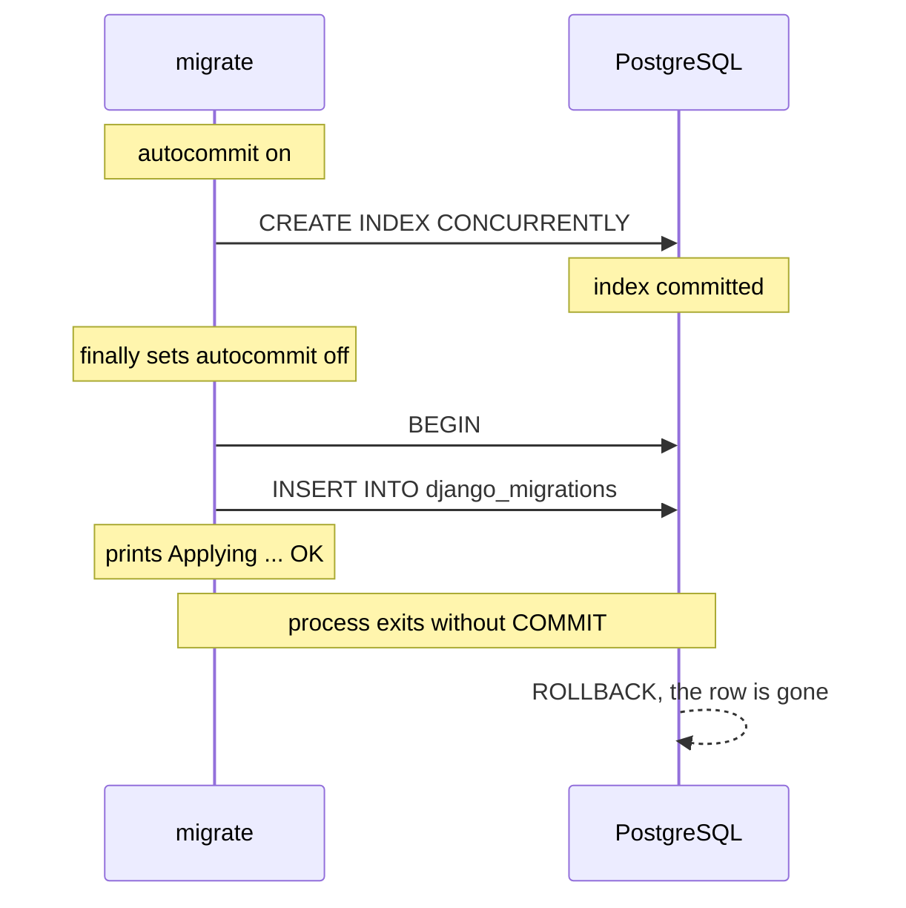

# Case Study: The Migration That Never Stayed Applied

A real incident, reproduced on a clean database. A non-atomic migration built indexes with `CREATE INDEX CONCURRENTLY` through a small helper that switched autocommit. Every run printed `OK`, but the migration was never recorded. A later attempt to roll back past it failed halfway and left the database inconsistent.

Reproduced with Django 5.2.17 and 6.1.2, psycopg2 2.9.13 and psycopg 3.3.6, PostgreSQL 16.15 and 18.6, with identical results everywhere. The SQL blocks are copied from PostgreSQL's statement log, with the `applied` timestamp shortened to `now()`. Table and app names are generic.

______________________________________________________________________

## Table of Contents

01. [Symptom](#1-symptom)
02. [The Helper](#2-the-helper)
03. [What PostgreSQL Received](#3-what-postgresql-received)
04. [Why the Helper Existed, and Why It Was Never Needed](#4-why-the-helper-existed-and-why-it-was-never-needed)
05. [Damage Forward: Every Later Migration Is Lost Too](#5-damage-forward-every-later-migration-is-lost-too)
06. [Why Some Earlier Migrations Were Recorded](#6-why-some-earlier-migrations-were-recorded)
07. [Damage Backward: A Rollback That Broke Halfway](#7-damage-backward-a-rollback-that-broke-halfway)
08. [The Fix](#8-the-fix)
09. [Recovering a Database](#9-recovering-a-database)
10. [Spotting It in Review](#10-spotting-it-in-review)

______________________________________________________________________

## 1. Symptom

```
$ python manage.py migrate shop
Operations to perform:
  Apply all migrations: shop
Running migrations:
  Applying shop.0037_order_indexes... OK
```

The same output on every run. `showmigrations shop` keeps listing `[ ] 0037_order_indexes`, the indexes exist and are valid, and no error is printed. Because the SQL used `IF NOT EXISTS`, every rerun is a silent no-op that prints `OK` again.

______________________________________________________________________

## 2. The Helper

```python
def _autocommit(connection, fn):
    """Commit any implicit transaction and run fn() in autocommit mode."""
    connection.commit()
    connection.set_autocommit(True)
    try:
        fn()
    finally:
        connection.set_autocommit(False)      # the bug


def _create_indexes(apps, schema_editor):
    connection = schema_editor.connection

    def run():
        with connection.cursor() as cursor:
            cursor.execute(
                "CREATE INDEX CONCURRENTLY IF NOT EXISTS shop_order_customer_idx "
                "ON shop_order (customer_id)"
            )

    _autocommit(connection, run)


class Migration(migrations.Migration):
    atomic = False
    dependencies = [("shop", "0036_order_customer")]
    operations = [
        migrations.SeparateDatabaseAndState(
            database_operations=[migrations.RunPython(_create_indexes, _drop_indexes)],
            state_operations=[migrations.AddIndex(...)],
        ),
    ]
```

The `finally` doesn't restore the mode autocommit was in; it forces it off. Under Django's default the connection started with autocommit **on**, so the helper leaves it in the opposite state from the one it found.

______________________________________________________________________

## 3. What PostgreSQL Received

```sql
CREATE INDEX CONCURRENTLY IF NOT EXISTS demo_item_code_idx ON demo_item (code)
BEGIN
INSERT INTO "django_migrations" ("app", "name", "applied") VALUES ('demo', '0002_step', now()) ...
-- process exits: no COMMIT, PostgreSQL rolls the transaction back
```



| Step                                       | Autocommit | Result                                               |
| ------------------------------------------ | ---------- | ---------------------------------------------------- |
| Migration starts (`atomic = False`)        | on         |                                                      |
| `_autocommit` sets it to `True`            | on         |                                                      |
| `CREATE INDEX CONCURRENTLY`                | on         | index committed                                      |
| `finally: set_autocommit(False)`           | **off**    | connection now waits for a commit                    |
| Django inserts the `django_migrations` row | off        | the driver sends `BEGIN` first; nothing ever commits |
| Django prints `OK`                         | off        | the INSERT was sent, not committed                   |
| Process exits, connection closes           |            | **row rolled back**                                  |

The index survives because it was built while autocommit was on. The row is lost because it was written after autocommit was switched off. `transactions-in-migrate.md` section 2 shows why `OK` is printed after the INSERT is sent, whether or not it commits.

______________________________________________________________________

## 4. Why the Helper Existed, and Why It Was Never Needed

The helper's docstring said psycopg 3 opens an implicit transaction for the queries `migrate` runs before the operations, and that `atomic = False` doesn't commit it. Measured, that isn't the case with Django's default settings, with either driver:

| Through Django, default `AUTOCOMMIT = True` | Driver status after a query |
| ------------------------------------------- | --------------------------- |
| psycopg2 2.9.13                             | `IDLE`                      |
| psycopg 3.3.6                               | `IDLE`                      |

A driver only opens a transaction on its own when autocommit is off, which Django doesn't do outside `atomic()`. And the project in question ran psycopg2, not psycopg 3. Every shape below builds the index and records the migration with no helper at all:

- `atomic = False` + `RunSQL([...CONCURRENTLY...])`;
- `atomic = False` + `RunPython` using `with schema_editor.connection.cursor()` directly;
- `atomic = False` + `AddIndexConcurrently`.

The `connection.commit()` at the top of the helper normally has nothing to commit. Its only effect in this incident was to save other migrations' pending rows (section 6).

______________________________________________________________________

## 5. Damage Forward: Every Later Migration Is Lost Too

All migrations in one `migrate` run share one connection, so autocommit stays off after the helper returns. The buggy migration (0002) followed by an ordinary atomic `AddField` (0003), in one run:

```sql
CREATE INDEX CONCURRENTLY IF NOT EXISTS demo_item_code_idx ON demo_item (code)
BEGIN
INSERT INTO "django_migrations" ("app", "name", "applied") VALUES ('demo', '0002_step', now()) ...
SAVEPOINT "s125627302471488_x1"
ALTER TABLE "demo_item" ADD COLUMN "label" varchar(10) DEFAULT '' NOT NULL
ALTER TABLE "demo_item" ALTER COLUMN "label" DROP DEFAULT
INSERT INTO "django_migrations" ("app", "name", "applied") VALUES ('demo', '0003_next', now()) ...
RELEASE SAVEPOINT "s125627302471488_x1"
-- no COMMIT
```

0003's `atomic()` found autocommit already off, so it acted as a nested block: a `SAVEPOINT` instead of `BEGIN`, and no `COMMIT` at the end (`transactions.md` section 11).

|      | Output                          | After the run            |
| ---- | ------------------------------- | ------------------------ |
| 0002 | `Applying demo.0002_step... OK` | index exists, **no row** |
| 0003 | `Applying demo.0003_next... OK` | **no column, no row**    |

Both print `OK`, and both are gone when the process exits. The next run applies both again, with the same result. This affects every app the run reaches after the buggy migration, not only the app that contains it.

______________________________________________________________________

## 6. Why Some Earlier Migrations Were Recorded

In the incident, two earlier migrations did show as applied even though one of them had the same helper. The sequence buggy (0002), ordinary (0003), buggy again (0004) reproduces it:

```sql
CREATE INDEX CONCURRENTLY IF NOT EXISTS demo_item_code_idx ON demo_item (code)
BEGIN
INSERT INTO "django_migrations" ... ('demo', '0002_step', now()) ...
SAVEPOINT "s136173490947904_x1"
ALTER TABLE "demo_item" ADD COLUMN "label" varchar(10) DEFAULT '' NOT NULL
ALTER TABLE "demo_item" ALTER COLUMN "label" DROP DEFAULT
INSERT INTO "django_migrations" ... ('demo', '0003_next', now()) ...
RELEASE SAVEPOINT "s136173490947904_x1"
COMMIT                                  -- 0004's helper: connection.commit()
CREATE INDEX CONCURRENTLY IF NOT EXISTS demo_item_code2_idx ON demo_item (code)
BEGIN
INSERT INTO "django_migrations" ... ('demo', '0004_again', now()) ...
-- no COMMIT
```

Recorded afterwards: `0002_step`, `0003_next`. Lost: `0004_again`. The `connection.commit()` at the top of 0004's helper saved everything pending from 0002 and 0003, then the helper's `finally` lost 0004's own row. The last buggy migration in a run is always the one that never sticks.

______________________________________________________________________

## 7. Damage Backward: A Rollback That Broke Halfway

The same helper also ran in the reverse function. Rolling back past it, with an older plain `CONCURRENTLY` migration further down:

```
0002_plain    atomic = False, RunSQL CREATE/DROP INDEX CONCURRENTLY, no helper
0003_helper   atomic = False, RunPython using the buggy helper for create and drop
0004_field    atomic = True, AddField
```

```
$ python manage.py migrate demo 0001
  Unapplying demo.0004_field... OK
  Unapplying demo.0003_helper... OK
  Unapplying demo.0002_plain...
django.db.utils.InternalError: DROP INDEX CONCURRENTLY cannot run inside a transaction block
```

| Step                           | Autocommit       | What happened                                                                                                                         |
| ------------------------------ | ---------------- | ------------------------------------------------------------------------------------------------------------------------------------- |
| Unapply 0004 (`atomic = True`) | on               | column dropped, row deleted, **committed**                                                                                            |
| Unapply 0003                   | on, then **off** | its index dropped while autocommit was on (permanent); the helper then left autocommit off, so the DELETE of 0003's row stays pending |
| Unapply 0002                   | off              | `DROP INDEX CONCURRENTLY` inside the open transaction: **fails**                                                                      |
| Process exits                  |                  | rollback: 0003's row delete is undone                                                                                                 |

State afterwards, identical on every combination:

| Migration     | Recorded? | Its objects                |
| ------------- | --------- | -------------------------- |
| `0002_plain`  | yes       | index present (consistent) |
| `0003_helper` | **yes**   | **index gone**             |
| `0004_field`  | no        | column gone (consistent)   |

The migration that fails is the innocent one (0002 has no helper and had applied fine on its own). The damage is in 0003: recorded as applied, with the index it creates missing. Anything that relies on Django's view of the schema, including a later `migrate`, now believes that index exists.

______________________________________________________________________

## 8. The Fix

Preferred: remove the helper. Nothing in a non-atomic migration needs to touch autocommit:

```python
def _create_indexes(apps, schema_editor):
    with schema_editor.connection.cursor() as cursor:
        cursor.execute(
            "CREATE INDEX CONCURRENTLY IF NOT EXISTS shop_order_customer_idx "
            "ON shop_order (customer_id)"
        )


def _drop_indexes(apps, schema_editor):
    with schema_editor.connection.cursor() as cursor:
        cursor.execute("DROP INDEX CONCURRENTLY IF EXISTS shop_order_customer_idx")
```

or, simpler still, `AddIndexConcurrently`, or `RunSQL` with a list of statements (`concurrent-indexes.md`).

If a helper must stay, make it restore what it found:

```python
def _autocommit(connection, fn):
    was_autocommit = connection.get_autocommit()
    connection.commit()
    connection.set_autocommit(True)
    try:
        fn()
    finally:
        connection.set_autocommit(was_autocommit)
```

Measured: with this version the migration is recorded, and a following atomic migration is applied and recorded in the same run.

Fix **every** migration that has the helper, in both its forward and reverse functions. One left behind repeats the damage for everything after it in the run, in either direction.

Editing an already-applied migration is safe here, because the change doesn't alter what the migration builds, only how the connection is left afterwards.

______________________________________________________________________

## 9. Recovering a Database

Fix the code first; otherwise any recovery run reaches the helper again.

### Forward case: objects exist, row missing

1. Confirm every object the migration creates exists, and every index is valid:
   ```sql
   SELECT c.relname, i.indisvalid
   FROM pg_index i JOIN pg_class c ON c.oid = i.indexrelid
   WHERE c.relname IN ('shop_order_customer_idx');
   ```
2. Check the migrations that ran after it in the same run. Their changes were rolled back too, so they show as unapplied; let them run normally.
3. Record the one whose objects exist without running it:
   ```
   python manage.py migrate shop 0037 --fake
   python manage.py migrate
   ```

### Backward case: row present, objects missing

1. List recorded migrations whose objects are missing (here, `0003_helper`, whose index is gone).
2. Fake back to just before the earliest of them. Only do this if every migration recorded after that point is also missing its objects:
   ```
   python manage.py migrate demo 0002 --fake
   ```
3. Apply forward normally, which rebuilds the missing objects and records them:
   ```
   python manage.py migrate demo
   ```

On a large table that rebuild can take hours, which is another reason to fix the helper before anyone runs a rollback on a shared environment.

______________________________________________________________________

## 10. Spotting It in Review

```bash
grep -rn "set_autocommit\|connection.commit()\|\.rollback()" */migrations/
```

Any hit in a migration is suspect. Look for:

- `set_autocommit(False)` or `set_autocommit(True)` with a hard-coded value in `finally`;
- `connection.commit()` "to end an implicit transaction";
- a docstring blaming the driver for an implicit transaction;
- the same helper copied into several migrations, which spreads the damage across every run that touches any of them.
