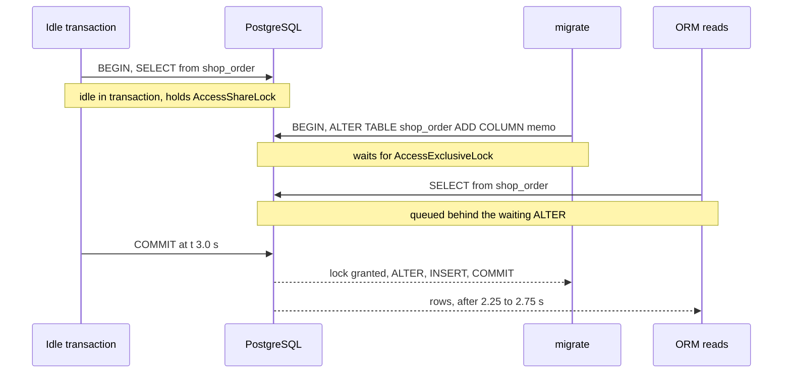

# Schema Change Locks in Django Migrations

Which table lock each common migration operation takes on PostgreSQL, how long it holds it, whether it rewrites the table, and how to stop a migration that waits for a lock from stalling every query on the table.

Verified by experiment on PostgreSQL 18.6 only (Docker image `postgres:18`, started with `log_statement = all`), with Django 6.1.2 and psycopg 3 (`psycopg[binary]==3.3.6`) only, on Python 3.14. Every operation ran as a real migration through `migrate` against a `shop_order` table of 200,000 rows, with `shop_account` (1,000 rows) and `shop_item` (1,000 rows, a `ForeignKey` to `shop_order`) as related tables. The SQL blocks are copied from PostgreSQL's statement log, with the `applied` timestamp of the `django_migrations` INSERT shortened to `now()`. Lock modes were read from `pg_locks` in a second session after each statement, while the migration's transaction was still open; "waits" means a probe session with `lock_timeout = '300ms'` was cancelled, "runs" means its statement completed. Times are the statement durations seen by the client on one development machine; they varied between runs (the two table rewrites ran 4.6 to 4.9 times faster on re-runs), so read them as orders of magnitude. Every "Source:" link points at the commit the Django `6.1.2` tag names. The lock modes and their conflicts are documented in [Table-Level Locks](https://www.postgresql.org/docs/18/explicit-locking.html#LOCKING-TABLES).

______________________________________________________________________

## Table of Contents

01. [Every Operation at a Glance](#1-every-operation-at-a-glance)
02. [A Migration Holds Every Lock Until `COMMIT`](#2-a-migration-holds-every-lock-until-commit)
03. [`AddField`: Defaults and `db_default`](#3-addfield-defaults-and-db_default)
04. [`AlterField`: Type Changes](#4-alterfield-type-changes)
05. [`AlterField`: `null=True` to `null=False`](#5-alterfield-nulltrue-to-nullfalse)
06. [Foreign Keys: `AddField` vs `NOT VALID` and `VALIDATE`](#6-foreign-keys-addfield-vs-not-valid-and-validate)
07. [Indexes: `AddIndex` vs `AddIndexConcurrently`](#7-indexes-addindex-vs-addindexconcurrently)
08. [Unique Constraints: `AddConstraint` vs a Concurrent Unique Index](#8-unique-constraints-addconstraint-vs-a-concurrent-unique-index)
09. [`RemoveField`, `RenameField`, `RenameModel`](#9-removefield-renamefield-renamemodel)
10. [The Lock Queue in Django Terms](#10-the-lock-queue-in-django-terms)
11. [`SET LOCAL lock_timeout` as the First Operation](#11-set-local-lock_timeout-as-the-first-operation)
12. [How This Was Verified](#12-how-this-was-verified)
13. [Quick Reference](#13-quick-reference)

______________________________________________________________________

## 1. Every Operation at a Glance

Each row is one migration on a fresh 200,000-row `shop_order`. "Lock held" is what `pg_locks` showed for the migration's session on `shop_order` after the operation's last statement, apart from `AccessShareLock`, which accompanied several of them. "Rewrite" means `pg_class.relfilenode` of `shop_order` changed. The probes ran against `shop_order` unless the row says otherwise.

| Migration operation                                                              | Lock held on `shop_order` until `COMMIT`                       | `SELECT`         | `INSERT`         | Rewrite                        | Time                                           |
| -------------------------------------------------------------------------------- | -------------------------------------------------------------- | ---------------- | ---------------- | ------------------------------ | ---------------------------------------------- |
| `AddField(TextField(null=True))`                                                 | `AccessExclusiveLock`                                          | waits            | waits            | no                             | 0.001 s                                        |
| `AddField(CharField(default="new"))`                                             | `AccessExclusiveLock`                                          | waits            | waits            | no                             | 0.001 s                                        |
| `AddField(UUIDField(default=uuid.uuid4))`                                        | `AccessExclusiveLock`                                          | waits            | waits            | no; **one UUID for all rows**  | 0.004 s                                        |
| `AddField(CharField(db_default="new"))`                                          | `AccessExclusiveLock`                                          | waits            | waits            | no                             | 0.001 s                                        |
| `AddField(DateTimeField(db_default=Now()))`                                      | `AccessExclusiveLock`                                          | waits            | waits            | no; one timestamp for all rows | 0.001 s                                        |
| `AddField(UUIDField(db_default=RandomUUID()))`                                   | `AccessExclusiveLock`, `ShareLock`                             | waits            | waits            | **yes**, and all 3 indexes     | **1.21 to 5.55 s**                             |
| `AlterField` `CharField(max_length=50)` to `100`, indexed                        | `AccessExclusiveLock`, `ShareLock`                             | waits            | waits            | no; indexes kept               | 0.002 s                                        |
| `AlterField` `CharField` to `TextField`, not indexed                             | `AccessExclusiveLock`                                          | waits            | waits            | no                             | 0.001 s                                        |
| `AlterField` `CharField(db_index=True)` to `TextField(db_index=True)`            | `AccessExclusiveLock`, `ShareLock`                             | waits            | waits            | no; **`_like` index rebuilt**  | 0.076 s                                        |
| `AlterField` `IntegerField` to `BigIntegerField`                                 | `AccessExclusiveLock`, `ShareLock`                             | waits            | waits            | **yes**, and all 3 indexes     | **0.79 to 3.86 s**                             |
| `AlterField` `null=True` to `null=False`, no `NULL` rows                         | `AccessExclusiveLock`                                          | waits            | waits            | no (full scan)                 | 0.019 s                                        |
| `AlterField` `null=True` to `null=False` with `default=""`, 20,000 `NULL` rows   | `AccessExclusiveLock`, `RowExclusiveLock`                      | waits            | waits            | no; 20,000 rows updated        | 0.227 s                                        |
| `AddField(ForeignKey(Account, null=True))`                                       | `AccessExclusiveLock`, `ShareRowExclusiveLock`, `ShareLock`    | waits            | waits            | no                             | 0.059 s                                        |
| (same) on `shop_account`                                                         | `ShareRowExclusiveLock`                                        | runs             | **waits**        |                                |                                                |
| `RunSQL` `ADD CONSTRAINT ... FOREIGN KEY ... NOT VALID`, own migration           | `ShareRowExclusiveLock` (and on `shop_account`)                | **runs**         | waits            | no                             | 0.001 s                                        |
| `RunSQL` `VALIDATE CONSTRAINT`, own migration                                    | `ShareUpdateExclusiveLock` (`RowShareLock` on `shop_account`)  | **runs**         | **runs**         | no                             | 0.017 s                                        |
| `AddIndex`                                                                       | `ShareLock`                                                    | **runs**         | waits            | no                             | 0.067 s                                        |
| `AddIndexConcurrently`, `atomic = False`                                         | `ShareUpdateExclusiveLock` while it runs, nothing after        | **runs**         | **runs**         | no                             | 0.144 s                                        |
| `AddConstraint(UniqueConstraint(fields=["code"]))`                               | `AccessExclusiveLock`, `ShareLock`                             | waits            | waits            | no                             | 0.328 s                                        |
| `CREATE UNIQUE INDEX CONCURRENTLY`, then `ADD CONSTRAINT ... UNIQUE USING INDEX` | nothing, then `AccessExclusiveLock`                            | runs, then waits | runs, then waits | no                             | 0.756 s, then 0.001 s                          |
| `RemoveField`                                                                    | `AccessExclusiveLock`                                          | waits            | waits            | no                             | 0.001 s                                        |
| `RemoveField` of `shop_item.order` (a `ForeignKey` to `shop_order`)              | `AccessExclusiveLock` on **both** `shop_item` and `shop_order` | waits            | waits            | no                             | 0.002 s                                        |
| `RenameField`                                                                    | `AccessExclusiveLock`                                          | waits            | waits            | no                             | 0.001 s                                        |
| `RenameModel("Order", "Purchase")`, referenced by `shop_item`                    | `AccessExclusiveLock` on **both** tables                       | waits            | waits            | no                             | 0.004 s; 0.110 s with 200,000 `shop_item` rows |
| `AlterModelTable` to the current name, then `RenameModel`                        | none: no SQL                                                   | runs             | runs             | no                             | 0 s                                            |

How to read it:

- **Fast is not the same as safe.** Most rows finished in a millisecond and still took `AccessExclusiveLock`, which blocks every `SELECT`. If the lock is not free, the migration waits and queues the application behind it (section 10). Start every migration that touches a busy table with `SET LOCAL lock_timeout` (section 11).
- **Only volatile defaults and real type changes rewrote the table.** The rewrite holds `AccessExclusiveLock` for the whole copy: up to 3.86 s and 5.55 s here, on 200,000 rows.
- **Foreign keys lock the other table too**, in both directions: adding one blocks writes to the referenced table, and removing one or renaming the referenced model blocks reads of both.
- **The lock lasts until the migration commits**, not until the statement returns (section 2).

______________________________________________________________________

## 2. A Migration Holds Every Lock Until `COMMIT`

From [Table-Level Locks](https://www.postgresql.org/docs/18/explicit-locking.html#LOCKING-TABLES):

> Once acquired, a lock is normally held until the end of the transaction.

With the default `atomic = True`, the whole migration file is one transaction (`transactions-in-migrate.md`), so a lock taken by the first operation is held through every operation after it. Measured with an `AddField` followed by a backfill in the same migration:

```python
def backfill(apps, schema_editor):
    apps.get_model("shop", "Order").objects.update(memo="x")


class Migration(migrations.Migration):
    dependencies = [("shop", "0001_initial")]
    operations = [
        migrations.AddField("order", "memo", models.TextField(null=True)),
        migrations.RunPython(backfill, migrations.RunPython.noop),
    ]
```

```sql
BEGIN
ALTER TABLE "shop_order" ADD COLUMN "memo" text NULL
UPDATE "shop_order" SET "memo" = 'x'
INSERT INTO "django_migrations" ("app", "name", "applied") VALUES ('shop', '0002_op', now()) RETURNING "django_migrations"."id"
COMMIT
```

| Statement                     | Took    | Locks on `shop_order` afterwards          |
| ----------------------------- | ------- | ----------------------------------------- |
| `ADD COLUMN "memo" text NULL` | 0.001 s | `AccessExclusiveLock`                     |
| `UPDATE ... SET "memo" = 'x'` | 2.609 s | `AccessExclusiveLock`, `RowExclusiveLock` |

A plain `SELECT id FROM shop_order WHERE id = 1`, sent from another session 0.022 s after the migration started, waited **2.716 s**. Its `clock_timestamp()` was `13:02:58.895`; the server logged the migration's `COMMIT` at `13:02:58.886`. The `ADD COLUMN` needed 1 ms of lock, and the table was unreadable for 2.7 s.

The same backfill in its own migration (`0002` adds the column and commits, `0003` runs the `RunPython`) held only `RowExclusiveLock` during the 2.688 s `UPDATE`:

| Probe during the backfill transaction                | Result                                                        |
| ---------------------------------------------------- | ------------------------------------------------------------- |
| `SELECT id FROM shop_order WHERE id = 1`             | runs                                                          |
| `INSERT INTO shop_order ...`                         | runs                                                          |
| `UPDATE shop_order SET amount = amount WHERE id = 1` | **waits**: the backfill holds the row lock until its `COMMIT` |

Locks accumulate in the same way across statements. Three `RunSQL` statements in one migration, measured after each:

| After                                 | `shop_order`                                                               | `shop_account`                          | Probes                                 |
| ------------------------------------- | -------------------------------------------------------------------------- | --------------------------------------- | -------------------------------------- |
| `ADD COLUMN "account_id" bigint NULL` | `AccessExclusiveLock`                                                      | none                                    | `shop_order` reads and writes wait     |
| `ADD CONSTRAINT ... NOT VALID`        | `AccessExclusiveLock`, `ShareRowExclusiveLock`                             | `ShareRowExclusiveLock`                 | and `INSERT` into `shop_account` waits |
| `VALIDATE CONSTRAINT`                 | `AccessExclusiveLock`, `ShareRowExclusiveLock`, `ShareUpdateExclusiveLock` | `ShareRowExclusiveLock`, `RowShareLock` | unchanged: nothing was released        |

`VALIDATE CONSTRAINT` only helps in a migration of its own (section 6).

Rules that follow:

- Put each operation that takes `AccessExclusiveLock` in a migration with nothing slow after it.
- Run data backfills in a separate migration from the schema change. In that migration, rows the backfill updated stay locked against other writers until it commits, so on a large table update in batches, each batch in its own transaction (a `RunPython` in an `atomic = False` migration with one `transaction.atomic()` per batch).
- With deferred SQL (indexes and constraints Django queues for the end of the migration) the lock also covers that SQL, which runs just before `COMMIT`.

______________________________________________________________________

## 3. `AddField`: Defaults and `db_default`

### Nullable column

```sql
ALTER TABLE "shop_order" ADD COLUMN "memo" text NULL
```

`AccessExclusiveLock`, no rewrite, 0.001 s.

### `default=` is set, then dropped

Django puts the Python default on the column only for the duration of the `ADD COLUMN`, so existing rows get the value, then drops it:

```sql
BEGIN
ALTER TABLE "shop_order" ADD COLUMN "status" varchar(20) DEFAULT 'new' NOT NULL
ALTER TABLE "shop_order" ALTER COLUMN "status" DROP DEFAULT
INSERT INTO "django_migrations" ("app", "name", "applied") VALUES ('shop', '0002_op', now()) RETURNING "django_migrations"."id"
COMMIT
```

Source: [`db/backends/base/schema.py#L817-L830`](https://github.com/django/django/blob/2212534bae393714e1e51db2341d4fd5545e19f6/django/db/backends/base/schema.py#L817-L830)

```python
        # Drop the default if we need to
        if (
            not field.has_db_default()
            and not self.skip_default_on_alter(field)
            and self.effective_default(field) is not None
        ):
            changes_sql, params = self._alter_column_default_sql(
                model, None, field, drop=True
            )
            sql = self.sql_alter_column % {
                "table": self.quote_name(model._meta.db_table),
                "changes": changes_sql,
            }
            self.execute(sql, params)
```

No rewrite (`relfilenode` unchanged, 0.001 s for both statements), because PostgreSQL stores a constant default in the catalog. From [ALTER TABLE, Notes](https://www.postgresql.org/docs/18/sql-altertable.html#SQL-ALTERTABLE-NOTES):

> When a column is added with ADD COLUMN and a non-volatile DEFAULT is specified, the default value is evaluated at the time of the statement and the result stored in the table's metadata, where it will be returned when any existing rows are accessed.

After the migration `information_schema.columns.column_default` for `status` was `NULL`, so an insert that leaves the column out fails. Measured with `psql`: `INSERT INTO shop_order (code, title, amount, note) VALUES ('x', 'x', 1, 'x')` returned `ERROR:  null value in column "status" of relation "shop_order" violates not-null constraint`. Use `db_default` when other writers (raw SQL, other services, old application servers during a deploy) insert into the table.

### `default=uuid.uuid4` gives every existing row the same value

`effective_default()` calls the callable once, in Python, and Django sends the result as a literal:

```sql
ALTER TABLE "shop_order" ADD COLUMN "ref" uuid DEFAULT '95517d2da2414d199d9bc5195b0e006a'::uuid NOT NULL
ALTER TABLE "shop_order" ALTER COLUMN "ref" DROP DEFAULT
```

Measured afterwards: `SELECT count(DISTINCT ref), count(*) FROM shop_order` returned `1, 200000`. A callable default is not a per-row default for existing rows; fill those with a backfill.

### `db_default=` stays on the column

```sql
ALTER TABLE "shop_order" ADD COLUMN "status" varchar(20) DEFAULT 'new' NOT NULL
```

One statement, no `DROP DEFAULT`, no rewrite, 0.001 s. `column_default` afterwards: `'new'::character varying`.

### `db_default=Now()`: no rewrite, one timestamp

Source: [`db/models/functions/datetime.py#L213-L223`](https://github.com/django/django/blob/2212534bae393714e1e51db2341d4fd5545e19f6/django/db/models/functions/datetime.py#L213-L223)

```python
class Now(Func):
    template = "CURRENT_TIMESTAMP"
    output_field = DateTimeField()

    def as_postgresql(self, compiler, connection, **extra_context):
        # PostgreSQL's CURRENT_TIMESTAMP means "the time at the start of the
        # transaction". Use STATEMENT_TIMESTAMP to be cross-compatible with
        # other databases.
        return self.as_sql(
            compiler, connection, template="STATEMENT_TIMESTAMP()", **extra_context
        )
```

```sql
ALTER TABLE "shop_order" ADD COLUMN "created" timestamp with time zone DEFAULT (STATEMENT_TIMESTAMP()) NOT NULL
```

`statement_timestamp()` is stable (`pg_proc.provolatile = 's'`), so PostgreSQL evaluated it once: no rewrite, 0.001 s, and `count(DISTINCT created)` was `1` for 200,000 rows.

### `db_default=RandomUUID()` rewrites the table

Source: [`contrib/postgres/functions.py#L4-L6`](https://github.com/django/django/blob/2212534bae393714e1e51db2341d4fd5545e19f6/django/contrib/postgres/functions.py#L4-L6)

```python
class RandomUUID(Func):
    template = "GEN_RANDOM_UUID()"
    output_field = UUIDField()
```

```sql
ALTER TABLE "shop_order" ADD COLUMN "ref" uuid DEFAULT (GEN_RANDOM_UUID()) NOT NULL
```

`gen_random_uuid()` is volatile (`provolatile = 'v'`). The statement took **5.554 s** in one run and 1.212 s in another, held `AccessExclusiveLock` and `ShareLock`, and changed the `relfilenode` of the table and of all three indexes; `count(DISTINCT ref)` was `200000`. The documentation says so:

> Adding a column with a volatile DEFAULT (e.g., clock_timestamp()), a stored generated column, an identity column, or a column with a domain data type that has constraints will cause the entire table and its indexes to be rewritten.

To give existing rows distinct values without the rewrite, add the column nullable, backfill in batches, then make it `NOT NULL` (section 5).

______________________________________________________________________

## 4. `AlterField`: Type Changes

| Change                                                                  | SQL Django sent                                                                                                                                                                                                               | Table rewritten | Indexes rebuilt               | Time                      |
| ----------------------------------------------------------------------- | ----------------------------------------------------------------------------------------------------------------------------------------------------------------------------------------------------------------------------- | --------------- | ----------------------------- | ------------------------- |
| `CharField(max_length=50, db_index=True)` to `max_length=100`           | `ALTER TABLE "shop_order" ALTER COLUMN "code" TYPE varchar(100)`                                                                                                                                                              | no              | none                          | 0.002 s                   |
| `CharField(max_length=50)` to `TextField()`                             | `ALTER TABLE "shop_order" ALTER COLUMN "title" TYPE text USING "title"::text`                                                                                                                                                 | no              | none (no index on the column) | 0.001 s                   |
| `CharField(max_length=50, db_index=True)` to `TextField(db_index=True)` | `DROP INDEX IF EXISTS "shop_order_code_15db80c4_like"`, `ALTER TABLE "shop_order" ALTER COLUMN "code" TYPE text USING "code"::text`, `CREATE INDEX "shop_order_code_15db80c4_like" ON "shop_order" ("code" text_pattern_ops)` | no              | the `_like` index, by Django  | 0.076 s                   |
| `IntegerField()` to `BigIntegerField()`                                 | `ALTER TABLE "shop_order" ALTER COLUMN "amount" TYPE bigint USING "amount"::bigint`                                                                                                                                           | **yes**         | all 3, by PostgreSQL          | 0.786 to 3.863 s (3 runs) |

All four took `AccessExclusiveLock`; the widening, the indexed change and the `bigint` change also showed a `ShareLock`. Reads and writes waited in every case.

PostgreSQL skips the rewrite when the old type is binary coercible to the new one. From [ALTER TABLE, Notes](https://www.postgresql.org/docs/18/sql-altertable.html#SQL-ALTERTABLE-NOTES):

> As an exception, when changing the type of an existing column, if the USING clause does not change the column contents and the old type is either binary coercible to the new type or an unconstrained domain over the new type, a table rewrite is not needed.

The `USING "code"::text` that Django adds does not change the contents, so it did not force a rewrite. `int` to `bigint` changes the storage, and rewrote the table and every index while holding `AccessExclusiveLock` for 0.8 to 3.9 s on 200,000 rows.

### Django rebuilds the `_like` index itself

For an indexed `CharField` or `TextField`, Django creates a second index with `varchar_pattern_ops` or `text_pattern_ops` (the `_like` index) for `LIKE` queries. When the column changes from `varchar` to `text`, the operator class no longer fits, so Django drops it and builds a new one inside the migration's transaction, under the `AccessExclusiveLock` it already holds:

Source: [`db/backends/postgresql/schema.py#L152-L163`](https://github.com/django/django/blob/2212534bae393714e1e51db2341d4fd5545e19f6/django/db/backends/postgresql/schema.py#L152-L163)

```python
    def _alter_column_type_sql(
        self, model, old_field, new_field, new_type, old_collation, new_collation
    ):
        # Drop indexes on varchar/text/citext columns that are changing to a
        # different type.
        old_db_params = old_field.db_parameters(connection=self.connection)
        old_type = old_db_params["type"]
        if self._is_changing_type_of_indexed_text_column(old_field, old_type, new_type):
            index_name = self._create_index_name(
                model._meta.db_table, [old_field.column], suffix="_like"
            )
            self.execute(self._delete_index_sql(model, index_name))
```

Source: [`db/backends/postgresql/schema.py#L284-L296`](https://github.com/django/django/blob/2212534bae393714e1e51db2341d4fd5545e19f6/django/db/backends/postgresql/schema.py#L284-L296)

```python
        # Added an index? Create any PostgreSQL-specific indexes.
        if (
            (not (old_field.db_index or old_field.unique) and new_field.db_index)
            or (not old_field.unique and new_field.unique)
            or (
                self._is_changing_type_of_indexed_text_column(
                    old_field, old_type, new_type
                )
            )
        ):
            like_index_statement = self._create_like_index_sql(model, new_field)
            if like_index_statement is not None:
                self.execute(like_index_statement)
```

Measured: only the `_like` index's `relfilenode` changed; the plain index on `code` and the table kept theirs. The rebuild took 0.074 s here and grows with the table, with reads blocked throughout.

______________________________________________________________________

## 5. `AlterField`: `null=True` to `null=False`

With no default, one statement:

```sql
ALTER TABLE "shop_order" ALTER COLUMN "note" SET NOT NULL
```

It scanned the table under `AccessExclusiveLock` (0.019 s for 200,000 rows, no rewrite).

With a default on the new field, Django runs a four-step change that updates the `NULL` rows first:

```sql
BEGIN
ALTER TABLE "shop_order" ALTER COLUMN "note" SET DEFAULT ''
UPDATE "shop_order" SET "note" = '' WHERE "note" IS NULL; SET CONSTRAINTS ALL IMMEDIATE
ALTER TABLE "shop_order" ALTER COLUMN "note" SET NOT NULL
ALTER TABLE "shop_order" ALTER COLUMN "note" DROP DEFAULT
INSERT INTO "django_migrations" ("app", "name", "applied") VALUES ('shop', '0002_op', now()) RETURNING "django_migrations"."id"
COMMIT
```

Source: [`db/backends/postgresql/schema.py#L8-L13`](https://github.com/django/django/blob/2212534bae393714e1e51db2341d4fd5545e19f6/django/db/backends/postgresql/schema.py#L8-L13)

```python
    # Setting all constraints to IMMEDIATE to allow changing data in the same
    # transaction.
    sql_update_with_default = (
        "UPDATE %(table)s SET %(column)s = %(default)s WHERE %(column)s IS NULL"
        "; SET CONSTRAINTS ALL IMMEDIATE"
    )
```

With 20,000 `NULL` rows out of 200,000, the `UPDATE` took 0.207 s and `SET NOT NULL` 0.019 s, all under `AccessExclusiveLock` from the first statement. The table's `relfilenode` did not change. The `UPDATE` time grows with the number of `NULL` rows, and reads wait for all of it; backfill the `NULL`s in a separate migration first, so that this one only has to scan.

For a large table, PostgreSQL can also validate a `NOT NULL` without blocking writes: add it `NOT VALID`, then `VALIDATE CONSTRAINT`, each in its own `RunSQL` with `SeparateDatabaseAndState`. The syntax depends on the version. `ADD CONSTRAINT ... NOT NULL col NOT VALID` exists only from PostgreSQL 18; on 16 it fails with `syntax error at or near "NOT"` (measured on 16.15). On 16 and 17 add `CHECK (col IS NOT NULL) NOT VALID` instead, which was measured on 16.15 to reject new `NULL`s and to validate once the old ones were gone. The `ALTER TABLE` docs add that a later `SET NOT NULL` skips its table scan when a valid `CHECK (col IS NOT NULL)` already exists (from the docs, not measured here). See the `postgres` skill's `references/lock-queue-and-timeouts.md`, section 13.

______________________________________________________________________

## 6. Foreign Keys: `AddField` vs `NOT VALID` and `VALIDATE`

### `AddField(ForeignKey)`

```python
migrations.AddField(
    "order",
    "account",
    models.ForeignKey(null=True, on_delete=django.db.models.deletion.PROTECT, to="shop.account"),
)
```

On PostgreSQL the constraint goes inline in the `ADD COLUMN`, and the index is deferred to the end of the migration:

```sql
BEGIN
ALTER TABLE "shop_order" ADD COLUMN "account_id" bigint NULL CONSTRAINT "shop_order_account_id_01539d85_fk_shop_account_id" REFERENCES "shop_account"("id") DEFERRABLE INITIALLY DEFERRED; SET CONSTRAINTS "shop_order_account_id_01539d85_fk_shop_account_id" IMMEDIATE
CREATE INDEX "shop_order_account_id_01539d85" ON "shop_order" ("account_id")
COMMIT
INSERT INTO "django_migrations" ("app", "name", "applied") VALUES ('shop', '0002_op', now()) RETURNING "django_migrations"."id"
```

Source: [`db/backends/postgresql/schema.py#L28-L33`](https://github.com/django/django/blob/2212534bae393714e1e51db2341d4fd5545e19f6/django/db/backends/postgresql/schema.py#L28-L33)

```python
    # Setting the constraint to IMMEDIATE to allow changing data in the same
    # transaction.
    sql_create_column_inline_fk = (
        "CONSTRAINT %(name)s REFERENCES %(to_table)s(%(to_column)s)%(on_delete_db)s"
        "%(deferrable)s; SET CONSTRAINTS %(namespace)s%(name)s IMMEDIATE"
    )
```

| After                       | `shop_order`                                   | `shop_account`          | `shop_order` `SELECT` / `INSERT` | `shop_account` `SELECT` / `INSERT` | Took    |
| --------------------------- | ---------------------------------------------- | ----------------------- | -------------------------------- | ---------------------------------- | ------- |
| `ADD COLUMN ... REFERENCES` | `AccessExclusiveLock`, `ShareRowExclusiveLock` | `ShareRowExclusiveLock` | waits / waits                    | runs / **waits**                   | 0.001 s |
| deferred `CREATE INDEX`     | the same, plus `ShareLock`                     | `ShareRowExclusiveLock` | waits / waits                    | runs / **waits**                   | 0.058 s |

The new column is all `NULL`, so the constraint check is instant. The cost is the index build, under `AccessExclusiveLock`, and the lock on the referenced table: inserts into `shop_account` wait until the migration commits.

### The split: `NOT VALID`, a concurrent index, then `VALIDATE`

Three migrations produce the same column, constraint and index, with the names Django uses (copied from `sqlmigrate` of the plain `AddField`). `SeparateDatabaseAndState` keeps Django's model state identical to the plain `AddField`.

```python
# 0002_fk_not_valid.py
class Migration(migrations.Migration):
    dependencies = [("shop", "0001_initial")]
    operations = [
        migrations.SeparateDatabaseAndState(
            state_operations=[
                migrations.AddField("order", "account", models.ForeignKey(null=True, on_delete=django.db.models.deletion.PROTECT, to="shop.account")),
            ],
            database_operations=[
                migrations.RunSQL('ALTER TABLE "shop_order" ADD COLUMN "account_id" bigint NULL'),
                migrations.RunSQL('ALTER TABLE "shop_order" ADD CONSTRAINT "shop_order_account_id_01539d85_fk_shop_account_id" FOREIGN KEY ("account_id") REFERENCES "shop_account" ("id") DEFERRABLE INITIALLY DEFERRED NOT VALID'),
            ],
        ),
    ]
```

```python
# 0003_fk_index.py
class Migration(migrations.Migration):
    atomic = False
    dependencies = [("shop", "0002_fk_not_valid")]
    operations = [
        migrations.RunSQL('CREATE INDEX CONCURRENTLY IF NOT EXISTS "shop_order_account_id_01539d85" ON "shop_order" ("account_id")', 'DROP INDEX CONCURRENTLY IF EXISTS "shop_order_account_id_01539d85"'),
    ]
```

```python
# 0004_fk_validate.py
class Migration(migrations.Migration):
    dependencies = [("shop", "0003_fk_index")]
    operations = [
        migrations.RunSQL('ALTER TABLE "shop_order" VALIDATE CONSTRAINT "shop_order_account_id_01539d85_fk_shop_account_id"', migrations.RunSQL.noop),
    ]
```

```sql
BEGIN
ALTER TABLE "shop_order" ADD COLUMN "account_id" bigint NULL
ALTER TABLE "shop_order" ADD CONSTRAINT "shop_order_account_id_01539d85_fk_shop_account_id" FOREIGN KEY ("account_id") REFERENCES "shop_account" ("id") DEFERRABLE INITIALLY DEFERRED NOT VALID
INSERT INTO "django_migrations" ("app", "name", "applied") VALUES ('shop', '0002_fk_not_valid', now()) RETURNING "django_migrations"."id"
COMMIT
CREATE INDEX CONCURRENTLY IF NOT EXISTS "shop_order_account_id_01539d85" ON "shop_order" ("account_id")
INSERT INTO "django_migrations" ("app", "name", "applied") VALUES ('shop', '0003_fk_index', now()) RETURNING "django_migrations"."id"
BEGIN
ALTER TABLE "shop_order" VALIDATE CONSTRAINT "shop_order_account_id_01539d85_fk_shop_account_id"
INSERT INTO "django_migrations" ("app", "name", "applied") VALUES ('shop', '0004_fk_validate', now()) RETURNING "django_migrations"."id"
COMMIT
```

| Step                                          | `shop_order`                 | `shop_account`          | `shop_order` `SELECT` / `INSERT` | `shop_account` `INSERT` | Took    |
| --------------------------------------------- | ---------------------------- | ----------------------- | -------------------------------- | ----------------------- | ------- |
| `ADD COLUMN`                                  | `AccessExclusiveLock`        | none                    | waits / waits                    | runs                    | 0.001 s |
| `ADD CONSTRAINT ... NOT VALID`                | adds `ShareRowExclusiveLock` | `ShareRowExclusiveLock` | waits / waits                    | waits                   | 0.001 s |
| `ADD CONSTRAINT ... NOT VALID`, own migration | `ShareRowExclusiveLock`      | `ShareRowExclusiveLock` | **runs** / waits                 | waits                   | 0.001 s |
| `CREATE INDEX CONCURRENTLY`                   | none after it returns        | none                    | runs / runs                      | runs                    | 0.090 s |
| `VALIDATE CONSTRAINT`                         | `ShareUpdateExclusiveLock`   | `RowShareLock`          | **runs** / **runs**              | **runs**                | 0.017 s |

The third row is a separate run where the column already existed, so `NOT VALID` was alone in its transaction. Afterwards `pg_constraint` showed the constraint with `convalidated = true` and `condeferrable = true`, as after the plain `AddField`. The validation scan is the only step that grows with the table, and it ran while both tables accepted reads and writes. The documentation describes the split:

> The main purpose of the NOT VALID constraint option is to reduce the impact of adding a constraint on concurrent updates. With NOT VALID, the ADD CONSTRAINT command does not scan the table and can be committed immediately. After that, a VALIDATE CONSTRAINT command can be issued to verify that existing rows satisfy the constraint. The validation step does not need to lock out concurrent updates, since it knows that other transactions will be enforcing the constraint for rows that they insert or update; only pre-existing rows need to be checked. Hence, validation acquires only a SHARE UPDATE EXCLUSIVE lock on the table being altered. (If the constraint is a foreign key then a ROW SHARE lock is also required on the table referenced by the constraint.)

`VALIDATE` must be in a later migration than the `ADD CONSTRAINT`. In the same migration it gains nothing: the measurement at the end of section 2 shows the `AccessExclusiveLock` and both `ShareRowExclusiveLock`s still held during the scan.

______________________________________________________________________

## 7. Indexes: `AddIndex` vs `AddIndexConcurrently`

| Operation                                                                     | SQL                                                                       | Lock                                     | `SELECT` | `INSERT` | Took    |
| ----------------------------------------------------------------------------- | ------------------------------------------------------------------------- | ---------------------------------------- | -------- | -------- | ------- |
| `AddIndex("order", models.Index(fields=["amount"], name="order_amount_idx"))` | `CREATE INDEX "order_amount_idx" ON "shop_order" ("amount")`              | `ShareLock`, until `COMMIT`              | runs     | waits    | 0.067 s |
| `AddIndexConcurrently(...)` in an `atomic = False` migration                  | `CREATE INDEX CONCURRENTLY "order_amount_idx" ON "shop_order" ("amount")` | `ShareUpdateExclusiveLock` while it runs | runs     | runs     | 0.144 s |

To watch the concurrent build hold its lock, a second session first inserted a row into `shop_order` and kept its transaction open. One second into the build, the migration's session showed `ShareUpdateExclusiveLock` granted, `wait_event = Lock / virtualxid`, phase `waiting for writers before build`, and `pg_blocking_pids()` naming the open transaction; probe `SELECT` and `INSERT` ran in 0.002 s and 0.001 s. The build finished 1.192 s after it started, right after that transaction committed at about 1.0 s.

The concurrent build took longer and waited for an older transaction, but reads and writes ran throughout. Migration templates, failure modes and invalid indexes are in `concurrent-indexes.md`.

______________________________________________________________________

## 8. Unique Constraints: `AddConstraint` vs a Concurrent Unique Index

`AddConstraint(UniqueConstraint(fields=["code"], name="order_code_uniq"))`:

```sql
ALTER TABLE "shop_order" ADD CONSTRAINT "order_code_uniq" UNIQUE ("code")
```

It built the unique index inside the statement, under `AccessExclusiveLock` and `ShareLock`: 0.328 s on 200,000 rows, with reads and writes waiting.

The same constraint built in two migrations:

```python
# 0002_uniq_index.py
class Migration(migrations.Migration):
    atomic = False
    dependencies = [("shop", "0001_initial")]
    operations = [
        migrations.RunSQL('CREATE UNIQUE INDEX CONCURRENTLY IF NOT EXISTS "order_code_uniq" ON "shop_order" ("code")', 'DROP INDEX CONCURRENTLY IF EXISTS "order_code_uniq"'),
    ]
```

```python
# 0003_uniq_constraint.py
class Migration(migrations.Migration):
    dependencies = [("shop", "0002_uniq_index")]
    operations = [
        migrations.SeparateDatabaseAndState(
            state_operations=[
                migrations.AddConstraint("order", models.UniqueConstraint(fields=["code"], name="order_code_uniq")),
            ],
            database_operations=[
                migrations.RunSQL('ALTER TABLE "shop_order" ADD CONSTRAINT "order_code_uniq" UNIQUE USING INDEX "order_code_uniq"'),
            ],
        ),
    ]
```

```sql
CREATE UNIQUE INDEX CONCURRENTLY IF NOT EXISTS "order_code_uniq" ON "shop_order" ("code")
INSERT INTO "django_migrations" ("app", "name", "applied") VALUES ('shop', '0002_uniq_index', now()) RETURNING "django_migrations"."id"
BEGIN
ALTER TABLE "shop_order" ADD CONSTRAINT "order_code_uniq" UNIQUE USING INDEX "order_code_uniq"
INSERT INTO "django_migrations" ("app", "name", "applied") VALUES ('shop', '0003_uniq_constraint', now()) RETURNING "django_migrations"."id"
COMMIT
```

The concurrent build took 0.756 s with reads and writes running. `ADD CONSTRAINT ... USING INDEX` took `AccessExclusiveLock` for 0.001 s, with no scan. `pg_constraint` then held `order_code_uniq` with `contype = 'u'`, as after `AddConstraint`. Before the rerun of a failed `0002`, check that the index is valid (`concurrent-indexes.md`): `IF NOT EXISTS` skips an invalid one.

______________________________________________________________________

## 9. `RemoveField`, `RenameField`, `RenameModel`

### `RemoveField` and `RenameField`

```sql
ALTER TABLE "shop_order" DROP COLUMN "note"
ALTER TABLE "shop_order" RENAME COLUMN "title" TO "headline"
```

Both took `AccessExclusiveLock` for 0.001 s with no rewrite. `DROP COLUMN` only hides the column; from [ALTER TABLE, Notes](https://www.postgresql.org/docs/18/sql-altertable.html#SQL-ALTERTABLE-NOTES):

> The DROP COLUMN form does not physically remove the column, but simply makes it invisible to SQL operations.

### Removing a `ForeignKey` locks the referenced table

`RemoveField("item", "order")` on `shop_item`, whose `order` points at `shop_order`:

```sql
SET CONSTRAINTS "shop_item_order_id_8a5a3b33_fk_shop_order_id" IMMEDIATE; ALTER TABLE "shop_item" DROP CONSTRAINT "shop_item_order_id_8a5a3b33_fk_shop_order_id"
ALTER TABLE "shop_item" DROP COLUMN "order_id"
```

Source: [`db/backends/base/schema.py#L860-L864`](https://github.com/django/django/blob/2212534bae393714e1e51db2341d4fd5545e19f6/django/db/backends/base/schema.py#L860-L864)

```python
        # Drop any FK constraints, MySQL requires explicit deletion
        if field.remote_field:
            fk_names = self._constraint_names(model, [field.column], foreign_key=True)
            for fk_name in fk_names:
                self.execute(self._delete_fk_sql(model, fk_name))
```

After the `DROP CONSTRAINT`, the migration held `AccessExclusiveLock` on `shop_item` **and on `shop_order`**, and probe `SELECT`s of `shop_order` waited until `COMMIT`. Dropping a child table's foreign key blocks reads of the parent table, so it needs the same `lock_timeout` care as an `ALTER` of the parent.

### `RenameModel` re-creates every foreign key that points at it

Source: [`db/migrations/operations/models.py#L447-L475`](https://github.com/django/django/blob/2212534bae393714e1e51db2341d4fd5545e19f6/django/db/migrations/operations/models.py#L447-L475)

```python
    def database_forwards(self, app_label, schema_editor, from_state, to_state):
        new_model = to_state.apps.get_model(app_label, self.new_name)
        if self.allow_migrate_model(schema_editor.connection.alias, new_model):
            old_model = from_state.apps.get_model(app_label, self.old_name)
            # Move the main table
            schema_editor.alter_db_table(
                new_model,
                old_model._meta.db_table,
                new_model._meta.db_table,
            )
            # Alter the fields pointing to us
            for related_object in old_model._meta.related_objects:
                if related_object.related_model == old_model:
                    model = new_model
                    related_key = (app_label, self.new_name_lower)
                else:
                    related_key = (
                        related_object.related_model._meta.app_label,
                        related_object.related_model._meta.model_name,
                    )
                    model = to_state.apps.get_model(*related_key)
                to_field = to_state.apps.get_model(*related_key)._meta.get_field(
                    related_object.field.name
                )
                schema_editor.alter_field(
                    model,
                    related_object.field,
                    to_field,
                )
```

`RenameModel("Order", "Purchase")`, with `shop_item.order` pointing at it:

```sql
BEGIN
ALTER TABLE "shop_order" RENAME TO "shop_purchase"
SET CONSTRAINTS "shop_item_order_id_8a5a3b33_fk_shop_order_id" IMMEDIATE; ALTER TABLE "shop_item" DROP CONSTRAINT "shop_item_order_id_8a5a3b33_fk_shop_order_id"
ALTER TABLE "shop_item" ADD CONSTRAINT "shop_item_order_id_8a5a3b33_fk_shop_purchase_id" FOREIGN KEY ("order_id") REFERENCES "shop_purchase" ("id") DEFERRABLE INITIALLY DEFERRED
INSERT INTO "django_migrations" ("app", "name", "applied") VALUES ('shop', '0002_op', now()) RETURNING "django_migrations"."id"
COMMIT
```

| After                         | `shop_order`          | `shop_item`                                    | `shop_item` `SELECT` / `INSERT` | Took, 1,000 items | Took, 200,000 items |
| ----------------------------- | --------------------- | ---------------------------------------------- | ------------------------------- | ----------------- | ------------------- |
| `RENAME TO`                   | `AccessExclusiveLock` | none                                           | runs / runs                     | 0.001 s           | 0.001 s             |
| `DROP CONSTRAINT`             | `AccessExclusiveLock` | `AccessExclusiveLock`                          | waits / waits                   | 0.001 s           | 0.001 s             |
| `ADD CONSTRAINT` (validating) | `AccessExclusiveLock` | `AccessExclusiveLock`, `ShareRowExclusiveLock` | waits / waits                   | 0.002 s           | **0.108 s**         |

The new foreign key is added without `NOT VALID`, so PostgreSQL checks every row of the child table while both tables are locked against reads. The time grows with each child table. The table itself was not rewritten: `shop_purchase` kept `shop_order`'s `relfilenode`. The identity sequence kept its name, `shop_order_id_seq`.

To rename only the model, keep the table name. With `AlterModelTable` to the current name first, `RenameModel` sent no SQL at all:

```python
operations = [
    migrations.AlterModelTable("order", "shop_order"),
    migrations.RenameModel("Order", "Purchase"),
]
```

```sql
BEGIN
INSERT INTO "django_migrations" ("app", "name", "applied") VALUES ('shop', '0002_op', now()) RETURNING "django_migrations"."id"
COMMIT
```

The renamed model then needs `class Meta: db_table = "shop_order"`. `alter_db_table` returns early when the names match:

Source: [`db/backends/base/schema.py#L712-L718`](https://github.com/django/django/blob/2212534bae393714e1e51db2341d4fd5545e19f6/django/db/backends/base/schema.py#L712-L718)

```python
    def alter_db_table(self, model, old_db_table, new_db_table):
        """Rename the table a model points to."""
        if old_db_table == new_db_table or (
            self.connection.features.ignores_table_name_case
            and old_db_table.lower() == new_db_table.lower()
        ):
            return
```

______________________________________________________________________

## 10. The Lock Queue in Django Terms

A migration that has to wait for its lock is worse than a slow one. A waiting `AccessExclusiveLock` request blocks every later request for the table, including plain reads. Measured: one session ran `SELECT id FROM shop_order WHERE id = 1` in a transaction and stayed `idle in transaction`, like a request or a job that never committed. `python manage.py migrate shop` then applied an `AddField(TextField(null=True))`, and three threads ran an ordinary ORM read, `Order.objects.filter(pk=1).values_list("id", flat=True).first()`, 0.25 s apart:



`pg_stat_activity` and `pg_locks` 1.25 s after the migration started waiting:

| Session          | `state`               | `wait_event`          | `pg_blocking_pids`        | Lock on `shop_order`                   |
| ---------------- | --------------------- | --------------------- | ------------------------- | -------------------------------------- |
| idle transaction | `idle in transaction` | `Client / ClientRead` | `{}`                      | `AccessShareLock`, granted             |
| `migrate`        | `active`              | `Lock / relation`     | the idle transaction      | `AccessExclusiveLock`, **not granted** |
| ORM read 1, 2, 3 | `active`              | `Lock / relation`     | **the `migrate` session** | `AccessShareLock`, **not granted**     |

| ORM read | Sent after the migration began waiting | Waited  |
| -------- | -------------------------------------- | ------- |
| 1        | 0.265 s                                | 2.750 s |
| 2        | 0.515 s                                | 2.500 s |
| 3        | 0.767 s                                | 2.249 s |

The reads don't conflict with the idle transaction; `pg_blocking_pids()` names the migration. All three returned when the idle transaction committed at t = 3.0 s, and `migrate` printed `Applying shop.0002_op... OK` at t = 3.1 s. Its log shows the 3 s wait as the gap between the `ALTER` and the next statement:

```text
2026-10-08 13:03:57.048 UTC [624] LOG:  statement: BEGIN
2026-10-08 13:03:57.049 UTC [624] LOG:  statement: ALTER TABLE "shop_order" ADD COLUMN "memo" text NULL
2026-10-08 13:04:00.057 UTC [624] LOG:  statement: INSERT INTO "django_migrations" ("app", "name", "applied") VALUES ('shop', '0002_op', '2026-10-08 13:04:00.057274+00:00'::timestamptz) RETURNING "django_migrations"."id"
2026-10-08 13:04:00.058 UTC [624] LOG:  statement: COMMIT
```

Nothing bounds this wait by default: `migrate` sends no `lock_timeout`, and `SHOW lock_timeout` and `SHOW idle_in_transaction_session_timeout` both returned `0` (disabled) on the test server. Every request that touches the table stalls for as long as the holder stays open. The lock queue in plain SQL, how to find the root blocker, and every timeout setting are in the `postgres` skill's `references/lock-queue-and-timeouts.md`.

______________________________________________________________________

## 11. `SET LOCAL lock_timeout` as the First Operation

```python
class Migration(migrations.Migration):
    dependencies = [("shop", "0001_initial")]
    operations = [
        migrations.RunSQL("SET LOCAL lock_timeout = '5s'", migrations.RunSQL.noop),
        migrations.AddField("order", "memo", models.TextField(null=True)),
        migrations.RunSQL(migrations.RunSQL.noop, "SET LOCAL lock_timeout = '5s'"),
    ]
```

The first `RunSQL` covers the forward run. The last one, empty forwards, is the first operation when the migration is unapplied, so it covers the backward run. Measured with a `RunPython` printing `SHOW lock_timeout` between them: `5s` in both directions. Without a `reverse_sql`, unapplying fails with `django.db.migrations.exceptions.IrreversibleError: Operation <RunSQL "SET LOCAL lock_timeout = '5s'"> in shop.0002_op is not reversible`, and the migration stays recorded; `Migration.unapply()` checks every operation for reversibility before it runs any of them ([`db/migrations/migration.py#L156-L160`](https://github.com/django/django/blob/2212534bae393714e1e51db2341d4fd5545e19f6/django/db/migrations/migration.py#L156-L160)).

### When it fires

The same idle transaction as in section 10, held until `migrate` exited, with the first `RunSQL` before the `AddField`:

```text
2026-10-08 13:05:06.458 UTC [680] LOG:  statement: BEGIN
2026-10-08 13:05:06.459 UTC [680] LOG:  statement: SET LOCAL lock_timeout = '5s'
2026-10-08 13:05:06.460 UTC [680] LOG:  statement: ALTER TABLE "shop_order" ADD COLUMN "memo" text NULL
2026-10-08 13:05:11.461 UTC [680] ERROR:  canceling statement due to lock timeout
2026-10-08 13:05:11.461 UTC [680] STATEMENT:  ALTER TABLE "shop_order" ADD COLUMN "memo" text NULL
2026-10-08 13:05:11.461 UTC [680] LOG:  statement: ROLLBACK
```

`migrate` exited with status 1. Its output, with the traceback's frames left out:

```text
Running migrations:
  Applying shop.0002_op...Traceback (most recent call last):
psycopg.errors.LockNotAvailable: canceling statement due to lock timeout

The above exception was the direct cause of the following exception:

Traceback (most recent call last):
django.db.utils.OperationalError: canceling statement due to lock timeout
```

| Measured                          | Without `lock_timeout`                              | With `SET LOCAL lock_timeout = '5s'`                                                |
| --------------------------------- | --------------------------------------------------- | ----------------------------------------------------------------------------------- |
| `migrate`                         | waited 3.0 s, until the holder committed, then `OK` | gave up after 5.0 s, exit status 1                                                  |
| ORM reads queued behind it        | waited until the holder committed                   | waited 4.729 s, 4.479 s and 4.230 s, then returned, while the holder was still open |
| `django_migrations` after the run | `0002_op` recorded                                  | only `0001_initial`                                                                 |
| `memo` column after the run       | exists                                              | absent: the whole migration rolled back                                             |
| rerun after the holder ended      | n/a                                                 | `Applying shop.0002_op... OK`                                                       |

The timeout does not stop the queue from forming: reads still waited up to the 5 s limit. It stops the queue from lasting longer than that. Pick the value as the longest stall the application can tolerate, and rerun `migrate` when it fails; Django does not retry.

### Where the setting applies

Measured with `RunPython` operations printing `SHOW lock_timeout`, and `SHOW lock_timeout` on Django's connection after `call_command("migrate")` returned:

| Migration                                                               | Inside the migration                                   | Next migration in the same run | After `migrate` |
| ----------------------------------------------------------------------- | ------------------------------------------------------ | ------------------------------ | --------------- |
| atomic, `SET LOCAL` first, then two `AddField`s (one with deferred SQL) | `5s` after the `SET`, `5s` after the second `AddField` | `0`                            | `0`             |
| `atomic = False`, `SET LOCAL`                                           | `0`                                                    |                                | `0`             |
| atomic, `SET` without `LOCAL`                                           | `5s`                                                   | **`5s`**                       | **`5s`**        |

- In an atomic migration, `SET LOCAL` lasts until that migration's `COMMIT` or `ROLLBACK`, which includes the deferred SQL Django runs just before `COMMIT` (the second `AddField`'s `CREATE INDEX` ran between the last `SHOW` and the `COMMIT`), and it never leaks into the next migration.
- In an `atomic = False` migration there is no transaction, so `SET LOCAL` does nothing. PostgreSQL logged `WARNING:  SET LOCAL can only be used in transaction blocks`; `migrate` printed only `Applying shop.0002_op... OK`.
- A plain `SET` stays on the connection after `COMMIT`: the next migration and the connection after `migrate` returned both still showed `5s`. Every later migration in the run uses that connection (`transactions-in-migrate.md`, section 9). Use `SET LOCAL` in atomic migrations.
- `lock_timeout` limits each lock wait separately. A migration whose statements each wait close to the limit can take longer than it in total (see `lock-queue-and-timeouts.md`, section 5, in the `postgres` skill).

______________________________________________________________________

## 12. How This Was Verified

- One PostgreSQL 18.6 server in Docker (`postgres:18`) started with `log_statement=all` and `log_line_prefix='%m [%p] '`; Django 6.1.2 with psycopg 3.3.6 on Python 3.14, run with `uv run --no-project --with "django==6.1.2" --with "psycopg[binary]==3.3.6"`.
- One Django project with an app `shop` (models `Account`, `Order`, `Item`). For each scenario the tables were dropped, `0001_initial` applied, `shop_order` filled with 200,000 rows (`shop_account` and `shop_item` with 1,000 each, or `shop_item` with 200,000 for the large `RenameModel` run) and vacuumed, and the scenario's migration files written. `call_command("migrate", "shop")` then ran them.
- A `connection.execute_wrapper()` around `migrate` timed each schema statement and, after it returned and before the next one, read `pg_locks` for the migration's backend from a second connection and ran probes from a third: `SELECT id FROM shop_order WHERE id = 1`, an `INSERT` into `shop_order`, the same for `shop_account` (and `shop_item` where relevant), each in its own transaction with `SET LOCAL lock_timeout = '300ms'` and then rolled back.
- Rewrites: `pg_class.relfilenode` of `shop_order` and its indexes before and after each migration. Volatility: `pg_proc.provolatile`.
- The backfill reader (section 2) and the concurrent-index observer (section 7) ran on separate threads with their own connections. The lock queue runs (sections 10 and 11) used a real `manage.py migrate` subprocess, an idle psycopg transaction as the holder, and three threads each with its own Django connection.
- The PostgreSQL documentation anchors were checked against the version 18 pages; Django source was quoted from the installed 6.1.2 package.
- Re-run to confirm: the `lock_timeout` failure and the queued reads (section 11: same log lines and error text, reads waited 4.735 s, 4.489 s and 4.238 s, nothing applied or recorded until the rerun), the `int` to `bigint` rewrite (section 4, two more runs), the `RandomUUID()` rewrite (section 3, one more run) and the parent-table lock from removing a foreign key (section 9). Lock modes, probe results, rewrites and error text were identical in every re-run. The two rewrites were faster on re-runs (0.786 s and 0.828 s against 3.863 s; 1.212 s against 5.554 s), which is why their times are given as ranges.

______________________________________________________________________

## 13. Quick Reference

| Question                                                                                              | Answer                                                                                                                                 |
| ----------------------------------------------------------------------------------------------------- | -------------------------------------------------------------------------------------------------------------------------------------- |
| Lock taken by `AddField`, `AlterField`, `RemoveField`, `RenameField`, `RenameModel`, `AddConstraint`? | `AccessExclusiveLock`: blocks reads and writes                                                                                         |
| How long is it held?                                                                                  | Until the migration's `COMMIT`, including every later operation and deferred SQL                                                       |
| Does `AddField` with `default=` rewrite?                                                              | No: `ADD COLUMN ... DEFAULT ... NOT NULL`, then `DROP DEFAULT`                                                                         |
| `default=uuid.uuid4` on existing rows?                                                                | One value for every row                                                                                                                |
| Which defaults rewrite?                                                                               | Volatile ones, such as `db_default=RandomUUID()`; `db_default=Now()` doesn't, and gives one timestamp                                  |
| Which type changes rewrite?                                                                           | `int` to `bigint` (table and every index); `varchar` widening and `varchar` to `text` don't                                            |
| Indexed `CharField` to `TextField`?                                                                   | No rewrite, but Django rebuilds the `_like` index under `AccessExclusiveLock`                                                          |
| `null=True` to `null=False`?                                                                          | `SET NOT NULL` scans under `AccessExclusiveLock`; with a default, an `UPDATE` of the `NULL` rows first                                 |
| `AddField(ForeignKey)`?                                                                               | `AccessExclusiveLock` on the table, `ShareRowExclusiveLock` on the referenced table (its inserts wait), index built in the transaction |
| Add a foreign key without blocking                                                                    | `NOT VALID` constraint, `CREATE INDEX CONCURRENTLY` (`atomic = False`), `VALIDATE CONSTRAINT`: three migrations                        |
| `VALIDATE CONSTRAINT` lock?                                                                           | `ShareUpdateExclusiveLock`, `RowShareLock` on the referenced table; reads and writes run                                               |
| `AddIndex` vs `AddIndexConcurrently`?                                                                 | `ShareLock` (writes wait) vs `ShareUpdateExclusiveLock` (reads and writes run)                                                         |
| Unique constraint without blocking                                                                    | `CREATE UNIQUE INDEX CONCURRENTLY`, then `ADD CONSTRAINT ... UNIQUE USING INDEX`                                                       |
| Removing a `ForeignKey` field?                                                                        | `AccessExclusiveLock` on the referenced table too                                                                                      |
| `RenameModel` of a referenced model?                                                                  | Drops and re-adds each child foreign key, validating every child row with both tables locked                                           |
| Rename a model with no SQL                                                                            | `AlterModelTable` to the current name, then `RenameModel`, and `Meta.db_table`                                                         |
| Why did a 1 ms migration stall the site?                                                              | It waited for its lock, and every query on the table queued behind it                                                                  |
| Bound that stall                                                                                      | `RunSQL("SET LOCAL lock_timeout = '5s'", RunSQL.noop)` first, `RunSQL(RunSQL.noop, "SET LOCAL ...")` last                              |
| Error when it fires                                                                                   | `django.db.utils.OperationalError: canceling statement due to lock timeout`; nothing applied or recorded                               |
| `SET LOCAL` in an `atomic = False` migration?                                                         | No effect; a server-side `WARNING` that `migrate` doesn't show                                                                         |
| Plain `SET` in a migration?                                                                           | Persists for the rest of the `migrate` run                                                                                             |
