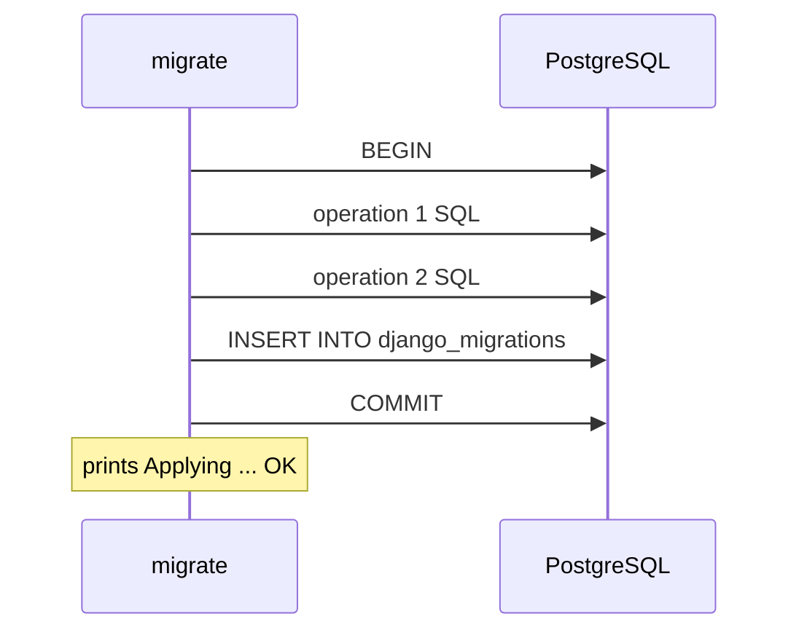

# How `migrate` Runs a Migration Inside Transactions

What `python manage.py migrate` sends to PostgreSQL for one migration file: where the transaction starts and ends, when the `django_migrations` row is written, and how `Migration.atomic` and `RunPython(atomic=...)` change that.

Verified against Django [6.1.2](https://github.com/django/django/tree/6.1.2) source; the quoted code behaves the same in 5.2.17 (only `record_migration`'s signature differs). Every scenario was run as a real migration on psycopg2 2.9.13 and psycopg 3.3.6 against PostgreSQL 16.15 and 18.6, with identical results in all eight combinations. The SQL blocks are copied from PostgreSQL's statement log (`log_statement = all`), with the `applied` timestamp shortened to `now()`. Every "Source:" link points at the commit that the `6.1.2` tag names, with line numbers.

______________________________________________________________________

## Table of Contents

01. [The Path of One Migration](#1-the-path-of-one-migration)
02. [When the Row Is Written](#2-when-the-row-is-written)
03. [Where the Transaction Comes From](#3-where-the-transaction-comes-from)
04. [`atomic = True`: One Transaction per File](#4-atomic--true-one-transaction-per-file)
05. [`atomic = False`: No Transaction at All](#5-atomic--false-no-transaction-at-all)
06. [Per-Operation Transactions](#6-per-operation-transactions)
07. [Every Combination on PostgreSQL](#7-every-combination-on-postgresql)
08. [MySQL, Oracle and SQLite](#8-mysql-oracle-and-sqlite)
09. [One Connection for the Whole Run](#9-one-connection-for-the-whole-run)
10. [Reading the SQL Before You Run It](#10-reading-the-sql-before-you-run-it)
11. [How This Was Verified](#11-how-this-was-verified)
12. [Quick Reference](#12-quick-reference)

______________________________________________________________________

## 1. The Path of One Migration

```
MigrationExecutor.apply_migration()
 └─ with connection.schema_editor(atomic=Migration.atomic)    BaseDatabaseSchemaEditor.__enter__
     │                                                          atomic_migration? -> BEGIN
     ├─ Migration.apply()
     │   └─ for each operation:
     │        atomic_operation and not atomic_migration?      -> own atomic() block
     │        operation.database_forwards()
     ├─ no deferred SQL? -> record_migration()                 INSERT INTO django_migrations
     └─ __exit__: run deferred SQL                              (FK constraints, indexes)
                  atomic_migration? -> COMMIT / ROLLBACK
 deferred SQL existed? -> record_migration()                   INSERT, after the COMMIT
 print "Applying <app>.<name>... OK"
```

______________________________________________________________________

## 2. When the Row Is Written

Source: [`db/migrations/executor.py#L241-L266`](https://github.com/django/django/blob/2212534bae393714e1e51db2341d4fd5545e19f6/django/db/migrations/executor.py#L241-L266)

```python
    def apply_migration(self, state, migration, fake=False, fake_initial=False):
        """Run a migration forwards."""
        migration_recorded = False
        if self.progress_callback:
            self.progress_callback("apply_start", migration, fake)
        if not fake:
            if fake_initial:
                # Test to see if this is an already-applied initial migration
                applied, state = self.detect_soft_applied(state, migration)
                if applied:
                    fake = True
            if not fake:
                # Alright, do it normally
                with self.connection.schema_editor(
                    atomic=migration.atomic
                ) as schema_editor:
                    state = migration.apply(state, schema_editor)
                    if not schema_editor.deferred_sql:
                        self.record_migration(migration.app_label, migration.name)
                        migration_recorded = True
        if not migration_recorded:
            self.record_migration(migration.app_label, migration.name)
        # Report progress
        if self.progress_callback:
            self.progress_callback("apply_success", migration, fake)
        return state
```

- `migration.apply()` runs every operation. If any raises, the code never reaches `record_migration()`, so no row is written.
- With no deferred SQL, the row is inserted **inside** the schema editor's block, so with `atomic = True` it is in the same transaction as the operations.
- With deferred SQL, the row is inserted **after** the block has exited, which for an atomic migration means after `COMMIT`.
- `progress_callback("apply_success", ...)` prints `OK`. It runs after the INSERT was **sent**, which is not the same as committed (see `lost-migration-row.md`).
- `--fake` skips `migration.apply()` and only runs `record_migration()`.

The INSERT itself is an ordinary `create()`:

Source: [`db/migrations/recorder.py#L99-L102`](https://github.com/django/django/blob/2212534bae393714e1e51db2341d4fd5545e19f6/django/db/migrations/recorder.py#L99-L102)

```python
    def record_applied(self, app, name):
        """Record that a migration was applied."""
        self.ensure_schema()
        self.migration_qs.create(app=app, name=name)
```

It runs in whatever transaction state the connection is in at that moment. It has no `atomic()` of its own.

______________________________________________________________________

## 3. Where the Transaction Comes From

Source: [`db/backends/base/schema.py#L162`](https://github.com/django/django/blob/2212534bae393714e1e51db2341d4fd5545e19f6/django/db/backends/base/schema.py#L162), [`#L166-L178`](https://github.com/django/django/blob/2212534bae393714e1e51db2341d4fd5545e19f6/django/db/backends/base/schema.py#L166-L178)

```python
        self.atomic_migration = self.connection.features.can_rollback_ddl and atomic
```

```python
    def __enter__(self):
        self.deferred_sql = []
        if self.atomic_migration:
            self.atomic = atomic(self.connection.alias)
            self.atomic.__enter__()
        return self

    def __exit__(self, exc_type, exc_value, traceback):
        if exc_type is None:
            for sql in self.deferred_sql:
                self.execute(sql, None)
        if self.atomic_migration:
            self.atomic.__exit__(exc_type, exc_value, traceback)
```

`atomic_migration` is fixed for the whole file. It is `True` only when the migration asked for it (`Migration.atomic`) **and** the database can roll back DDL. The transaction is a plain `transaction.atomic()`, so everything in `transactions.md` applies, including "with autocommit already off, the outermost `atomic()` is only a savepoint".

Source: [`db/migrations/migration.py#L120-L134`](https://github.com/django/django/blob/2212534bae393714e1e51db2341d4fd5545e19f6/django/db/migrations/migration.py#L120-L134)

```python
            atomic_operation = operation.atomic or (
                self.atomic and operation.atomic is not False
            )
            if not schema_editor.atomic_migration and atomic_operation:
                # Force a transaction on a non-transactional-DDL backend or an
                # atomic operation inside a non-atomic migration.
                with atomic(schema_editor.connection.alias):
                    operation.database_forwards(
                        self.app_label, schema_editor, old_state, project_state
                    )
            else:
                # Normal behavior
                operation.database_forwards(
                    self.app_label, schema_editor, old_state, project_state
                )
```

`atomic_operation` is recalculated for each operation. In words: if the file isn't already in a transaction, but this operation wants one, give it its own. The defaults that feed it:

| Attribute                                                   | Default                                                                    | Source                                                                                                                                                                                                                                                                                                                                                                                                                                                                             |
| ----------------------------------------------------------- | -------------------------------------------------------------------------- | ---------------------------------------------------------------------------------------------------------------------------------------------------------------------------------------------------------------------------------------------------------------------------------------------------------------------------------------------------------------------------------------------------------------------------------------------------------------------------------- |
| `Migration.atomic`                                          | `True`                                                                     | [`migration.py#L51-L53`](https://github.com/django/django/blob/2212534bae393714e1e51db2341d4fd5545e19f6/django/db/migrations/migration.py#L51-L53)                                                                                                                                                                                                                                                                                                                                 |
| `Operation.atomic` (`AddField`, `CreateModel`, `RunSQL`, …) | `False`                                                                    | [`operations/base.py#L39-L41`](https://github.com/django/django/blob/2212534bae393714e1e51db2341d4fd5545e19f6/django/db/migrations/operations/base.py#L39-L41)                                                                                                                                                                                                                                                                                                                     |
| `RunPython(atomic=...)`                                     | `None` ("no preference")                                                   | [`operations/special.py#L150-L153`](https://github.com/django/django/blob/2212534bae393714e1e51db2341d4fd5545e19f6/django/db/migrations/operations/special.py#L150-L153)                                                                                                                                                                                                                                                                                                           |
| `can_rollback_ddl`                                          | `True` on PostgreSQL and SQLite, `False` on the base class (MySQL, Oracle) | [`postgresql/features.py#L32`](https://github.com/django/django/blob/2212534bae393714e1e51db2341d4fd5545e19f6/django/db/backends/postgresql/features.py#L32), [`sqlite3/features.py#L20`](https://github.com/django/django/blob/2212534bae393714e1e51db2341d4fd5545e19f6/django/db/backends/sqlite3/features.py#L20), [`base/features.py#L176-L177`](https://github.com/django/django/blob/2212534bae393714e1e51db2341d4fd5545e19f6/django/db/backends/base/features.py#L176-L177) |

______________________________________________________________________

## 4. `atomic = True`: One Transaction per File

There is **one** transaction for the whole file, not one per operation. Two `AddField` operations, logged:

```sql
BEGIN
ALTER TABLE "demo_item" ADD COLUMN "label" varchar(10) DEFAULT '' NOT NULL
ALTER TABLE "demo_item" ALTER COLUMN "label" DROP DEFAULT
ALTER TABLE "demo_item" ADD COLUMN "note" varchar(10) DEFAULT '' NOT NULL
ALTER TABLE "demo_item" ALTER COLUMN "note" DROP DEFAULT
INSERT INTO "django_migrations" ("app", "name", "applied") VALUES ('demo', '0002_step', now()) ...
COMMIT
```



If the second operation fails, everything rolls back, the first operation and the row included. Measured with `AddField` followed by a failing `RunSQL`: after the error the new column did not exist and no row was written.

### With deferred SQL

Operations that create foreign keys or indexes queue that SQL to run at the end of the block. The INSERT then moves after `COMMIT`. A `CreateModel` with a `ForeignKey`, logged:

```sql
BEGIN
CREATE TABLE "demo_child" ("id" bigint NOT NULL PRIMARY KEY GENERATED BY DEFAULT AS IDENTITY, "item_id" bigint NOT NULL)
ALTER TABLE "demo_child" ADD CONSTRAINT "demo_child_item_id_c439086b_fk_demo_item_id" FOREIGN KEY ("item_id") REFERENCES "demo_item" ...
CREATE INDEX "demo_child_item_id_c439086b" ON "demo_child" ("item_id")
COMMIT
INSERT INTO "django_migrations" ("app", "name", "applied") VALUES ('demo', '0002_step', now()) ...
```

The INSERT is still a single statement with no `atomic()` of its own. With autocommit on, as normal, it commits immediately.

______________________________________________________________________

## 5. `atomic = False`: No Transaction at All

There is no transaction around the file, and none per operation either. With autocommit on, every statement commits as it runs:

```sql
ALTER TABLE "demo_item" ADD COLUMN "label" varchar(10) DEFAULT '' NOT NULL
ALTER TABLE "demo_item" ALTER COLUMN "label" DROP DEFAULT
ALTER TABLE "demo_item" ADD COLUMN "note" varchar(10) DEFAULT '' NOT NULL
ALTER TABLE "demo_item" ALTER COLUMN "note" DROP DEFAULT
INSERT INTO "django_migrations" ("app", "name", "applied") VALUES ('demo', '0002_step', now()) ...
```

There is no `BEGIN` or `COMMIT` anywhere: one operation can emit several statements, and each commits separately.

### A failure leaves the migration half-applied

`AddField`, then a `RunSQL` that fails:

```sql
ALTER TABLE "demo_item" ADD COLUMN "label" varchar(10) DEFAULT '' NOT NULL
ALTER TABLE "demo_item" ALTER COLUMN "label" DROP DEFAULT
SELECT * FROM table_that_does_not_exist
-- ERROR: relation "table_that_does_not_exist" does not exist
```

|                         | After the failed run                                                    | After a rerun                                                             |
| ----------------------- | ----------------------------------------------------------------------- | ------------------------------------------------------------------------- |
| Column `label`          | exists (committed)                                                      | exists                                                                    |
| `django_migrations` row | none                                                                    | none                                                                      |
| `migrate` output        | `ProgrammingError: relation "table_that_does_not_exist" does not exist` | `ProgrammingError: column "label" of relation "demo_item" already exists` |

The rerun starts again at the first operation and fails on work the first run already committed. The fix is in how the migration is written: keep non-atomic migrations to the operations that need it (usually a single `CONCURRENTLY` index), and make each statement idempotent with `IF NOT EXISTS` / `IF EXISTS`.

`atomic = False` doesn't change autocommit; it only stops Django from turning it off:

|                                                        | Before the migration | During the operations       | After                                        |
| ------------------------------------------------------ | -------------------- | --------------------------- | -------------------------------------------- |
| `atomic = True`                                        | on                   | **off** (inside `atomic()`) | on                                           |
| `atomic = False`                                       | on                   | on                          | on                                           |
| `atomic = False` + a helper that forces autocommit off | on                   | on                          | **off** (the bug in `lost-migration-row.md`) |

______________________________________________________________________

## 6. Per-Operation Transactions

`RunPython(..., atomic=True)` inside an `atomic = False` migration gets its own transaction:

```python
class Migration(migrations.Migration):
    atomic = False
    operations = [
        migrations.AddField("item", "label", models.CharField(max_length=10, default="")),
        migrations.RunPython(fill, migrations.RunPython.noop, atomic=True),
    ]
```

```sql
ALTER TABLE "demo_item" ADD COLUMN "label" varchar(10) DEFAULT '' NOT NULL
ALTER TABLE "demo_item" ALTER COLUMN "label" DROP DEFAULT
BEGIN
INSERT INTO "demo_item" ("code", "label") VALUES (10, '') RETURNING "demo_item"."id"
INSERT INTO "demo_item" ("code", "label") VALUES (11, '') RETURNING "demo_item"."id"
COMMIT
INSERT INTO "django_migrations" ("app", "name", "applied") VALUES ('demo', '0002_step', now()) ...
```

The reverse doesn't work: `RunPython(..., atomic=False)` can't escape an `atomic = True` migration. Because `atomic_migration` is `True`, the `if` in `Migration.apply()` is false and the operation runs in the migration's transaction. Measured: a `CREATE INDEX CONCURRENTLY` in `RunPython(..., atomic=False)` inside a default migration failed with `CREATE INDEX CONCURRENTLY cannot run inside a transaction block`.

______________________________________________________________________

## 7. Every Combination on PostgreSQL

| `Migration.atomic` | Operation                                         | Transaction it runs in                  |
| ------------------ | ------------------------------------------------- | --------------------------------------- |
| `True`             | any schema operation                              | the one migration transaction           |
| `True`             | `RunPython(...)` / `RunPython(..., atomic=True)`  | the one migration transaction           |
| `True`             | `RunPython(..., atomic=False)`                    | **still** the one migration transaction |
| `False`            | any schema operation, `RunSQL`                    | none; each statement commits            |
| `False`            | `RunPython(...)` / `RunPython(..., atomic=False)` | none; each statement commits            |
| `False`            | `RunPython(..., atomic=True)`                     | its own `BEGIN … COMMIT`                |

What fails inside a transaction, measured:

| Migration                                                               | Result                                                                                                                                 |
| ----------------------------------------------------------------------- | -------------------------------------------------------------------------------------------------------------------------------------- |
| `atomic = True` + `RunSQL("CREATE INDEX CONCURRENTLY ...")`             | `CREATE INDEX CONCURRENTLY cannot run inside a transaction block`                                                                      |
| `atomic = True` + `RunPython(..., atomic=False)` running `CONCURRENTLY` | same error                                                                                                                             |
| `atomic = True` + `AddIndexConcurrently(...)`                           | `NotSupportedError: The AddIndexConcurrently operation cannot be executed inside a transaction (set atomic = False on the migration).` |
| `atomic = True` + `RunPython` calling `connection.set_autocommit(...)`  | `TransactionManagementError: This is forbidden when an 'atomic' block is active.`                                                      |
| `atomic = False` + any of the `CONCURRENTLY` forms above                | works, with psycopg2 and psycopg 3                                                                                                     |

______________________________________________________________________

## 8. MySQL, Oracle and SQLite

These were not run; they follow from the source in section 3.

On backends with `can_rollback_ddl = False` (MySQL, Oracle), `atomic_migration` is always `False`, so there is never a file-level transaction. `Migration.atomic` then only decides the default for `RunPython`:

| Operation                                                 | `Migration.atomic = True` | `Migration.atomic = False` |
| --------------------------------------------------------- | ------------------------- | -------------------------- |
| `AddField`, `CreateModel`, … (`Operation.atomic = False`) | no transaction            | no transaction             |
| `RunPython(...)` (`atomic=None`)                          | **own transaction**       | no transaction             |
| `RunPython(..., atomic=True)`                             | own transaction           | own transaction            |
| `RunPython(..., atomic=False)`                            | no transaction            | no transaction             |

Schema operations can't be protected there anyway: MySQL commits implicitly around each DDL statement, so a failed migration is always half-applied.

SQLite has `can_rollback_ddl = True`, so it behaves like PostgreSQL in section 7.

______________________________________________________________________

## 9. One Connection for the Whole Run

Every migration in one `migrate` command, in every app, runs on the same database connection, and autocommit is a property of that connection. Django doesn't reset it between migrations. So a migration that leaves autocommit off affects every migration after it in that run:

| Later migration                           | What happens                                                                                                                                                                |
| ----------------------------------------- | --------------------------------------------------------------------------------------------------------------------------------------------------------------------------- |
| `atomic = True`                           | `atomic()` finds autocommit off, behaves as a nested block (a savepoint), and never commits. It prints `OK`; its changes and its row are rolled back when the process exits |
| `atomic = False` using `CONCURRENTLY`     | fails with `cannot run inside a transaction block`                                                                                                                          |
| Anything that calls `connection.commit()` | commits everything pending up to that point, including earlier migrations' rows                                                                                             |

A new `migrate` process opens a new connection, and Django sets autocommit from the `AUTOCOMMIT` setting (default `True`) on every new connection. So each run starts clean, and repeats the problem when it reaches the same migration. `lost-migration-row.md` walks through both directions with logged SQL.

______________________________________________________________________

## 10. Reading the SQL Before You Run It

`python manage.py sqlmigrate <app> <name>` prints what a migration would send. An atomic migration is wrapped:

```sql
BEGIN;
--
-- Add field label to item
--
ALTER TABLE "demo_item" ADD COLUMN "label" varchar(10) DEFAULT '' NOT NULL;
ALTER TABLE "demo_item" ALTER COLUMN "label" DROP DEFAULT;
COMMIT;
```

A non-atomic one has no `BEGIN;` / `COMMIT;`. `RunPython` can't be shown:

```sql
--
-- Raw Python operation
--
-- THIS OPERATION CANNOT BE WRITTEN AS SQL
```

So for `RunPython`, read the function. Anything there that touches the connection directly (`set_autocommit`, `commit`, `rollback`) changes the transaction state for every later migration in the run.

______________________________________________________________________

## 11. How This Was Verified

- **Matrix:** Django 5.2.17 and 6.1.2, psycopg2-binary 2.9.13 and psycopg 3.3.6, PostgreSQL 16.15 and 18.6 in Docker: eight combinations, 17 migration scenarios each, identical outcomes in every combination.
- **Method:** a minimal Django project; for each scenario the schema was reset, migration files written, `migrate` run (and rerun where relevant), then `django_migrations`, the table's columns and its indexes (with `indisvalid`) were read back with `psql`.
- **SQL:** PostgreSQL ran with `log_statement = all`; the statements of the `migrate` session between two marker queries are what the SQL blocks above show.
- **Not run:** MySQL, Oracle, SQLite (section 8 follows from the source).

______________________________________________________________________

## 12. Quick Reference

| Question                                            | Answer                                                                             |
| --------------------------------------------------- | ---------------------------------------------------------------------------------- |
| One transaction per operation or per file?          | Per file, with `atomic = True` on PostgreSQL                                       |
| Is the row in that transaction?                     | Yes, unless the file queued deferred SQL; then it is inserted right after `COMMIT` |
| When is the row written?                            | Only after every operation succeeded                                               |
| Does `OK` mean committed?                           | No; it means the INSERT was sent                                                   |
| `atomic = False` and an operation fails?            | Earlier statements stay committed, no row, rerun fails on "already exists"         |
| `RunPython(atomic=True)` in a non-atomic migration? | Its own `BEGIN … COMMIT`                                                           |
| `RunPython(atomic=False)` in an atomic migration?   | Still inside the migration's transaction                                           |
| Autocommit left off by one migration?               | Off for every later migration in that `migrate` run, in every app                  |
| `--fake`?                                           | Writes the row without running any operation                                       |
