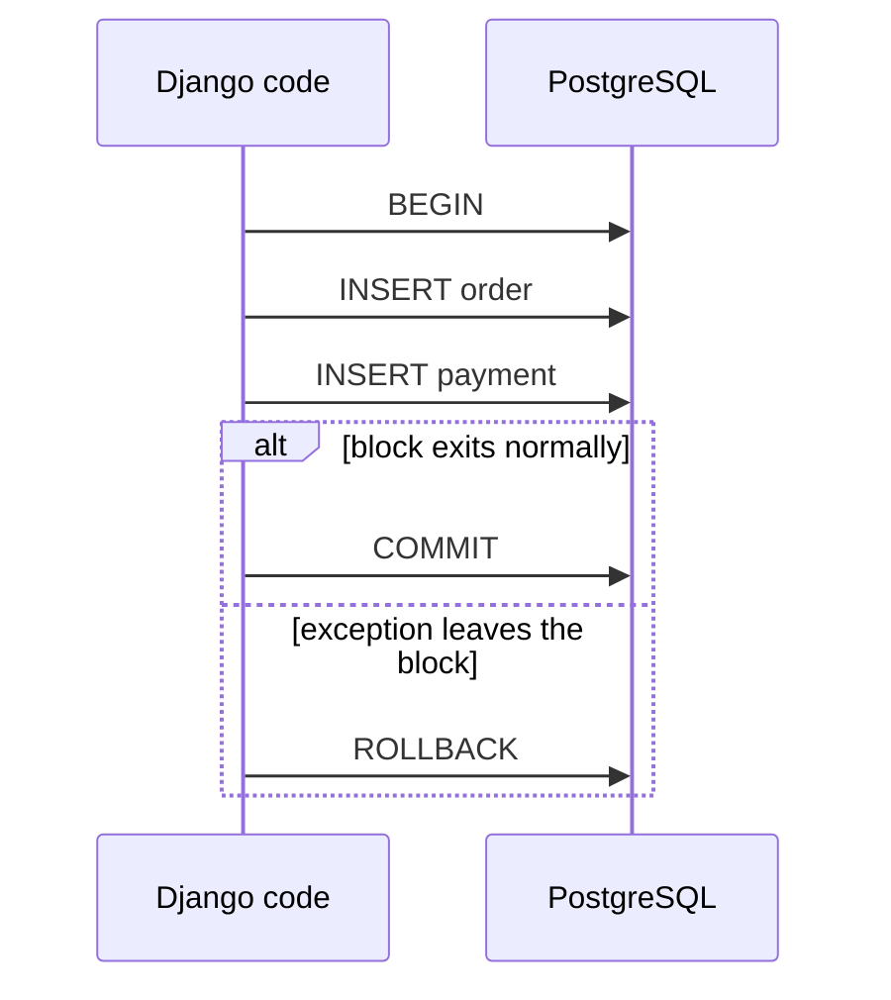
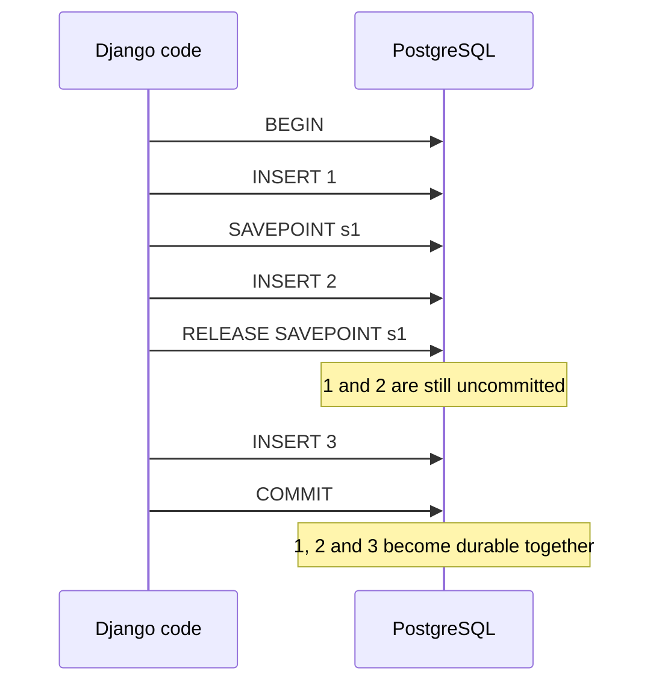
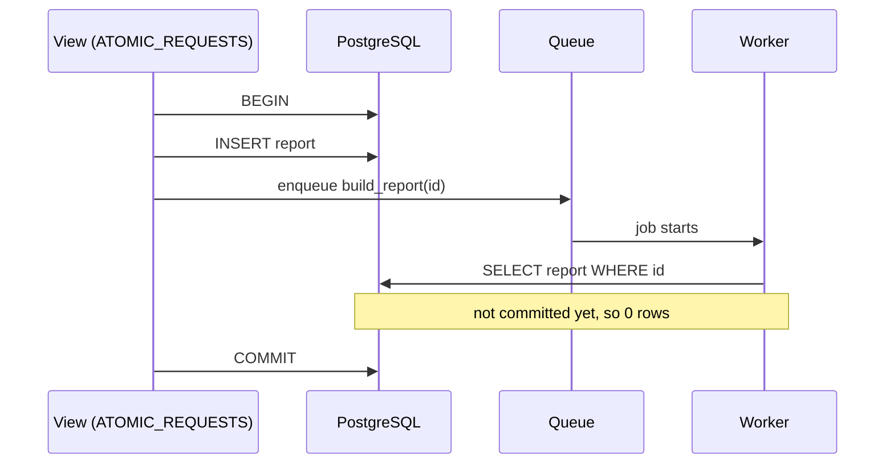

# Django Transactions on PostgreSQL

What Django, the database driver and PostgreSQL each do when your code runs queries, opens `atomic()` blocks, hits an error, or turns autocommit off.

Verified against Django [6.1.2](https://github.com/django/django/tree/6.1.2) source; the code quoted here behaves the same in 5.2.17. Every behaviour was run on psycopg2 2.9.13 and psycopg 3.3.6, against PostgreSQL 16.15 and 18.6, with identical results in all eight combinations. The SQL blocks are copied from PostgreSQL's statement log (`log_statement = all`), so they show what the server actually received, including the `BEGIN` and `COMMIT` that the driver sends on its own. Every "Source:" link points at the commit that the `6.1.2` tag names, with line numbers.

______________________________________________________________________

## Table of Contents

01. [Three Layers, One Connection](#1-three-layers-one-connection)
02. [Autocommit: PEP 249 vs Django](#2-autocommit-pep-249-vs-django)
03. [One `atomic()` Block](#3-one-atomic-block)
04. [Nested `atomic()` Is a Savepoint](#4-nested-atomic-is-a-savepoint)
05. [Recovering From an Error Inside a Transaction](#5-recovering-from-an-error-inside-a-transaction)
06. [PostgreSQL's Aborted Transaction](#6-postgresqls-aborted-transaction)
07. [`savepoint=False` and `durable=True`](#7-savepointfalse-and-durabletrue)
08. [`on_commit` and `ATOMIC_REQUESTS`](#8-on_commit-and-atomic_requests)
09. [Transactions Django Opens for You](#9-transactions-django-opens-for-you)
10. [Row Locks With `select_for_update()`](#10-row-locks-with-select_for_update)
11. [Turning Autocommit Off](#11-turning-autocommit-off)
12. [How This Was Verified](#12-how-this-was-verified)
13. [Quick Reference](#13-quick-reference)

______________________________________________________________________

## 1. Three Layers, One Connection

```
  your code            Django                         driver                   PostgreSQL
 ───────────    ─────────────────────────    ──────────────────────    ─────────────────────────
 Model.save()   transaction.atomic()         psycopg2 / psycopg 3      session state:
 cursor()       connection.autocommit        conn.autocommit           idle
 try/except     in_atomic_block              sends BEGIN when          idle in transaction
                needs_rollback               autocommit is off         idle in transaction (aborted)
```

Each layer keeps its own state, and they can disagree. Most surprises in this document come from one layer changing state without the others knowing: Python catching an exception that PostgreSQL still considers fatal, or a helper switching the driver's autocommit off while Django's `atomic()` assumes it is on.

______________________________________________________________________

## 2. Autocommit: PEP 249 vs Django

PEP 249, the database API every Python driver implements, gives connections `commit()` and `rollback()` but no `begin()`, and says:

> Note that if the database supports an auto-commit feature, this must be initially off.

([PEP 249, Connection Methods](https://peps.python.org/pep-0249/#commit))

With no `begin()`, the driver starts transactions itself: when autocommit is off and no transaction is open, it sends `BEGIN` before your next statement. Measured with a raw connection, no Django involved:

| Raw driver connection   | `autocommit` at start | Transaction status after `SELECT 1` |
| ----------------------- | --------------------- | ----------------------------------- |
| `psycopg2.connect(...)` | `False`               | `INTRANS` (a `BEGIN` was sent)      |
| `psycopg.connect(...)`  | `False`               | `INTRANS` (a `BEGIN` was sent)      |

Django reverses that default. From its documentation ([`docs/topics/db/transactions.txt`](https://github.com/django/django/blob/2212534bae393714e1e51db2341d4fd5545e19f6/docs/topics/db/transactions.txt#L272-L274)):

> PEP 249, the Python Database API Specification v2.0, requires autocommit to be initially turned off. Django overrides this default and turns autocommit on.

Source: [`db/utils.py#L163-L164`](https://github.com/django/django/blob/2212534bae393714e1e51db2341d4fd5545e19f6/django/db/utils.py#L163-L164), [`db/backends/base/base.py#L257`](https://github.com/django/django/blob/2212534bae393714e1e51db2341d4fd5545e19f6/django/db/backends/base/base.py#L257)

```python
            conn.setdefault("ATOMIC_REQUESTS", False)
            conn.setdefault("AUTOCOMMIT", True)
```

```python
        self.set_autocommit(self.settings_dict["AUTOCOMMIT"])
```

The second line runs in `connect()`, so every new connection starts with autocommit on, whatever the previous connection did. Measured through Django with the default settings:

| Through Django  | `connection.get_autocommit()` | Driver status after `SELECT 1` |
| --------------- | ----------------------------- | ------------------------------ |
| psycopg2 2.9.13 | `True`                        | `IDLE`                         |
| psycopg 3.3.6   | `True`                        | `IDLE`                         |

So under Django's default, there is no hidden "implicit transaction" left open by earlier queries, with either driver. A cursor (`with connection.cursor() as cur:`) is only a handle for sending SQL; opening or closing it never begins or ends a transaction.

The trade-off between the two defaults:

| Default                 | What a forgotten step costs                                                                                                                            |
| ----------------------- | ------------------------------------------------------------------------------------------------------------------------------------------------------ |
| PEP 249: autocommit off | A forgotten `commit()` silently loses every write since the last commit, and the session sits "idle in transaction", holding locks and an old snapshot |
| Django: autocommit on   | A forgotten `atomic()` saves each statement on its own, so a crash halfway through leaves partial writes                                               |

Django picks the failure that is visible, and gives you `atomic()` to opt into all-or-nothing behaviour where you need it.

______________________________________________________________________

## 3. One `atomic()` Block

```python
from django.db import transaction

with transaction.atomic():
    order.save()
    payment.save()     # if this raises, order.save() is rolled back too
```



Entering the block sends nothing to PostgreSQL: Django only switches the driver's autocommit off, and the driver sends `BEGIN` together with the first query. On exit Django commits or rolls back and turns autocommit back on. Measured:

| Code                                                    | Statements PostgreSQL received                                       |
| ------------------------------------------------------- | -------------------------------------------------------------------- |
| `with transaction.atomic(): pass`                       | none, not even `BEGIN` or `COMMIT`                                   |
| `with transaction.atomic():`, sleep 1 s, then one query | `BEGIN` and the query, both 1 s after the `with` line, then `COMMIT` |
| One query with autocommit on, no `atomic()`             | the query only; no `BEGIN`, no `COMMIT`                              |

So a transaction starts at the first query inside the block, and with autocommit on Django sends no transaction commands at all: PostgreSQL runs each statement as its own transaction.

______________________________________________________________________

## 4. Nested `atomic()` Is a Savepoint

```python
with transaction.atomic():          # outermost: a real transaction
    insert(1)
    with transaction.atomic():      # nested: a savepoint
        insert(2)
    insert(3)
```

Logged SQL:

```sql
BEGIN
INSERT INTO t VALUES (1)
SAVEPOINT "s134520318068544_x1"
INSERT INTO t VALUES (2)
RELEASE SAVEPOINT "s134520318068544_x1"
INSERT INTO t VALUES (3)
COMMIT
```



Releasing a savepoint saves nothing. Only the outermost block's `COMMIT` makes the work durable, so if the outer block later fails, the inner block's rows go with it.

Source: [`db/transaction.py#L193-L233`](https://github.com/django/django/blob/2212534bae393714e1e51db2341d4fd5545e19f6/django/db/transaction.py#L193-L233)

```python
    def __enter__(self):
        connection = get_connection(self.using)

        if (
            self.durable
            and connection.atomic_blocks
            and not connection.atomic_blocks[-1]._from_testcase
        ):
            raise RuntimeError(
                "A durable atomic block cannot be nested within another "
                "atomic block."
            )
        if not connection.in_atomic_block:
            # Reset state when entering an outermost atomic block.
            connection.commit_on_exit = True
            connection.needs_rollback = False
            if not connection.get_autocommit():
                # Pretend we're already in an atomic block to bypass the code
                # that disables autocommit to enter a transaction, and make a
                # note to deal with this case in __exit__.
                connection.in_atomic_block = True
                connection.commit_on_exit = False

        if connection.in_atomic_block:
            # We're already in a transaction; create a savepoint, unless we
            # were told not to or we're already waiting for a rollback. The
            # second condition avoids creating useless savepoints and prevents
            # overwriting needs_rollback until the rollback is performed.
            if self.savepoint and not connection.needs_rollback:
                sid = connection.savepoint()
                connection.savepoint_ids.append(sid)
            else:
                connection.savepoint_ids.append(None)
        else:
            connection.set_autocommit(
                False, force_begin_transaction_with_broken_autocommit=True
            )
            connection.in_atomic_block = True

        if connection.in_atomic_block:
            connection.atomic_blocks.append(self)
```

Three things in this method matter later:

- the `durable` check at the top (section 7);
- the `not connection.get_autocommit()` branch, which makes an outermost block behave like a nested one when autocommit is already off (section 11);
- `savepoint and not connection.needs_rollback`, which is why `savepoint=False` creates nothing (section 7).

______________________________________________________________________

## 5. Recovering From an Error Inside a Transaction

### The pattern that works

Wrap only the risky statement in its own `atomic()` and catch the exception **outside** it:

```python
with transaction.atomic():
    insert(10)
    try:
        with transaction.atomic():
            insert(11)
            insert(10)                 # IntegrityError: duplicate key
    except IntegrityError:
        pass
    insert(12)
# committed rows: 10, 12
```

Logged SQL:

```sql
BEGIN
INSERT INTO t VALUES (10)
SAVEPOINT "s134520318068544_x2"
INSERT INTO t VALUES (11)
INSERT INTO t VALUES (10)
-- ERROR: duplicate key value violates unique constraint "t_pkey"
ROLLBACK TO SAVEPOINT "s134520318068544_x2"
RELEASE SAVEPOINT "s134520318068544_x2"
INSERT INTO t VALUES (12)
COMMIT
```

The inner block's exit sees the exception and sends `ROLLBACK TO SAVEPOINT`, which undoes 11 and the failed insert, and clears PostgreSQL's aborted state. The outer transaction carries on.

### The pattern that breaks

Catching the error inside `atomic()` without an inner block:

```python
with transaction.atomic():
    T.objects.create(id=22)
    try:
        T.objects.create(id=22)        # IntegrityError
    except IntegrityError:
        pass
    T.objects.create(id=23)            # raises
```

What the next query raises depends on how it is issued:

| How the failed query ran                     | What the next query raises                                                                                                                 |
| -------------------------------------------- | ------------------------------------------------------------------------------------------------------------------------------------------ |
| ORM (`create()`, `save()`, queryset methods) | `TransactionManagementError: An error occurred in the current transaction. You can't execute queries until the end of the 'atomic' block.` |
| Raw `cursor.execute()`                       | `InternalError: current transaction is aborted, commands ignored until end of transaction block` (PostgreSQL's own error)                  |

In both cases the block's exit sends `ROLLBACK`, and nothing from the block is saved, 22 included.

The ORM case fails earlier because ORM queries run inside `mark_for_rollback_on_error()`, which flags the Django connection as soon as a query raises inside an atomic block. A raw cursor doesn't set that flag, so the next query reaches PostgreSQL and is refused there.

Source: [`db/transaction.py#L130-L137`](https://github.com/django/django/blob/2212534bae393714e1e51db2341d4fd5545e19f6/django/db/transaction.py#L130-L137), [`db/models/base.py#L983-L987`](https://github.com/django/django/blob/2212534bae393714e1e51db2341d4fd5545e19f6/django/db/models/base.py#L983-L987)

```python
    try:
        yield
    except Exception as exc:
        connection = get_connection(using)
        if connection.in_atomic_block:
            connection.needs_rollback = True
            connection.rollback_exc = exc
        raise
```

```python
        # A transaction isn't needed if one query is issued.
        if meta.parents:
            context_manager = transaction.atomic(using=using, savepoint=False)
        else:
            context_manager = transaction.mark_for_rollback_on_error(using=using)
```

Source: [`db/backends/base/base.py#L519-L524`](https://github.com/django/django/blob/2212534bae393714e1e51db2341d4fd5545e19f6/django/db/backends/base/base.py#L519-L524)

```python
    def validate_no_broken_transaction(self):
        if self.needs_rollback:
            raise TransactionManagementError(
                "An error occurred in the current transaction. You can't "
                "execute queries until the end of the 'atomic' block."
            ) from self.rollback_exc
```

______________________________________________________________________

## 6. PostgreSQL's Aborted Transaction

Python and PostgreSQL keep separate state, and `try/except` only changes Python's. When a statement fails inside a transaction, PostgreSQL marks the whole transaction as failed. Catching the exception sends nothing to the server, so the server never hears that you "handled" it.

Measured with a raw psycopg 3 connection (autocommit off), after two good inserts and one duplicate:

| Check                                     | Result                                                                                                    |
| ----------------------------------------- | --------------------------------------------------------------------------------------------------------- |
| `pg_stat_activity.state` for that session | `idle in transaction (aborted)`                                                                           |
| Next statement (`SELECT 1`)               | `InFailedSqlTransaction: current transaction is aborted, commands ignored until end of transaction block` |
| Server's reply to `COMMIT`                | `ROLLBACK`                                                                                                |
| Rows saved                                | 0, the two good inserts included                                                                          |

```sql
BEGIN;
INSERT INTO orders VALUES (1);      -- OK, but only pending
INSERT INTO orders VALUES (2);      -- OK, but only pending
INSERT INTO orders VALUES (2);      -- ERROR: duplicate key
SELECT 1;                           -- ERROR: current transaction is aborted ...
COMMIT;                             -- server replies ROLLBACK: orders 1 and 2 are gone
```

### Why PostgreSQL waits for the client instead of ending the transaction

PostgreSQL discards the transaction's work immediately; it can never commit. What it won't do is end the transaction on its own, because the client still believes it is inside one:

```sql
BEGIN;
UPDATE accounts SET balance = balance - 100 WHERE id = 1;   -- fails
UPDATE accounts SET balance = balance + 100 WHERE id = 2;   -- ?
COMMIT;
```

If the server ended the transaction at the first error, the second `UPDATE` would run in autocommit and be saved: account 2 would gain money never taken from account 1. Refusing every statement until `ROLLBACK` keeps the unit all-or-nothing, keeps the failure loud, and keeps client and server agreeing on whether a transaction is open.

It also can't choose the rollback for you, because the client may want to keep part of the work:

```sql
BEGIN;
INSERT INTO orders VALUES (1);      -- before the savepoint
SAVEPOINT s1;
INSERT INTO orders VALUES (1);      -- ERROR: duplicate key
ROLLBACK TO SAVEPOINT s1;           -- undoes only the work after s1
COMMIT;                             -- order 1 is saved
```

Measured: the rows after that `COMMIT` were `[1]`. A nested `atomic()` relies on exactly this.

______________________________________________________________________

## 7. `savepoint=False` and `durable=True`

### `atomic(savepoint=False)`

An inner block that creates no savepoint has nothing to roll back to:

```python
with transaction.atomic():
    insert(30)
    try:
        with transaction.atomic(savepoint=False):
            insert(30)                 # IntegrityError
    except IntegrityError:
        pass
    insert(31)                         # TransactionManagementError
```

```sql
BEGIN
INSERT INTO t VALUES (30)
INSERT INTO t VALUES (30)
-- ERROR: duplicate key value violates unique constraint "t_pkey"
ROLLBACK
```

There is no `SAVEPOINT` in the log. The failure marks the whole outer transaction for rollback, the next query raises `TransactionManagementError`, and nothing is saved. Use `savepoint=False` only where a failure should abort everything anyway; it saves the savepoint round trips.

### `atomic(durable=True)`

```python
with transaction.atomic():
    with transaction.atomic(durable=True):   # RuntimeError
        ...
```

`RuntimeError: A durable atomic block cannot be nested within another atomic block.` Mark a block durable where its work must be committed when the block ends, for example before calling another system that will read the data. The check turns "this was silently nested in someone else's transaction" into an error.

______________________________________________________________________

## 8. `on_commit` and `ATOMIC_REQUESTS`

### `transaction.on_commit(fn)`

Registers `fn` to run after the current transaction commits. Measured order of events:

```python
with transaction.atomic():
    with transaction.atomic():
        transaction.on_commit(lambda: log("callback ran"))
        log("inner block exited next")
    log("outer block still open")
log("after outer exit")
```

```
inner block exited next
outer block still open
callback ran            <- only after the outermost COMMIT
after outer exit
```

A callback registered in a block that rolls back never runs.

Source: [`db/transaction.py#L140-L145`](https://github.com/django/django/blob/2212534bae393714e1e51db2341d4fd5545e19f6/django/db/transaction.py#L140-L145)

```python
def on_commit(func, using=None, robust=False):
    """
    Register `func` to be called when the current transaction is committed.
    If the current transaction is rolled back, `func` will not be called.
    """
    get_connection(using).on_commit(func, robust)
```

### `ATOMIC_REQUESTS = True`

Django wraps each view in `atomic()`. The view is then the outermost block, every `atomic()` in code it calls is a savepoint, and nothing commits until the view returns. It applies only to views: management commands, migrations and background workers run without it.

The common bug is enqueueing a job during the request:



Enqueue through `on_commit` instead, so the job starts only after the row exists:

```python
transaction.on_commit(lambda: build_report.delay(report.id))
```

______________________________________________________________________

## 9. Transactions Django Opens for You

Transactions are not rare even if you never write `atomic()`:

| Where                                     | What Django does                              | Source                                                                                                                                         |
| ----------------------------------------- | --------------------------------------------- | ---------------------------------------------------------------------------------------------------------------------------------------------- |
| Every view, with `ATOMIC_REQUESTS = True` | wraps the view in `atomic()`                  | section 8                                                                                                                                      |
| Every migration, unless `atomic = False`  | wraps the migration in `atomic()`             | `transactions-in-migrate.md`                                                                                                                   |
| `get_or_create()`                         | runs the `INSERT` in `atomic()`               | [`query.py#L1075-L1077`](https://github.com/django/django/blob/2212534bae393714e1e51db2341d4fd5545e19f6/django/db/models/query.py#L1075-L1077) |
| `update_or_create()`                      | runs the lock, update or create in `atomic()` | [`query.py#L1109`](https://github.com/django/django/blob/2212534bae393714e1e51db2341d4fd5545e19f6/django/db/models/query.py#L1109)             |
| `save()` on a model with parent tables    | `atomic(savepoint=False)`                     | [`base.py#L983-L987`](https://github.com/django/django/blob/2212534bae393714e1e51db2341d4fd5545e19f6/django/db/models/base.py#L983-L987)       |

`get_or_create()` with autocommit on, logged:

```sql
SELECT "u"."id" FROM "u" WHERE "u"."id" = 1 LIMIT 21
BEGIN
INSERT INTO "u" ("id") VALUES (1)
COMMIT
```

`select_for_update()` takes row locks, and a lock has to belong to a transaction, so outside one it refuses to run:

Source: [`db/models/sql/compiler.py#L859-L868`](https://github.com/django/django/blob/2212534bae393714e1e51db2341d4fd5545e19f6/django/db/models/sql/compiler.py#L859-L868)

```python
                if self.query.select_for_update and features.has_select_for_update:
                    if (
                        self.connection.get_autocommit()
                        # Don't raise an exception when database doesn't
                        # support transactions, as it's a noop.
                        and features.supports_transactions
                    ):
                        raise TransactionManagementError(
                            "select_for_update cannot be used outside of a transaction."
                        )
```

Write your own `atomic()` whenever several writes must succeed or fail together: an order and its line items, moving stock or money between rows, a record and its audit entry, a loader that deletes old rows and inserts new ones.

______________________________________________________________________

## 10. Row Locks With `select_for_update()`

`select_for_update()` adds `FOR UPDATE` to the query, which locks the selected rows. PostgreSQL holds a row lock until the **transaction** ends, not until the `SELECT` finishes. That is why Django only allows it inside a transaction (section 9): with autocommit on, the statement would be its own transaction and the lock would be gone before your next line of Python runs.

```python
with transaction.atomic():
    acct = Acct.objects.select_for_update().get(id=2)   # row locked from here
    # application logic: validation, branching, other queries; the row stays locked
    acct.balance -= 30
    acct.save(update_fields=["balance"])
# COMMIT: lock released
```

Two workers running that block at the same moment, logged with timestamps:

```sql
06.450 W1 BEGIN
06.451 W1 SELECT ... FROM "acct" WHERE "acct"."id" = 2 LIMIT 21 FOR UPDATE
06.456 W2 BEGIN
06.456 W2 SELECT ... FROM "acct" WHERE "acct"."id" = 2 LIMIT 21 FOR UPDATE   -- waits for W1
06.953 W1 UPDATE "acct" SET "balance" = 70 WHERE "acct"."id" = 2
06.954 W1 COMMIT                                                         -- W2's SELECT returns now, seeing 70
07.484 W2 UPDATE "acct" SET "balance" = 40 WHERE "acct"."id" = 2
07.485 W2 COMMIT
```

The Python lines map to SQL like this: `atomic()` sends nothing itself; `select_for_update().get()` sends `BEGIN` and the `SELECT … FOR UPDATE`; pure Python in between sends nothing and the row stays locked; `save()` sends the `UPDATE`; leaving the block sends `COMMIT`. Any query inside the block, including ones in functions it calls, runs in the same transaction.

### The lost update it prevents

Two workers each subtract 30 from a balance of 100 after 0.5 s of application logic. Measured at `READ COMMITTED`, Django's default, on all eight combinations. With `OPTIONS["isolation_level"]` set to `REPEATABLE READ` or `SERIALIZABLE`, the second writer gets `could not serialize access due to concurrent update` instead of losing the update, and must retry (see the `postgres` skill's `references/isolation-levels.md`).

| Pattern                                                     | Final balance           | Both workers took               |
| ----------------------------------------------------------- | ----------------------- | ------------------------------- |
| `get()`, compute, `save()`; no lock                         | **70**: one update lost | 0.6 s                           |
| `atomic()` + `select_for_update().get()`, compute, `save()` | 40                      | 1.1 s: the second worker waited |
| `filter(id=2).update(balance=F("balance") - 30)`            | 40                      | 0.6 s                           |

When the new value can be written as an expression, `F()` needs no lock: the single `UPDATE` reads and writes the current value in the database. Use `select_for_update()` when the decision needs Python logic, and keep that transaction short, because every other writer of the row waits for it. Under `ATOMIC_REQUESTS` the lock lasts until the view returns.

### The options and the SQL they produce

Logged from Django 6.1.2:

| Django                                                    | SQL suffix                              | Effect                                                |
| --------------------------------------------------------- | --------------------------------------- | ----------------------------------------------------- |
| `select_for_update().get(id=1)`                           | `LIMIT 21 FOR UPDATE`                   | waits if another transaction holds the row            |
| `select_for_update(nowait=True)`                          | `FOR UPDATE NOWAIT`                     | fails at once instead of waiting                      |
| `select_for_update(skip_locked=True)`                     | `FOR UPDATE SKIP LOCKED`                | leaves rows locked by others out of the result        |
| `select_related("owner").select_for_update()`             | `… JOIN "owner" … FOR UPDATE`           | locks the `owner` row too                             |
| `select_related("owner").select_for_update(of=("self",))` | `… JOIN "owner" … FOR UPDATE OF "acct"` | locks only the `acct` row                             |
| `select_for_update(no_key=True)`                          | `FOR NO KEY UPDATE`                     | doesn't block inserts of rows that reference this one |

Measured on PostgreSQL: the plain join form made another session's lock on the `owner` row wait, and the `of=("self",)` form didn't. While a parent row was held `FOR UPDATE`, inserting a child row that references it waited; under `FOR NO KEY UPDATE` the insert ran.

`nowait` and `skip_locked` can't be combined:

Source: [`db/models/query.py#L1788-L1802`](https://github.com/django/django/blob/2212534bae393714e1e51db2341d4fd5545e19f6/django/db/models/query.py#L1788-L1802)

```python
    def select_for_update(self, nowait=False, skip_locked=False, of=(), no_key=False):
        """
        Return a new QuerySet instance that will select objects with a
        FOR UPDATE lock.
        """
        if nowait and skip_locked:
            raise ValueError("The nowait option cannot be used with skip_locked.")
        obj = self._chain()
        obj._for_write = True
        obj.query.select_for_update = True
        obj.query.select_for_update_nowait = nowait
        obj.query.select_for_update_skip_locked = skip_locked
        obj.query.select_for_update_of = of
        obj.query.select_for_no_key_update = no_key
        return obj
```

### Rules that follow

- **The lock is taken when the queryset is evaluated**, not when it is built. Measured: building `Acct.objects.select_for_update()` inside `atomic()` sent nothing; the `SELECT … FOR UPDATE` went out on `get()` / `list()`.
- **Lock in a consistent order** when a transaction locks several rows, for example `select_for_update().filter(...).order_by("pk")`. Two transactions locking the same rows in opposite order deadlock, and PostgreSQL aborts one with `deadlock detected`.
- **Do no slow I/O while holding the lock** (HTTP calls, emails): put it in `on_commit` or after the block.

______________________________________________________________________

## 11. Turning Autocommit Off

### `set_autocommit()`

Source: [`db/backends/base/base.py#L471-L488`](https://github.com/django/django/blob/2212534bae393714e1e51db2341d4fd5545e19f6/django/db/backends/base/base.py#L471-L488), [`#L512-L517`](https://github.com/django/django/blob/2212534bae393714e1e51db2341d4fd5545e19f6/django/db/backends/base/base.py#L512-L517)

```python
        self.validate_no_atomic_block()
        self.close_if_health_check_failed()
        self.ensure_connection()

        start_transaction_under_autocommit = (
            force_begin_transaction_with_broken_autocommit
            and not autocommit
            and hasattr(self, "_start_transaction_under_autocommit")
        )

        if start_transaction_under_autocommit:
            self._start_transaction_under_autocommit()
        elif autocommit:
            self._set_autocommit(autocommit)
        else:
            with debug_transaction(self, "BEGIN"):
                self._set_autocommit(autocommit)
        self.autocommit = autocommit
```

```python
    def validate_no_atomic_block(self):
        """Raise an error if an atomic block is active."""
        if self.in_atomic_block:
            raise TransactionManagementError(
                "This is forbidden when an 'atomic' block is active."
            )
```

Calling it inside `atomic()` raises `TransactionManagementError: This is forbidden when an 'atomic' block is active.` Outside `atomic()`, turning autocommit off and never committing loses the work:

```python
connection.set_autocommit(False)
insert(40)
connection.close()
# after reconnecting: no row 40, and autocommit is True again
```

```sql
BEGIN
INSERT INTO t VALUES (40)
-- connection closed: PostgreSQL rolls the open transaction back
```

### `atomic()` cannot commit while autocommit is off

```python
connection.set_autocommit(False)
with transaction.atomic():        # outermost block, but autocommit is already off
    insert(50)
connection.close()
# after reconnecting: no row 50
```

```sql
BEGIN
SAVEPOINT "s134520318068544_x4"
INSERT INTO t VALUES (50)
RELEASE SAVEPOINT "s134520318068544_x4"
-- no COMMIT
```

This is the `not connection.get_autocommit()` branch in section 4: `atomic()` assumes someone else owns the transaction, behaves as a nested block, and leaves committing to that owner. Code that switches autocommit off and forgets to restore it therefore silently disables every later `atomic()` on that connection, until the connection is closed.

### `"AUTOCOMMIT": False` in `DATABASES`

This keeps the driver's PEP 249 default for the whole project. From Django's docs ([`transactions.txt#L284-L293`](https://github.com/django/django/blob/2212534bae393714e1e51db2341d4fd5545e19f6/docs/topics/db/transactions.txt#L284-L293)):

> You can totally disable Django's transaction management for a given database by setting AUTOCOMMIT to False in its configuration. If you do this, Django won't enable autocommit, and won't perform any commits. You'll get the regular behavior of the underlying database library.

Measured with `"AUTOCOMMIT": False`:

| Check                                               | Result                                                                                           |
| --------------------------------------------------- | ------------------------------------------------------------------------------------------------ |
| `connection.get_autocommit()`                       | `False`                                                                                          |
| Driver status after a plain `SELECT 1`              | `INTRANS`: even a read opened a transaction                                                      |
| After an outermost `with atomic(): insert(5)` exits | still `INTRANS`; nothing committed                                                               |
| Rows after the connection closes                    | none                                                                                             |
| Next query after a caught `IntegrityError`          | `InternalError: current transaction is aborted, commands ignored until end of transaction block` |
| After `transaction.rollback()`                      | queries work again                                                                               |

Compared with `atomic()`:

|                          | `atomic()`                                 | `AUTOCOMMIT: False`                                                             |
| ------------------------ | ------------------------------------------ | ------------------------------------------------------------------------------- |
| Where it starts          | at the `with`                              | silently, at the first query                                                    |
| Where it ends            | at the end of the block                    | only when you call `commit()` or `rollback()`                                   |
| Commits on success       | yes                                        | never automatically                                                             |
| Cleans up after an error | yes, `ROLLBACK` or `ROLLBACK TO SAVEPOINT` | no; the connection stays aborted until you roll back                            |
| Scope                    | one block of related writes                | everything the connection does, including Django's and third-party apps' writes |

### Django drops connections whose autocommit wasn't restored

Source: [`db/__init__.py#L57-L63`](https://github.com/django/django/blob/2212534bae393714e1e51db2341d4fd5545e19f6/django/db/__init__.py#L57-L63), [`db/backends/base/base.py#L596-L602`](https://github.com/django/django/blob/2212534bae393714e1e51db2341d4fd5545e19f6/django/db/backends/base/base.py#L596-L602)

```python
def close_old_connections(**kwargs):
    for conn in connections.all(initialized_only=True):
        conn.close_if_unusable_or_obsolete()


signals.request_started.connect(close_old_connections)
signals.request_finished.connect(close_old_connections)
```

```python
        if self.connection is not None:
            self.health_check_done = False
            # If the application didn't restore the original autocommit
            # setting, don't take chances, drop the connection.
            if self.get_autocommit() != self.settings_dict["AUTOCOMMIT"]:
                self.close()
                return
```

In a web process, a request that leaves autocommit off loses its uncommitted work when the next request starts. Outside requests, in management commands, `migrate` and workers, nothing runs this check, so the connection stays in that state until the process exits.

______________________________________________________________________

## 12. How This Was Verified

- **Matrix:** Django 5.2.17 and 6.1.2, psycopg2-binary 2.9.13 and psycopg 3.3.6, PostgreSQL 16.15 and 18.6 in Docker: eight combinations, identical results in every case.
- **SQL:** PostgreSQL ran with `log_statement = all` and `log_line_prefix = '[%p] '`. Each test issued a marker query before and after, and the statements of that session between the markers are what the SQL blocks above show. Savepoint names come from that run.
- **State:** driver transaction status from psycopg 3's `info.transaction_status` and psycopg2's `get_transaction_status()`; row counts read back on a fresh connection.
- **Source:** quotes come from the installed 6.1.2 package, byte-identical to GitHub at the tag's commit; the same functions were compared with 5.2.17.

______________________________________________________________________

## 13. Quick Reference

| Situation                                          | What happens                                                                                                     |
| -------------------------------------------------- | ---------------------------------------------------------------------------------------------------------------- |
| Query outside `atomic()`, default settings         | Commits on its own; driver status stays `IDLE`                                                                   |
| Outermost `atomic()`                               | `BEGIN` … `COMMIT`, or `ROLLBACK` on exception                                                                   |
| Nested `atomic()`                                  | `SAVEPOINT` … `RELEASE SAVEPOINT`; durable only when the outermost block commits                                 |
| Exception caught outside an inner `atomic()`       | `ROLLBACK TO SAVEPOINT`; outer transaction continues                                                             |
| Exception caught inside `atomic()`, no inner block | Next ORM query: `TransactionManagementError`; next raw query: `current transaction is aborted`; block rolls back |
| `COMMIT` on an aborted transaction                 | Server replies `ROLLBACK`; earlier successful statements are lost                                                |
| `atomic(savepoint=False)` fails, caught            | Whole outer transaction is doomed                                                                                |
| `atomic(durable=True)` nested                      | `RuntimeError`                                                                                                   |
| `on_commit(fn)`                                    | Runs after the outermost `COMMIT`; never after rollback                                                          |
| `ATOMIC_REQUESTS = True`                           | Every view is one transaction; enqueue jobs in `on_commit`                                                       |
| `select_for_update()` outside a transaction        | `TransactionManagementError`                                                                                     |
| `select_for_update()` inside `atomic()`            | Row locked until the outermost block commits or rolls back                                                       |
| `atomic()` with no queries inside                  | Nothing sent to PostgreSQL                                                                                       |
| Read, compute, `save()` concurrently, no lock      | Lost update; use `F()` or `select_for_update()`                                                                  |
| `set_autocommit()` inside `atomic()`               | `TransactionManagementError: This is forbidden when an 'atomic' block is active.`                                |
| Autocommit off, then `atomic()`                    | Only a savepoint; no `COMMIT` until you call `commit()`                                                          |
| `"AUTOCOMMIT": False`                              | Every connection runs one open-ended transaction until you commit or roll back                                   |
