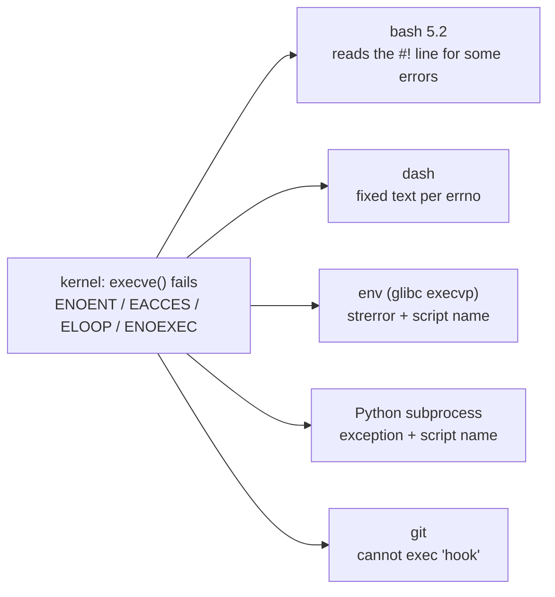
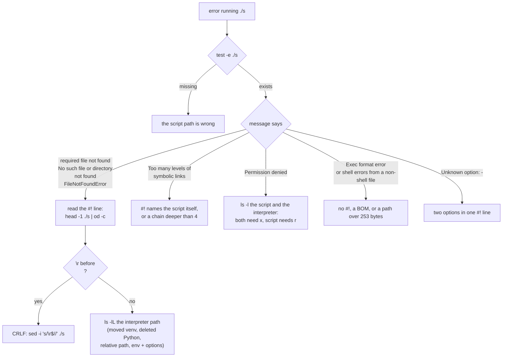

# What Each Caller Prints When a Script Fails to Run

When `execve()` fails, the kernel returns a bare errno. Every message the user sees is written by the program that called `execve()`: the shell, `env`, Python, git. They word the same errno differently, most of them name the **script** when the problem is the **interpreter**, and bash 5.2 changed the wording most answers online quote. This file maps each failure to each caller's exact output, so a message can be traced back to its cause. How the kernel parses the `#!` line is in [`shebang.md`](shebang.md).

Verified by experiment on Linux 7.0.0 (Ubuntu 24.04) with bash 5.2.21, dash 0.5.12 (`/bin/sh`), GNU coreutils 9.4, glibc 2.39, git 2.43.0, Python 3.12.3 and 3.15.0, in the `en_US.UTF-8` locale. Source quotes are from bash 5.2 patch 21 ([mirror/bash@2bb3cbe](https://github.com/mirror/bash/tree/2bb3cbefdb8fd019765b1a9cc42ecf37ff22fec6)), dash [v0.5.12](https://git.kernel.org/pub/scm/utils/dash/dash.git/tag/?h=v0.5.12), coreutils [v9.4](https://github.com/coreutils/coreutils/tree/v9.4), glibc [2.39](https://github.com/bminor/glibc/tree/glibc-2.39), CPython [v3.15.0](https://github.com/python/cpython/tree/v3.15.0) and git [v2.43.0](https://github.com/git/git/tree/v2.43.0). Every "Source:" link is pinned to a commit, with line numbers.

______________________________________________________________________

## Table of Contents

1. [From errno to Message](#1-from-errno-to-message)
2. [The Table](#2-the-table)
3. [bash 5.2 Changed the Messages](#3-bash-52-changed-the-messages)
4. [dash](#4-dash)
5. [env and glibc `execvp()`](#5-env-and-glibc-execvp)
6. [Python](#6-python)
7. [git Hooks](#7-git-hooks)
8. [Reading a Message Backwards](#8-reading-a-message-backwards)

______________________________________________________________________

## 1. From errno to Message



Only bash ever opens the script to see which interpreter it names, and since 5.2 only for errors other than `ENOENT`. Everyone else reports the errno against the path they passed to `execve()`, which is the script.

______________________________________________________________________

## 2. The Table

`s` is the script; exit statuses follow the comma. bash is shown as typed at an interactive prompt; under `bash -c` the prefix is `bash: line 1:` and in a script file `script.sh: line N:`, except for `bad interpreter` messages, which never carry a line number (`bash: ./s: ...`, `script.sh: ./s: ...`). dash under `sh -c` prints `sh: 1:`.

| Failure                                                                    | bash 5.2.21                                                                                                  | dash (`sh`)                                          | `env ./s`                                            | Python `subprocess.run(["./s"])`                                | git hook                                                                                      |
| -------------------------------------------------------------------------- | ------------------------------------------------------------------------------------------------------------ | ---------------------------------------------------- | ---------------------------------------------------- | --------------------------------------------------------------- | --------------------------------------------------------------------------------------------- |
| interpreter missing (`ENOENT`)                                             | `bash: ./s: cannot execute: required file not found`, 127                                                    | `sh: 1: ./s: not found`, 127                         | `env: ‘./s’: No such file or directory`, 127         | `FileNotFoundError: [Errno 2] No such file or directory: './s'` | `fatal: cannot exec '.git/hooks/pre-commit': No such file or directory`, commit fails         |
| CRLF, `#!/bin/sh\r`                                                        | same as interpreter missing                                                                                  | same                                                 | same                                                 | same                                                            | same                                                                                          |
| CRLF, `#!/usr/bin/env python3\r`                                           | `/usr/bin/env: ‘python3\r’: No such file or directory` and `use -[v]S to pass options in shebang lines`, 127 | same, 127                                            | same, 127                                            | no exception, `returncode` 127                                  | same text, commit fails                                                                       |
| script itself missing                                                      | `bash: ./s: No such file or directory`, 127                                                                  | `sh: 1: ./s: not found`, 127                         | `env: ‘./s’: No such file or directory`, 127         | `FileNotFoundError: [Errno 2] No such file or directory: './s'` | no hook runs, commit succeeds                                                                 |
| `#!` names the script itself (`ELOOP`)                                     | `bash: ./s: /abs/s: bad interpreter: Too many levels of symbolic links`, 126                                 | `sh: 1: ./s: Too many levels of symbolic links`, 127 | `env: ‘./s’: Too many levels of symbolic links`, 126 | `OSError: [Errno 40] Too many levels of symbolic links: './s'`  | `fatal: cannot exec '.git/hooks/pre-commit': Too many levels of symbolic links`, commit fails |
| interpreter not executable (`EACCES`)                                      | `bash: ./s: /abs/interp: bad interpreter: Permission denied`, 126                                            | `sh: 1: ./s: Permission denied`, 126                 | `env: ‘./s’: Permission denied`, 126                 | `PermissionError: [Errno 13] Permission denied: './s'`          | `fatal: cannot exec '.git/hooks/pre-commit': Permission denied`, commit fails                 |
| script not executable                                                      | `bash: ./s: Permission denied`, 126                                                                          | `sh: 1: ./s: Permission denied`, 126                 | `env: ‘./s’: Permission denied`, 126                 | `PermissionError: [Errno 13] Permission denied: './s'`          | hook skipped with a `hint:`, commit **succeeds**                                              |
| `#!` line ignored (`ENOEXEC`: a BOM or a path over 253 bytes), uv launcher | runs it as bash: `./s: line 4: from: command not found`, 2                                                   | runs it as sh: `./s: 4: from: not found`, 2          | glibc retries with `/bin/sh`: dash's errors, 2       | `OSError: [Errno 8] Exec format error: './s'`                   | retried with `/bin/sh`: `.git/hooks/pre-commit: 4: from: not found`                           |

Three rows look identical from Python, dash and `env`: "interpreter missing", "CRLF" and "script missing" all print "No such file or directory" or "not found" against `./s`. Only `test -e ./s` tells them apart.

Reproduce any row by building `s` and running every caller:

```bash
cd "$(mktemp -d)"
printf '#!%s/.venv/bin/python\nprint("hello")\n' "$PWD" > s && chmod +x s   # interpreter missing
bash -c './s'; echo "exit=$?"
sh -c './s'; echo "exit=$?"
env ./s; echo "exit=$?"
/usr/bin/python3 -c 'import subprocess; subprocess.run(["./s"])' 2>&1 | tail -1
git init -q repo && cp -p s repo/.git/hooks/pre-commit
git -C repo -c user.name=t -c user.email=t@t commit -q --allow-empty -m m; echo "exit=$?"
```

```text
bash: line 1: ./s: cannot execute: required file not found
exit=127
sh: 1: ./s: not found
exit=127
env: ‘./s’: No such file or directory
exit=127
FileNotFoundError: [Errno 2] No such file or directory: './s'
fatal: cannot exec '.git/hooks/pre-commit': No such file or directory
exit=1
```

______________________________________________________________________

## 3. bash 5.2 Changed the Messages

`shell_execve()` handles a failed `execve()`. bash 5.2 added the `ENOENT` branch at line 5985, **before** the branch that reads the `#!` line and prints `bad interpreter`:

Source: [`execute_cmd.c#L5964-L6016`](https://github.com/mirror/bash/blob/2bb3cbefdb8fd019765b1a9cc42ecf37ff22fec6/execute_cmd.c#L5964-L6016)

```c
  if (i != ENOEXEC)
    {
      /* make sure this is set correctly for file_error/report_error */
      last_command_exit_value = (i == ENOENT) ?  EX_NOTFOUND : EX_NOEXEC; /* XXX Posix.2 says that exit status is 126 */
      if (file_isdir (command))
#if defined (EISDIR)
	internal_error (_("%s: %s"), command, strerror (EISDIR));
#else
	internal_error (_("%s: is a directory"), command);
#endif
      else if (executable_file (command) == 0)
	{
	  errno = i;
	  file_error (command);
	}
      /* errors not involving the path argument to execve. */
      else if (i == E2BIG || i == ENOMEM)
	{
	  errno = i;
	  file_error (command);
	}
      else if (i == ENOENT)
	{
	  errno = i;
	  internal_error (_("%s: cannot execute: required file not found"), command);
	}
      else
	{
	  /* The file has the execute bits set, but the kernel refuses to
	     run it for some reason.  See why. */
#if defined (HAVE_HASH_BANG_EXEC)
	  READ_SAMPLE_BUF (command, sample, sample_len);
	  if (sample_len > 0)
	    sample[sample_len - 1] = '\0';
	  if (sample_len > 2 && sample[0] == '#' && sample[1] == '!')
	    {
	      char *interp;
	      int ilen;

	      interp = getinterp (sample, sample_len, (int *)NULL);
	      ilen = strlen (interp);
	      errno = i;
	      if (interp[ilen - 1] == '\r')
		{
		  interp = xrealloc (interp, ilen + 2);
		  interp[ilen - 1] = '^';
		  interp[ilen] = 'M';
		  interp[ilen + 1] = '\0';
		}
	      sys_error (_("%s: %s: bad interpreter"), command, interp ? interp : "");
	      FREE (interp);
	      return (EX_NOEXEC);
	    }
```

What follows from the order of these branches:

| errno from `execve()`                | bash 5.1 and older                                                         | bash 5.2                                            |
| ------------------------------------ | -------------------------------------------------------------------------- | --------------------------------------------------- |
| `ENOENT` (missing interpreter, CRLF) | `./s: /usr/bin/python3^M: bad interpreter: No such file or directory`, 126 | `./s: cannot execute: required file not found`, 127 |
| `EACCES`, `ELOOP`, `ENOTDIR`         | `./s: <interp>: bad interpreter: <strerror>`, 126                          | unchanged                                           |
| script does not exist                | `./s: No such file or directory`, 127                                      | unchanged                                           |

So on bash 5.2:

- The `^M` rewrite is still in the code, but a CR on the end of a path usually names a file that does not exist, which gives `ENOENT`, so CRLF almost never reaches it. It does when the error is something else: `#!/bin/sh/python3\r` gives `bad interpreter: Not a directory` with `^M` shown.
- "required file not found" means the script exists and is executable, but a file it depends on is missing: the `#!` interpreter, or, for an ELF binary, its dynamic loader. The message does not say which.
- `bad interpreter` now appears only for errors other than `ENOENT`, such as `EACCES`, `ELOOP` and `ENOTDIR`.

`READ_SAMPLE_BUF` reads 128 bytes (`HASH_BANG_BUFSIZ`), so the interpreter shown in a `bad interpreter` message is cut at 125 bytes even though the kernel used the whole path. Read the real line with `head -1 ./s`.

### `ENOEXEC`: run it as a shell script

Source: [`execute_cmd.c#L6030-L6054`](https://github.com/mirror/bash/blob/2bb3cbefdb8fd019765b1a9cc42ecf37ff22fec6/execute_cmd.c#L6030-L6054)

```c
  READ_SAMPLE_BUF (command, sample, sample_len);

  if (sample_len == 0)
    return (EXECUTION_SUCCESS);

  /* Is this supposed to be an executable script?
     If so, the format of the line is "#! interpreter [argument]".
     A single argument is allowed.  The BSD kernel restricts
     the length of the entire line to 32 characters (32 bytes
     being the size of the BSD exec header), but we allow up to 128
     characters. */
  if (sample_len > 0)
    {
#if !defined (HAVE_HASH_BANG_EXEC)
      if (sample_len > 2 && sample[0] == '#' && sample[1] == '!')
	return (execute_shell_script (sample, sample_len, command, args, env));
      else
#endif
      if (check_binary_file (sample, sample_len))
	{
	  internal_error (_("%s: cannot execute binary file: %s"), command, strerror (i));
	  errno = i;
	  return (EX_BINARY_FILE);
	}
    }
```

After this, bash executes the text as shell commands in a subshell. An empty file "runs" and exits 0.

______________________________________________________________________

## 4. dash

dash maps errno values to exit statuses itself, putting `ELOOP` with `ENOENT` at 127 (bash and `env` use 126 for `ELOOP`), and prints the fixed text `not found` for `ENOENT`:

Source: [`src/exec.c#L131-L146`](https://git.kernel.org/pub/scm/utils/dash/dash.git/tree/src/exec.c?id=4bbf8721a3ac6401ced6a0454956801f6ba37256#n131)

```c
	/* Map to POSIX errors */
	switch (e) {
	default:
		exerrno = 126;
		break;
	case ELOOP:
	case ENAMETOOLONG:
	case ENOENT:
	case ENOTDIR:
		exerrno = 127;
		break;
	}
	exitstatus = exerrno;
	TRACE(("shellexec failed for %s, errno %d, suppressint %d\n",
		argv[0], e, suppressint ));
	exerror(EXEND, "%s: %s", argv[0], errmsg(e, E_EXEC));
```

On `ENOEXEC` it re-runs the same file with `/bin/sh` in front:

Source: [`src/exec.c#L151-L169`](https://git.kernel.org/pub/scm/utils/dash/dash.git/tree/src/exec.c?id=4bbf8721a3ac6401ced6a0454956801f6ba37256#n151)

```c
STATIC void
tryexec(char *cmd, char **argv, char **envp)
{
	char *const path_bshell = _PATH_BSHELL;

repeat:
#ifdef SYSV
	do {
		execve(cmd, argv, envp);
	} while (errno == EINTR);
#else
	execve(cmd, argv, envp);
#endif
	if (cmd != path_bshell && errno == ENOEXEC) {
		*argv-- = cmd;
		*argv = cmd = path_bshell;
		goto repeat;
	}
}
```

______________________________________________________________________

## 5. env and glibc `execvp()`

`env` calls `execvp()` and prints `strerror` against the program name, exiting 127 for `ENOENT` and 126 for anything else. The `-S` hint fires whenever that name contains a character from `C_ISSPACE_CHARS`, which includes `\r`; see [`shebang.md` section 4](shebang.md#4-usrbinenv-shebangs) for the quote. With CRLF line endings the hint is a red herring: the "space" is the carriage return.

glibc's `execvp()`, used by `env`, `xargs`, `find -exec` and many C programs, runs a file that fails with `ENOEXEC` through `/bin/sh`:

Source: [`posix/execvpe.c#L81-L90`](https://github.com/bminor/glibc/blob/ef321e23c20eebc6d6fb4044425c00e6df27b05f/posix/execvpe.c#L81-L90), [`posix/execvpe.c#L58-L67`](https://github.com/bminor/glibc/blob/ef321e23c20eebc6d6fb4044425c00e6df27b05f/posix/execvpe.c#L58-L67)

```c
  /* Don't search when it contains a slash.  */
  if (strchr (file, '/') != NULL)
    {
      __execve (file, argv, envp);

      if (errno == ENOEXEC && exec_script)
        maybe_script_execute (file, argv, envp);

      return -1;
    }
```

```c
  char *new_argv[argc > 1 ? 2 + argc : 3];
  new_argv[0] = (char *) _PATH_BSHELL;
  new_argv[1] = (char *) file;
  if (argc > 1)
    memcpy (new_argv + 2, argv + 1, argc * sizeof (char *));
  else
    new_argv[2] = NULL;

  /* Execute the shell.  */
  __execve (new_argv[0], new_argv, envp);
```

glibc's `posix_spawn()` does not retry. `strace` shows the two calls:

```bash
cd "$(mktemp -d)"
printf 'echo "run by: $0"\n' > s && chmod +x s
strace -f -e trace=execve -o env.trace env ./s
grep -o 'execve(.*' env.trace | sed 's|, 0x[0-9a-f]* /\* [0-9]* vars \*/||'
```

```text
run by: ./s
execve("/usr/bin/env", ["env", "./s"]) = 0
execve("./s", ["./s"]) = -1 ENOEXEC (Exec format error)
execve("/bin/sh", ["/bin/sh", "./s"]) = 0
```

______________________________________________________________________

## 6. Python

`subprocess` attaches the program it was asked to run, `orig_executable`, as the exception's filename, so the exception always names the script even when the kernel's complaint is about the interpreter:

Source: [`Lib/subprocess.py#L2151-L2156`](https://github.com/python/cpython/blob/d220409a13b77de7a6c30abe16ea90db01528edc/Lib/subprocess.py#L2151-L2156)

```python
                    else:
                        err_filename = orig_executable
                    if errno_num != 0:
                        err_msg = os.strerror(errno_num)
                    if err_filename is not None:
                        raise child_exception_type(errno_num, err_msg, err_filename)
```

Python never falls back to `/bin/sh` on `ENOEXEC`: neither the fork-and-exec path in `_posixsubprocess.c` nor `posix_spawn()` retries, and `os.execvp()` is implemented in Python and calls `execv()` directly for a name with a slash. A file without a shebang that runs fine from bash raises `OSError: [Errno 8] Exec format error` from Python. `os.execv()`, `os.execvp()` and `os.execl()` errors carry no filename at all (`FileNotFoundError: [Errno 2] No such file or directory`); `os.execve()`, `os.execvpe()` and `os.execle()` name the script, like `subprocess`.

To run a Python file regardless of its shebang, call the interpreter explicitly: `subprocess.run([sys.executable, "./s"])`.

______________________________________________________________________

## 7. git Hooks

git checks the execute bit first. A hook without it is skipped, the commit **succeeds**, and the only trace is a hint, which `advice.ignoredHook=false` silences:

Source: [`hook.c#L17-L41`](https://github.com/git/git/blob/564d0252ca632e0264ed670534a51d18a689ef5d/hook.c#L17-L41)

```c
	if (access(path.buf, X_OK) < 0) {
		int err = errno;

#ifdef STRIP_EXTENSION
		strbuf_addstr(&path, STRIP_EXTENSION);
		if (access(path.buf, X_OK) >= 0)
			return path.buf;
		if (errno == EACCES)
			err = errno;
#endif

		if (err == EACCES && advice_enabled(ADVICE_IGNORED_HOOK)) {
			static struct string_list advise_given = STRING_LIST_INIT_DUP;

			if (!string_list_lookup(&advise_given, name)) {
				string_list_insert(&advise_given, name);
				advise(_("The '%s' hook was ignored because "
					 "it's not set as executable.\n"
					 "You can disable this warning with "
					 "`git config advice.ignoredHook false`."),
				       path.buf);
			}
		}
		return NULL;
	}
```

```text
hint: The '.git/hooks/pre-commit' hook was ignored because it's not set as executable.
hint: You can disable this warning with `git config advice.ignoredHook false`.
```

An executable hook that fails to exec is reported against the hook path, and the commit fails. On `ENOEXEC` git retries the hook with `/bin/sh`, like dash:

Source: [`run-command.c#L396-L398`](https://github.com/git/git/blob/564d0252ca632e0264ed670534a51d18a689ef5d/run-command.c#L396-L398), [`run-command.c#L408-L412`](https://github.com/git/git/blob/564d0252ca632e0264ed670534a51d18a689ef5d/run-command.c#L408-L412)

```c
	case CHILD_ERR_ERRNO:
		error_errno("cannot exec '%s'", cmd->args.v[0]);
		break;
```

```c
	/*
	 * Add SHELL_PATH so in the event exec fails with ENOEXEC we can
	 * attempt to interpret the command with 'sh'.
	 */
	strvec_push(out, SHELL_PATH);
```

The `check-executables-have-shebangs` and `check-shebang-scripts-are-executable` hooks from the [pre-commit-hooks](https://github.com/pre-commit/pre-commit-hooks) repository catch the two halves of this before a commit.

______________________________________________________________________

## 8. Reading a Message Backwards



`scripts/check_shebang.py` in this skill runs these checks in one go: it parses the first 256 bytes the way the kernel does and reports what would fail.
