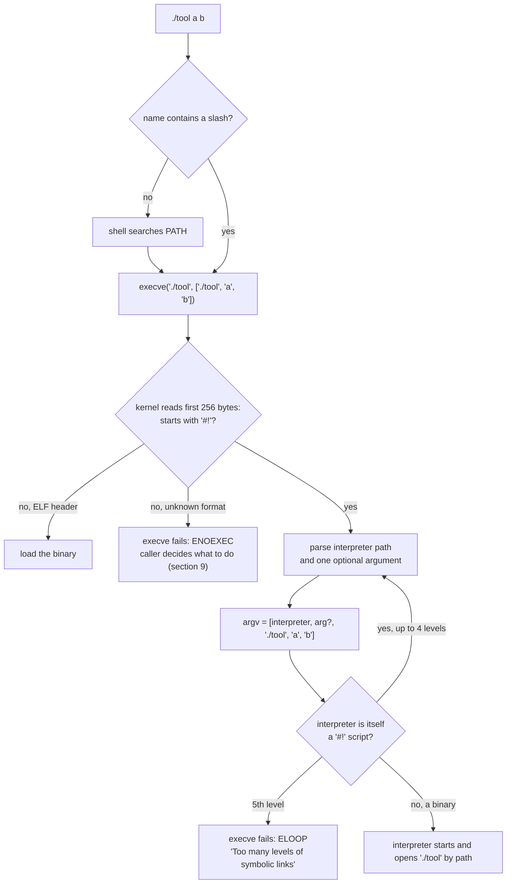
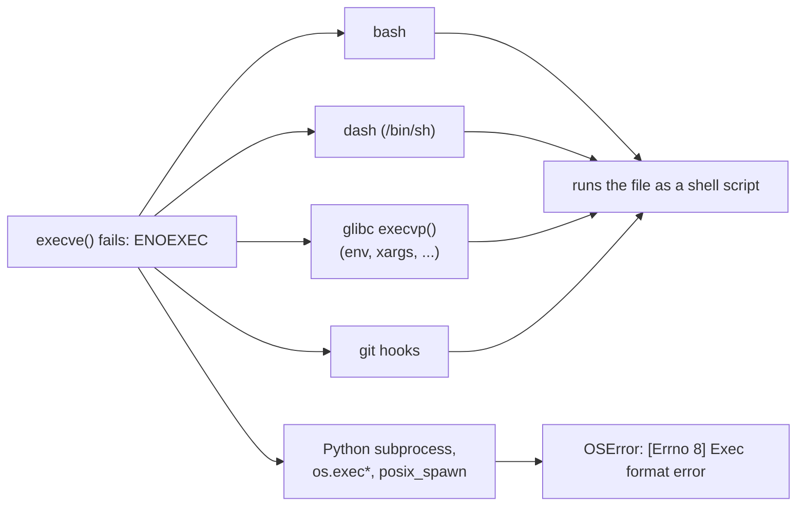

# How Linux Runs a `#!` Script

What happens between typing `./tool` and the interpreter starting: how the kernel reads the `#!` (shebang) line, the limits it applies, and the failures that follow from them. Which error text each caller prints for those failures is in [`exec-errors.md`](exec-errors.md); how Python installers write the launchers in `.venv/bin` is covered by the `python` skill.

Verified against Linux [7.0](https://github.com/torvalds/linux/tree/v7.0) source (`fs/binfmt_script.c`, `fs/exec.c`, `include/uapi/linux/binfmts.h`), coreutils [v9.4](https://github.com/coreutils/coreutils/tree/v9.4) (`src/env.c`) and glibc [2.39](https://github.com/bminor/glibc/tree/glibc-2.39) (`posix/execvpe.c`), and by experiment on Linux 7.0.0 (Ubuntu 24.04) with bash 5.2.21, dash 0.5.12, GNU coreutils 9.4, glibc 2.39, Python 3.12.3 and 3.15.0. Every "Source:" link points at the commit the tag names, with line numbers, so it shows exactly the code quoted here.

______________________________________________________________________

## Table of Contents

01. [The Big Picture](#1-the-big-picture)
02. [Parsing the `#!` Line](#2-parsing-the--line)
03. [Only One Argument](#3-only-one-argument)
04. [`/usr/bin/env` Shebangs](#4-usrbinenv-shebangs)
05. [The 255-Byte Line](#5-the-255-byte-line)
06. [CRLF Line Endings](#6-crlf-line-endings)
07. [Relative Interpreter Paths](#7-relative-interpreter-paths)
08. [Interpreter Chains and `ELOOP`](#8-interpreter-chains-and-eloop)
09. [No `#!` Line: `ENOEXEC` and the Shell Fallback](#9-no--line-enoexec-and-the-shell-fallback)
10. [Permissions on the Script and the Interpreter](#10-permissions-on-the-script-and-the-interpreter)
11. [Smaller Facts](#11-smaller-facts)
12. [Quick Reference](#12-quick-reference)

______________________________________________________________________

## 1. The Big Picture

The shebang names the program that **reads** the file, never the file itself. The kernel does all the work inside one `execve()` call:



Three consequences shape everything below:

- The kernel only parses the line. It never searches `PATH` for the interpreter and never splits arguments, so `#!python3` and `#!/usr/bin/env python3 -u` do not do what they look like (sections 4 and 7).
- When `execve()` fails, the kernel returns only an errno. The words the user sees (`bad interpreter`, `required file not found`, `FileNotFoundError`) come from whichever program called `execve()`, and most of them name the script, not the interpreter. See [`exec-errors.md`](exec-errors.md).
- The interpreter gets the script **path**, not its contents, and must open it again. A script the interpreter cannot read fails after the kernel has already accepted it (section 10).

______________________________________________________________________

## 2. Parsing the `#!` Line

`prepare_binprm()` zeroes a 256-byte buffer and reads the start of the file into it:

Source: [`include/uapi/linux/binfmts.h#L18-L19`](https://github.com/torvalds/linux/blob/028ef9c96e96197026887c0f092424679298aae8/include/uapi/linux/binfmts.h#L18-L19), [`fs/exec.c#L1598-L1604`](https://github.com/torvalds/linux/blob/028ef9c96e96197026887c0f092424679298aae8/fs/exec.c#L1598-L1604)

```c
/* sizeof(linux_binprm->buf) */
#define BINPRM_BUF_SIZE 256
```

```c
static int prepare_binprm(struct linux_binprm *bprm)
{
	loff_t pos = 0;

	memset(bprm->buf, 0, BINPRM_BUF_SIZE);
	return kernel_read(bprm->file, bprm->buf, BINPRM_BUF_SIZE, &pos);
}
```

`load_script()` then splits that buffer into the interpreter path and at most one argument. Only space and tab count as whitespace:

Source: [`fs/binfmt_script.c#L18`](https://github.com/torvalds/linux/blob/028ef9c96e96197026887c0f092424679298aae8/fs/binfmt_script.c#L18), [`fs/binfmt_script.c#L40-L42`](https://github.com/torvalds/linux/blob/028ef9c96e96197026887c0f092424679298aae8/fs/binfmt_script.c#L40-L42), [`fs/binfmt_script.c#L58-L85`](https://github.com/torvalds/linux/blob/028ef9c96e96197026887c0f092424679298aae8/fs/binfmt_script.c#L58-L85)

```c
static inline bool spacetab(char c) { return c == ' ' || c == '\t'; }
```

```c
	/* Not ours to exec if we don't start with "#!". */
	if ((bprm->buf[0] != '#') || (bprm->buf[1] != '!'))
		return -ENOEXEC;
```

```c
	buf_end = bprm->buf + sizeof(bprm->buf) - 1;
	i_end = strnchr(bprm->buf, sizeof(bprm->buf), '\n');
	if (!i_end) {
		i_end = next_non_spacetab(bprm->buf + 2, buf_end);
		if (!i_end)
			return -ENOEXEC; /* Entire buf is spaces/tabs */
		/*
		 * If there is no later space/tab/NUL we must assume the
		 * interpreter path is truncated.
		 */
		if (!next_terminator(i_end, buf_end))
			return -ENOEXEC;
		i_end = buf_end;
	}
	/* Trim any trailing spaces/tabs from i_end */
	while (spacetab(i_end[-1]))
		i_end--;

	/* Skip over leading spaces/tabs */
	i_name = next_non_spacetab(bprm->buf+2, i_end);
	if (!i_name || (i_name == i_end))
		return -ENOEXEC; /* No interpreter name found */

	/* Is there an optional argument? */
	i_arg = NULL;
	i_sep = next_terminator(i_name, i_end);
	if (i_sep && (*i_sep != '\0'))
		i_arg = next_non_spacetab(i_sep, i_end);
```

It then rebuilds the argument list. The caller's `argv[0]` is removed and replaced by three things, pushed in reverse order: the interpreter, the optional argument, and the path that was passed to `execve()`:

Source: [`fs/binfmt_script.c#L96-L124`](https://github.com/torvalds/linux/blob/028ef9c96e96197026887c0f092424679298aae8/fs/binfmt_script.c#L96-L124)

```c
	/*
	 * OK, we've parsed out the interpreter name and
	 * (optional) argument.
	 * Splice in (1) the interpreter's name for argv[0]
	 *           (2) (optional) argument to interpreter
	 *           (3) filename of shell script (replace argv[0])
	 *
	 * This is done in reverse order, because of how the
	 * user environment and arguments are stored.
	 */
	retval = remove_arg_zero(bprm);
	if (retval)
		return retval;
	retval = copy_string_kernel(bprm->interp, bprm);
	if (retval < 0)
		return retval;
	bprm->argc++;
	*((char *)i_end) = '\0';
	if (i_arg) {
		*((char *)i_sep) = '\0';
		retval = copy_string_kernel(i_arg, bprm);
		if (retval < 0)
			return retval;
		bprm->argc++;
	}
	retval = copy_string_kernel(i_name, bprm);
	if (retval)
		return retval;
	bprm->argc++;
```

Laid out for a typical venv launcher:

```text
first line of ./tool:   #!/home/u/proj/.venv/bin/python -I
command:                ./tool run --all

the shell calls:        execve("./tool", ["./tool", "run", "--all"])
                                          ^^^^^^^^ dropped by remove_arg_zero()

the kernel runs:        /home/u/proj/.venv/bin/python   -I    ./tool   run --all
                        └──────── interpreter ───────┘  └arg┘ └ path ┘ └argv[1:]┘
```

The path is the one passed to `execve()`, verbatim. bash passes `./tool` when you type `./tool`, but the full path when it found the command on `PATH`, so `sys.argv[0]` of the same launcher differs between the two. The caller's original `argv[0]` (what `exec -a NAME` sets) is gone; the script can never see it.

Measured, with an interpreter that prints the argv it received:

```bash
cd "$(mktemp -d)"
mkdir bin
printf '#!/usr/bin/python3\nimport sys; print(sys.orig_argv)\n' > bin/show.py
chmod +x bin/show.py
/usr/bin/python3 -c 'import os; os.execv("bin/show.py", ["CALLER_ARGV0", "a", "b c"])'
PATH="$PWD/bin:$PATH" show.py x 2>&1 | sed "s|$PWD|\$PWD|g"
```

```text
['/usr/bin/python3', 'bin/show.py', 'a', 'b c']
['/usr/bin/python3', '$PWD/bin/show.py', 'x']
```

______________________________________________________________________

## 3. Only One Argument

Everything after the interpreter path, up to the end of the line, is **one** argument. Internal spaces stay inside it; only leading and trailing spaces and tabs are trimmed.

```bash
cd "$(mktemp -d)"
printf '#!/usr/bin/python3\nimport sys; print(sys.argv[1:])\n' > argv.py
printf '#! \t %s/argv.py \t -I   -u  \t \nbody\n' "$PWD" > s
chmod +x argv.py s
./s extra
```

```text
['-I   -u', './s', 'extra']
```

`#!/usr/bin/python3 -I -u` therefore hands Python the single argument `-I -u`. Python parses it as a cluster of one-letter options, accepts `I`, then fails on the space. Same result on 3.12.3 and 3.15.0, exit status 2:

```text
Unknown option: -
usage: /usr/bin/python3 [option] ... [-c cmd | -m mod | file | -] [arg] ...
Try `python -h' for more information.
```

The first line is really `Unknown option: - ` with a trailing space: the "option" Python rejects is the space character. An option that takes a value is worse, because it fails silently: `#!/usr/bin/python3 -X dev` gives `-X` the value `' dev'` with a leading space, which never matches `dev`, so development mode stays off with no error.

| Shebang                     | Python receives          | Result                      |
| --------------------------- | ------------------------ | --------------------------- |
| `#!/usr/bin/python3 -I`     | `-I`                     | works                       |
| `#!/usr/bin/python3 -I -u`  | `-I -u`                  | `Unknown option: -`, exit 2 |
| `#!/usr/bin/python3 -Iu`    | `-Iu`                    | works, both flags set       |
| `#!/usr/bin/python3 -X dev` | `-X` with value `' dev'` | runs, dev mode silently off |
| `#!/usr/bin/python3 -Xdev`  | `-X` with value `dev`    | works                       |

Write options as one word (`-Iu`, `-Xdev`, `-Werror`), or split them with `env -S` (section 4).

______________________________________________________________________

## 4. `/usr/bin/env` Shebangs

`#!/usr/bin/env python3` makes the kernel run `env` with the single argument `python3`; `env` then looks `python3` up on `PATH` with glibc's `execvp()`. Three things follow.

### The interpreter depends on the caller's `PATH`

The same file runs under whichever `python3` comes first on the `PATH` of whoever starts it, at the moment they start it:

| Started from                  | `PATH` it sees                                                                                                                        | `python3` that runs                                                                                   |
| ----------------------------- | ------------------------------------------------------------------------------------------------------------------------------------- | ----------------------------------------------------------------------------------------------------- |
| a shell with a venv activated | the venv's `bin` first                                                                                                                | the venv's                                                                                            |
| a git hook                    | the caller's `PATH` with `/usr/lib/git-core` (git's exec path) in front                                                               | the venv's only if git was started from that shell; an IDE or GUI client often has a different `PATH` |
| cron                          | `/usr/bin:/bin` unless the crontab sets `PATH`                                                                                        | the system one                                                                                        |
| a systemd system service      | `/usr/local/sbin:/usr/local/bin:/usr/sbin:/usr/bin` (Ubuntu with snapd appends `:/snap/bin`; check with `systemctl show-environment`) | the system one                                                                                        |

A broken venv earlier on `PATH` does not stop the search. glibc treats `ENOENT` from one directory as "try the next", so a dangling `.venv/bin/python3` symlink silently falls through to the next `python3`:

Source: [`posix/execvpe.c#L145-L163`](https://github.com/bminor/glibc/blob/ef321e23c20eebc6d6fb4044425c00e6df27b05f/posix/execvpe.c#L145-L163)

```c
      switch (errno)
	{
	  case EACCES:
	  /* Record that we got a 'Permission denied' error.  If we end
	     up finding no executable we can use, we want to diagnose
	     that we did find one but were denied access.  */
	    got_eacces = true;
	  case ENOENT:
	  case ESTALE:
	  case ENOTDIR:
	  /* Those errors indicate the file is missing or not executable
	     by us, in which case we want to just try the next path
	     directory.  */
	  case ENODEV:
	  case ETIMEDOUT:
	  /* Some strange filesystems like AFS return even
	     stranger error numbers.  They cannot reasonably mean
	     anything else so ignore those, too.  */
	    break;
```

```bash
cd "$(mktemp -d)"
mkdir -p venv/bin
ln -s /nonexistent/python3.13 venv/bin/python3
printf '#!/usr/bin/env python3\nimport sys; print("ran", sys.executable)\n' > s.py; chmod +x s.py
PATH="$PWD/venv/bin:/usr/bin:/bin" ./s.py; echo "exit=$?"
```

```text
ran /usr/bin/python3
exit=0
```

Check what a given environment would pick with `env python3 -c 'import sys; print(sys.executable)'`. When a script must run under one specific Python, put its absolute path in the shebang instead.

### Options need `-S`

`#!/usr/bin/env python3 -u` makes `env` look for a program literally named `python3 -u`. coreutils 9.4 then adds a hint, because the name contains whitespace:

Source: [`src/env.c#L893-L899`](https://github.com/coreutils/coreutils/blob/9530a14420fc1a267e90d45e8a0d710c3668382d/src/env.c#L893-L899), [`src/env.c#L74`](https://github.com/coreutils/coreutils/blob/9530a14420fc1a267e90d45e8a0d710c3668382d/src/env.c#L74)

```c
  execvp (argv[optind], &argv[optind]);

  int exit_status = errno == ENOENT ? EXIT_ENOENT : EXIT_CANNOT_INVOKE;
  error (0, errno, "%s", quote (argv[optind]));

  if (exit_status == EXIT_ENOENT && strpbrk (argv[optind], C_ISSPACE_CHARS))
    error (0, 0, _("use -[v]S to pass options in shebang lines"));
```

```c
#define C_ISSPACE_CHARS " \t\n\v\f\r"
```

```bash
cd "$(mktemp -d)"
printf '#!/usr/bin/env python3 -u\nprint("ran")\n' > e.py; chmod +x e.py
LC_ALL=C ./e.py; echo "exit=$?"
printf '#!/usr/bin/env -S python3 -u\nprint("ran")\n' > e2.py; chmod +x e2.py
./e2.py; echo "exit=$?"
```

```text
/usr/bin/env: 'python3 -u': No such file or directory
/usr/bin/env: use -[v]S to pass options in shebang lines
exit=127
ran
exit=0
```

In a UTF-8 locale `env` prints the name in curly quotes (`‘python3 -u’`); the examples use `LC_ALL=C` to get plain ones, so match on the text after the quotes.

An `env` option written before the command has the same problem from the other side: `#!/usr/bin/env -i python3` passes `-i python3` as one argument, and `env` rejects the space as an option letter with `/usr/bin/env: invalid option -- ' '`, exit 125. coreutils lists the whitespace characters as options only to catch this:

Source: [`src/env.c#L802-L809`](https://github.com/coreutils/coreutils/blob/9530a14420fc1a267e90d45e8a0d710c3668382d/src/env.c#L802-L809)

```c
        case ' ': case '\t': case '\n': case '\v': case '\f': case '\r':
          /* These are undocumented options.  Attempt to detect
             incorrect shebang usage with extraneous space, e.g.:
                #!/usr/bin/env -i command
             In which case argv[1] == "-i command".  */
          error (0, 0, _("invalid option -- '%c'"), optc);
          error (0, 0, _("use -[v]S to pass options in shebang lines"));
          usage (EXIT_CANCELED);
```

`#!/usr/bin/env -- python3` fails the same way (`unrecognized option '-- python3'`). Put everything after `-S`: `#!/usr/bin/env -S -i python3`.

### How `-S` splits

`-S` (coreutils 8.30 and later) re-splits its one argument into words. The rules that matter on a shebang line, all checked with coreutils 9.4:

| Written after `-S`                                | Becomes                                                                                                   |
| ------------------------------------------------- | --------------------------------------------------------------------------------------------------------- |
| runs of space, tab, CR, LF, VT, FF outside quotes | one separator                                                                                             |
| `"a b"` or `'a b'`                                | one argument with the space                                                                               |
| `\_` outside double quotes                        | a separator; inside double quotes, a space                                                                |
| a word starting with `#`                          | end of the string (a comment); the script path is still appended                                          |
| `${NAME}`                                         | the variable's value as **one** argument, never word-split; an unset `${NAME}` alone produces no argument |
| `$NAME` without braces                            | error `only ${VARNAME} expansion is supported`, exit 125                                                  |

Source: [`src/env.c#L385-L396`](https://github.com/coreutils/coreutils/blob/9530a14420fc1a267e90d45e8a0d710c3668382d/src/env.c#L385-L396)

```c
        case ' ': case '\t': case '\n': case '\v': case '\f': case '\r':
          /* Start a new argument if outside quotes.  */
          if (sq || dq)
            break;
          ss.sep = true;
          str += strspn (str, C_ISSPACE_CHARS);
          continue;

        case '#':
          if (!ss.sep)
            break;
          goto eos; /* '#' as first char terminates the string.  */
```

Debug a shebang with `-vS`, which prints the split before running:

```bash
cd "$(mktemp -d)"
printf '#!/usr/bin/env -vS python3 -I -c "import sys; print(sys.argv[1:])" "a b" c\\_d # comment\n' > split.py; chmod +x split.py
LC_ALL=C ./split.py x
```

```text
split -S:  ' python3 -I -c "import sys; print(sys.argv[1:])" "a b" c\\_d # comment'
 into:    'python3'
     &    '-I'
     &    '-c'
     &    'import sys; print(sys.argv[1:])'
     &    'a b'
     &    'c'
     &    'd'
executing: python3
   arg[0]= 'python3'
   arg[1]= '-I'
   arg[2]= '-c'
   arg[3]= 'import sys; print(sys.argv[1:])'
   arg[4]= 'a b'
   arg[5]= 'c'
   arg[6]= 'd'
   arg[7]= './split.py'
   arg[8]= 'x'
['a b', 'c', 'd', './split.py', 'x']
```

Two more `-S` traps:

- `-S -i python3` empties the environment, so `execvp()` falls back to glibc's default `/bin:/usr/bin`: the system Python runs even inside an activated venv, and `sys.executable` is `''`, so `subprocess.run([sys.executable, ...])` fails with `PermissionError: [Errno 13] Permission denied: ''`. Keep the search path with `#!/usr/bin/env -S -i PATH=${PATH} python3`; `${PATH}` is expanded before `-i` clears the environment.
- `-S -C DIR python3` changes directory before Python opens the script, so it works only when the script is run by an absolute path: run as `./x.py` it fails with `can't open file 'DIR/./x.py'`.

`-S` treats `\r` as whitespace, so a CRLF file with an `env -S` shebang runs where the same file with `#!/usr/bin/env python3` fails (section 6). Convert it anyway; the next tool to read it may not be so forgiving.

______________________________________________________________________

## 5. The 255-Byte Line

The first line must fit in the 256-byte buffer with its newline. When no newline is in the buffer, the kernel checks whether the interpreter path ended (a space, tab or NUL after it). If it did not, the kernel refuses with `ENOEXEC` rather than run a truncated path; if it did, only the argument is cut.

| First line (without newline)           | Result                                                |
| -------------------------------------- | ----------------------------------------------------- |
| up to 255 bytes, `#!` included         | runs as written                                       |
| interpreter path longer than 253 bytes | `execve()` fails with `ENOEXEC` (`Exec format error`) |
| path fits, argument runs past byte 255 | argument silently cut at byte 255, no error           |

Measured on 7.0, with `/bin/echo` behind a symlink of the chosen length:

```bash
cd "$(mktemp -d)"
for len in 253 254; do
  i="$PWD/$(printf 'p%.0s' $(seq $(( len - ${#PWD} - 4 ))))$len"
  ln -s /bin/echo "$i"
  printf '#!%s\n' "$i" > "s$len"; chmod +x "s$len"
  printf '%s-byte interpreter path: ' "${#i}"
  /usr/bin/python3 -c 'import subprocess,sys; print(repr(subprocess.run([sys.argv[1], "ARG"], capture_output=True, text=True).stdout))' "./s$len" 2>&1 | tail -1
done
```

```text
253-byte interpreter path: './s253 ARG\n'
254-byte interpreter path: OSError: [Errno 8] Exec format error: './s254'
```

A cut argument fails in whichever way the remaining text happens to parse. Padding an `env -S` line so the cut lands at different points:

```bash
cd "$(mktemp -d)"
for pad in 224 225 227 231; do
  f=s$pad.py
  printf '#!/usr/bin/env -S A=%s python3 -I\nimport sys; print("ran file, isolated =", sys.flags.isolated)\n' "$(printf 'x%.0s' $(seq $pad))" > $f
  chmod +x $f
  printf 'line1=%s bytes: ' "$(head -1 $f | tr -d '\n' | wc -c)"
  echo 'print("ran stdin")' | LC_ALL=C ./$f 2>&1; echo "exit=$?"
done
```

```text
line1=255 bytes: ran file, isolated = 1
exit=0
line1=256 bytes: ran stdin
exit=0
line1=258 bytes: ran file, isolated = 0
exit=0
line1=262 bytes: /usr/bin/env: 'pyt': No such file or directory
exit=127
```

At 256 bytes the cut turns `-I` into `-`, which tells Python to read its program from standard input: from a pipe or `/dev/null` it runs whatever arrives and exits 0, from a terminal it opens the interactive prompt, and it never runs the file. At 258 bytes the option is lost without a trace. Check the length with `head -1 FILE | tr -d '\n' | wc -c`; it must print 255 or less.

The buffer was 128 bytes before Linux 5.1 (commit `6eb3c3d0a52d`), so older kernels allow only 125 bytes of path. Before Linux 5.0 (commit `b5372fe5dc84`) a too-long path was silently truncated instead of refused. execve(2) gives the limit as 255 characters after `#!`, with the excess ignored; that is two bytes too many, because the `#!` counts within the 256-byte buffer, and since Linux 5.0 an unterminated path is refused rather than ignored.

A deep project directory is the usual way to hit this. bash and dash do not report the `ENOEXEC`: they run the file as a shell script instead (section 9), so a Python launcher with a 300-byte shebang prints shell errors. uv and pip avoid the limit for the launchers they write by switching to a `#!/bin/sh` wrapper once the line, counting `#!` and the newline, passes 127 bytes (see the `python` skill).

______________________________________________________________________

## 6. CRLF Line Endings

`spacetab()` matches only space and tab, so a carriage return stays part of the line. In a file saved with Windows line endings, the interpreter becomes `/usr/bin/python3\r`, which does not exist, and `execve()` fails with `ENOENT`:

```bash
cd "$(mktemp -d)"
printf '#!/usr/bin/python3\r\nprint("ran")\r\n' > crlf.py; chmod +x crlf.py
head -1 crlf.py | od -c
bash -c ./crlf.py; echo "exit=$?"
sed -i 's/\r$//' crlf.py && ./crlf.py
```

```text
0000000   #   !   /   u   s   r   /   b   i   n   /   p   y   t   h   o
0000020   n   3  \r  \n
0000024
bash: line 1: ./crlf.py: cannot execute: required file not found
exit=127
ran
```

Where the CR ends up decides the message:

| First line                 | What breaks                | Message                                                                                                                                    |
| -------------------------- | -------------------------- | ------------------------------------------------------------------------------------------------------------------------------------------ |
| `#!/usr/bin/python3\r`     | interpreter path           | bash 5.2: `cannot execute: required file not found`; dash: `not found`; Python and `env`: `No such file or directory`; all name the script |
| `#!/usr/bin/python3 -u\r`  | the argument               | `Unknown option: -^M` from Python                                                                                                          |
| `#!/usr/bin/env python3\r` | the program `env` looks up | `/usr/bin/env: 'python3\r': No such file or directory` plus the misleading `use -[v]S` hint                                                |

bash 5.1 and older printed `/usr/bin/python3^M: bad interpreter: No such file or directory`, which is what most answers online quote. bash 5.2 never reaches that code for a missing interpreter (see [`exec-errors.md`](exec-errors.md)), so searching for `^M: bad interpreter` will not match a modern system. Look at the bytes: `head -1 FILE | od -c` shows `\r \n`, and `cat -A` shows `^M$`.

______________________________________________________________________

## 7. Relative Interpreter Paths

`load_script()` passes the interpreter name straight to `open_exec()`, which opens it relative to the **current directory** of the process that called `execve()`:

Source: [`fs/binfmt_script.c#L129-L138`](https://github.com/torvalds/linux/blob/028ef9c96e96197026887c0f092424679298aae8/fs/binfmt_script.c#L129-L138), [`fs/exec.c#L814-L818`](https://github.com/torvalds/linux/blob/028ef9c96e96197026887c0f092424679298aae8/fs/exec.c#L814-L818)

```c
	/*
	 * OK, now restart the process with the interpreter's dentry.
	 */
	file = open_exec(i_name);
	if (IS_ERR(file))
		return PTR_ERR(file);

	bprm->interpreter = file;
	return 0;
}
```

```c
struct file *open_exec(const char *name)
{
	CLASS(filename_kernel, filename)(name);
	return do_open_execat(AT_FDCWD, filename, 0);
}
```

So `#!.venv/bin/python` runs whichever `.venv` is under the directory you are standing in, not the one next to the script, and `#!python3` is not looked up on `PATH` at all:

```bash
cd "$(mktemp -d)"
mkdir -p proj/.venv/bin other/.venv/bin
printf '#!/bin/sh\necho "proj interpreter"\n' > proj/.venv/bin/python
printf '#!/bin/sh\necho "OTHER interpreter"\n' > other/.venv/bin/python
chmod +x proj/.venv/bin/python other/.venv/bin/python
printf '#!.venv/bin/python\n' > proj/tool; chmod +x proj/tool
(cd proj && ./tool)
(cd other && ../proj/tool)
bash -c ./proj/tool; echo "exit=$?"
```

```text
proj interpreter
OTHER interpreter
bash: line 1: ./proj/tool: cannot execute: required file not found
exit=127
```

Use an absolute path, or `#!/usr/bin/env NAME` when you want a `PATH` lookup. uv's relocatable venvs solve the "next to the script" case with a `/bin/sh` wrapper instead (see the `python` skill).

______________________________________________________________________

## 8. Interpreter Chains and `ELOOP`

The interpreter may itself be a `#!` script; the kernel just goes round its loop again. The loop stops at a fixed depth:

Source: [`fs/exec.c#L1690-L1704`](https://github.com/torvalds/linux/blob/028ef9c96e96197026887c0f092424679298aae8/fs/exec.c#L1690-L1704)

```c
	/* This allows 4 levels of binfmt rewrites before failing hard. */
	for (depth = 0;; depth++) {
		struct file *exec;
		if (depth > 5)
			return -ELOOP;

		ret = search_binary_handler(bprm);
		if (ret < 0)
			return ret;
		if (!bprm->interpreter)
			break;

		exec = bprm->file;
		bprm->file = bprm->interpreter;
		bprm->interpreter = NULL;
```

A chain of five scripts ending in a binary runs; a sixth fails. Each level prepends its own interpreter to the arguments:

```bash
cd "$(mktemp -d)"
printf '#!/bin/echo\n' > s1; chmod +x s1
for n in 2 3 4 5 6; do printf '#!%s/s%s\n' "$PWD" $((n-1)) > "s$n"; chmod +x "s$n"; done
for n in 1 2 3 4 5 6; do
  printf 's%s: ' "$n"
  /usr/bin/python3 -c '
import os, subprocess, sys
try:
    out = subprocess.run([sys.argv[1], "ARG"], capture_output=True, text=True).stdout
    print("ran /bin/echo, argv[1:] =", out.replace(os.getcwd() + "/", "").split())
except OSError as e:
    print(type(e).__name__, e.errno, e.strerror)
' "./s$n"
done
```

```text
s1: ran /bin/echo, argv[1:] = ['./s1', 'ARG']
s2: ran /bin/echo, argv[1:] = ['s1', './s2', 'ARG']
s3: ran /bin/echo, argv[1:] = ['s1', 's2', './s3', 'ARG']
s4: ran /bin/echo, argv[1:] = ['s1', 's2', 's3', './s4', 'ARG']
s5: ran /bin/echo, argv[1:] = ['s1', 's2', 's3', 's4', './s5', 'ARG']
s6: OSError 40 Too many levels of symbolic links
```

`ELOOP` is errno 40, and `strerror(ELOOP)` is "Too many levels of symbolic links", a text written for symlink loops. No symlink is involved here.

### A shebang that names the script itself

The common way to hit `ELOOP` is a shebang that points at the file it is in, for example writing `#!/proj/.venv/bin/tool` in `/proj/.venv/bin/tool` because the launcher "should run itself". The kernel finds the same `#!` script as the interpreter on every pass until the depth limit:

```bash
cd "$(mktemp -d)"
mkdir -p .venv/bin
printf '#!%s/.venv/bin/tool\nimport sys\nsys.exit(0)\n' "$PWD" > .venv/bin/tool; chmod +x .venv/bin/tool
bash -c .venv/bin/tool 2>&1 | sed "s|$PWD|\$PWD|g"; echo "exit=${PIPESTATUS[0]}"
sh -c .venv/bin/tool; echo "exit=$?"
```

```text
bash: .venv/bin/tool: $PWD/.venv/bin/tool: bad interpreter: Too many levels of symbolic links
exit=126
sh: 1: .venv/bin/tool: Too many levels of symbolic links
exit=127
```

`ELOOP` is not `ENOEXEC`, so no shell falls back to running the file as a script: the error is final. The fix is to name the interpreter binary (`.venv/bin/python`) in the shebang.

______________________________________________________________________

## 9. No `#!` Line: `ENOEXEC` and the Shell Fallback

A file that starts with neither `#!` nor a known binary header (ELF, or a format registered with `binfmt_misc`) makes `execve()` fail with `ENOEXEC`, "Exec format error". The same happens for a too-long interpreter path (section 5), and for a UTF-8 byte order mark before the `#!`, since the first two bytes are then not `#!`.

What happens next depends entirely on the caller. A long POSIX tradition says a shell should run such a file as a shell script, and several programs do:



Each fallback, quoted in [`exec-errors.md`](exec-errors.md), means a Python file without a shebang (or with an over-long one) gets **parsed by the shell**. From a uv launcher whose `#!` line is ignored (a BOM, or a path over 253 bytes), on a machine without ImageMagick:

```text
./tool: line 3: import: command not found
./tool: line 4: from: command not found
./tool: line 6: syntax error near unexpected token `"-script.pyw"'
./tool: line 6: `    if sys.argv[0].endswith("-script.pyw"):'
```

Worse, `import sys` is a valid shell command wherever ImageMagick is installed: `/usr/bin/import` is its screen-capture tool. With a display it waits for a mouse click (the script seems to hang) or writes a screenshot file named `sys` into the current directory; without one it prints `import-im6.q16: unable to open X server`. Check with `command -v import`.

The same file run from Python fails cleanly:

```bash
cd "$(mktemp -d)"
printf 'echo "ran as shell, \\$0=$0"\n' > noshebang; chmod +x noshebang
/usr/bin/python3 -c 'import subprocess; subprocess.run(["./noshebang"])' 2>&1 | tail -1
bash -c ./noshebang; echo "exit=$?"
```

```text
OSError: [Errno 8] Exec format error: './noshebang'
ran as shell, $0=./noshebang
exit=0
```

So a script that "works from the terminal" can fail from Python, or the other way round. Give every executable script a `#!` line so all callers agree. The shells refuse only files that look binary: a file that starts with an ELF header or has a NUL byte in its first line, within its first 128 bytes. bash prints `cannot execute binary file: Exec format error` and dash `Exec format error`, both with exit status 126; any other bytes, a BOM included, are run as shell code.

______________________________________________________________________

## 10. Permissions on the Script and the Interpreter

The kernel and the interpreter each open the script, with different checks:

| File                                        | Needs                                                       | Fails with                                              |
| ------------------------------------------- | ----------------------------------------------------------- | ------------------------------------------------------- |
| the script, opened by the kernel            | execute permission, a regular file, not on a `noexec` mount | `EACCES`, `Permission denied`                           |
| the interpreter, opened by the kernel       | execute permission, a regular file, not on a `noexec` mount | `EACCES`; a missing one gives `ENOENT`                  |
| the script, opened again by the interpreter | **read** permission                                         | the interpreter's own error, after `execve()` succeeded |

The kernel opens files for exec with `MAY_EXEC` only, so it reads the `#!` line of a mode `111` script that the user cannot read. The interpreter then cannot open it:

Source: [`fs/exec.c#L768-L773`](https://github.com/torvalds/linux/blob/028ef9c96e96197026887c0f092424679298aae8/fs/exec.c#L768-L773), [`fs/exec.c#L785-L786`](https://github.com/torvalds/linux/blob/028ef9c96e96197026887c0f092424679298aae8/fs/exec.c#L785-L786)

```c
	struct open_flags open_exec_flags = {
		.open_flag = O_LARGEFILE | O_RDONLY | __FMODE_EXEC,
		.acc_mode = MAY_EXEC,
		.intent = LOOKUP_OPEN,
		.lookup_flags = LOOKUP_FOLLOW,
	};
```

```c
	if (path_noexec(&file->f_path))
		return ERR_PTR(-EACCES);
```

```bash
cd "$(mktemp -d)"
printf '#!/usr/bin/python3\nprint("ran")\n' > s.py; chmod 111 s.py
./s.py 2>&1 | sed "s|$PWD|\$PWD|g"; echo "exit=${PIPESTATUS[0]}"
```

```text
/usr/bin/python3: can't open file '$PWD/./s.py': [Errno 13] Permission denied
exit=2
```

Give scripts both bits: `chmod 755`, or `u+rx`. A directory or a non-executable file named as the interpreter gives `EACCES`, which bash 5.2 reports as `bad interpreter: Permission denied` and everything else reports as `Permission denied` on the script.

______________________________________________________________________

## 11. Smaller Facts

- **Process name.** A running script's `comm` (what `ps -o comm`, `top` and `pgrep -x` match) is the basename of the path passed to `execve()`, cut to 15 bytes, while `/proc/PID/exe` is the interpreter. For a plain `#!/abs/.venv/bin/python` launcher that is the launcher's name, so `pgrep -x pre-commit` finds it and `pgrep -x python3` does not. A `#!/bin/sh` wrapper launcher then execs Python by its venv path, so its `comm` becomes `python` and `pgrep -x pre-commit` finds nothing; use `pgrep -f bin/pre-commit`. Source: [`fs/exec.c#L1238`](https://github.com/torvalds/linux/blob/028ef9c96e96197026887c0f092424679298aae8/fs/exec.c#L1238).
- **Executing through a file descriptor.** `fexecve()`, `execveat(fd, "", ..., AT_EMPTY_PATH)` and Python's `os.execve(fd, ...)` give the interpreter the path `/dev/fd/N`. If the descriptor is close-on-exec (Python's default), the interpreter could not open that path, so the kernel fails early with `ENOENT`; call `os.set_inheritable(fd, True)` first. Source: [`fs/binfmt_script.c#L87-L94`](https://github.com/torvalds/linux/blob/028ef9c96e96197026887c0f092424679298aae8/fs/binfmt_script.c#L87-L94), [`fs/exec.c#L1435-L1440`](https://github.com/torvalds/linux/blob/028ef9c96e96197026887c0f092424679298aae8/fs/exec.c#L1435-L1440).
- **setuid.** The set-user-ID and set-group-ID bits on a script are ignored; credentials come from the final binary (documented in execve(2)).
- **`binfmt_misc`.** Formats registered under `/proc/sys/fs/binfmt_misc` run without a `#!`. Ubuntu registers Python 3.12 bytecode, so an executable `.pyc` file runs directly; check `ls /proc/sys/fs/binfmt_misc` before concluding a file "cannot" run.

______________________________________________________________________

## 12. Quick Reference

| Shebang                             | What the kernel runs                       | Result                                         |
| ----------------------------------- | ------------------------------------------ | ---------------------------------------------- |
| `#!/abs/.venv/bin/python`           | `/abs/.venv/bin/python ./tool ARGS`        | correct                                        |
| `#!/abs/.venv/bin/tool` (itself)    | loops                                      | `ELOOP`, "Too many levels of symbolic links"   |
| `#!/usr/bin/python3 -I -u`          | `python3 '-I -u' ./tool`                   | `Unknown option: -`                            |
| `#!/usr/bin/python3 -Iu`            | `python3 -Iu ./tool`                       | correct                                        |
| `#!/usr/bin/env python3 -u`         | `env 'python3 -u' ./tool`                  | `env: 'python3 -u': No such file or directory` |
| `#!/usr/bin/env -S python3 -u`      | `env -S 'python3 -u' ./tool`, split by env | correct                                        |
| `#!/usr/bin/env -i python3`         | `env '-i python3' ./tool`                  | `invalid option -- ' '`, exit 125              |
| `#!/usr/bin/python3 -X dev`         | `python3 '-X dev' ./tool`                  | runs, but dev mode is silently off             |
| `#!/usr/bin/env python3`            | `python3` first on the caller's `PATH`     | depends on `PATH`                              |
| `#!python3` or `#!.venv/bin/python` | path relative to the caller's cwd          | depends on cwd, usually `ENOENT`               |
| `#!/usr/bin/python3` + CRLF         | `/usr/bin/python3\r`                       | `ENOENT`                                       |
| a path over 253 bytes               | nothing                                    | `ENOEXEC`; shells run the file as shell code   |
| no `#!` line                        | nothing                                    | `ENOEXEC`; shells run the file as shell code   |

To see what really happens, trace the calls and their errno values:

```bash
strace -f -e trace=execve ./tool 2>&1 | grep execve
```
