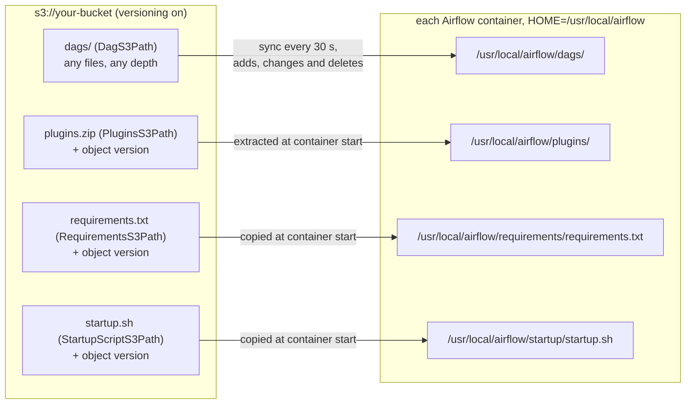
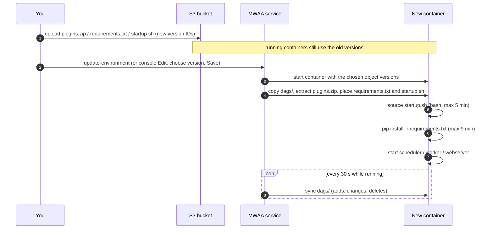

# From the S3 Bucket to the MWAA Container Filesystem

An MWAA environment never runs your files from S3. Everything you upload through the S3 console, the MWAA console's **DAG code in Amazon S3** pane or `aws s3 cp` is copied into each Airflow container (scheduler, worker, webserver) under `/usr/local/airflow`, and Airflow, pip and bash read it from there. This file maps every upload to its container path, says when each copy happens, and shows how Python finds your code once it is there.

Verified against the MWAA image source, [amazon-mwaa-docker-images](https://github.com/aws/amazon-mwaa-docker-images/tree/32b2a2e81c99fa8b937dcb2eead71c9b9252127f) at commit `32b2a2e` (`images/airflow/3.0.6`; the files quoted here are identical or differ only in logging flags in the `2.10.3`, `2.11.2`, `3.2.1` and `3.3.1` directories), Apache Airflow [3.0.6](https://github.com/apache/airflow/tree/3.0.6), pip [26.2.1](https://github.com/pypa/pip/tree/26.2.1), and the Amazon MWAA User Guide as published on 2026-10-15. The repository has no tags; each Airflow version is a directory on `main`, so every `Source:` link points at that commit. The S3 sync and the `plugins.zip` extraction run in the managed service, not in the image; what this file says about them comes from the User Guide and is marked as such.

______________________________________________________________________

## Table of Contents

1. [The Map](#1-the-map)
2. [When Each Copy Happens](#2-when-each-copy-happens)
3. [The Container Layout](#3-the-container-layout)
4. [How Python Finds Your Code](#4-how-python-finds-your-code)
5. [plugins.zip: Zip the Contents, Not the Folder](#5-pluginszip-zip-the-contents-not-the-folder)
6. [Files Other Uploads Point At](#6-files-other-uploads-point-at)
7. [Looking Inside a Running Container](#7-looking-inside-a-running-container)
8. [Quick Reference](#8-quick-reference)

______________________________________________________________________

## 1. The Map

An environment has one source bucket (`SourceBucketArn`). The four paths you enter in the console, or pass as `--dag-s3-path`, `--plugins-s3-path`, `--requirements-s3-path` and `--startup-script-s3-path`, are keys **relative to that bucket**. Whatever you name them in S3, each lands at a fixed container path:



| You upload (S3 key, relative to the bucket) | Container path                                     | Evidence                                                                                           |
| ------------------------------------------- | -------------------------------------------------- | -------------------------------------------------------------------------------------------------- |
| the DAG folder, e.g. `dags/`                | `/usr/local/airflow/dags/`, hierarchy preserved    | User Guide, "Adding or updating DAGs"; Airflow default `dags_folder = {AIRFLOW_HOME}/dags`         |
| `plugins.zip`                               | extracted into `/usr/local/airflow/plugins/`       | User Guide, "Installing custom plugins"; Airflow default `plugins_folder = {AIRFLOW_HOME}/plugins` |
| `requirements.txt`                          | `/usr/local/airflow/requirements/requirements.txt` | image `run.sh` and the User Guide's own DAG that runs `pip3 download -r` on this path              |
| `startup.sh`                                | `/usr/local/airflow/startup/startup.sh`            | image wrapper `execute-user-startup-script` sources `${HOME}/startup/startup.sh`, a fixed path     |

The S3 folder name of the DAG folder never appears in the container: `s3://bucket/prod/airflow-dags/x.py` is still `/usr/local/airflow/dags/x.py`.

`HOME` and `AIRFLOW_HOME` are both `/usr/local/airflow`:

Source: [`images/airflow/3.0.6/Dockerfiles/Dockerfile.base` L13-L14](https://github.com/aws/amazon-mwaa-docker-images/blob/32b2a2e81c99fa8b937dcb2eead71c9b9252127f/images/airflow/3.0.6/Dockerfiles/Dockerfile.base#L13-L14)

```dockerfile
ENV AIRFLOW_USER_HOME=/usr/local/airflow
ENV AIRFLOW_HOME=${AIRFLOW_USER_HOME}
```

The requirements and startup paths are what the image's local runner sets and what its scripts read:

Source: [`images/airflow/3.0.6/run.sh` L81-L82](https://github.com/aws/amazon-mwaa-docker-images/blob/32b2a2e81c99fa8b937dcb2eead71c9b9252127f/images/airflow/3.0.6/run.sh#L81-L82)

```bash
MWAA__CORE__REQUIREMENTS_PATH="/usr/local/airflow/requirements/requirements.txt"
MWAA__CORE__STARTUP_SCRIPT_PATH="/usr/local/airflow/startup/startup.sh"
```

______________________________________________________________________

## 2. When Each Copy Happens

The DAG folder and the three versioned files follow two different lifecycles. This is the single most useful fact about MWAA's filesystem:

| Upload              | S3 object version needed | Reaches the container                    | What you must do after uploading                                                              |
| ------------------- | ------------------------ | ---------------------------------------- | --------------------------------------------------------------------------------------------- |
| anything in `dags/` | no                       | within about 30 s, on running containers | nothing                                                                                       |
| `plugins.zip`       | yes                      | only when a container starts             | select the new version and update the environment (console **Edit**, or `update-environment`) |
| `requirements.txt`  | yes                      | only when a container starts             | same                                                                                          |
| `startup.sh`        | yes                      | only when a container starts             | same                                                                                          |

From the User Guide ("Adding or updating DAGs"): "Amazon MWAA automatically syncs new and changed objects from your Amazon S3 bucket to Amazon MWAA scheduler and worker containers' `/usr/local/airflow/dags` folder every 30 seconds, preserving the Amazon S3 source's file hierarchy, regardless of file type." And ("Deleting files on Amazon S3"): "This causes any DAG deletions in an Amazon S3 bucket to be synced", while "For `plugins.zip` and `requirements.txt` files, changes occur only after an environment update".

So overwriting `plugins.zip` in S3 changes nothing until an update points the environment at the new object version; the console's version dropdown and `--plugins-s3-object-version` exist for that. The `UpdateEnvironment` API reference says of each of the three: "You must specify a version each time a `plugins.zip` file is updated." Read the version ID S3 assigned to the upload and pass it explicitly:

```bash
VERSION=$(aws s3api head-object --bucket "$BUCKET" --key plugins.zip --query VersionId --output text)
aws mwaa update-environment --name "$ENV_NAME" \
  --plugins-s3-path plugins.zip --plugins-s3-object-version "$VERSION"
```



Steps 5 to 7 run in that order in every container; the order of step 5's parts is the service's and is not visible in the image. Steps 6 and 7 come from `entrypoint.py`:

Source: [`images/airflow/3.0.6/python/mwaa/entrypoint.py` L262-L279](https://github.com/aws/amazon-mwaa-docker-images/blob/32b2a2e81c99fa8b937dcb2eead71c9b9252127f/images/airflow/3.0.6/python/mwaa/entrypoint.py#L262-L279)

```python
    environ = setup_environment_variables(command, executor_type)

    if command == "migrate-db":
        await airflow_db_migrate(environ)
        print("Finished running db validations")
        return

    if command == "package-requirements":
        from mwaa.utils.user_requirements import package_user_requirements
        package_user_requirements(environ)
        print("Finished packaging requirements")
        return

    await install_user_requirements(command, environ)

    if command == "test-requirements":
        print("Finished testing requirements")
        return
```

`setup_environment_variables()` is what runs `startup.sh` (see `startup-script.md`), so the startup script always finishes before pip starts, and pip sees every variable it exported.

Consequences:

- A file that `requirements.txt` or `startup.sh` reads from `/usr/local/airflow/dags/` or `/usr/local/airflow/plugins/` must be in S3 **before** the update starts. The User Guide says the plugins are in place "prior to Amazon MWAA's `pip3 install -r requirements.txt`" and that files in the DAG folder "will be synchronized to each Amazon MWAA container before Apache Airflow starts".
- Removing `plugins.zip` or `requirements.txt` from an environment is not possible; the User Guide's workaround is to point it at an empty zip or text file. Deleting the current version in S3 and then updating fails with `Unable to read version {version number} of file {file name}`.
- A change to a file in `dags/` that a DAG reads at parse time is picked up by the next parse; a change to a module that a running worker has already imported is not, until that process restarts.

______________________________________________________________________

## 3. The Container Layout

What a scheduler or worker container holds, with where each part comes from:

```text
/usr/local/airflow/                      HOME and AIRFLOW_HOME; owned by user "airflow" (passwordless sudo)
├── dags/                                ← s3://bucket/<DagS3Path>/, synced every 30 s
│   ├── my_dag.py
│   ├── common/                          your shared modules: importable as "common" (section 4)
│   └── constraints-custom.txt           any file type syncs; requirements.txt can point here
├── plugins/                             ← plugins.zip, extracted at container start
│   ├── my_plugin.py
│   ├── operators/
│   └── *.whl                            wheels for "--find-links /usr/local/airflow/plugins"
├── requirements/
│   └── requirements.txt                 ← RequirementsS3Path, whatever its S3 name
├── startup/
│   └── startup.sh                       ← StartupScriptS3Path, whatever its S3 name
├── config/
│   └── airflow_local_settings.py        MWAA's own; on sys.path ahead of plugins/
└── .local/
    ├── bin/                             console scripts; first on PATH
    ├── etc/
    │   ├── airflow_constraints.txt      Apache's constraints for this Airflow version
    │   └── mwaa_essential_constraints.txt  pins you cannot override (requirements-install.md)
    └── lib/python3.12/site-packages/    Airflow, providers and everything requirements.txt installs
/python/mwaa/                            MWAA's entrypoint package; PYTHONPATH=/python
/tmp/                                    scratch space for tasks; task storage is 20 GB in total
```

- Installed packages go to the `airflow` user's site directory, `/usr/local/airflow/.local/lib/python3.12/site-packages`, as every path in the image's bill of materials shows. The User Guide's "installed at `/usr/local/airflow/.local/bin`" names only the console-script directory, and the `-r /usr/local/airflow/.local/bin` in its sample log is not the requirements file's path.
- `/tmp` is per container. The User Guide: "There's no guarantee that subsequent tasks run on the same Fargate container instance, which can use a different `/tmp` folder." Pass data between tasks through S3 or XCom, not the local disk.
- Everything outside `dags/` is rebuilt when a container starts, so files a task writes elsewhere disappear on the next restart, scale-in or environment update.
- The Python and Airflow versions are fixed by the image. A startup script cannot change them; the image's post-startup check prints `Validation Error: Python version 3.12 expected` if something tries.

______________________________________________________________________

## 4. How Python Finds Your Code

Three directories you control end up on `sys.path`, each added by a different part of the stack, in this order:

```text
sys.path (scheduler, DAG processor and task processes, Airflow 3.0.6)
  1. /python                                    PYTHONPATH, MWAA's own "mwaa" package
  2. Python 3.12 standard library
  3. /usr/local/airflow/.local/lib/python3.12/site-packages   (user site: requirements.txt)
  4. ... system site-packages
  5. /usr/local/airflow/config                  appended when airflow.settings is imported
  6. /usr/local/airflow/plugins                 appended right after it
  7. /usr/local/airflow/dags                    appended by the DAG processor and the task runner
```

`config/` and `plugins/` are appended by `airflow.settings`:

Source: [`airflow-core/src/airflow/settings.py` L551-L560](https://github.com/apache/airflow/blob/e965c2e676d85ced65a485d4b2601addc2fd3e97/airflow-core/src/airflow/settings.py#L551-L560)

```python
def prepare_syspath_for_config_and_plugins():
    """Update sys.path for the config and plugins directories."""
    # Add ./config/ for loading custom log parsers etc, or
    # airflow_local_settings etc.
    config_path = os.path.join(AIRFLOW_HOME, "config")
    if config_path not in sys.path:
        sys.path.append(config_path)

    if PLUGINS_FOLDER not in sys.path:
        sys.path.append(PLUGINS_FOLDER)
```

In Airflow 3 the DAG folder is the default DAG bundle, and its root is appended when a file is parsed and when a task runs:

Source: [`airflow-core/src/airflow/dag_processing/processor.py` L167-L170](https://github.com/apache/airflow/blob/e965c2e676d85ced65a485d4b2601addc2fd3e97/airflow-core/src/airflow/dag_processing/processor.py#L167-L170)

```python
    # Put bundle root on sys.path if needed. This allows the dag bundle to add
    # code in util modules to be shared between files within the same bundle.
    if (bundle_root := os.fspath(msg.bundle_path)) not in sys.path:
        sys.path.append(bundle_root)
```

The task runner has the same four lines ([`task-sdk/src/airflow/sdk/execution_time/task_runner.py` L614-L617](https://github.com/apache/airflow/blob/e965c2e676d85ced65a485d4b2601addc2fd3e97/task-sdk/src/airflow/sdk/execution_time/task_runner.py#L614-L617)).

What follows from the order:

| You have                                                          | `import` resolves to                                         | Why                                                    |
| ----------------------------------------------------------------- | ------------------------------------------------------------ | ------------------------------------------------------ |
| `dags/common/db.py`                                               | `from common.db import x` works in any DAG or task           | `/usr/local/airflow/dags` is on `sys.path`             |
| `plugins.zip` with `operators/hello.py` at its top level          | `from operators.hello import HelloOperator` works            | `/usr/local/airflow/plugins` is on `sys.path`          |
| a package named `mwaa` in `dags/` or `plugins.zip`                | MWAA's `/python/mwaa`, never yours                           | `PYTHONPATH` comes first                               |
| `dags/email/`, `dags/logging.py`, `plugins/json/`                 | the standard library module                                  | the standard library comes before appended directories |
| `dags/utils/` while some installed package is also called `utils` | the installed package                                        | site-packages comes before appended directories        |
| the same top-level name in `plugins.zip` and in `dags/`           | the `plugins/` one                                           | `plugins/` is appended before `dags/`                  |
| `airflow_local_settings.py` in `plugins.zip`                      | MWAA's `/usr/local/airflow/config/airflow_local_settings.py` | `config/` is appended before `plugins/`                |

Give shared code one distinctive top-level package name (`acme_pipelines/`) instead of `utils`, `common` or `helpers`, and keep it in one place.

The plugin manager does not use `sys.path` to find plugins. It walks `plugins/` recursively, including subdirectories, and imports each `.py` file under its bare file stem:

Source: [`airflow-core/src/airflow/plugins_manager.py` L270-L289](https://github.com/apache/airflow/blob/e965c2e676d85ced65a485d4b2601addc2fd3e97/airflow-core/src/airflow/plugins_manager.py#L270-L289)

```python
    files = find_path_from_directory(settings.PLUGINS_FOLDER, ".airflowignore")
    plugin_search_locations: list[tuple[str, Generator[str, None, None]]] = [("", files)]

    if conf.getboolean("core", "LOAD_EXAMPLES"):
        log.debug("Note: Loading plugins from examples as well: %s", settings.PLUGINS_FOLDER)
        from airflow.example_dags import plugins

        example_plugins_folder = next(iter(plugins.__path__))
        example_files = find_path_from_directory(example_plugins_folder, ".airflowignore")
        plugin_search_locations.append((plugins.__name__, example_files))

    for module_prefix, plugin_files in plugin_search_locations:
        for file_path in plugin_files:
            path = Path(file_path)
            if not path.is_file() or path.suffix != ".py":
                continue
            mod_name = f"{module_prefix}.{path.stem}" if module_prefix else path.stem

            try:
                loader = importlib.machinery.SourceFileLoader(mod_name, file_path)
                spec = importlib.util.spec_from_loader(mod_name, loader)
```

Two consequences: an `AirflowPlugin` class is registered from any depth, so a wrongly nested zip still shows its plugins in the UI while imports of its modules fail (section 5); and two plugin files with the same name in different subdirectories (`a/helpers.py`, `b/helpers.py`) are both registered in `sys.modules` as `helpers`, the second replacing the first. Use `.airflowignore` in `plugins/` to keep non-plugin files out of this walk.

______________________________________________________________________

## 5. plugins.zip: Zip the Contents, Not the Folder

The zip's top level becomes `/usr/local/airflow/plugins/`. Zipping the folder itself adds one directory level:

```text
cd plugins && zip -r ../plugins.zip .        zip -r plugins.zip plugins
(correct)                                     (one level too deep)

plugins.zip                                   plugins.zip
├── my_plugin.py                              └── plugins/
├── operators/                                    ├── my_plugin.py
│   └── hello.py                                  └── operators/
└── numpy-2.1.0-...whl                                └── hello.py

/usr/local/airflow/plugins/                   /usr/local/airflow/plugins/
├── my_plugin.py                              └── plugins/
├── operators/hello.py                            ├── my_plugin.py
└── numpy-2.1.0-...whl                            └── operators/hello.py

from operators.hello import ...  works        from operators.hello import ...
                                              ModuleNotFoundError: No module named 'operators'
```

With the nested zip, the plugin manager's recursive walk still registers `my_plugin.py`, which is why the UI's plugin list looks fine while DAGs show `Broken DAG: ... No module named 'operators'`.

Also keep out of the zip:

- `__pycache__/` and `.pyc` files, compiled on another machine (`zip -r ../plugins.zip . -x '*__pycache__*'`).
- Wheels in a subdirectory, if `requirements.txt` uses `--find-links /usr/local/airflow/plugins`: pip lists a `--find-links` directory with `os.scandir()`, without recursing ([`src/pip/_internal/index/sources.py`](https://github.com/pypa/pip/blob/634a6ec1a5d9dcc2433571cdb2f4c58a4bb29caf/src/pip/_internal/index/sources.py#L62), pip 26.2.1).

The User Guide also asks for `chmod -R 755 .` before zipping, so that executables shipped in the zip keep their execute bit, and warns that the Windows built-in zip tool can add subfolders. Check any zip before uploading:

```bash
unzip -l plugins.zip | head -20
```

Or run this skill's checker, which reports a nested top-level folder, bytecode and misplaced wheels:

```bash
uv run scripts/check_mwaa_layout.py --plugins plugins.zip
```

______________________________________________________________________

## 6. Files Other Uploads Point At

`requirements.txt` and `startup.sh` often need another file: a custom constraints file, a wheel, a certificate, a binary. Only two places are both writable by you and present before pip runs: `dags/` and `plugins.zip`. Refer to them by **absolute** container path:

| Needed by                     | Put it in            | Refer to it as                                                          |
| ----------------------------- | -------------------- | ----------------------------------------------------------------------- |
| a custom constraints file     | `s3://bucket/dags/`  | `--constraint "/usr/local/airflow/dags/constraints-custom.txt"`         |
| an extra requirements file    | `s3://bucket/dags/`  | `-r /usr/local/airflow/dags/requirements-extra.txt`                     |
| wheels for an offline install | top of `plugins.zip` | `--find-links /usr/local/airflow/plugins` and `--no-index`              |
| a shared library or binary    | `plugins.zip`        | `export LD_LIBRARY_PATH=/usr/local/airflow/plugins/lib` in `startup.sh` |

A relative path in `requirements.txt` is resolved against the directory of `requirements.txt` itself, `/usr/local/airflow/requirements/`, not against your repository layout or pip's working directory, and that directory holds nothing but `requirements.txt`. See `requirements-install.md`, section 4, for pip's source.

Two more rules for files in `dags/`:

- Any file type syncs, so a constraints file next to the DAGs is fine. The DAG processor only parses `.py` files and zip archives; list other `.py` helpers in `dags/.airflowignore` if they are slow to import.
- Anyone who can write to `dags/` can change these files on a running environment within 30 s. The User Guide suggests `plugins.zip` "for any files that you don't want continuously changed during environment execution, or that you do not want to grant access to users that write DAGs".

______________________________________________________________________

## 7. Looking Inside a Running Container

MWAA has no SSH. To see what a container actually holds, upload this DAG to `dags/`, trigger it, and read the task log. It uses `@task.bash`, from `apache-airflow-providers-standard`, which the 3.0.6 image installs:

```python
import pendulum
from airflow.sdk import dag, task


@dag(schedule=None, start_date=pendulum.datetime(2026, 1, 1), catchup=False, tags=["debug"])
def mwaa_inspect_filesystem():
    @task.bash
    def inspect() -> str:
        return r"""
        set -x
        id; echo "HOME=$HOME AIRFLOW_HOME=$AIRFLOW_HOME PYTHONPATH=$PYTHONPATH"
        ls -la /usr/local/airflow
        find /usr/local/airflow/dags /usr/local/airflow/plugins -maxdepth 2 | head -100
        ls -la /usr/local/airflow/requirements /usr/local/airflow/startup
        head -20 /usr/local/airflow/requirements/requirements.txt
        python3 -c 'import sys; print("\n".join(sys.path))'
        python3 -m pip list --user 2>/dev/null | head -50
        df -h /tmp /usr/local/airflow
        """

    inspect()


mwaa_inspect_filesystem()
```

The `python3 -c` line runs in a fresh interpreter, so it prints `sys.path` without the entries Airflow appends at run time (section 4); add `import sys; print(sys.path)` inside a `@task` function to see those.

The image's local runner reproduces the layout with bind mounts, which is how to test a change before uploading it:

Source: [`images/airflow/3.0.6/docker-compose-test-commands.yaml` L36-L40](https://github.com/aws/amazon-mwaa-docker-images/blob/32b2a2e81c99fa8b937dcb2eead71c9b9252127f/images/airflow/3.0.6/docker-compose-test-commands.yaml#L36-L40)

```yaml
  volumes:
    - ./dags:/usr/local/airflow/dags
    - ./plugins:/usr/local/airflow/plugins
    - ./requirements:/usr/local/airflow/requirements
    - ./startup:/usr/local/airflow/startup
```

Note that `plugins/` here is a mounted directory, not an extracted zip, so the local runner cannot catch a wrongly nested `plugins.zip`; check the zip itself (section 5). Put your files at the same relative paths (`requirements/requirements.txt`, `startup/startup.sh`) and run, from `images/airflow/<version>/`:

```bash
./run.sh test-requirements
```

______________________________________________________________________

## 8. Quick Reference

| Question                                                                       | Answer                                                                |
| ------------------------------------------------------------------------------ | --------------------------------------------------------------------- |
| Where do my DAGs live in the container?                                        | `/usr/local/airflow/dags/`, whatever the S3 folder is called          |
| How fast does a DAG upload or delete reach containers?                         | about 30 s; no environment update needed                              |
| I uploaded a new `plugins.zip`/`requirements.txt`/`startup.sh`; why no change? | they apply only on an environment update with the new object version  |
| Where is `plugins.zip` extracted?                                              | `/usr/local/airflow/plugins/`, the zip's top level at that directory  |
| Where is `requirements.txt` in the container?                                  | `/usr/local/airflow/requirements/requirements.txt`                    |
| Where are packages installed?                                                  | `/usr/local/airflow/.local/lib/python3.12/site-packages` (user site)  |
| How do I reference a custom constraints file?                                  | put it in `dags/`, use `/usr/local/airflow/dags/<name>` (absolute)    |
| Can DAGs import shared modules from `dags/` and `plugins/`?                    | yes, both are on `sys.path`; standard library and installed names win |
| Where can a task write scratch files?                                          | `/tmp`, per container, 20 GB task storage in total                    |
| How do I see the real filesystem?                                              | the inspection DAG in section 7                                       |
