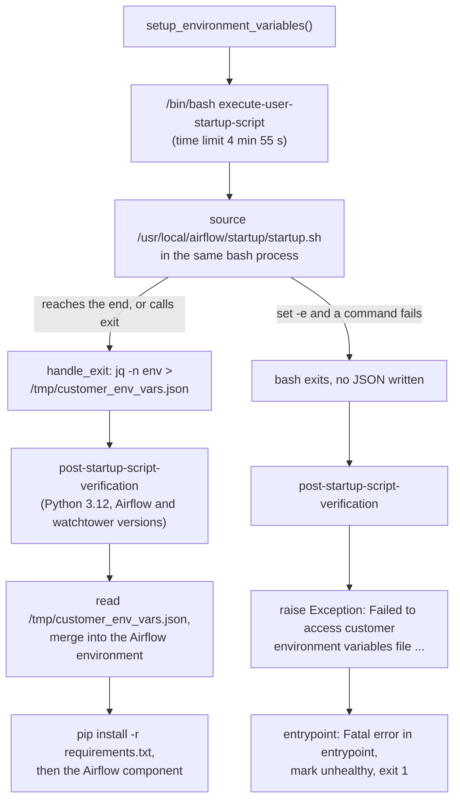

# How MWAA Runs startup.sh

MWAA does not execute your startup script; it `source`s it into a bash wrapper and then saves that shell's environment for Airflow. That one fact explains why the `#!` line is ignored, why only `export`ed variables survive, why `exit 1` does not fail anything, and why `set -e` can take the whole container down.

Verified against the MWAA image source, [amazon-mwaa-docker-images](https://github.com/aws/amazon-mwaa-docker-images/tree/32b2a2e81c99fa8b937dcb2eead71c9b9252127f) at commit `32b2a2e` (`images/airflow/3.0.6`; `execute-user-startup-script` is identical in the `2.10.3`, `2.11.2`, `3.2.1` and `3.3.1` directories), the Amazon MWAA User Guide as published on 2026-10-15, and by running a reproduction of the wrapper with GNU bash 5.2.21 and jq 1.7.

______________________________________________________________________

## Table of Contents

1. [The Wrapper](#1-the-wrapper)
2. [What Survives the Script](#2-what-survives-the-script)
3. [set -e Kills the Container](#3-set--e-kills-the-container)
4. [Which Variables You Can Override](#4-which-variables-you-can-override)
5. [Timing, Components and Logs](#5-timing-components-and-logs)
6. [Patterns That Work](#6-patterns-that-work)

______________________________________________________________________

## 1. The Wrapper

`startup.sh` is copied to `/usr/local/airflow/startup/startup.sh` (`container-filesystem.md`). MWAA then runs this wrapper with `/bin/bash`:

Source: [`images/airflow/3.0.6/bin/airflow-user/execute-user-startup-script` L1-L18](https://github.com/aws/amazon-mwaa-docker-images/blob/32b2a2e81c99fa8b937dcb2eead71c9b9252127f/images/airflow/3.0.6/bin/airflow-user/execute-user-startup-script#L1-L18)

```bash
#!/usr/bin/env bash
echo "Executing customer startup script"

handle_exit() {
    echo "Exiting customer startup script"
    jq -n env > /tmp/customer_env_vars.json

    unalias exit
    exit
}

shopt -s expand_aliases # Enable alias expansion (off by default in noninteractive shells)
alias exit=handle_exit # Alias exit to our custom handler to save env vars

# shellcheck disable=SC1091\
source "${HOME}/startup/startup.sh"

handle_exit
```



Because the file is sourced:

- The `#!` line is a comment. `#!/bin/sh` scripts run under **bash**, so bash syntax (`[[ ]]`, arrays) works, and the execute bit is irrelevant.
- `exit` anywhere in the script, including inside a function, means `handle_exit`: it dumps the environment and ends the wrapper with the status of `exit` itself, 0. The argument (`exit 1`) is discarded.
- A failing command does not stop the script, unless the script enables `set -e`.
- The wrapper is started without a `cwd`, so the script inherits the entrypoint's working directory (the image's `WORKDIR` is `/usr/local/airflow`). Do not rely on it: use absolute paths, or `cd /tmp` before downloading files.

______________________________________________________________________

## 2. What Survives the Script

`jq -n env` prints the process environment, which holds exported variables only. The reproduction (`wrapper.sh` with the same `alias exit`, `source` and `jq -n env` logic, writing to a scratch file), with bash 5.2.21:

| `startup.sh` body                                                 | Wrapper exit | Env file        | `FOO` | `BAR`     |
| ----------------------------------------------------------------- | ------------ | --------------- | ----- | --------- |
| `export FOO=1` then `BAR=2`                                       | 0            | written         | `1`   | absent    |
| `export FOO=1`, `exit 1`, `export BAR=2`                          | 0            | written         | `1`   | absent    |
| `export FOO=1`, `false`, `export BAR=after`                       | 0            | written         | `1`   | `after`   |
| `export FOO=1`, `f() { exit 3; }`, `f`, `export BAR=2`            | 0            | written         | `1`   | absent    |
| `#!/bin/sh`, `export FOO=1`, `[[ x == x ]] && export BAR=bashism` | 0            | written         | `1`   | `bashism` |
| `export FOO=1`, `( export BAR=sub )`                              | 0            | written         | `1`   | absent    |
| `set -e`, `export FOO=1`, `false`, `export BAR=2`                 | **1**        | **not written** | n/a   | n/a       |

Rules that follow:

1. `export` every variable Airflow, pip or a task needs. `VAR=value` alone stays inside the script.
2. Variables set in a subshell `( ... )`, a pipeline stage, or a command run with `bash -c` never reach the dump.
3. `exit` ends the script early but does not signal failure. To make a problem visible, `echo` it; the line appears in the startup log stream.
4. A shell function or alias defined in `startup.sh` does not survive; only the environment does.

______________________________________________________________________

## 3. set -e Kills the Container

With `set -e` (or `set -o errexit`, or `set -euo pipefail`), the first failing command makes bash exit immediately. `handle_exit` never runs, `/tmp/customer_env_vars.json` is never written, and the image treats that as fatal:

Source: [`images/airflow/3.0.6/python/mwaa/config/setup_environment.py` L92-L117](https://github.com/aws/amazon-mwaa-docker-images/blob/32b2a2e81c99fa8b937dcb2eead71c9b9252127f/images/airflow/3.0.6/python/mwaa/config/setup_environment.py#L92-L117)

```python
        customer_env_vars_path = "/tmp/customer_env_vars.json"
        if os.path.isfile(customer_env_vars_path):
            try:
                with open(customer_env_vars_path, "r") as f:
                    customer_env_dict = json.load(f)
                logger.info("Successfully read the customer's environment variables.")
                return customer_env_dict
            except Exception as e:
                logger.error(f"Error reading the customer's environment variables: {e}")
                PROCESS_LOGGER.error(
                    "[ERROR] Failed to load environment variables from startup script. "
                    "Please verify your startup script configuration."
                )
                raise Exception(f"Failed to read customer's environment variables from startup script: {e}")

        else:
            logger.error(
                "An unexpected error occurred: the file containing the customer-defined "
                "environment variables could not be located. If the customer's startup "
                "script defines environment variables, this error message indicates that "
                "those variables won't be exported to the Airflow tasks."
            )
            PROCESS_LOGGER.error(
                "[ERROR] An unexpected error occurred: Failed to locate environment variables file from startup script.")
            raise Exception(
                "Failed to access customer environment variables file: Service was unable to create or locate /tmp/customer_env_vars.json")
```

The exception reaches `entrypoint.py`'s top level, which logs `Fatal error in entrypoint`, writes the unhealthy marker and exits 1. The same happens if the script is killed by the time limit before it reaches its end.

The symptom in the startup log stream is `[ERROR] An unexpected error occurred: Failed to locate environment variables file from startup script.` A `yum install` of a package that does not exist, a `curl` without network access on a private environment, or `grep` finding nothing is enough to trigger it under `set -e`.

Do not use `set -e` in `startup.sh`. Check the commands that matter and report instead:

```bash
#!/bin/sh
if ! sudo yum install -y libaio; then
    echo "WARNING: libaio install failed; Oracle tasks will fail"
fi
export ENVIRONMENT_STAGE="production"
```

______________________________________________________________________

## 4. Which Variables You Can Override

Your exports are one layer of the final environment, and later layers win:

Source: [`images/airflow/3.0.6/python/mwaa/config/setup_environment.py` L280-L303](https://github.com/aws/amazon-mwaa-docker-images/blob/32b2a2e81c99fa8b937dcb2eead71c9b9252127f/images/airflow/3.0.6/python/mwaa/config/setup_environment.py#L280-L303)

```python
    environ = {
        **os.environ,
        # Custom configuration and environment variables that we think are good, but
        # allow the user to override.
        **mwaa_opinionated_airflow_config,
        **mwaa_opinionated_airflow_environ,
        # What the user defined in the startup script.
        **startup_script_environ,
        # What the user passed via Airflow config secrets (specified by the
        # MWAA__CORE__CUSTOM_AIRFLOW_CONFIGS environment variable.)
        **user_airflow_config,
        # The MWAA__x__y environment variables that are passed to the container are
        # considered protected environment variables that cannot be overridden at
        # runtime to avoid breaking the functionality of the container.
        **{
            key: value
            for (key, value) in os.environ.items()
            if _is_protected_os_environ(key)
        },
        # Essential variables that our setup will not function properly without, hence
        # it always has the highest priority.
        **mwaa_essential_airflow_config,
        **mwaa_essential_airflow_environ,
    }
```

```text
lowest  ┌──────────────────────────────────────────────────────────────┐
        │ container environment                                        │
        │ MWAA's opinionated Airflow config and environment            │
        │ ► your startup.sh exports                                    │  PATH, LD_LIBRARY_PATH, your own vars
        │ Airflow configuration options set in the MWAA console        │  beat a startup.sh AIRFLOW__X__Y export
        │ protected variables (MWAA__*, PYTHONPATH, AWS_REGION, ...)   │  your value silently dropped
        │ MWAA's essential Airflow config and environment              │
highest └──────────────────────────────────────────────────────────────┘
```

So:

- Exports of new names, and of `PATH`, `LD_LIBRARY_PATH`, `CLASSPATH`, `JAVA_HOME` and similar, take effect.
- An `AIRFLOW__SECTION__KEY` export works unless the same option is also set in the console's Airflow configuration options, which win, or MWAA treats it as essential.
- Anything starting with `MWAA__`, and the protected list below, keeps MWAA's value. The User Guide's wording is: "If you overwrite a *reserved* variable, Amazon MWAA restores it to its default."

The protected names in the 3.0.6 image ([`setup_environment.py` L154-L214](https://github.com/aws/amazon-mwaa-docker-images/blob/32b2a2e81c99fa8b937dcb2eead71c9b9252127f/images/airflow/3.0.6/python/mwaa/config/setup_environment.py#L154-L214)): `AIRFLOW_ENV_ID`, `AIRFLOW_ENV_NAME`, `AIRFLOW_HOME`, `AIRFLOW_TASK_REVISION_ID`, `AIRFLOW_VERSION`, `AIRFLOW__AWS_MWAA__REDIRECT_URL`, `JWT_PUBLIC_KEY`, `AIRFLOW__WEBSERVER__BASE_URL`, `AIRFLOW__API__BASE_URL`, `AWS_DEFAULT_REGION`, `AWS_REGION`, `CUSTOMER_ACCOUNT_ID`, `ECS_AGENT_URI`, `ECS_CONTAINER_METADATA_URI`, `ECS_CONTAINER_METADATA_URI_V4`, `AWS_CONTAINER_CREDENTIALS_RELATIVE_URI`, `AWS_EXECUTION_ENV`, `PYTHONPATH`, `PYTHONUNBUFFERED`, `WATCHTOWER_VERSION`, `USE_NON_CRITICAL_LOGGING`, `AIRFLOW__CORE__DATABASE_ACCESS_ISOLATION`. The User Guide's reserved list adds Airflow settings MWAA sets as essential, such as `AIRFLOW__CORE__EXECUTOR`, `AIRFLOW__CORE__FERNET_KEY`, `AIRFLOW__CORE__SQL_ALCHEMY_CONN` and `AIRFLOW__CELERY__BROKER_URL`.

`PYTHONPATH` is protected (reserved since Airflow 2.9 on MWAA), so a startup script cannot add directories to it. Put importable code in `dags/` or `plugins.zip` instead, which are on `sys.path` already (`container-filesystem.md`, section 4).

______________________________________________________________________

## 5. Timing, Components and Logs

| Fact                  | Value                                                                                             | Source                                                    |
| --------------------- | ------------------------------------------------------------------------------------------------- | --------------------------------------------------------- |
| time limit            | 5 minutes minus a 5-second SIGTERM grace, so 4 min 55 s                                           | `setup_environment.py` L32-L35                            |
| runs on               | every container: scheduler, worker, webserver; not on the `migrate-db` container                  | `setup_environment.py` L45-L48; User Guide                |
| runs before           | `pip install -r requirements.txt` and the Airflow process                                         | `entrypoint.py` L262-L275                                 |
| which component am I? | `$MWAA_AIRFLOW_COMPONENT`, set to the container command (`scheduler`, `worker`, `webserver`, ...) | `config/environ.py` L28                                   |
| user and privileges   | `airflow`, with passwordless `sudo`                                                               | `bootstrap/03-root-secondpass/002-make-airflow-sudoer.sh` |
| log stream            | prefix `startup_script_execution`, in each component's log group, always at INFO                  | `logging/config.py` L221-L224; User Guide                 |

The script runs again every time a container starts: on each environment update, on worker scale-out, and on container replacement. Make it idempotent, and keep it fast, because worker scale-out waits for it.

The 5-minute limit covers everything the script does, including `yum install` over the network. A private environment without a NAT gateway has no internet access, so downloads hang until the limit; the User Guide suggests skipping installs on the webserver (`if [[ "${MWAA_AIRFLOW_COMPONENT}" != "webserver" ]]`) or shipping the files in `plugins.zip`.

______________________________________________________________________

## 6. Patterns That Work

Install an OS package on the components that run tasks:

```bash
#!/bin/sh
if [[ "${MWAA_AIRFLOW_COMPONENT}" != "webserver" ]]; then
    sudo yum install -y libaio || echo "WARNING: libaio install failed"
fi
```

Use a binary or shared library shipped in `plugins.zip`:

```bash
#!/bin/sh
export PATH="/usr/local/airflow/plugins/bin:${PATH}"
export LD_LIBRARY_PATH="/usr/local/airflow/plugins/lib${LD_LIBRARY_PATH:+:${LD_LIBRARY_PATH}}"
```

The `${VAR:+:...}` form avoids a trailing `:` when the variable was empty, which the dynamic linker would read as "also search the current directory".

Give pip access to private `git+https` dependencies without writing a token into `requirements.txt` or S3. Fetch it at startup from Secrets Manager (the execution role needs `secretsmanager:GetSecretValue` on it) and hand it to git through `GIT_CONFIG_*`, which git reads from the environment:

```bash
#!/bin/sh
GITHUB_TOKEN=$(aws secretsmanager get-secret-value --secret-id airflow/github-token \
    --query SecretString --output text)
export GIT_CONFIG_COUNT=1
export GIT_CONFIG_KEY_0="url.https://${GITHUB_TOKEN}@github.com/.insteadOf"
export GIT_CONFIG_VALUE_0="https://github.com/"
```

`requirements.txt` then names the dependency without credentials, for example `mylib @ git+https://github.com/acme/mylib.git@v1.2.0`. The `GIT_CONFIG_*` variables stay in the environment of every task, which can read them; scope the token to read access on the repositories pip needs.

Test a script before uploading it with the image's local runner, from `images/airflow/<version>/` in [amazon-mwaa-docker-images](https://github.com/aws/amazon-mwaa-docker-images), with the script at `startup/startup.sh`:

```bash
./run.sh test-startup-script
```

`./run.sh test-requirements` also runs the startup script first, so it tests a token hand-off like the one above end to end.
