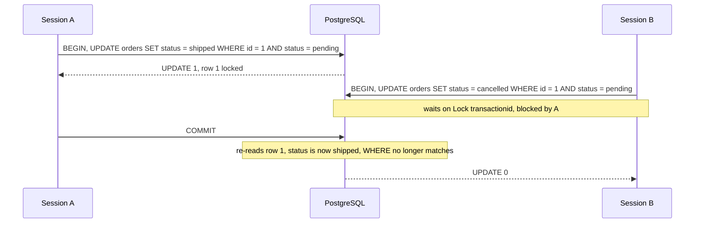
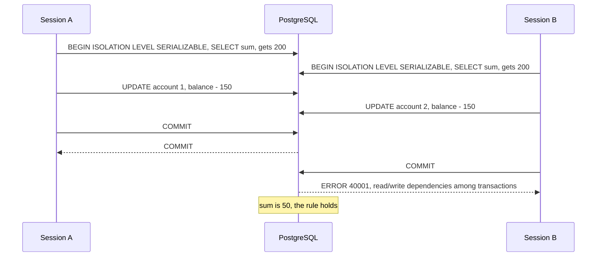

# Isolation Levels: Read Committed, Repeatable Read and Serializable

What each isolation level shows a transaction while other sessions commit, which errors each level raises, what to retry, and how to choose the level from SQL, psycopg 3 and Django.

Verified by experiment on PostgreSQL 18 only (18.6, Docker image `postgres:18`, started with `log_statement = all`), with two or three psycopg 3.3.6 sessions per test on Python 3.14, and Django 6.1.2 with psycopg 3 (`psycopg[binary]==3.3.6`) only. Statement order and the `BEGIN` each client sent were read from the server log; waits and blockers from `pg_stat_activity` and `pg_blocking_pids()`; predicate locks from `pg_locks`. The levels are documented in [Transaction Isolation](https://www.postgresql.org/docs/18/transaction-iso.html) and retries in [Serialization Failure Handling](https://www.postgresql.org/docs/18/mvcc-serialization-failure-handling.html#MVCC-SERIALIZATION-FAILURE-HANDLING).

______________________________________________________________________

## Table of Contents

01. [The Three Levels at a Glance](#1-the-three-levels-at-a-glance)
02. [Non-Repeatable Reads and Phantoms](#2-non-repeatable-reads-and-phantoms)
03. [When the Snapshot Is Taken](#3-when-the-snapshot-is-taken)
04. [Read Committed Re-checks Rows Another Session Changed](#4-read-committed-re-checks-rows-another-session-changed)
05. [The Lost Update Across the Three Levels](#5-the-lost-update-across-the-three-levels)
06. [Concurrent Update Errors in Repeatable Read](#6-concurrent-update-errors-in-repeatable-read)
07. [Write Skew: Repeatable Read Allows It, Serializable Stops It](#7-write-skew-repeatable-read-allows-it-serializable-stops-it)
08. [Preventing Write Skew with Row Locks](#8-preventing-write-skew-with-row-locks)
09. [Serializable Failures You Did Not Expect](#9-serializable-failures-you-did-not-expect)
10. [Retry the Whole Transaction](#10-retry-the-whole-transaction)
11. [Setting the Level in SQL](#11-setting-the-level-in-sql)
12. [Setting the Level from psycopg 3](#12-setting-the-level-from-psycopg-3)
13. [Setting the Level from Django](#13-setting-the-level-from-django)
14. [How This Was Verified](#14-how-this-was-verified)
15. [Quick Reference](#15-quick-reference)

______________________________________________________________________

## 1. The Three Levels at a Glance

`default_transaction_isolation` is `read committed` on a fresh server, and a plain `BEGIN` runs at that level. Every row below was measured with two sessions, mostly on a table `accounts (id, customer_id, balance)` holding two rows of 100 for customer 7; the sections that follow give the exact statements.

| Situation                                                                     | `READ COMMITTED` (default)            | `REPEATABLE READ`                                             | `SERIALIZABLE`                    |
| ----------------------------------------------------------------------------- | ------------------------------------- | ------------------------------------------------------------- | --------------------------------- |
| Snapshot                                                                      | a new one for every statement         | one, taken by the first statement                             | one, taken by the first statement |
| Re-read a row another session changed (100 to 50) and committed               | **50**                                | 100                                                           | 100                               |
| Re-count rows after another session inserted a matching one                   | **3 rows**, was 2                     | 2 rows                                                        | 2 rows                            |
| Both read 100, both write `balance = 70`                                      | both commit: **one update lost** (70) | second writer: `40001`                                        | second writer: `40001`            |
| Both run `UPDATE … SET balance = balance - 30`                                | both commit (40)                      | second writer: `40001` (70)                                   | second writer: `40001` (70)       |
| Write skew: both check `sum(balance) - 150 >= 0`, each debits a different row | both commit: **sum -100**             | both commit: **sum -100**                                     | second `COMMIT`: `40001` (sum 50) |
| Error you must be ready to retry                                              | none from isolation                   | `40001` `could not serialize access due to concurrent update` | `40001`, with either message      |

`READ UNCOMMITTED` is accepted (`SHOW transaction_isolation` returns `read uncommitted`) but behaves like `READ COMMITTED`. Measured: session B ran `UPDATE accounts SET balance = 999 WHERE id = 1` without committing; session A at `READ UNCOMMITTED` read 100. The docs say the same: "PostgreSQL's Read Uncommitted mode behaves like Read Committed" ([Transaction Isolation](https://www.postgresql.org/docs/18/transaction-iso.html#MVCC-ISOLEVEL-TABLE)).

The rest of this file shows each row in detail.

______________________________________________________________________

## 2. Non-Repeatable Reads and Phantoms

Session A reads, session B changes the data with autocommit on (so it commits at once), then A reads again in the same transaction.

**Non-repeatable read.** B ran `UPDATE accounts SET balance = 50 WHERE id = 1`:

| A's level         | A's first `SELECT balance` | A's second `SELECT balance` | After A commits |
| ----------------- | -------------------------- | --------------------------- | --------------- |
| `READ COMMITTED`  | 100                        | **50**                      | 50              |
| `REPEATABLE READ` | 100                        | 100                         | 50              |
| `SERIALIZABLE`    | 100                        | 100                         | 50              |

**Phantom.** Table `orders` had two `pending` orders (amounts 80 and 20). B ran `INSERT INTO orders VALUES (4, 'pending', 500)`:

| A's level         | `SELECT count(*), sum(amount) … WHERE status = 'pending'`, first | second       |
| ----------------- | ---------------------------------------------------------------- | ------------ |
| `READ COMMITTED`  | (2, 100)                                                         | **(3, 600)** |
| `REPEATABLE READ` | (2, 100)                                                         | (2, 100)     |
| `SERIALIZABLE`    | (2, 100)                                                         | (2, 100)     |

In `READ COMMITTED`, two statements in one transaction can disagree. A report that runs a count and then a sum, or a check followed by a dependent read, can mix two states of the database. `REPEATABLE READ` gives every statement the same snapshot; in PostgreSQL it also hides phantoms, which the SQL standard allows at that level ([isolation levels table](https://www.postgresql.org/docs/18/transaction-iso.html#MVCC-ISOLEVEL-TABLE)).

______________________________________________________________________

## 3. When the Snapshot Is Taken

The `REPEATABLE READ` and `SERIALIZABLE` snapshot is not taken by `BEGIN`. The docs: "a query in a repeatable read transaction sees a snapshot as of the start of the first non-transaction-control statement in the transaction" ([Repeatable Read](https://www.postgresql.org/docs/18/transaction-iso.html#XACT-REPEATABLE-READ)).

Measured: A ran `BEGIN ISOLATION LEVEL REPEATABLE READ`, then one statement; B then committed `balance = 50`; then A read the balance.

| A's first statement after `BEGIN`                    | A then reads | Snapshot taken by the first statement?      |
| ---------------------------------------------------- | ------------ | ------------------------------------------- |
| (none; B committed between `BEGIN` and A's `SELECT`) | 50           | n/a: the `SELECT` took it, after B's commit |
| `SELECT 1`                                           | **100**      | yes                                         |
| `SELECT now()`                                       | **100**      | yes                                         |
| `SELECT pg_current_xact_id()`                        | **100**      | yes                                         |
| `SHOW transaction_isolation`                         | 50           | no                                          |
| `SET LOCAL statement_timeout = '5s'`                 | 50           | no                                          |

In the first row, B then committed `balance = 10` and A read 50 again: the snapshot was fixed by A's first `SELECT`, not by `BEGIN`.

The same timing decides whether a write conflicts. A held row 1 (uncommitted `UPDATE`), and B in `REPEATABLE READ` updated the same row:

| B's sequence                                                           | Result for B                                                                    |
| ---------------------------------------------------------------------- | ------------------------------------------------------------------------------- |
| `BEGIN`, then `UPDATE … WHERE id = 1` while A is still open; A commits | waited for A, then `ERROR: could not serialize access due to concurrent update` |
| `BEGIN` while A is open; A commits; then `UPDATE … WHERE id = 1`       | `UPDATE 1`, balance 40                                                          |

A transaction that starts with an `UPDATE` takes its snapshot when that `UPDATE` starts, so a row another transaction has locked but not yet committed is a conflict.

Drivers and frameworks send `BEGIN` with the first query (psycopg 3 with autocommit off, Django's `atomic()`), so in practice the snapshot is taken by the first query of the transaction, whatever time the code "started" it.

______________________________________________________________________

## 4. Read Committed Re-checks Rows Another Session Changed

In `READ COMMITTED`, an `UPDATE`, `DELETE` or `SELECT … FOR UPDATE` that finds a row locked by another transaction waits. When that transaction commits, PostgreSQL re-reads the new version of the row and evaluates the `WHERE` clause again: "The search condition of the command (the WHERE clause) is re-evaluated to see if the updated version of the row still matches the search condition" ([Read Committed](https://www.postgresql.org/docs/18/transaction-iso.html#XACT-READ-COMMITTED)).



Measured, each with B at `READ COMMITTED` waiting for A:

| A's change (then `COMMIT`)                                                  | B's statement                                                                                | B got                                                 |
| --------------------------------------------------------------------------- | -------------------------------------------------------------------------------------------- | ----------------------------------------------------- |
| `UPDATE orders SET status = 'shipped' WHERE id = 1 AND status = 'pending'`  | `UPDATE orders SET status = 'cancelled' WHERE id = 1 AND status = 'pending'`                 | **`UPDATE 0`**; row stays `shipped`                   |
| `UPDATE orders SET amount = amount + 5 WHERE id = 1` (80 to 85)             | `UPDATE orders SET amount = amount * 2 WHERE id = 1 AND status = 'pending' RETURNING amount` | `170`: applied to A's new version                     |
| `UPDATE counters SET hits = hits + 1` (rows 9 and 10 become 10 and 11)      | `DELETE FROM counters WHERE hits = 10 RETURNING id`                                          | **nothing deleted**, though a row now has `hits = 10` |
| `UPDATE orders SET status = 'shipped' WHERE id = 1`                         | `SELECT id, status FROM orders WHERE status = 'pending' ORDER BY id FOR UPDATE`              | `[(2, 'pending')]`: row 1 dropped out                 |
| same as the first row, but A runs `ROLLBACK`                                | `UPDATE orders SET status = 'cancelled' WHERE id = 1 AND status = 'pending'`                 | `UPDATE 1`; row is `cancelled`                        |
| `UPDATE orders SET status = 'shipped' WHERE id = 2` (row starts to match B) | `UPDATE orders SET amount = 0 WHERE status = 'shipped' RETURNING id`                         | returned at once with id 3 only; row 2 kept amount 20 |

What follows from this:

- **Check the row count.** `UPDATE … WHERE id = 1 AND status = 'pending'` is a safe compare-and-set in `READ COMMITTED`: of two concurrent callers, one gets `UPDATE 1` and the other `UPDATE 0`. Code that ignores the count believes it cancelled an order that was shipped.
- Only rows the statement already found are re-checked. A row that starts to match because of the other transaction is not picked up (last row: B saw row 2 as `pending` in its snapshot and did not wait for it).
- At `REPEATABLE READ`, the first row's sequence does not return `UPDATE 0`: B waited, then got `ERROR: could not serialize access due to concurrent update` (section 6).

______________________________________________________________________

## 5. The Lost Update Across the Three Levels

Two sessions both read balance 100, compute in the application, and write. Measured with both sessions at the same level:

| Pattern                                                | `READ COMMITTED`                                             | `REPEATABLE READ`                  | `SERIALIZABLE`                  |
| ------------------------------------------------------ | ------------------------------------------------------------ | ---------------------------------- | ------------------------------- |
| Read 100, write the computed value: `SET balance = 70` | B waits for A, then `UPDATE 1`: **final 70, one debit lost** | B waits, then `40001`; final 70    | B waits, then `40001`; final 70 |
| `SET balance = balance - 30`, computed in SQL          | B waits, then `UPDATE 1`: **final 40, correct**              | B waits, then `40001`; final 70    | B waits, then `40001`; final 70 |
| Read 100, write `70`, but A runs `ROLLBACK` instead    | n/a                                                          | B waits, then `UPDATE 1`; final 70 | not run                         |

The `40001` error in this table is `ERROR: could not serialize access due to concurrent update`, raised when the first writer commits. B's later `COMMIT` returns `ROLLBACK`.

So the levels trade the failure mode:

- `READ COMMITTED` never raises an isolation error, and loses the update when the new value was computed in the application. The fixes are in `row-locks.md`: compute in SQL, or lock with `SELECT … FOR UPDATE` first.
- `REPEATABLE READ` and `SERIALIZABLE` never lose the update; they make the second writer fail, even for `balance = balance - 30`, which `READ COMMITTED` handles correctly. The application must retry (section 10).

**Changing the server default affects single statements too.** B ran in autocommit mode (no `BEGIN`), so each statement was its own transaction:

| B's `default_transaction_isolation` | A holds row 1 (`balance - 30`), B runs `UPDATE accounts SET balance = balance - 30 WHERE id = 1`, A commits | Final balance |
| ----------------------------------- | ----------------------------------------------------------------------------------------------------------- | ------------- |
| `read committed`                    | B: `UPDATE 1`                                                                                               | 40            |
| `repeatable read`                   | B: `ERROR: could not serialize access due to concurrent update`                                             | 70            |

Setting `default_transaction_isolation = 'repeatable read'` for a database or role turns every statement that waits on a row lock into one that can fail with `40001`, including code that never opens a transaction and has no retry.

______________________________________________________________________

## 6. Concurrent Update Errors in Repeatable Read

At `REPEATABLE READ` and `SERIALIZABLE`, a transaction cannot modify or lock a row that another transaction changed and committed after the snapshot was taken. The docs: "a repeatable read transaction cannot modify or lock rows changed by other transactions after the repeatable read transaction began" ([Repeatable Read](https://www.postgresql.org/docs/18/transaction-iso.html#XACT-REPEATABLE-READ)).

Measured: A ran `SELECT sum(balance) FROM accounts` (taking its snapshot), B committed `UPDATE accounts SET balance = 50 WHERE id = 1`, then A ran:

| A's statement                                                                  | `REPEATABLE READ` | `SERIALIZABLE` |
| ------------------------------------------------------------------------------ | ----------------- | -------------- |
| `UPDATE accounts SET balance = balance - 30 WHERE id = 1`                      | `40001`           | `40001`        |
| `SELECT balance FROM accounts WHERE id = 1 FOR UPDATE`                         | `40001`           | `40001`        |
| `DELETE FROM accounts WHERE id = 1`                                            | `40001`           | `40001`        |
| `UPDATE accounts SET balance = balance - 30 WHERE id = 2` (row B didn't touch) | `UPDATE 1`        | `UPDATE 1`     |

The error is raised at once when the other transaction has already committed, and after the wait when it is still open (section 5). The full error, as psycopg 3 reports it:

```
ERROR 40001: could not serialize access due to concurrent update
```

After it, the transaction is aborted like after any error:

```
A: UPDATE accounts SET balance = balance - 30 WHERE id = 1  -> ERROR 40001: could not serialize access due to concurrent update
A: UPDATE accounts SET balance = balance - 30 WHERE id = 1  -> ERROR 25P02: current transaction is aborted, commands ignored until end of transaction block
A: COMMIT                                                   -> ROLLBACK
```

**A savepoint does not help.** The snapshot belongs to the whole transaction, so retrying the statement inside it fails the same way:

```
A: BEGIN ISOLATION LEVEL REPEATABLE READ
A: SELECT balance FROM accounts WHERE id = 1               -> 100
B: UPDATE accounts SET balance = 50 WHERE id = 1           -> UPDATE 1   (autocommit)
A: SAVEPOINT s1
A: UPDATE accounts SET balance = balance - 30 WHERE id = 1 -> ERROR 40001: could not serialize access due to concurrent update
A: ROLLBACK TO SAVEPOINT s1
A: SELECT balance FROM accounts WHERE id = 1               -> 100   (still the old snapshot)
A: UPDATE accounts SET balance = balance - 30 WHERE id = 1 -> ERROR 40001: could not serialize access due to concurrent update
```

Retrying the whole transaction worked: `ROLLBACK`, `BEGIN ISOLATION LEVEL REPEATABLE READ`, the `SELECT` returned 50, the `UPDATE` succeeded, and the final balance was 20.

______________________________________________________________________

## 7. Write Skew: Repeatable Read Allows It, Serializable Stops It

The rule: a customer's accounts must not sum below zero. Each session checks the sum, then debits 150 from a **different** account. No row is written by both, so row locks and the concurrent-update check never fire.

```sql
-- each session, at the level under test
SELECT sum(balance) FROM accounts WHERE customer_id = 7;          -- 200, so 150 is allowed
UPDATE accounts SET balance = balance - 150 WHERE id = 1;         -- the other session: id = 2
COMMIT;
```

| Level             | A's `COMMIT` | B's `COMMIT`                                                                                | Final sum |
| ----------------- | ------------ | ------------------------------------------------------------------------------------------- | --------- |
| `READ COMMITTED`  | `COMMIT`     | `COMMIT`                                                                                    | **-100**  |
| `REPEATABLE READ` | `COMMIT`     | `COMMIT`                                                                                    | **-100**  |
| `SERIALIZABLE`    | `COMMIT`     | `ERROR 40001: could not serialize access due to read/write dependencies among transactions` | 50        |

`REPEATABLE READ` gives each transaction a consistent snapshot, but both snapshots predate the other's write, and nothing compares them. Only `SERIALIZABLE` tracks what each transaction read (predicate locks) and aborts one side. The full error:

```
ERROR 40001: could not serialize access due to read/write dependencies among transactions
DETAIL: Reason code: Canceled on identification as a pivot, during commit attempt.
HINT: The transaction might succeed if retried.
```



**Where the failure surfaces depends on timing.** Measured at `SERIALIZABLE`:

| Order of steps                                             | Who fails, and on which statement                                                                                       | Final sum                               |
| ---------------------------------------------------------- | ----------------------------------------------------------------------------------------------------------------------- | --------------------------------------- |
| A reads, B reads, A writes, B writes, A commits, B commits | B on `COMMIT`: `Reason code: Canceled on identification as a pivot, during commit attempt.`                             | 50                                      |
| A reads, B reads, A writes, A commits, B writes            | B on its `UPDATE`: `Reason code: Canceled on identification as a pivot, during write.`; B's `COMMIT` returns `ROLLBACK` | 50                                      |
| A reads, writes and commits before B reads                 | nobody: the transactions did not overlap, and B's `SELECT sum` returned 50                                              | -100: the test debited without checking |

So the `40001` can come from any statement, including `COMMIT`. Code that only wraps the write in `try` misses the commit-time failure.

______________________________________________________________________

## 8. Preventing Write Skew with Row Locks

Without `SERIALIZABLE`, the check must lock what it depends on. Two ways, measured at `READ COMMITTED` and `REPEATABLE READ` with A debiting first and committing while B waits:

| Approach                                                                                                                                     | `READ COMMITTED`                                             | `REPEATABLE READ`                                                                   |
| -------------------------------------------------------------------------------------------------------------------------------------------- | ------------------------------------------------------------ | ----------------------------------------------------------------------------------- |
| Lock every row the check reads: `SELECT id, balance FROM accounts WHERE customer_id = 7 ORDER BY id FOR UPDATE`, sum them in the application | B waits, then gets `[(1, -50), (2, 100)]`: sum 50, B refuses | B waits, then `40001`: retry needed                                                 |
| Lock one parent row: `SELECT id FROM customers WHERE id = 7 FOR NO KEY UPDATE`, then `SELECT sum(balance) …`                                 | B waits, gets the lock, then reads sum **50** and refuses    | B waits, gets the lock, then reads sum **200**, debits, commits: **final sum -100** |

The parent-row pattern **fails silently at `REPEATABLE READ`**. B's snapshot was taken by its first statement (the lock request), before A committed. A locked the customer row but didn't change it, so B gets the lock without a `40001`, and its `SELECT sum` then reads the old snapshot. The lock serialised the two transactions, but B decided on stale data. Use this pattern only at `READ COMMITTED`, where every statement takes a fresh snapshot.

`FOR UPDATE` cannot be attached to the aggregate itself:

```
SELECT sum(balance) FROM accounts WHERE customer_id = 7 FOR UPDATE
ERROR 0A000: FOR UPDATE is not allowed with aggregate functions
```

______________________________________________________________________

## 9. Serializable Failures You Did Not Expect

`SERIALIZABLE` aborts on read/write dependencies it can see, and how precisely it sees them depends on the plan of each read. Measured on `items (id int PRIMARY KEY, …)` with 10,000 rows; A and B each read and then updated a **different** row, so no real conflict existed:

| Each session reads                                            | Plan                                                                 | `SIReadLock`s held by A                             | B's `COMMIT` |
| ------------------------------------------------------------- | -------------------------------------------------------------------- | --------------------------------------------------- | ------------ |
| `WHERE id = 1` / `WHERE id = 9000`                            | `Index Scan using items_pkey`                                        | `tuple` on `items`, `page` on `items_pkey`          | `COMMIT`     |
| `WHERE sku = 'sku-1'` / `'sku-9000'`, no index on `sku`       | `Seq Scan on items`                                                  | `relation` on `items`                               | **`40001`**  |
| `WHERE bucket = 1` / `= 2` (100 rows each), index on `bucket` | `Bitmap Heap Scan on items`, `Bitmap Index Scan on items_bucket_idx` | `relation` on `items`, `page` on `items_bucket_idx` | **`40001`**  |

A sequential scan, and here a bitmap heap scan, takes a predicate lock on the whole table, so any concurrent write to that table is a conflict. Reads that go through an index scan lock only what they touched. At `SERIALIZABLE`, index the columns your transactions filter on, and expect some `40001`s even then.

**Unique keys.** Both sessions checked that order 9 did not exist, then inserted it. B waited for A in every case:

| Level                                                  | B's `INSERT INTO orders VALUES (9, …)` after A committed                                                    |
| ------------------------------------------------------ | ----------------------------------------------------------------------------------------------------------- |
| `READ COMMITTED`                                       | `ERROR 23505: duplicate key value violates unique constraint "orders_pkey"`                                 |
| `REPEATABLE READ`                                      | `ERROR 23505: duplicate key value violates unique constraint "orders_pkey"`                                 |
| `SERIALIZABLE`, after `SELECT count(*) … WHERE id = 9` | `ERROR 40001: could not serialize access due to read/write dependencies among transactions`, `during write` |
| `SERIALIZABLE`, no prior check                         | `ERROR 23505: duplicate key value violates unique constraint "orders_pkey"`                                 |

At `SERIALIZABLE`, the check-then-insert race is reported as `40001`, which retry loops already catch. Without the prior read, it is an ordinary unique violation.

**Read-only transactions.** `BEGIN ISOLATION LEVEL SERIALIZABLE READ ONLY DEFERRABLE` was accepted; a write inside it failed with `ERROR 25006: cannot execute UPDATE in a read-only transaction`.

______________________________________________________________________

## 10. Retry the Whole Transaction

From [Serialization Failure Handling](https://www.postgresql.org/docs/18/mvcc-serialization-failure-handling.html#MVCC-SERIALIZATION-FAILURE-HANDLING): "It is important to retry the complete transaction, including all logic that decides which SQL to issue and/or which values to use. Therefore, PostgreSQL does not offer an automatic retry facility, since it cannot do so with any guarantee of correctness."

| SQLSTATE | Name (from [Appendix A](https://www.postgresql.org/docs/18/errcodes-appendix.html#ERRCODES-TABLE)) | Measured message                                                                                                                      | Retry?                                                    |
| -------- | -------------------------------------------------------------------------------------------------- | ------------------------------------------------------------------------------------------------------------------------------------- | --------------------------------------------------------- |
| `40001`  | `serialization_failure`                                                                            | `could not serialize access due to concurrent update`; `could not serialize access due to read/write dependencies among transactions` | Yes, the whole transaction                                |
| `40P01`  | `deadlock_detected`                                                                                | `deadlock detected`                                                                                                                   | Yes, the whole transaction (the docs call it "advisable") |
| `23505`  | `unique_violation`                                                                                 | `duplicate key value violates unique constraint "orders_pkey"`                                                                        | Only when a retry would re-check and take another path    |
| `25P02`  | `in_failed_sql_transaction`                                                                        | `current transaction is aborted, commands ignored until end of transaction block`                                                     | No: a symptom; find the first error                       |

What a retry must include, measured:

- **Re-read everything.** The decision ("is the sum still at least 150?") must be computed again from the new snapshot. In every measured run, the attempt that finally completed read the committed value (50) and refused.
- **Start a new transaction.** A savepoint keeps the old snapshot (section 6).
- **Wait a little before retrying.** Without a delay, the losing session started its next attempt before the winner's `COMMIT` had returned, re-read the old sum 200, and failed again with `during write`. In three runs it needed 3, 4 and 5 attempts. With a 50 ms backoff it needed exactly 2 attempts in every run.
- **Cap the attempts**, and re-raise the last error.

The retry loop for psycopg 3, run as written:

```python
import time

import psycopg

RETRYABLE = (psycopg.errors.SerializationFailure, psycopg.errors.DeadlockDetected)


def run_transaction(conn, work, attempts=5):
    for attempt in range(1, attempts + 1):
        try:
            with conn.transaction():
                return work(conn)
        except RETRYABLE:
            if attempt == attempts:
                raise
            time.sleep(0.05 * attempt)
```

`work` receives the connection and does all reads, decisions and writes. Measured with two threads, each on its own autocommit connection with `conn.isolation_level = IsolationLevel.SERIALIZABLE`, running the write-skew check from section 7: one called `work` once and debited; the other called it twice, read 50 on the second call and refused; final sum 50.

`psycopg.errors.SerializationFailure` (`40001`) and `psycopg.errors.DeadlockDetected` (`40P01`) are subclasses of `psycopg.OperationalError`; `UniqueViolation` (`23505`) is an `IntegrityError`. `psycopg.errors.lookup("40001")` returns `SerializationFailure`.

Keep side effects (emails, HTTP calls, messages) out of `work`, or make them idempotent: they run once per attempt.

______________________________________________________________________

## 11. Setting the Level in SQL

| Scope                           | Statement                                                                       | Measured                                                          |
| ------------------------------- | ------------------------------------------------------------------------------- | ----------------------------------------------------------------- |
| One transaction                 | `BEGIN ISOLATION LEVEL SERIALIZABLE` (or `START TRANSACTION ISOLATION LEVEL …`) | `SHOW transaction_isolation` → `serializable`                     |
| One transaction, after `BEGIN`  | `SET TRANSACTION ISOLATION LEVEL SERIALIZABLE` as the first statement           | works; also overrides the level given to `BEGIN`                  |
| Rest of the session             | `SET SESSION CHARACTERISTICS AS TRANSACTION ISOLATION LEVEL REPEATABLE READ`    | sets `default_transaction_isolation` to `repeatable read`         |
| Rest of the session             | `SET default_transaction_isolation = 'serializable'`                            | an autocommit `SHOW transaction_isolation` returns `serializable` |
| Every session of a role         | `ALTER ROLE app SET default_transaction_isolation = 'repeatable read'`          | new connections of that role report `repeatable read`             |
| One connection, from the client | connection option `options='-c default_transaction_isolation=serializable'`     | that connection reports `serializable`                            |

An explicit `BEGIN ISOLATION LEVEL READ COMMITTED` wins over `default_transaction_isolation = 'serializable'` (measured).

`SET TRANSACTION` has to come first ([SET TRANSACTION](https://www.postgresql.org/docs/18/sql-set-transaction.html): "The transaction isolation level cannot be changed after the first query or data-modification statement (SELECT, INSERT, DELETE, UPDATE, MERGE, FETCH, or COPY) of a transaction has been executed."). Measured:

| Sequence                                                                | Result                                                                                                                                                                             |
| ----------------------------------------------------------------------- | ---------------------------------------------------------------------------------------------------------------------------------------------------------------------------------- |
| `BEGIN; SHOW transaction_isolation; SET TRANSACTION … SERIALIZABLE`     | `SET`: `SHOW` doesn't count as a query                                                                                                                                             |
| `BEGIN; SELECT 1; SET TRANSACTION … SERIALIZABLE`                       | `ERROR 25001: SET TRANSACTION ISOLATION LEVEL must be called before any query`                                                                                                     |
| `BEGIN; SELECT 1; SET TRANSACTION … READ COMMITTED` (the current level) | `SET`: re-setting the same level is accepted                                                                                                                                       |
| `BEGIN; SAVEPOINT s1; SET TRANSACTION … SERIALIZABLE`                   | `ERROR 25001: SET TRANSACTION ISOLATION LEVEL must not be called in a subtransaction`                                                                                              |
| `SET TRANSACTION … SERIALIZABLE` outside a transaction                  | `WARNING: SET TRANSACTION can only be used in transaction blocks`; nothing changes                                                                                                 |
| `SET default_transaction_isolation = 'snapshot'`                        | `ERROR 22023: invalid value for parameter "default_transaction_isolation": "snapshot"`, `HINT: Available values: serializable, repeatable read, read committed, read uncommitted.` |

Check the level in effect with `SHOW transaction_isolation` (the current transaction) and `SHOW default_transaction_isolation` (what the next one gets). The setting is documented in [Client Connection Defaults](https://www.postgresql.org/docs/18/runtime-config-client.html#GUC-DEFAULT-TRANSACTION-ISOLATION).

______________________________________________________________________

## 12. Setting the Level from psycopg 3

`conn.isolation_level` is applied only to transactions psycopg starts itself: it builds the `BEGIN` it sends.

Source: [`psycopg/_connection_base.py#L545-L575`](https://github.com/psycopg/psycopg/blob/a67654d1e7afbf9b3a619557838f62de1c790e7c/psycopg/psycopg/_connection_base.py#L545-L575)

```python
    def _start_query(self) -> PQGen[None]:
        """Generator to start a transaction if necessary."""
        if self._autocommit:
            return

        if self.pgconn.transaction_status != IDLE:
            return

        yield from self._exec_command(self._get_tx_start_command())
        if self._pipeline:
            yield from self._pipeline._sync_gen()

    def _get_tx_start_command(self) -> bytes:
        if self._begin_statement:
            return self._begin_statement

        parts = [b"BEGIN"]

        if self.isolation_level is not None:
            val = IsolationLevel(self.isolation_level)
            parts.append(b"ISOLATION LEVEL")
            parts.append(val.name.replace("_", " ").encode())

        if self.read_only is not None:
            parts.append(b"READ ONLY" if self.read_only else b"READ WRITE")

        if self.deferrable is not None:
            parts.append(b"DEFERRABLE" if self.deferrable else b"NOT DEFERRABLE")

        self._begin_statement = b" ".join(parts)
        return self._begin_statement
```

Measured with psycopg 3.3.6, server log on the right:

| Code                                                                                                              | `SHOW transaction_isolation`                                                                             | Server received                         |
| ----------------------------------------------------------------------------------------------------------------- | -------------------------------------------------------------------------------------------------------- | --------------------------------------- |
| `conn = psycopg.connect(dsn)` (autocommit off), `conn.isolation_level = IsolationLevel.SERIALIZABLE`, first query | `serializable`                                                                                           | `BEGIN ISOLATION LEVEL SERIALIZABLE`    |
| autocommit on, `conn.isolation_level = IsolationLevel.REPEATABLE_READ`, plain query                               | `read committed`                                                                                         | the query only, no `BEGIN`              |
| same connection, inside `with conn.transaction():`                                                                | `repeatable read`                                                                                        | `BEGIN ISOLATION LEVEL REPEATABLE READ` |
| autocommit off, `conn.execute("SET TRANSACTION ISOLATION LEVEL SERIALIZABLE")` first                              | `serializable`                                                                                           | `BEGIN`, then the `SET TRANSACTION`     |
| next transaction on that connection                                                                               | `read committed`                                                                                         | `BEGIN`                                 |
| `conn.isolation_level = …` while a transaction is open                                                            | `psycopg.ProgrammingError: can't change 'isolation_level' now: connection in transaction status INTRANS` |                                         |

`conn.isolation_level` is `None` until set, and then psycopg sends a plain `BEGIN`, which runs at the server's `default_transaction_isolation`. With autocommit on, statements outside `conn.transaction()` also run at the server default, whatever `conn.isolation_level` says.

______________________________________________________________________

## 13. Setting the Level from Django

Django passes `OPTIONS["isolation_level"]` to psycopg's `isolation_level` after connecting ([Django docs: Isolation level](https://docs.djangoproject.com/en/6.1/ref/databases/#isolation-level)).

Source: [`db/backends/postgresql/base.py#L324-L347`](https://github.com/django/django/blob/2212534bae393714e1e51db2341d4fd5545e19f6/django/db/backends/postgresql/base.py#L324-L347)

```python
        options = self.settings_dict["OPTIONS"]
        set_isolation_level = False
        try:
            isolation_level_value = options["isolation_level"]
        except KeyError:
            self.isolation_level = IsolationLevel.READ_COMMITTED
        else:
            # Set the isolation level to the value from OPTIONS.
            try:
                self.isolation_level = IsolationLevel(isolation_level_value)
                set_isolation_level = True
            except ValueError:
                raise ImproperlyConfigured(
                    f"Invalid transaction isolation level {isolation_level_value} "
                    f"specified. Use one of the psycopg.IsolationLevel values."
                )
        if self.pool:
            # If nothing else has opened the pool, open it now.
            self.pool.open()
            connection = self.pool.getconn()
        else:
            connection = self.Database.connect(**conn_params)
        if set_isolation_level:
            connection.isolation_level = self.isolation_level
```

```python
from django.db.backends.postgresql.psycopg_any import IsolationLevel

DATABASES = {
    "default": {
        "ENGINE": "django.db.backends.postgresql",
        # ...
        "OPTIONS": {"isolation_level": IsolationLevel.REPEATABLE_READ},
    }
}
```

Measured with Django 6.1.2 and psycopg 3.3.6. Django keeps autocommit on outside `atomic()`, so psycopg sends no `BEGIN` there and the setting doesn't apply:

| `OPTIONS`                                                                          | `connection.isolation_level`                                                                                                                        | Outside `atomic()` | Inside `atomic()` and a nested one | `BEGIN` in the server log               |
| ---------------------------------------------------------------------------------- | --------------------------------------------------------------------------------------------------------------------------------------------------- | ------------------ | ---------------------------------- | --------------------------------------- |
| no `isolation_level`                                                               | `IsolationLevel.READ_COMMITTED` (2)                                                                                                                 | `read committed`   | `read committed`                   | `BEGIN`                                 |
| `IsolationLevel.READ_COMMITTED`                                                    | `READ_COMMITTED` (2)                                                                                                                                | `read committed`   | `read committed`                   | `BEGIN ISOLATION LEVEL READ COMMITTED`  |
| `IsolationLevel.REPEATABLE_READ`                                                   | `REPEATABLE_READ` (3)                                                                                                                               | `read committed`   | `repeatable read`                  | `BEGIN ISOLATION LEVEL REPEATABLE READ` |
| `IsolationLevel.SERIALIZABLE`                                                      | `SERIALIZABLE` (4)                                                                                                                                  | `read committed`   | `serializable`                     | `BEGIN ISOLATION LEVEL SERIALIZABLE`    |
| `3` (plain integer)                                                                | `REPEATABLE_READ` (3)                                                                                                                               | `read committed`   | `repeatable read`                  | `BEGIN ISOLATION LEVEL REPEATABLE READ` |
| `"serializable"` (string)                                                          | connecting raises `ImproperlyConfigured: Invalid transaction isolation level serializable specified. Use one of the psycopg.IsolationLevel values.` |                    |                                    |                                         |
| no `isolation_level`, `"options": "-c default_transaction_isolation=serializable"` | **`READ_COMMITTED` (2)**                                                                                                                            | **`serializable`** | **`serializable`**                 | `BEGIN`                                 |
| `IsolationLevel.REPEATABLE_READ` and that same `"options"`                         | `REPEATABLE_READ` (3)                                                                                                                               | `serializable`     | `repeatable read`                  | `BEGIN ISOLATION LEVEL REPEATABLE READ` |

What this means in practice:

- The level applies only inside `atomic()`. ORM writes outside it run at the server default.
- Without the option, `connection.isolation_level` reports `READ_COMMITTED` without asking the server (the `except KeyError` branch above). A role or database default of `serializable` is in effect anyway; check with `SHOW transaction_isolation`.
- `SET TRANSACTION ISOLATION LEVEL …` through `cursor.execute()` works as the first statement inside `atomic()`. After a query it raises `django.db.utils.InternalError` (cause `psycopg.errors.ActiveSqlTransaction`, SQLSTATE `25001`) `SET TRANSACTION ISOLATION LEVEL must be called before any query`; in a nested `atomic()`, `… must not be called in a subtransaction`.

**What the failures look like in Django.** Measured with two threads, each in its own `atomic()`:

| Pattern                                                                                                                | `READ_COMMITTED`                 | `REPEATABLE_READ`                                        | `SERIALIZABLE`                                                             |
| ---------------------------------------------------------------------------------------------------------------------- | -------------------------------- | -------------------------------------------------------- | -------------------------------------------------------------------------- |
| `get()`, subtract 30, `save(update_fields=["balance"])`                                                                | both commit: **70**, lost update | second: `OperationalError` `40001` concurrent update; 70 | same as `REPEATABLE_READ`                                                  |
| `select_for_update().get(id=1)` after another session committed a change to row 1 since this transaction's first query | locks; sees 50                   | `OperationalError` `40001` concurrent update             | same                                                                       |
| Write skew: `aggregate(Sum)` check, then `filter(id=…).update(balance=F("balance") - 150)`                             | both commit: **-100**            | both commit: **-100**                                    | second raises when leaving `atomic()`: `40001` read/write dependencies; 50 |

The exception is `django.db.utils.OperationalError`; its `__cause__` is `psycopg.errors.SerializationFailure`, with `sqlstate == "40001"`. At `SERIALIZABLE`, the write-skew failure was raised by the `COMMIT` that `atomic()` sends on exit, after the block's code had finished. The server log for the losing side:

```
BEGIN ISOLATION LEVEL SERIALIZABLE
SELECT SUM("accounts"."balance") AS "s" FROM "accounts" WHERE "accounts"."customer_id" = 7
UPDATE "accounts" SET "balance" = ("accounts"."balance" - 150) WHERE "accounts"."id" = 2
COMMIT
ERROR:  could not serialize access due to read/write dependencies among transactions
DETAIL:  Reason code: Canceled on identification as a pivot, during commit attempt.
HINT:  The transaction might succeed if retried.
```

After the exception, `connection.in_atomic_block` was `False` and the next query ran normally.

A retry helper for Django, run as written:

```python
import time

from django.db import OperationalError, transaction

RETRYABLE = {"40001", "40P01"}  # serialization_failure, deadlock_detected


def run_in_transaction(fn, attempts=5):
    for attempt in range(1, attempts + 1):
        try:
            with transaction.atomic(durable=True):
                return fn()
        except OperationalError as e:
            code = getattr(e.__cause__, "sqlstate", None)
            if code not in RETRYABLE or attempt == attempts:
                raise
            time.sleep(0.05 * attempt)
```

`durable=True` makes it raise `RuntimeError` if called inside another `atomic()`, where a retry could not start a new transaction. Measured, two threads each calling `run_in_transaction(fn)`:

| `fn`                                                 | `READ_COMMITTED`                        | `REPEATABLE_READ`              | `SERIALIZABLE`                                   |
| ---------------------------------------------------- | --------------------------------------- | ------------------------------ | ------------------------------------------------ |
| `get()`, subtract 30, `save()`                       | each `fn` ran once: **70**, lost update | loser's `fn` ran twice: **40** | loser's `fn` ran twice: **40**                   |
| Sum check, then `update(balance=F("balance") - 150)` | each ran once: **-100**                 | each ran once: **-100**        | loser's `fn` ran twice, read 50, refused: **50** |

A retry helper fixes only the anomalies the level detects. At `REPEATABLE_READ`, write skew needs a row lock (section 8) or `SERIALIZABLE`.

______________________________________________________________________

## 14. How This Was Verified

- One PostgreSQL 18.6 server in Docker (`postgres:18`), started with `log_statement=all` and `log_line_prefix='%m [%p] '`. Clients: psycopg 3.3.6 on Python 3.14, Django 6.1.2 with psycopg 3.3.6, and `psql` 16.
- SQL scenarios (sections 1 to 11): two sessions per test (three where a monitoring session read `pg_locks` or `EXPLAIN`), each its own autocommit psycopg 3 connection sending `BEGIN` and `COMMIT` itself, so the server log shows exactly the statements listed. Tables were recreated before every case. A statement was reported as "waiting" when it had not returned after 0.6 s; `pg_stat_activity` then showed `Lock` / `transactionid` and `pg_blocking_pids()` named the other session. Errors were read from psycopg's `diag` (SQLSTATE, primary message, detail, hint).
- Predicate locks (section 9): `items` held 10,000 rows (`generate_series`), analysed before each run; plans from `EXPLAIN (COSTS OFF)`; locks from `pg_locks WHERE mode = 'SIReadLock'` while both transactions were open.
- Retry loops (section 10 and 13): two threads synchronised with a barrier so both read before either wrote; the loops above were run as printed. The no-backoff variant logged every attempt with a timestamp and was run three times; the backoff variant was also run three times.
- psycopg 3 and Django (sections 12 and 13): `SHOW transaction_isolation` at each point, and the `BEGIN` actually sent read from the server log by backend pid. Source quotes were compared with the installed packages and with the files at the pinned commits (identical).
- Re-run for the self-check: the read-modify-write lost update at all three levels, the write skew at all three levels, the `READ COMMITTED` re-check cases of section 4, and the parent-row lock at both levels gave the same results on a second run.

______________________________________________________________________

## 15. Quick Reference

| Question                                                                       | Answer                                                                                                  |
| ------------------------------------------------------------------------------ | ------------------------------------------------------------------------------------------------------- |
| Default level?                                                                 | `READ COMMITTED` (`default_transaction_isolation = 'read committed'`)                                   |
| Does `READ UNCOMMITTED` show uncommitted data?                                 | No; it behaves like `READ COMMITTED`                                                                    |
| When is the `REPEATABLE READ` snapshot taken?                                  | At the first query of the transaction, not at `BEGIN`; `SHOW` and `SET` don't take it                   |
| Two reads in one `READ COMMITTED` transaction disagree?                        | Expected: each statement gets a new snapshot                                                            |
| Concurrent `UPDATE … WHERE status = 'pending'` returned `UPDATE 0`?            | `READ COMMITTED` re-checked the row after the other commit and it no longer matched                     |
| Read, compute, write loses updates at which level?                             | `READ COMMITTED`; the others raise `40001` instead                                                      |
| `could not serialize access due to concurrent update`                          | `REPEATABLE READ`/`SERIALIZABLE` tried to modify or lock a row changed after its snapshot               |
| `could not serialize access due to read/write dependencies among transactions` | `SERIALIZABLE` detected a possible anomaly; can come from any statement or `COMMIT`                     |
| SQLSTATE to retry                                                              | `40001` and `40P01`; retry the whole transaction, with a short backoff and a cap                        |
| Retry from a savepoint?                                                        | No; the snapshot stays old and the statement fails again                                                |
| Does `REPEATABLE READ` stop write skew?                                        | No; use `SERIALIZABLE`, or lock rows at `READ COMMITTED`                                                |
| Parent-row lock as a mutex at `REPEATABLE READ`?                               | Unsafe: the later reads use the snapshot taken before the lock was granted                              |
| Unexpected `40001` at `SERIALIZABLE` on unrelated rows?                        | A sequential or bitmap scan locked the whole table; index the filter columns                            |
| Set the level for one transaction                                              | `BEGIN ISOLATION LEVEL …`, or `SET TRANSACTION …` as its first statement                                |
| Set it for a session, role or connection                                       | `SET default_transaction_isolation`; `ALTER ROLE … SET`; `options='-c default_transaction_isolation=…'` |
| psycopg 3                                                                      | `conn.isolation_level = IsolationLevel.SERIALIZABLE`; applies to the `BEGIN` psycopg sends              |
| Django                                                                         | `OPTIONS["isolation_level"] = IsolationLevel.…`; applies inside `atomic()` only                         |
| Django exception for `40001`                                                   | `django.db.utils.OperationalError`, `__cause__` is `psycopg.errors.SerializationFailure`                |
