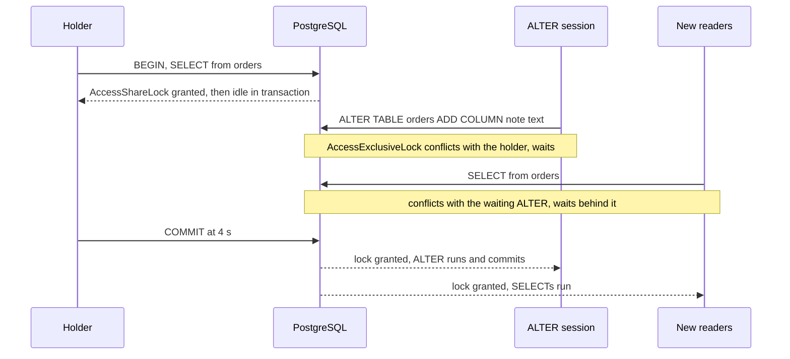

# The Lock Queue and Timeouts

Why an `ALTER TABLE` that needs a few milliseconds can stop every query on a table, how to see it happen, which timeout bounds which wait, and which table lock common DDL takes.

Verified by experiment on PostgreSQL 18.6 only (Docker image `postgres:18`, started with `log_statement = all`), with psycopg 3.3.6 sessions and the `psql` 16 client; test tables held at most 200,000 rows. Lock modes, `granted` flags, wait events and blockers were read from `pg_locks`, `pg_stat_activity` and `pg_blocking_pids()` while the sessions waited, and statement order from the server log. The lock modes and their conflicts are documented in [Table-Level Locks](https://www.postgresql.org/docs/18/explicit-locking.html#LOCKING-TABLES), the timeouts in [Client Connection Defaults](https://www.postgresql.org/docs/18/runtime-config-client.html).

______________________________________________________________________

## Table of Contents

01. [The Outage: One Open Transaction, One `ALTER`, Every Query Waits](#1-the-outage-one-open-transaction-one-alter-every-query-waits)
02. [Why New Queries Wait Behind a Waiting `ALTER`](#2-why-new-queries-wait-behind-a-waiting-alter)
03. [Seeing the Queue](#3-seeing-the-queue)
04. [Ending the Holder: Cancel vs Terminate](#4-ending-the-holder-cancel-vs-terminate)
05. [`lock_timeout`](#5-lock_timeout)
06. [`statement_timeout`](#6-statement_timeout)
07. [`idle_in_transaction_session_timeout` and `idle_session_timeout`](#7-idle_in_transaction_session_timeout-and-idle_session_timeout)
08. [`transaction_timeout`](#8-transaction_timeout)
09. [The Timeouts Side by Side](#9-the-timeouts-side-by-side)
10. [`SET`, `SET LOCAL` and Per-Connection Defaults](#10-set-set-local-and-per-connection-defaults)
11. [The Safe Migration Pattern: `lock_timeout` and Retry](#11-the-safe-migration-pattern-lock_timeout-and-retry)
12. [A DDL Lock Lasts Until `COMMIT`](#12-a-ddl-lock-lasts-until-commit)
13. [Which Lock Common DDL Takes](#13-which-lock-common-ddl-takes)
14. [How This Was Verified](#14-how-this-was-verified)
15. [Quick Reference](#15-quick-reference)

______________________________________________________________________

## 1. The Outage: One Open Transaction, One `ALTER`, Every Query Waits

A table `orders` with 1,000 rows, and seven client sessions started in this order:

| t (s) | Session                   | Sends                                                                                                            | Outcome                                                           |
| ----- | ------------------------- | ---------------------------------------------------------------------------------------------------------------- | ----------------------------------------------------------------- |
| 0.01  | holder                    | `SELECT count(*) FROM orders` with autocommit off, so the driver sends `BEGIN` first; then the session sits idle | returns; the transaction stays open                               |
| 0.27  | reader0                   | `SELECT count(*) FROM orders`                                                                                    | returned in 0.00 s                                                |
| 0.52  | ddl                       | `ALTER TABLE orders ADD COLUMN note text`                                                                        | **waited 3.49 s**                                                 |
| 0.78  | reader1, reader2, reader3 | `SELECT count(*) FROM orders`                                                                                    | **each waited 3.24 s**                                            |
| 0.88  | writer                    | `INSERT INTO orders VALUES (9999, 1)`                                                                            | **waited 3.14 s**                                                 |
| 4.00  | holder                    | `COMMIT`                                                                                                         | the `ALTER` and all four queued statements returned by t = 4.02 s |

reader0 and reader1 send the same query to the same table. The only difference is that the `ALTER` was waiting when reader1 arrived. Adding a nullable column changes only the catalog (section 13), so the `ALTER` itself is fast; the 3.5 s are spent waiting for its lock, and every query that arrives meanwhile waits as long.

The holder doesn't have to be idle. Measured with each kind of holder:

| What holds `AccessShareLock` on `orders`                                  | `ALTER`                                                        | Each later `SELECT` | Later `INSERT` |
| ------------------------------------------------------------------------- | -------------------------------------------------------------- | ------------------- | -------------- |
| A transaction left idle after one `SELECT`, committed at t = 4 s          | waited 3.49 s                                                  | waited 3.24 s       | waited 3.14 s  |
| A running autocommit `SELECT pg_sleep(4), count(*) FROM orders`           | waited 3.51 s                                                  | waited 3.26 s       | waited 3.16 s  |
| The idle transaction again, with `SET lock_timeout = '1s'` before `ALTER` | failed after 1.00 s: `canceling statement due to lock timeout` | waited 0.75 s       | waited 0.65 s  |

With `lock_timeout`, the queued statements ran the moment the `ALTER` gave up (t = 1.52 s), 2.5 s before the holder committed.



______________________________________________________________________

## 2. Why New Queries Wait Behind a Waiting `ALTER`

Every statement takes a table-level lock on each table it uses and keeps it until its transaction ends. `SELECT` takes `AccessShareLock`; `INSERT`, `UPDATE` and `DELETE` take `RowExclusiveLock`; many forms of `ALTER TABLE` take `AccessExclusiveLock`, which conflicts with every mode. From [Table-Level Locks](https://www.postgresql.org/docs/18/explicit-locking.html#LOCKING-TABLES):

> Only an ACCESS EXCLUSIVE lock blocks a SELECT (without FOR UPDATE/SHARE) statement.

reader1's `AccessShareLock` doesn't conflict with the holder's `AccessShareLock`. It conflicts with the `AccessExclusiveLock` the `ALTER` is waiting for, and a new request does not overtake a waiting request it conflicts with. The [`pg_blocking_pids()`](https://www.postgresql.org/docs/18/functions-info.html#FUNCTIONS-INFO-SESSION-TABLE) documentation calls this a soft block:

> One server process blocks another if it either holds a lock that conflicts with the blocked process's lock request (hard block), or is waiting for a lock that would conflict with the blocked process's lock request and is ahead of it in the wait queue (soft block).

When the holder committed, the queue drained in order: the server log shows the `ALTER` acquiring its lock in the same millisecond as the holder's `COMMIT`, and the readers and the writer 12 ms later, once the `ALTER` had committed (section 3).

What queues behind a waiting statement depends on the lock mode it waits for, not on whether it is DDL. Measured with a holder idle in a transaction after an `INSERT` (`RowExclusiveLock`), and a plain `CREATE INDEX` waiting for its `ShareLock`:

| Waiting statement (lock mode it waits for)           | `SELECT` sent while it waits | `INSERT` sent while it waits |
| ---------------------------------------------------- | ---------------------------- | ---------------------------- |
| `ALTER TABLE ... ADD COLUMN` (`AccessExclusiveLock`) | waited 3.24 s                | waited 3.14 s                |
| `CREATE INDEX` (`ShareLock`)                         | ran at once (0.00 s)         | waited 3.18 s                |

`AccessShareLock` doesn't conflict with `ShareLock`, so reads carried on past the waiting index build while writes queued behind it.

______________________________________________________________________

## 3. Seeing the Queue

Run against the scenario of section 1 at t = 1.47 s:

```sql
SELECT l.pid, l.mode, l.granted, a.state, a.wait_event_type, a.wait_event,
       pg_blocking_pids(l.pid)
FROM pg_locks l JOIN pg_stat_activity a USING (pid)
WHERE l.locktype = 'relation' AND l.relation = 'orders'::regclass
ORDER BY l.granted DESC, a.backend_start;
```

Result, with pids replaced by session names:

| Session                   | `mode`                | `granted` | `state`               | `wait_event_type` / `wait_event` | `pg_blocking_pids` |
| ------------------------- | --------------------- | --------- | --------------------- | -------------------------------- | ------------------ |
| holder                    | `AccessShareLock`     | true      | `idle in transaction` | `Client` / `ClientRead`          | (empty)            |
| ddl                       | `AccessExclusiveLock` | **false** | `active`              | `Lock` / `relation`              | holder             |
| reader1, reader2, reader3 | `AccessShareLock`     | **false** | `active`              | `Lock` / `relation`              | **ddl**            |
| writer                    | `RowExclusiveLock`    | **false** | `active`              | `Lock` / `relation`              | **ddl**            |

With the running holder (`pg_sleep`) instead, the holder's row showed `active` and `Timeout` / `PgSleep`; the other rows were identical.

- Rows with `granted = false` are the queue, and their sessions show `Lock` / `relation`.
- `pg_blocking_pids()` of a queued reader names the waiting `ALTER`, not the session causing the outage. Follow the chain to a session that blocks others and is not blocked itself.

This query returns only those root blockers:

```sql
SELECT a.pid, a.state, a.wait_event, now() - a.xact_start AS xact_age, left(a.query, 60) AS last_query
FROM pg_stat_activity a
WHERE a.pid IN (SELECT unnest(pg_blocking_pids(w.pid)) FROM pg_stat_activity w)
  AND cardinality(pg_blocking_pids(a.pid)) = 0;
```

Measured: exactly one row, the holder, with `state = idle in transaction` and `wait_event = ClientRead`. For an idle session, `query` is the last statement it ran, which finished long ago; `xact_age` shows how long the transaction has been open.

### `log_lock_waits`

`log_lock_waits` was `off` in `pg_settings` on 18.6. With it on (set per session by a superuser, `SET log_lock_waits = on`), each waiter logs a line once it has waited [`deadlock_timeout`](https://www.postgresql.org/docs/18/runtime-config-locks.html#GUC-DEADLOCK-TIMEOUT) (1 s by default). From the run above, where pid 87 was the holder, 89 the `ALTER`, 90 to 92 the readers and 93 the writer:

```text
2026-10-08 10:56:41.225 UTC [89] LOG:  process 89 still waiting for AccessExclusiveLock on relation 16389 of database 16384 after 1000.100 ms
2026-10-08 10:56:41.225 UTC [89] DETAIL:  Process holding the lock: 87. Wait queue: 89, 90, 91, 92, 93.
2026-10-08 10:56:41.225 UTC [89] STATEMENT:  ALTER TABLE orders ADD COLUMN note text
2026-10-08 10:56:41.478 UTC [90] LOG:  process 90 still waiting for AccessShareLock on relation 16389 of database 16384 after 1000.146 ms at character 22
2026-10-08 10:56:41.478 UTC [90] DETAIL:  Process holding the lock: 87. Wait queue: 89, 90, 91, 92, 93.
2026-10-08 10:56:41.478 UTC [90] STATEMENT:  SELECT count(*) FROM orders
```

Unlike `pg_blocking_pids()`, the `DETAIL` line names the session that **holds** the lock (87) for every waiter, and lists the whole queue in order. When the holder committed:

```text
2026-10-08 10:56:43.702 UTC [87] LOG:  statement: COMMIT
2026-10-08 10:56:43.702 UTC [89] LOG:  process 89 acquired AccessExclusiveLock on relation 16389 of database 16384 after 3477.459 ms
2026-10-08 10:56:43.714 UTC [90] LOG:  process 90 acquired AccessShareLock on relation 16389 of database 16384 after 3236.276 ms at character 22
2026-10-08 10:56:43.714 UTC [93] LOG:  process 93 acquired RowExclusiveLock on relation 16389 of database 16384 after 3136.222 ms at character 13
```

PostgreSQL 18 also has [`log_lock_failures`](https://www.postgresql.org/docs/18/runtime-config-logging.html#GUC-LOG-LOCK-FAILURES), `off` by default. Its documentation says "Currently, only lock failures due to SELECT NOWAIT is supported", and that is what was measured: with it on, `SELECT ... FOR UPDATE NOWAIT` on a locked row logged

```text
2026-10-08 11:20:01.144 UTC [253] LOG:  process 253 could not obtain ShareLock on transaction 857
2026-10-08 11:20:01.144 UTC [253] DETAIL:  Process holding the lock: 252, Wait queue: .
```

while `LOCK TABLE orders IN ACCESS EXCLUSIVE MODE NOWAIT` and an `ALTER` cancelled by `lock_timeout` logged only their `ERROR` lines.

______________________________________________________________________

## 4. Ending the Holder: Cancel vs Terminate

Measured in the scenario of section 1, with the holder idle in its transaction:

| t (s) | Action from a monitoring session        | Result                                                                                                                                       |
| ----- | --------------------------------------- | -------------------------------------------------------------------------------------------------------------------------------------------- |
| 2.00  | `SELECT pg_cancel_backend(<holder>)`    | returned `true`; 0.5 s later `pg_locks` was unchanged: holder still `idle in transaction` with its lock granted, everyone else still waiting |
| 3.01  | `SELECT pg_terminate_backend(<holder>)` | returned `true`; the `ALTER` and all four queued statements returned at t = 3.01 to 3.02 s                                                   |

`pg_cancel_backend()` cancels the statement a session is running. An idle session has none, so nothing happens, even though the call reports `true`. Terminating the session rolls back its transaction and releases its locks. The holder's application learned of it only on its next statement, which failed with SQLSTATE `57P01`, `terminating connection due to administrator command` (psycopg raises `AdminShutdown`).

A transaction that is aborted by an error holds no table locks. Measured: a session ran `SELECT count(*) FROM orders` (holding `AccessShareLock`), then `SELECT 1/0`; its state became `idle in transaction (aborted)`, its rows in `pg_locks` disappeared, and another session's `ALTER TABLE orders ADD COLUMN note text` ran at once. A session shown as `idle in transaction (aborted)` is not what holds a lock queue up; look for `idle in transaction` or `active`.

______________________________________________________________________

## 5. `lock_timeout`

[`lock_timeout`](https://www.postgresql.org/docs/18/runtime-config-client.html#GUC-LOCK-TIMEOUT) cancels a statement that has waited longer than the limit for one lock. Measured with `SET lock_timeout = '500ms'`:

| The statement waits for                                      | Result                                                                                    |
| ------------------------------------------------------------ | ----------------------------------------------------------------------------------------- |
| `ALTER TABLE` behind an idle reader (table lock)             | after 0.50 s: `canceling statement due to lock timeout`, SQLSTATE `55P03`                 |
| `UPDATE` of a row another open transaction updated           | after 0.50 s, same error, with `CONTEXT: while updating tuple (0,1) in relation "orders"` |
| `SELECT ... FOR UPDATE` of that row                          | after 0.50 s, same error, with `CONTEXT: while locking tuple (0,1) in relation "orders"`  |
| a plain `SELECT` queued behind a waiting `ALTER` (section 2) | after 0.50 s, same error; the `ALTER` itself carried on waiting                           |
| nothing: `SELECT pg_sleep(1)` with `lock_timeout = '200ms'`  | ran to completion in 1.00 s                                                               |

psycopg raises `psycopg.errors.LockNotAvailable`. `NOWAIT` failures (`could not obtain lock on row in relation "orders"`, `could not obtain lock on relation "orders"`) have the same SQLSTATE, `55P03`, so one handler covers both.

### The limit is per lock, not per statement

A `SELECT count(*) FROM orders, items` needed two locks, each held by another session for 0.7 s, released one after the other at t = 0.7 s and t = 1.4 s:

| Setting                    | Result                                                                          |
| -------------------------- | ------------------------------------------------------------------------------- |
| `lock_timeout = '1s'`      | ran, after **1.39 s** in total: neither wait reached 1 s                        |
| `statement_timeout = '1s'` | cancelled after 1.00 s: `canceling statement due to statement timeout`, `57014` |

The documentation says so:

> The time limit applies separately to each lock acquisition attempt.

A statement that needs several locks can wait up to `lock_timeout` for each of them.

### Inside a transaction it aborts the transaction

Measured: after `BEGIN; SET LOCAL lock_timeout = '300ms'` and an `ALTER` cancelled after 0.30 s, the session was `idle in transaction (aborted)`, and `SELECT 1` failed with `current transaction is aborted, commands ignored until end of transaction block` (`25P02`). Roll back and retry the whole transaction; nothing that ran before the timeout is kept.

______________________________________________________________________

## 6. `statement_timeout`

[`statement_timeout`](https://www.postgresql.org/docs/18/runtime-config-client.html#GUC-STATEMENT-TIMEOUT) cancels a statement that runs longer than the limit, whatever it is doing. Measured:

| Settings                                                  | Statement                                                | Result                                                                          |
| --------------------------------------------------------- | -------------------------------------------------------- | ------------------------------------------------------------------------------- |
| `statement_timeout = '500ms'`                             | `SELECT pg_sleep(2)`                                     | cancelled after 0.50 s: `canceling statement due to statement timeout`, `57014` |
| `statement_timeout = '500ms'`                             | `ALTER TABLE` waiting for an idle reader                 | cancelled after 0.50 s, same error: time spent waiting for a lock counts        |
| `statement_timeout = '500ms'`, `lock_timeout = '1s'`      | same `ALTER`                                             | cancelled after 0.50 s by `statement_timeout`                                   |
| `statement_timeout = '500ms'`, `lock_timeout = '300ms'`   | same `ALTER`                                             | cancelled after 0.30 s by `lock_timeout` (`55P03`)                              |
| `statement_timeout = '1s'`                                | one string: `SELECT pg_sleep(0.7); SELECT pg_sleep(0.7)` | **ran**, 1.40 s in total                                                        |
| none; `pg_cancel_backend()` from another session at 0.5 s | `SELECT pg_sleep(3)`                                     | cancelled after 0.50 s: `canceling statement due to user request`, `57014`      |

Whichever of the two limits is shorter fires first. The documentation explains the multi-statement row:

> If multiple SQL statements appear in a single simple-query message, the timeout is applied to each statement separately.

A timeout and a manual cancel share SQLSTATE `57014` (psycopg raises `QueryCanceled` for both); only the message tells them apart. Like `lock_timeout`, a `statement_timeout` inside a transaction leaves it `idle in transaction (aborted)` (measured).

For migrations, prefer `lock_timeout`. `statement_timeout` also cancels a statement that already holds its lock and is doing its work, such as a table rewrite, and cancelling `CREATE INDEX CONCURRENTLY` leaves an invalid index (see `concurrent-indexes.md`). From the `lock_timeout` documentation:

> Unlike statement_timeout, this timeout can only occur while waiting for locks.

______________________________________________________________________

## 7. `idle_in_transaction_session_timeout` and `idle_session_timeout`

[`idle_in_transaction_session_timeout`](https://www.postgresql.org/docs/18/runtime-config-client.html#GUC-IDLE-IN-TRANSACTION-SESSION-TIMEOUT) ends a session that has sat idle inside a transaction for longer than the limit. That is exactly the holder of section 1:

> This option can be used to ensure that idle sessions do not hold locks for an unreasonable amount of time.

Measured: the holder set `idle_in_transaction_session_timeout = '1s'`, read `orders` and went idle; another session's `ALTER TABLE orders ADD COLUMN note text` returned after **1.00 s** (1.02 s on a rerun). Then:

| Check                                                  | Result                                                                                                                     |
| ------------------------------------------------------ | -------------------------------------------------------------------------------------------------------------------------- |
| holder's backend in `pg_stat_activity`                 | gone                                                                                                                       |
| holder's psycopg connection, before its next statement | `closed = False`, `info.status = OK`: the client has not been told                                                         |
| holder's next statement, `SELECT 1`                    | `FATAL`: `terminating connection due to idle-in-transaction timeout`, SQLSTATE `25P03` (`IdleInTransactionSessionTimeout`) |
| the connection after that                              | `closed = True`, `info.status = BAD`                                                                                       |

The transaction is rolled back and the connection is gone; a pool has to discard it.

| Case                                                                               | Result                                                                                                                 |
| ---------------------------------------------------------------------------------- | ---------------------------------------------------------------------------------------------------------------------- |
| limit 500 ms, `SELECT pg_sleep(1.5)` running inside the transaction                | ran to completion: a running statement is not idle                                                                     |
| limit set in autocommit mode, then a transaction aborted by `SELECT 1/0`, idle 1 s | terminated: an aborted transaction counts as idle in a transaction                                                     |
| limit set by the first statement of the transaction that then failed, idle 1 s     | **not** terminated: still `idle in transaction (aborted)`, because the failed transaction undid the `SET` (section 10) |

[`idle_session_timeout`](https://www.postgresql.org/docs/18/runtime-config-client.html#GUC-IDLE-SESSION-TIMEOUT) is the separate limit for sessions idle **outside** a transaction. Measured with 1 s: after 1.5 s idle the backend was gone, and the next statement failed with `FATAL`: `terminating connection due to idle-session timeout`, `57P05` (`IdleSessionTimeout`). With 500 ms it did not end a session that sat idle in a transaction for 1 s. Idle connections hold no table locks, so it doesn't help with the lock queue.

______________________________________________________________________

## 8. `transaction_timeout`

[`transaction_timeout`](https://www.postgresql.org/docs/18/runtime-config-client.html#GUC-TRANSACTION-TIMEOUT) was added in PostgreSQL 17 ([release notes](https://www.postgresql.org/docs/17/release-17.html)) and bounds a whole transaction, running or idle:

> Terminate any session that spans longer than the specified amount of time in a transaction. The limit applies both to explicit transactions (started with BEGIN) and to an implicitly started transaction corresponding to a single statement.

Measured on 18.6 with `SET transaction_timeout = '1s'`:

| Case                                                                       | Result                                                                                                          |
| -------------------------------------------------------------------------- | --------------------------------------------------------------------------------------------------------------- |
| explicit transaction, `SELECT pg_sleep(3)`                                 | after 1.00 s: `FATAL`, `terminating connection due to transaction timeout`, SQLSTATE `25P04`; connection closed |
| explicit transaction, idle for 1.5 s                                       | backend gone; the next statement failed with the same `FATAL` `25P04`                                           |
| explicit transaction, `SELECT pg_sleep(0.2)` in a loop                     | 4 statements ran, then terminated at 1.00 s                                                                     |
| autocommit, one `SELECT pg_sleep(3)`                                       | terminated after 1.00 s                                                                                         |
| autocommit, one string `SELECT pg_sleep(0.7); SELECT pg_sleep(0.7)`        | terminated after 1.00 s: the string is one implicit transaction                                                 |
| autocommit, five separate `SELECT pg_sleep(0.5)`                           | all ran: each statement is its own transaction                                                                  |
| plus `statement_timeout = '500ms'`, `SELECT pg_sleep(3)`                   | cancelled at 0.50 s with `57014`; the connection stayed open                                                    |
| plus `statement_timeout = '2s'`, `SELECT pg_sleep(3)`                      | terminated at 1.00 s with `25P04`                                                                               |
| `SET LOCAL transaction_timeout = '1s'` 1.5 s into a transaction            | the next `SELECT pg_sleep(0.6)` ran; the one after it was terminated 0.40 s in, 1.0 s after the `SET`           |
| holder idle in a transaction with the 1 s limit; another session's `ALTER` | the `ALTER` returned after 1.00 s                                                                               |

Unlike `lock_timeout` and `statement_timeout`, it ends the **session** (`FATAL`; psycopg raises `TransactionTimeout`), so the application must reconnect. Set inside a running transaction, its clock starts at the `SET`, not at `BEGIN`.

______________________________________________________________________

## 9. The Timeouts Side by Side

All measured on 18.6; every default is `0` (off).

| Setting                               | Limits                                         | Message                                                     | SQLSTATE | Severity | Afterwards                                                |
| ------------------------------------- | ---------------------------------------------- | ----------------------------------------------------------- | -------- | -------- | --------------------------------------------------------- |
| `lock_timeout`                        | each wait for one lock                         | `canceling statement due to lock timeout`                   | `55P03`  | `ERROR`  | connection open; an explicit transaction is aborted       |
| `statement_timeout`                   | each statement, including its lock waits       | `canceling statement due to statement timeout`              | `57014`  | `ERROR`  | connection open; an explicit transaction is aborted       |
| `idle_in_transaction_session_timeout` | time idle inside a transaction, aborted or not | `terminating connection due to idle-in-transaction timeout` | `25P03`  | `FATAL`  | session ended; the client finds out on its next statement |
| `transaction_timeout`                 | a whole transaction, running or idle           | `terminating connection due to transaction timeout`         | `25P04`  | `FATAL`  | session ended                                             |
| `idle_session_timeout`                | time idle outside a transaction                | `terminating connection due to idle-session timeout`        | `57P05`  | `FATAL`  | session ended; the client finds out on its next statement |

| Goal                                                       | Setting                                                            |
| ---------------------------------------------------------- | ------------------------------------------------------------------ |
| A migration must never queue traffic for long              | `lock_timeout` on the migration's session, plus retry (section 11) |
| A forgotten open transaction must not hold locks for hours | `idle_in_transaction_session_timeout` on application roles         |
| No single query may run away                               | `statement_timeout` on application roles                           |
| No transaction may live longer than N, busy or not         | `transaction_timeout`                                              |

______________________________________________________________________

## 10. `SET`, `SET LOCAL` and Per-Connection Defaults

[`SET`](https://www.postgresql.org/docs/18/sql-set.html) changes a setting for the session, `SET LOCAL` for the current transaction only. Measured with a psycopg connection in autocommit mode and the session value of `lock_timeout` starting at `0`:

| Sequence                                                                 | `SHOW lock_timeout` afterwards                                                            |
| ------------------------------------------------------------------------ | ----------------------------------------------------------------------------------------- |
| `SET LOCAL lock_timeout = '1s'` outside a transaction                    | `0`, with `WARNING: SET LOCAL can only be used in transaction blocks` (`25P01`); no error |
| `BEGIN; SET LOCAL lock_timeout = '1s'; COMMIT`                           | `1s` inside the transaction, `0` after                                                    |
| `BEGIN; SET lock_timeout = '2s'; COMMIT`                                 | `2s`, kept for the rest of the session                                                    |
| `BEGIN; SET lock_timeout = '3s'; ROLLBACK`                               | `2s`: the rollback undid the `SET`                                                        |
| `BEGIN; SET lock_timeout = '4s'`, a failing statement, `ROLLBACK`        | `2s`                                                                                      |
| `BEGIN; SAVEPOINT s1; SET lock_timeout = '5s'; ROLLBACK TO SAVEPOINT s1` | `2s` inside the transaction and after `COMMIT`                                            |
| `BEGIN; SELECT set_config('lock_timeout', '6s', true); COMMIT`           | `6s` inside, `2s` after: `set_config(..., true)` is `SET LOCAL`                           |
| `RESET lock_timeout`                                                     | `0`                                                                                       |
| one string: `SET LOCAL lock_timeout = '7s'; SHOW lock_timeout`           | `7s` from the `SHOW` in the string, no warning; `0` for the next statement                |

`psql` behaved the same: `psql -c "SET LOCAL lock_timeout = '7s'; SHOW lock_timeout"` showed `7s`, while two separate `-c` arguments printed the warning and then `0`. A `SET LOCAL` sent on its own in autocommit mode does nothing, and the only sign is a `WARNING` notice, not an error.

The rollback rule is documented:

> If SET (or equivalently SET SESSION) is issued within a transaction that is later aborted, the effects of the SET command disappear when the transaction is rolled back.

It bites with drivers that start with autocommit off, such as psycopg. Their first `SET` opens a transaction, so a later `rollback()`, or an error, takes the setting with it. Measured in section 7: an `idle_in_transaction_session_timeout` set that way stopped applying as soon as a statement in the same transaction failed.

### Defaults that don't depend on application code

| How                                                                               | `SHOW` in the new session           |
| --------------------------------------------------------------------------------- | ----------------------------------- |
| `psycopg.connect(..., options="-c lock_timeout=1500ms -c statement_timeout=30s")` | `1500ms`, `30s`                     |
| `PGOPTIONS='-c lock_timeout=1500ms' psql ... -c 'SHOW lock_timeout'`              | `1500ms`                            |
| `ALTER ROLE app SET lock_timeout = '2500ms'`, then log in as `app`                | `2500ms`                            |
| the same role, connecting with `options="-c lock_timeout=100ms"`                  | `100ms`: the connection option wins |

`ALTER ROLE ... SET` is stored in `pg_db_role_setting` (measured: `('app', ['lock_timeout=2500ms'])`) and applies from the role's next login. Give the migration role a short `lock_timeout` this way, and application roles an `idle_in_transaction_session_timeout`. The documentation advises against a server-wide value:

> Setting lock_timeout in postgresql.conf is not recommended because it would affect all sessions.

______________________________________________________________________

## 11. The Safe Migration Pattern: `lock_timeout` and Retry

Run the DDL with a short `lock_timeout`. If the lock isn't free, the `ALTER` gives up, the queue behind it drains, and it tries again a moment later. Measured with an idle transaction holding `AccessShareLock` from t = 0 to t = 3.0 s, one session running `SELECT count(*) FROM orders` and another `INSERT INTO orders ...` every 50 ms, and the `ALTER TABLE orders ADD COLUMN note text` started at t = 0.5 s:

| Migration                                             | `ALTER` done | Attempts | Slowest `SELECT`   | Slowest `INSERT`   | `SELECT`s completed in 5 s |
| ----------------------------------------------------- | ------------ | -------- | ------------------ | ------------------ | -------------------------- |
| no timeout                                            | t = 3.02 s   | 1        | **2.48 to 2.49 s** | **2.43 to 2.47 s** | 49                         |
| `SET LOCAL lock_timeout = '200ms'`, retry after 0.5 s | t = 3.34 s   | 5        | 0.19 s             | 0.18 to 0.21 s     | 83                         |

The ranges cover two runs; the `ALTER` times, attempt counts and `SELECT` counts were identical in both. Without the timeout, traffic stopped for 2.5 s. With it, no statement waited longer than about one `lock_timeout`, and the migration finished 0.3 s later.

A retry loop with psycopg 3. `conn.transaction()` sends `BEGIN`, then `COMMIT`, or `ROLLBACK` when an exception leaves the block:

```python
import os
import time

import psycopg


def run_ddl(dsn, statements, lock_timeout="200ms", attempts=20, pause=0.5):
    """Run DDL in one transaction; give up each lock wait after lock_timeout and retry."""
    with psycopg.connect(dsn, autocommit=True) as conn:
        for attempt in range(1, attempts + 1):
            try:
                with conn.transaction():
                    conn.execute(f"SET LOCAL lock_timeout = '{lock_timeout}'")
                    for sql in statements:
                        conn.execute(sql)
                return attempt
            except psycopg.errors.LockNotAvailable:
                time.sleep(pause)
    raise RuntimeError(f"lock not acquired after {attempts} attempts")


print(run_ddl(os.environ["DATABASE_URL"], ["ALTER TABLE orders ADD COLUMN note text"]))
```

Run against a session holding `AccessShareLock` for 2 s, it printed `3`. The server log:

```text
2026-10-08 11:29:33.857 UTC [305] LOG:  statement: BEGIN
2026-10-08 11:29:33.858 UTC [305] LOG:  statement: SET LOCAL lock_timeout = '200ms'
2026-10-08 11:29:33.858 UTC [305] LOG:  statement: ALTER TABLE orders ADD COLUMN note text
2026-10-08 11:29:34.058 UTC [305] ERROR:  canceling statement due to lock timeout
2026-10-08 11:29:34.058 UTC [305] STATEMENT:  ALTER TABLE orders ADD COLUMN note text
2026-10-08 11:29:34.060 UTC [305] LOG:  statement: ROLLBACK
2026-10-08 11:29:34.561 UTC [305] LOG:  statement: BEGIN
2026-10-08 11:29:34.562 UTC [305] LOG:  statement: SET LOCAL lock_timeout = '200ms'
2026-10-08 11:29:34.562 UTC [305] LOG:  statement: ALTER TABLE orders ADD COLUMN note text
2026-10-08 11:29:34.762 UTC [305] ERROR:  canceling statement due to lock timeout
2026-10-08 11:29:34.762 UTC [305] STATEMENT:  ALTER TABLE orders ADD COLUMN note text
2026-10-08 11:29:34.763 UTC [305] LOG:  statement: ROLLBACK
2026-10-08 11:29:35.247 UTC [304] LOG:  statement: COMMIT;
2026-10-08 11:29:35.263 UTC [305] LOG:  statement: BEGIN
2026-10-08 11:29:35.264 UTC [305] LOG:  statement: SET LOCAL lock_timeout = '200ms'
2026-10-08 11:29:35.264 UTC [305] LOG:  statement: ALTER TABLE orders ADD COLUMN note text
2026-10-08 11:29:35.266 UTC [305] LOG:  statement: COMMIT
```

The same with `psql` in a shell loop. Each `-c` is sent separately in one session, so the session-level `SET` applies to the `ALTER`, and `ON_ERROR_STOP=1` makes `psql` exit non-zero on the timeout:

```bash
for attempt in $(seq 1 20); do
  if psql -X -q -v ON_ERROR_STOP=1 \
       -c "SET lock_timeout = '200ms'" \
       -c "ALTER TABLE orders ADD COLUMN note text"; then
    echo "attempt $attempt succeeded"
    break
  fi
  sleep 0.5
done
```

Measured against a holder that kept its lock for 2.5 s: three `ERROR:  canceling statement due to lock timeout` lines, then success on attempt 4.

Rules for the pattern:

- Set `lock_timeout` in the same transaction as the DDL, with `SET LOCAL`, so it covers every statement in it and ends with it.
- On `55P03`, roll back (the transaction is aborted, section 5), wait, and retry the whole transaction. The aborted transaction has already released its locks (section 4).
- Keep `lock_timeout` short: every query that arrives during an attempt waits for up to that long.
- Bound the attempts. When they run out, find the root blocker (section 3) instead of raising the timeout.
- Keep the transaction short after the DDL gets its lock (section 12).

______________________________________________________________________

## 12. A DDL Lock Lasts Until `COMMIT`

From [Table-Level Locks](https://www.postgresql.org/docs/18/explicit-locking.html#LOCKING-TABLES):

> Once acquired, a lock is normally held until the end of the transaction.

Measured: a transaction ran `ALTER TABLE orders ADD COLUMN note text`, which returned in 0.00 s, and then stayed open. A `SELECT count(*) FROM orders` sent from another session at t = 0.22 s waited **1.82 s**, until the `COMMIT` at t = 2.03 s.

Anything that runs after the DDL in the same transaction, such as a data backfill, more DDL, or slow application code, runs while every reader of the table waits. Commit DDL that takes `AccessExclusiveLock` in its own short transaction, and backfill in separate transactions.

______________________________________________________________________

## 13. Which Lock Common DDL Takes

Each statement ran in an open transaction on a 10,000-row `orders` table (with a 100-row `customers` table for the foreign key). The lock was read from `pg_locks`, a rewrite was detected by a change of `pg_relation_filenode('orders')`, and a probe session with `lock_timeout = '300ms'` tried a `SELECT count(*)` and an `INSERT`. "waits" means the probe hit its `lock_timeout`.

| Statement                                                                                                            | Lock on `orders`                                          | Rewrote the table | Concurrent `SELECT` | Concurrent `INSERT` |
| -------------------------------------------------------------------------------------------------------------------- | --------------------------------------------------------- | ----------------- | ------------------- | ------------------- |
| `ALTER TABLE orders ADD COLUMN note text`                                                                            | `AccessExclusiveLock`                                     | no                | waits               | waits               |
| `ALTER TABLE orders ADD COLUMN state text NOT NULL DEFAULT 'new'`                                                    | `AccessExclusiveLock`                                     | no                | waits               | waits               |
| `ALTER TABLE orders ADD COLUMN created timestamptz DEFAULT clock_timestamp()`                                        | `AccessExclusiveLock`                                     | **yes**           | waits               | waits               |
| `ALTER TABLE orders ALTER COLUMN status SET DEFAULT 'new'`                                                           | `AccessExclusiveLock`                                     | no                | waits               | waits               |
| `ALTER TABLE orders ALTER COLUMN amount TYPE bigint` (from `int`)                                                    | `AccessExclusiveLock`                                     | **yes**           | waits               | waits               |
| `ALTER TABLE orders ALTER COLUMN code TYPE varchar(20)` (from `varchar(10)`)                                         | `AccessExclusiveLock`                                     | no                | waits               | waits               |
| `ALTER TABLE orders ALTER COLUMN amount SET NOT NULL`                                                                | `AccessExclusiveLock`                                     | no                | waits               | waits               |
| `ALTER TABLE orders DROP COLUMN code`                                                                                | `AccessExclusiveLock`                                     | no                | waits               | waits               |
| `ALTER TABLE orders ADD CONSTRAINT amount_positive CHECK (amount > 0)`                                               | `AccessExclusiveLock`                                     | no                | waits               | waits               |
| `ALTER TABLE orders ADD CONSTRAINT amount_positive CHECK (amount > 0) NOT VALID`                                     | `AccessExclusiveLock`                                     | no                | waits               | waits               |
| `ALTER TABLE orders VALIDATE CONSTRAINT amount_positive`                                                             | `ShareUpdateExclusiveLock`                                | no                | **runs**            | **runs**            |
| `ALTER TABLE orders ADD CONSTRAINT amount_nn NOT NULL amount NOT VALID` (new in 18)                                  | `AccessExclusiveLock`                                     | no                | waits               | waits               |
| `ALTER TABLE orders VALIDATE CONSTRAINT amount_nn`                                                                   | `ShareUpdateExclusiveLock`                                | no                | **runs**            | **runs**            |
| `ALTER TABLE orders ADD CONSTRAINT orders_customer_fk FOREIGN KEY (customer_id) REFERENCES customers (id) NOT VALID` | `ShareRowExclusiveLock`, and the same on `customers`      | no                | **runs**            | waits               |
| `ALTER TABLE orders VALIDATE CONSTRAINT orders_customer_fk`                                                          | `ShareUpdateExclusiveLock`; `RowShareLock` on `customers` | no                | **runs**            | **runs**            |
| `CREATE INDEX orders_amount_idx ON orders (amount)`                                                                  | `ShareLock`                                               | no                | **runs**            | waits               |
| `DROP INDEX orders_amount_idx`                                                                                       | `AccessExclusiveLock`                                     | no                | waits               | waits               |
| `TRUNCATE orders`                                                                                                    | `AccessExclusiveLock`                                     | **yes**           | waits               | waits               |
| `ANALYZE orders`                                                                                                     | `ShareUpdateExclusiveLock`                                | no                | **runs**            | **runs**            |

Statements that can't run in a transaction block were observed while running or waiting, on a 200,000-row table with half its rows deleted:

| Statement                                                                          | Observed                                                | Lock on `orders`                       | `wait_event`              | Concurrent `SELECT` | Concurrent `INSERT` |
| ---------------------------------------------------------------------------------- | ------------------------------------------------------- | -------------------------------------- | ------------------------- | ------------------- | ------------------- |
| `CREATE INDEX CONCURRENTLY orders_amount_cidx ON orders (amount)`                  | waiting for an open transaction that had inserted a row | `ShareUpdateExclusiveLock`, granted    | `Lock` / `virtualxid`     | **runs**            | **runs**            |
| `VACUUM orders`, throttled (`vacuum_cost_delay = '20ms'`, `vacuum_cost_limit = 1`) | running, 0.5 s in                                       | `ShareUpdateExclusiveLock`, granted    | `Timeout` / `VacuumDelay` | **runs**            | **runs**            |
| `VACUUM FULL orders`                                                               | waiting for an open transaction that had read the table | `AccessExclusiveLock`, **not granted** | `Lock` / `relation`       | waits               | waits               |

How to read the tables:

- **Fast is not the same as safe.** Adding a column with a constant default, `SET DEFAULT`, widening a `varchar`, and adding a `NOT VALID` constraint changed only the catalog, yet each took `AccessExclusiveLock`. Any of them causes the outage of section 1 if it has to wait. Run every one with `lock_timeout`.
- The rewrites (`relfilenode` changed) also showed a `ShareLock` on `orders` next to the `AccessExclusiveLock`; a session never conflicts with its own locks, so other sessions see only the `AccessExclusiveLock`. A rewrite holds that lock for as long as it takes to copy the table and rebuild its indexes. The extra `ShareLock` also appeared without any rewrite, on `ALTER COLUMN TYPE` of an indexed `varchar` column (measured separately), so it accompanies work on the column's indexes rather than the rewrite itself.
- **Add constraints in two steps.** `ADD CONSTRAINT ... NOT VALID` takes `AccessExclusiveLock` briefly and doesn't scan. `VALIDATE CONSTRAINT` scans under `ShareUpdateExclusiveLock`, which lets reads and writes continue. Measured on 18 for `NOT NULL`: right after `NOT VALID`, inserting a `NULL` failed with `null value in column "amount" of relation "orders" violates not-null constraint`. `VALIDATE` failed with `column "amount" of relation "orders" contains null values` while an old `NULL` row remained, and succeeded once it was deleted (`pg_constraint.convalidated = t`). `NOT NULL ... NOT VALID` is new in PostgreSQL 18: on 16 the same statement fails with `syntax error at or near "NOT"` (measured on 16.15). On 16 and 17 use `ADD CONSTRAINT orders_amount_chk CHECK (amount IS NOT NULL) NOT VALID`, then `VALIDATE CONSTRAINT`; measured on 16.15, the `NOT VALID` check rejected a new `NULL` (`new row for relation "orders" violates check constraint "orders_amount_chk"`) and validated once the old `NULL` row was gone.
- **A foreign key locks both tables.** `ADD CONSTRAINT ... FOREIGN KEY ... NOT VALID` took `ShareRowExclusiveLock` on `orders` and on `customers`; inserts into **both** tables waited.
- `CREATE INDEX` blocks writes, not reads; `CREATE INDEX CONCURRENTLY` blocks neither, but waits for older transactions (`virtualxid`). Its phases are in `concurrent-indexes.md`.
- `VACUUM` and `ANALYZE` don't block reads or writes. `ShareUpdateExclusiveLock` conflicts with itself ([Table-Level Locks](https://www.postgresql.org/docs/18/explicit-locking.html#LOCKING-TABLES)), so two of the statements measured above taking it (`VACUUM`, `ANALYZE`, `CREATE INDEX CONCURRENTLY`, `VALIDATE CONSTRAINT`) can't run on the same table at the same time.
- `VACUUM FULL`, `TRUNCATE` and `DROP INDEX` take `AccessExclusiveLock`, and queue traffic like an `ALTER`.

______________________________________________________________________

## 14. How This Was Verified

- One PostgreSQL 18.6 server in Docker (`postgres:18`), started with `log_statement=all` and `log_line_prefix='%m [%p] '`; `log_lock_waits` and `log_lock_failures` were turned on per session where shown. Clients: psycopg 3.3.6 on Python 3.14, and `psql` 16.
- Lock queue (sections 1 to 4): a holder session (idle transaction or a running `pg_sleep`), then the `ALTER`, three readers and a writer, each on its own connection and thread, 0.25 s apart; `pg_locks`, `pg_stat_activity` and `pg_blocking_pids()` were sampled from a separate monitoring session while they waited.
- Timeouts (sections 5 to 9): each setting tested on its own connection with `pg_sleep` or a second session holding the lock; errors read from psycopg's `diag` (SQLSTATE, severity, message, context), and session survival from `pg_stat_activity`.
- `SET` scope (section 10): `SHOW` after each sequence, on one autocommit connection; per-role settings with a temporary role.
- Retry pattern (section 11): two traffic threads issuing a statement every 50 ms for 5 s, with per-statement latency recorded; the Python and shell snippets above were run as written.
- DDL locks (section 13): one fresh table per statement; probes used `lock_timeout = '300ms'`, so "waits" means the probe was cancelled with `55P03`.
- The key results (the lock queue of sections 1 to 3, all timeout rows of sections 5 to 8, the `SET` scope table and the retry comparison of section 11) were run twice. Errors, lock modes and states were identical, and timings agreed within 0.05 s; only the number of `INSERT`s completed in section 11 varied with machine load.

______________________________________________________________________

## 15. Quick Reference

| Question                                                          | Answer                                                                                            |
| ----------------------------------------------------------------- | ------------------------------------------------------------------------------------------------- |
| Why did a fast `ALTER` stop all queries?                          | It waited for `AccessExclusiveLock`, and new queries queued behind the waiting request            |
| What usually holds the lock it waits for?                         | A session `idle in transaction` that once read the table, or a long-running query                 |
| Does a waiting `CREATE INDEX` block reads?                        | No; `ShareLock` blocks only writes, which queue behind it                                         |
| Find the queue                                                    | `pg_locks` rows with `granted = false`; sessions with `wait_event_type = 'Lock'`                  |
| Find the root blocker                                             | A pid in someone's `pg_blocking_pids()` whose own `pg_blocking_pids()` is empty                   |
| End an idle holder                                                | `pg_terminate_backend(pid)`; `pg_cancel_backend(pid)` returns `true` and does nothing             |
| Does an `idle in transaction (aborted)` session hold table locks? | No                                                                                                |
| Bound a lock wait                                                 | `lock_timeout`: `canceling statement due to lock timeout`, `55P03`, per lock                      |
| Bound a statement                                                 | `statement_timeout`: `canceling statement due to statement timeout`, `57014`, includes lock waits |
| Bound an idle open transaction                                    | `idle_in_transaction_session_timeout`: `FATAL`, `25P03`, client learns on next statement          |
| Bound a whole transaction (17+)                                   | `transaction_timeout`: `FATAL`, `25P04`, session ended                                            |
| `SET LOCAL` with autocommit on?                                   | Warning only, no effect                                                                           |
| `SET` in a transaction that rolls back or fails?                  | Undone                                                                                            |
| Default for one role                                              | `ALTER ROLE <role> SET lock_timeout = '...'`; connection options override it                      |
| Safe DDL on a busy table                                          | `BEGIN; SET LOCAL lock_timeout = '200ms'; <DDL>; COMMIT`, retry on `55P03`                        |
| When is a DDL lock released?                                      | At `COMMIT` or `ROLLBACK`, not when the statement returns                                         |
| Add a constraint without blocking traffic for a scan              | `ADD CONSTRAINT ... NOT VALID`, then `VALIDATE CONSTRAINT`                                        |
