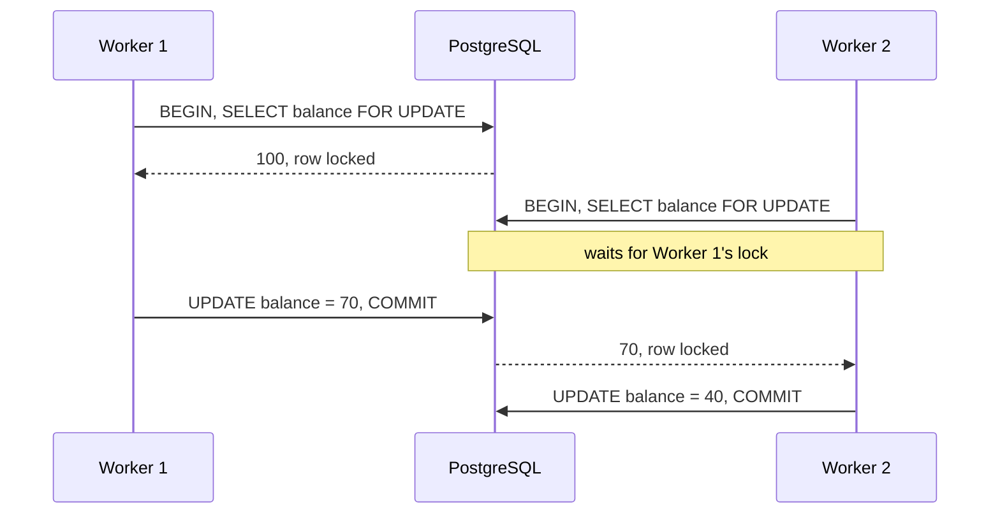

# Row Locks: `SELECT … FOR UPDATE` and Friends

What a row lock blocks, how long it lives, what happens when you take one outside a transaction, and how to avoid lost updates and deadlocks.

Verified by experiment on PostgreSQL 16.15 and 18.6, with identical results: two or more psycopg 3.3.6 sessions per test, with `lock_timeout = '1s'` on the second session so that "waits" shows up as a timeout instead of a hang. Lock strengths and conflicts are documented in [Row-Level Locks](https://www.postgresql.org/docs/18/explicit-locking.html#LOCKING-ROWS).

______________________________________________________________________

## Table of Contents

01. [A Row Lock Belongs to a Transaction](#1-a-row-lock-belongs-to-a-transaction)
02. [What a `FOR UPDATE` Lock Blocks](#2-what-a-for-update-lock-blocks)
03. [Outside a Transaction the Lock Is Useless](#3-outside-a-transaction-the-lock-is-useless)
04. [The Lost Update It Prevents](#4-the-lost-update-it-prevents)
05. [`NOWAIT` and `SKIP LOCKED`](#5-nowait-and-skip-locked)
06. [Joins and `FOR UPDATE OF`](#6-joins-and-for-update-of)
07. [`FOR NO KEY UPDATE` and Foreign Keys](#7-for-no-key-update-and-foreign-keys)
08. [Deadlocks](#8-deadlocks)
09. [Seeing Who Waits for Whom](#9-seeing-who-waits-for-whom)
10. [Quick Reference](#10-quick-reference)

______________________________________________________________________

## 1. A Row Lock Belongs to a Transaction

`SELECT … FOR UPDATE` acquires the lock; the **transaction** decides how long it is held. The lock is released when the transaction ends, by `COMMIT` or `ROLLBACK`, not when the `SELECT` finishes.

```
BEGIN
  │
  ├─ SELECT … FOR UPDATE      lock acquired
  │      (statement finishes; the lock stays)
  ├─ application work          lock held
  ├─ UPDATE …                  lock held
  │
COMMIT                         lock released
```

"Lock this row" really means "lock this row for the rest of my transaction".

______________________________________________________________________

## 2. What a `FOR UPDATE` Lock Blocks

Session A ran `SELECT * FROM acct WHERE id = 1 FOR UPDATE` inside an open transaction. Session B then tried:

| Session B                                      | Result                                    |
| ---------------------------------------------- | ----------------------------------------- |
| `SELECT * FROM acct WHERE id = 1` (plain read) | **ran**: readers never wait for row locks |
| `SELECT … WHERE id = 1 FOR UPDATE`             | waited                                    |
| `SELECT … WHERE id = 1 FOR SHARE`              | waited                                    |
| `UPDATE acct … WHERE id = 1`                   | waited                                    |
| `DELETE FROM acct WHERE id = 1`                | waited                                    |
| `SELECT … WHERE id = 2 FOR UPDATE`             | ran: locks are per row                    |
| `UPDATE acct … WHERE id = 2`                   | ran                                       |

Without a timeout, B waits until A's transaction ends. Measured: B's `FOR UPDATE` on row 1 waited 2.0 s, exactly until A committed, then returned.

Plain `SELECT`s seeing the row while it's locked is MVCC at work: readers see the last committed version and are never blocked by writers or by row locks.

______________________________________________________________________

## 3. Outside a Transaction the Lock Is Useless

With autocommit on, a `SELECT … FOR UPDATE` is its own transaction, so the lock is released as soon as the statement ends:

| Session A (autocommit on)                                          | Session B, immediately after                       |
| ------------------------------------------------------------------ | -------------------------------------------------- |
| `SELECT * FROM acct WHERE id = 1 FOR UPDATE`, connection kept open | `SELECT … WHERE id = 1 FOR UPDATE` **ran** at once |

So the pattern "lock, compute in the application, write" only works inside an explicit transaction:

```
autocommit on                         inside BEGIN … COMMIT
─────────────                         ─────────────────────
SELECT … FOR UPDATE  ~10 ms           BEGIN
  lock acquired                       SELECT … FOR UPDATE   lock acquired
  statement ends → lock released      2 s of application work   lock held
2 s of application work  NO LOCK      UPDATE …              lock held
UPDATE …                              COMMIT                lock released
```

PostgreSQL accepts `FOR UPDATE` in autocommit mode without complaint. Some frameworks refuse it outright for this reason; Django raises `select_for_update cannot be used outside of a transaction.`

______________________________________________________________________

## 4. The Lost Update It Prevents

Two workers run concurrently, each reading a balance of 100, spending 0.5 s on application logic, then writing `balance - 30`. The correct result is 40. Measured through Django at `READ COMMITTED`, the default, on every combination tested. At `REPEATABLE READ` and `SERIALIZABLE` the second writer gets `could not serialize access due to concurrent update` instead, even for the single-statement `UPDATE`, and must retry; see `isolation-levels.md`.

| Pattern                                                                | Final balance           | Time for both workers           |
| ---------------------------------------------------------------------- | ----------------------- | ------------------------------- |
| Read, compute, write; no lock                                          | **70**: one update lost | 0.6 s                           |
| `BEGIN`; `SELECT … FOR UPDATE`; compute; `UPDATE`; `COMMIT`            | 40                      | 1.1 s: the second worker waited |
| Single statement `UPDATE acct SET balance = balance - 30 WHERE id = 2` | 40                      | 0.6 s                           |



Choose between the two correct patterns:

- When the new value can be computed in SQL, a single `UPDATE … SET col = col - 30` needs no explicit lock: the `UPDATE` locks the row itself and reads the current value.
- When the decision needs application logic (validation, branching, calling other code), lock the row with `FOR UPDATE` inside a transaction, and keep that transaction short, because every other writer of the row waits for it.

______________________________________________________________________

## 5. `NOWAIT` and `SKIP LOCKED`

| Clause                   | When the row is locked by someone else                          |
| ------------------------ | --------------------------------------------------------------- |
| (none)                   | wait until the other transaction ends                           |
| `FOR UPDATE NOWAIT`      | fail at once: `could not obtain lock on row in relation "acct"` |
| `FOR UPDATE SKIP LOCKED` | leave locked rows out of the result                             |

Measured with row 1 locked by another session: `SELECT id FROM acct ORDER BY id FOR UPDATE SKIP LOCKED` returned `[2, 3]`.

`SKIP LOCKED` is the standard way to build a work queue on a table: each worker takes the next unlocked rows, and workers never wait for each other. `NOWAIT` suits interactive requests that should fail fast instead of queueing behind a long transaction.

______________________________________________________________________

## 6. Joins and `FOR UPDATE OF`

`FOR UPDATE` on a join locks the matching rows of **every** table in the join. Measured, with session A holding the lock and session B probing:

| Session A's query                                                      | B locks `owner` 1 | B locks `acct` 1 |
| ---------------------------------------------------------------------- | ----------------- | ---------------- |
| `SELECT … FROM acct JOIN owner … WHERE acct.id = 1 FOR UPDATE`         | waited            | waited           |
| `SELECT … FROM acct JOIN owner … WHERE acct.id = 1 FOR UPDATE OF acct` | **ran**           | waited           |

A query that joins to a shared parent row (a customer, an organisation) to read it can serialise every writer of that parent. Name the tables you mean to lock with `OF`.

______________________________________________________________________

## 7. `FOR NO KEY UPDATE` and Foreign Keys

Inserting or updating a row that references a parent takes a `FOR KEY SHARE` lock on the parent row, to make sure the parent can't disappear meanwhile. `FOR UPDATE` conflicts with that lock; `FOR NO KEY UPDATE` doesn't. Measured:

| Session A holds parent `owner` 1 with… | B inserts a child referencing `owner` 1 | B updates `owner` 1 |
| -------------------------------------- | --------------------------------------- | ------------------- |
| `FOR UPDATE`                           | **waited**                              | waited              |
| `FOR NO KEY UPDATE`                    | ran                                     | waited              |

Use `FOR NO KEY UPDATE` when you are going to change the row but not its key, which is almost always. It still blocks other writers of the row, without blocking inserts of child rows.

______________________________________________________________________

## 8. Deadlocks

Two transactions that lock the same rows in opposite order wait for each other forever. PostgreSQL detects the cycle after `deadlock_timeout` (1 s by default) and aborts one of them. Measured:

```
X: BEGIN; SELECT … WHERE id = 1 FOR UPDATE      -- holds 1
Y: BEGIN; SELECT … WHERE id = 2 FOR UPDATE      -- holds 2
X: SELECT … WHERE id = 2 FOR UPDATE             -- waits for Y
Y: SELECT … WHERE id = 1 FOR UPDATE             -- waits for X: a cycle
-- one transaction: ERROR: deadlock detected   (its transaction is now aborted)
-- the other: gets its lock and carries on
```

The aborted side must roll back, and usually retry. To avoid deadlocks, lock rows in a consistent order (`ORDER BY id … FOR UPDATE`) and lock everything a transaction needs up front.

______________________________________________________________________

## 9. Seeing Who Waits for Whom

Row locks are stored in the row itself, not listed row by row in `pg_locks`. A session waiting for one appears in `pg_stat_activity` as `wait_event_type = 'Lock'`, `wait_event = 'transactionid'`: it is waiting for the holding transaction to end. `pg_blocking_pids()` names the holder:

```sql
SELECT pid, state, wait_event_type, wait_event,
       pg_blocking_pids(pid) AS blocked_by,
       now() - xact_start AS in_transaction_for,
       left(query, 60) AS query
FROM pg_stat_activity
WHERE cardinality(pg_blocking_pids(pid)) > 0;
```

Measured: the waiting session showed `state = active`, `Lock / transactionid`, and `pg_blocking_pids` returned exactly the pid of the session holding the row. Look the holder up in `pg_stat_activity` too; it is often `idle in transaction`, with application code doing slow work between its `FOR UPDATE` and its `COMMIT`.

______________________________________________________________________

## 10. Quick Reference

| Question                                                                 | Answer                                                                    |
| ------------------------------------------------------------------------ | ------------------------------------------------------------------------- |
| How long is a row lock held?                                             | Until its transaction commits or rolls back                               |
| `FOR UPDATE` with autocommit on?                                         | Released when the statement ends; protects nothing                        |
| Does a locked row block plain `SELECT`s?                                 | No                                                                        |
| Does it block `UPDATE`, `DELETE`, `FOR UPDATE`, `FOR SHARE` of that row? | Yes, until the holder's transaction ends                                  |
| Fail instead of waiting?                                                 | `FOR UPDATE NOWAIT`                                                       |
| Skip rows others hold?                                                   | `FOR UPDATE SKIP LOCKED`                                                  |
| `FOR UPDATE` on a join?                                                  | Locks rows in every joined table unless you write `FOR UPDATE OF <table>` |
| Lock a parent without blocking child inserts?                            | `FOR NO KEY UPDATE`                                                       |
| Avoid lost updates without an explicit lock?                             | Compute in SQL: `UPDATE … SET col = col - 30`                             |
| Avoid deadlocks?                                                         | Lock rows in a consistent order                                           |
| Who is blocking a session?                                               | `pg_blocking_pids(pid)`                                                   |
