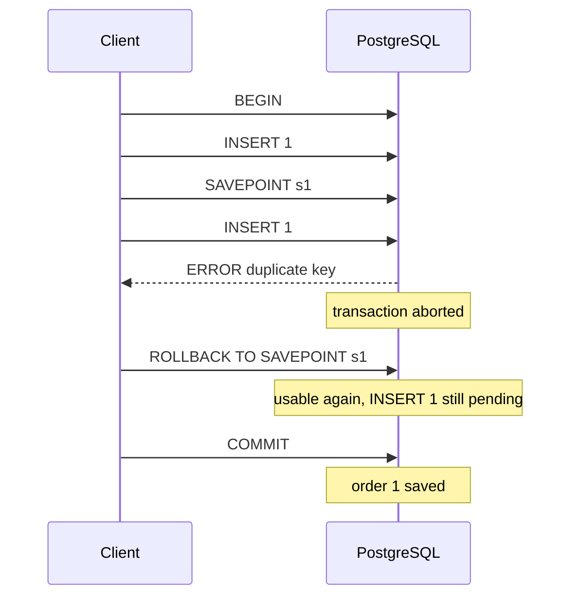

# PostgreSQL Transactions as Clients See Them

How the server decides what is one transaction, how Python drivers add transactions you didn't ask for, what an error inside a transaction does, and why the server insists on an explicit `ROLLBACK`.

Verified by experiment on PostgreSQL 16.15 and 18.6, with psycopg2 2.9.13, psycopg 3.3.6 and `psql` 16.15; both server versions gave identical results. Statement sequences come from the server log (`log_statement = all`), and session states from `pg_stat_activity`.

______________________________________________________________________

## Table of Contents

1. [Every Statement Is a Transaction](#1-every-statement-is-a-transaction)
2. [Drivers Send `BEGIN` for You](#2-drivers-send-begin-for-you)
3. [Multi-Statement Query Strings](#3-multi-statement-query-strings)
4. [The Aborted Transaction](#4-the-aborted-transaction)
5. [Savepoints](#5-savepoints)
6. [Idle in Transaction](#6-idle-in-transaction)
7. [Seeing the Transaction State](#7-seeing-the-transaction-state)
8. [How This Was Verified](#8-how-this-was-verified)
9. [Quick Reference](#9-quick-reference)

______________________________________________________________________

## 1. Every Statement Is a Transaction

On the server, a statement sent outside `BEGIN … COMMIT` runs as its own transaction and commits as soon as it finishes. The client sends nothing extra for this: measured with a driver in autocommit mode, the server log shows the statement alone, with no `BEGIN` or `COMMIT` around it. There is no server-side "autocommit off" switch; a multi-statement transaction exists only between an explicit `BEGIN` and `COMMIT` or `ROLLBACK`, or inside a multi-statement query string (section 3).

```sql
INSERT INTO t VALUES (1);          -- committed when it finishes

BEGIN;
INSERT INTO t VALUES (2);          -- pending
INSERT INTO t VALUES (3);          -- pending
COMMIT;                            -- 2 and 3 become durable together
```

______________________________________________________________________

## 2. Drivers Send `BEGIN` for You

PEP 249, the database API every Python driver implements, has no `begin()` method and says autocommit "must be initially off" ([PEP 249](https://peps.python.org/pep-0249/#commit)). A driver therefore emulates "autocommit off" by sending `BEGIN` itself before the first statement when no transaction is open.

Measured with raw connections:

| Connection                         | `autocommit` at start | Status after `SELECT 1`                           |
| ---------------------------------- | --------------------- | ------------------------------------------------- |
| `psycopg2.connect(...)`            | `False`               | `INTRANS`: a `BEGIN` was sent before the `SELECT` |
| `psycopg.connect(...)` (psycopg 3) | `False`               | `INTRANS`: a `BEGIN` was sent before the `SELECT` |

Consequences:

- **Even reads open a transaction.** A script that only runs `SELECT`s still holds a transaction open between them, and with it an `idle in transaction` session (section 6).
- **A forgotten `commit()` loses writes silently.** Closing the connection, or the process exiting, rolls the open transaction back with no error. Measured: an `INSERT` followed by `close()` without `commit()` left no row.
- **Opening or closing a cursor does nothing to the transaction.** A cursor only sends statements and reads results.

To get the server's own per-statement behaviour from the driver, turn autocommit on:

```python
conn = psycopg.connect(dsn, autocommit=True)     # psycopg 3
conn = psycopg2.connect(dsn); conn.autocommit = True   # psycopg2
```

Frameworks often do this for you; Django, for example, turns autocommit on for every connection it opens.

______________________________________________________________________

## 3. Multi-Statement Query Strings

When one query string holds several statements separated by `;`, the server runs them as a single implicit transaction unless the string itself contains `BEGIN`/`COMMIT` ([protocol docs](https://www.postgresql.org/docs/18/protocol-flow.html#PROTOCOL-FLOW-MULTI-STATEMENT)).

Measured with `psql -c`, which sends its argument as one string:

```sql
-- one string
INSERT INTO m VALUES (1); INSERT INTO m VALUES (1);
-- ERROR: duplicate key value violates unique constraint "m_pkey"
-- rows afterwards: 0, the first INSERT was rolled back too
```

```sql
-- one string
CREATE INDEX CONCURRENTLY m_a ON m (id); CREATE INDEX CONCURRENTLY m_b ON m (id);
-- ERROR: CREATE INDEX CONCURRENTLY cannot run inside a transaction block
```

```
psql -c "CREATE INDEX CONCURRENTLY m_a ON m (id)" -c "CREATE INDEX CONCURRENTLY m_b ON m (id)"
-- two strings: both indexes built
```

The same happens through psycopg2 and psycopg 3 when one `execute()` call carries several statements, even with autocommit on. Send statements that refuse transaction blocks one per `execute()`.

______________________________________________________________________

## 4. The Aborted Transaction

Once any statement fails inside a transaction, the server marks the whole transaction as failed. Measured with psycopg 3, autocommit off, after two good inserts and a duplicate:

| Check                                    | Result                                                                            |
| ---------------------------------------- | --------------------------------------------------------------------------------- |
| `pg_stat_activity.state` for the session | `idle in transaction (aborted)`                                                   |
| The next statement, `SELECT 1`           | `current transaction is aborted, commands ignored until end of transaction block` |
| The server's reply to `COMMIT`           | `ROLLBACK`                                                                        |
| Rows saved                               | 0: the two good inserts are lost too                                              |

```sql
BEGIN;
INSERT INTO orders VALUES (1);     -- OK, but only pending
INSERT INTO orders VALUES (2);     -- OK, but only pending
INSERT INTO orders VALUES (2);     -- ERROR: duplicate key
SELECT 1;                          -- ERROR: current transaction is aborted ...
COMMIT;                            -- server replies ROLLBACK
```

### Application code and the server keep separate state

When the driver raises the error, the application can catch it and move on to its next line. Catching it sends nothing to the server, so the session stays aborted and refuses the next statement. The client has to send `ROLLBACK` (or `ROLLBACK TO SAVEPOINT`) to clear it.

```python
conn.execute("INSERT INTO orders VALUES (1)")
try:
    conn.execute("INSERT INTO orders VALUES (1)")    # UniqueViolation
except psycopg.errors.UniqueViolation:
    pass                                            # the server is still aborted

conn.execute("SELECT 1")                             # InFailedSqlTransaction
conn.rollback()                                      # clears it; the first INSERT is gone as well
```

### Why the server doesn't end the transaction itself

The server discards the transaction's work at once; an aborted transaction can never commit. What it won't do is end the transaction on its own, because the client still believes it is inside one:

```sql
BEGIN;
UPDATE accounts SET balance = balance - 100 WHERE id = 1;   -- fails
UPDATE accounts SET balance = balance + 100 WHERE id = 2;   -- ?
COMMIT;
```

If the server ended the transaction at the first error, the second `UPDATE` would run on its own and commit, crediting money that was never debited. Refusing every statement until `ROLLBACK`:

- stops later statements from slipping through as separate transactions;
- keeps the failure visible, because every later statement errors;
- keeps client and server agreeing on whether a transaction is open.

It also can't choose the rollback for the client, because the client may want to keep part of the work (section 5).

______________________________________________________________________

## 5. Savepoints

A savepoint is a point inside a transaction that you can roll back to without losing the work before it:

```sql
BEGIN;
INSERT INTO orders VALUES (1);     -- before the savepoint
SAVEPOINT s1;
INSERT INTO orders VALUES (1);     -- ERROR: duplicate key
ROLLBACK TO SAVEPOINT s1;          -- undoes only the work after s1, clears the aborted state
COMMIT;                            -- order 1 is saved
```

Measured: the rows after that `COMMIT` were `[1]`.



`RELEASE SAVEPOINT s1` discards the savepoint after a success; it saves nothing by itself. Only the outer `COMMIT` makes work durable. Frameworks build nested transactions from savepoints; Django's nested `atomic()` blocks, for example, are `SAVEPOINT` / `RELEASE SAVEPOINT` / `ROLLBACK TO SAVEPOINT`.

______________________________________________________________________

## 6. Idle in Transaction

`pg_stat_activity.state` ([docs](https://www.postgresql.org/docs/18/monitoring-stats.html#MONITORING-PG-STAT-ACTIVITY-VIEW)) tells you what a session is doing between statements:

| State                           | Meaning                                                                                                                             |
| ------------------------------- | ----------------------------------------------------------------------------------------------------------------------------------- |
| `active`                        | running a statement                                                                                                                 |
| `idle`                          | connected, no transaction open                                                                                                      |
| `idle in transaction`           | a transaction is open, waiting for the client's next statement                                                                      |
| `idle in transaction (aborted)` | as above, but a statement failed; everything is refused until `ROLLBACK` or `ROLLBACK TO SAVEPOINT` (a `COMMIT` acts as `ROLLBACK`) |

An idle transaction is not harmless. Measured effects on a concurrent index build in the same database (see `concurrent-indexes.md`):

| The idle transaction…          | Effect                                                                                       |
| ------------------------------ | -------------------------------------------------------------------------------------------- |
| wrote to the table             | keeps its row locks; `CREATE INDEX CONCURRENTLY` waits in `waiting for writers before build` |
| runs at `REPEATABLE READ`      | keeps its snapshot; the build waits in `waiting for old snapshots`                           |
| only read, at `READ COMMITTED` | no effect on the build                                                                       |

Find them:

```sql
SELECT pid, usename, application_name, state, backend_xmin, xact_start,
       now() - xact_start AS open_for, left(query, 60) AS last_query
FROM pg_stat_activity
WHERE state LIKE 'idle in transaction%'
ORDER BY xact_start;
```

`query` is the **last** statement the session ran, not what is holding the transaction open. Bound how long they can live with [`idle_in_transaction_session_timeout`](https://www.postgresql.org/docs/18/runtime-config-client.html#GUC-IDLE-IN-TRANSACTION-SESSION-TIMEOUT), which terminates a session left idle in a transaction for longer than the limit.

______________________________________________________________________

## 7. Seeing the Transaction State

| Where              | How                                                                                                                                                                                    |
| ------------------ | -------------------------------------------------------------------------------------------------------------------------------------------------------------------------------------- |
| Server log         | run a test server with `-c log_statement=all`; look for `BEGIN`, `SAVEPOINT`, `RELEASE`, `ROLLBACK`, `COMMIT`                                                                          |
| `pg_stat_activity` | `state` column, section 6                                                                                                                                                              |
| psycopg 3          | `conn.info.transaction_status`: `IDLE`, `INTRANS`, `INERROR`                                                                                                                           |
| psycopg2           | `conn.get_transaction_status()`: `0` idle, `2` in transaction, `3` in error                                                                                                            |
| `psql`             | the default prompt is `%/%R%x%# `; `%x` shows `*` inside a transaction block and `!` inside a failed one ([docs](https://www.postgresql.org/docs/18/app-psql.html#APP-PSQL-PROMPTING)) |

______________________________________________________________________

## 8. How This Was Verified

- PostgreSQL 16.15 and 18.6 in Docker, with `log_statement = all` and `log_line_prefix = '[%p] '`.
- Driver defaults and transaction status: raw psycopg2 2.9.13 and psycopg 3.3.6 connections.
- Aborted state: a psycopg 3 session with two good inserts and a duplicate, inspected from a second session through `pg_stat_activity`; the `COMMIT` reply read from the cursor's status message.
- Multi-statement strings: `psql -c` with one string and with separate `-c` arguments; the same through both drivers.
- Idle-transaction effects: a second session left idle in a transaction in each of the listed ways, then a concurrent index build with `statement_timeout = '2s'`.

______________________________________________________________________

## 9. Quick Reference

| Situation                                   | What happens                                                                  |
| ------------------------------------------- | ----------------------------------------------------------------------------- |
| Statement outside `BEGIN`                   | Its own transaction, committed when it finishes                               |
| PEP 249 driver, default settings            | `BEGIN` sent before the first statement; open until `commit()` / `rollback()` |
| Connection closed with a transaction open   | Rolled back, no error                                                         |
| Several statements in one string            | One implicit transaction; `CONCURRENTLY` fails                                |
| Error inside a transaction                  | Aborted; later statements refused; `COMMIT` answered with `ROLLBACK`          |
| Error caught in application code            | Server still aborted until `ROLLBACK`                                         |
| `ROLLBACK TO SAVEPOINT`                     | Undoes work after the savepoint; transaction usable again                     |
| `idle in transaction` after writing a table | Holds row locks; concurrent index builds on that table wait                   |
| `idle in transaction` at `REPEATABLE READ`  | Holds a snapshot; concurrent index builds in that database wait               |
