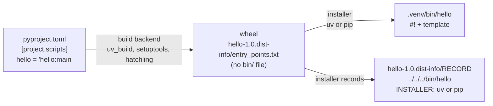

# Console-Script Launchers in `.venv/bin`

Commands such as `.venv/bin/pre-commit` are small Python files with a `#!` line, written by the **installer** (uv or pip) when a package is installed. This file covers where they come from, why their first line is what it is, the `/bin/sh` wrapper installers switch to for long or spaced paths, and why moving a project breaks them. How the kernel runs any `#!` file, and what each caller prints when that fails, is covered by the `linux` skill (`references/shebang.md` and `references/exec-errors.md`).

Verified against uv [0.13.0](https://github.com/astral-sh/uv/tree/0.13.0) (`crates/uv-install-wheel/src/wheel.rs`), pip [26.2.1](https://github.com/pypa/pip/tree/26.2.1) (`src/pip/_internal/operations/install/wheel.py` and its vendored distlib 0.4.2, `src/pip/_vendor/distlib/scripts.py`) and CPython [v3.15.0](https://github.com/python/cpython/tree/v3.15.0) (`Modules/getpath.py`), and by installing a one-module package with a console script into fresh venvs on Linux 7.0 with Python 3.15.0. Every "Source:" link points at the commit the tag names, with line numbers.

______________________________________________________________________

## Table of Contents

1. [Who Writes the Launcher](#1-who-writes-the-launcher)
2. [The Templates](#2-the-templates)
3. [Why the Shebang Names the Venv's Python](#3-why-the-shebang-names-the-venvs-python)
4. [The `/bin/sh` Wrapper](#4-the-binsh-wrapper)
5. [Moving a Project Breaks Its Launchers](#5-moving-a-project-breaks-its-launchers)
6. [Relocatable Venvs](#6-relocatable-venvs)
7. [Quick Reference](#7-quick-reference)

______________________________________________________________________

## 1. Who Writes the Launcher

Not the package's repository, and not its build backend. They only **declare** the command; the installer generates the file on the target machine, because only then is the interpreter path known:



The wheel carries the package and the command's declaration, but no launcher file:

```bash
cd "$(mktemp -d)"
mkdir -p proj/src/hello
printf '[project]\nname = "hello"\nversion = "1.0"\n[project.scripts]\nhello = "hello:main"\n[build-system]\nrequires = ["uv_build>=0.9,<0.14"]\nbuild-backend = "uv_build"\n' > proj/pyproject.toml
printf 'def main():\n    print("hello")\n' > proj/src/hello/__init__.py
uv build -q --wheel -o . proj
unzip -Z1 hello-1.0-py3-none-any.whl
unzip -p hello-1.0-py3-none-any.whl hello-1.0.dist-info/entry_points.txt
```

```text
hello/
hello/__init__.py
hello-1.0.dist-info/
hello-1.0.dist-info/WHEEL
hello-1.0.dist-info/entry_points.txt
hello-1.0.dist-info/METADATA
hello-1.0.dist-info/RECORD
[console_scripts]
hello = hello:main

```

After installation, the dist-info directory says which installer ran and lists the generated launcher, so uninstalling removes it. For the pre-commit launcher in a uv-managed project:

```bash
cd .venv/lib/python3*/site-packages/pre_commit-*.dist-info
cat INSTALLER; echo
cat entry_points.txt
grep bin/pre-commit RECORD
```

```text
uv
[console_scripts]
pre-commit = pre_commit.main:main
../../../bin/pre-commit,sha256=dXhKoAOR78MiW8dMeyJwQpW8i2WdjZxugNo5Ouy8ULs,329
```

Because the installer owns the file, editing a launcher by hand lasts only until the next reinstall.

______________________________________________________________________

## 2. The Templates

uv and pip write different bodies. uv's comment says it started from pip's template, but pip has since replaced distlib's template with its own, so the two no longer match.

uv 0.13.0:

Source: [`crates/uv-install-wheel/src/wheel.rs#L33-L53`](https://github.com/astral-sh/uv/blob/4ecd0eff2a81e3ffdcd7cfee10d08936e4747c17/crates/uv-install-wheel/src/wheel.rs#L33-L53)

```rust
fn get_script_launcher(entry_point: &Script, shebang: &str) -> String {
    let Script {
        module, function, ..
    } = entry_point;

    let import_name = entry_point.import_name();

    format!(
        r#"{shebang}
# -*- coding: utf-8 -*-
import sys
from {module} import {import_name}
if __name__ == "__main__":
    if sys.argv[0].endswith("-script.pyw"):
        sys.argv[0] = sys.argv[0][:-11]
    elif sys.argv[0].endswith(".exe"):
        sys.argv[0] = sys.argv[0][:-4]
    sys.exit({function}())
"#
    )
}
```

pip 26.2.1:

Source: [`src/pip/_internal/operations/install/wheel.py#L417-L426`](https://github.com/pypa/pip/blob/634a6ec1a5d9dcc2433571cdb2f4c58a4bb29caf/src/pip/_internal/operations/install/wheel.py#L417-L426)

```python
class PipScriptMaker(ScriptMaker):
    # Override distlib's default script template with one that
    # doesn't import `re` module, allowing scripts to load faster.
    script_template = textwrap.dedent("""\
        import sys
        from %(module)s import %(import_name)s
        if __name__ == '__main__':
            sys.argv[0] = sys.argv[0].removesuffix('.exe')
            sys.exit(%(func)s())
""")
```

Line by line, for the uv version:

| Line                             | Purpose                                                                                                                                                                                                                                   |
| -------------------------------- | ----------------------------------------------------------------------------------------------------------------------------------------------------------------------------------------------------------------------------------------- |
| `#!...`                          | the interpreter (section 3), or the `/bin/sh` wrapper (section 4)                                                                                                                                                                         |
| `# -*- coding: utf-8 -*-`        | a Python 2 leftover; UTF-8 is already the default on Python 3                                                                                                                                                                             |
| `from hello import main`         | the `module:function` from `entry_points.txt`                                                                                                                                                                                             |
| `-script.pyw` / `.exe` stripping | Windows launchers can be named `hello-script.pyw` or `hello.exe`; this makes `sys.argv[0]`, and so usage and help text, read `hello`. Never true on Linux                                                                                 |
| `sys.exit(main())`               | the function's return value becomes the process exit status: `None` gives 0, an int gives that status, a string is printed to stderr with status 1. A git hook run through this launcher blocks the commit when `main()` returns non-zero |

______________________________________________________________________

## 3. Why the Shebang Names the Venv's Python

The shebang names the program that reads the file. The file is Python source, so it must be a Python interpreter, and it must be the **venv's** one: only that path makes Python use the venv's `site-packages`, where `hello` is installed. Because the path is absolute, the launcher works without activating the venv.

`.venv/bin/python` is a symlink to the base interpreter, yet running it by the venv path gives a venv `sys.prefix`. CPython looks for `pyvenv.cfg` next to the path it was **started as**, one directory up first, before resolving the symlink:

Source: [`Modules/getpath.py#L348-L363`](https://github.com/python/cpython/blob/d220409a13b77de7a6c30abe16ea90db01528edc/Modules/getpath.py#L348-L363)

```python
if not py_setpath:
    try:
        # prefix2 is just to avoid calculating dirname again later,
        # as the path in venv_prefix is the more common case.
        venv_prefix2 = executable_dir or dirname(executable)
        venv_prefix = dirname(venv_prefix2)
        try:
            # Read pyvenv.cfg from one level above executable
            pyvenvcfg = readlines(joinpath(venv_prefix, VENV_LANDMARK))
        except (FileNotFoundError, PermissionError):
            # Try the same directory as executable
            pyvenvcfg = readlines(joinpath(venv_prefix2, VENV_LANDMARK))
            venv_prefix = venv_prefix2
    except (FileNotFoundError, PermissionError):
        venv_prefix = None
        pyvenvcfg = []
```

```bash
cd "$(mktemp -d)"
uv venv -q --python 3.15 .venv
ls -l .venv/bin/python | sed "s|.* -> |symlink to |; s|$HOME|~|"
.venv/bin/python -c 'import sys; print("via venv path:", sys.prefix)' | sed "s|$PWD|\$PWD|"
"$(readlink -f .venv/bin/python)" -c 'import sys; print("via resolved target:", sys.prefix)' | sed "s|$HOME|~|"
```

```text
symlink to ~/.local/share/uv/python/cpython-3.15-linux-x86_64-gnu/bin/python3.15
via venv path: $PWD/.venv
via resolved target: ~/.local/share/uv/python/cpython-3.15.0-linux-x86_64-gnu
```

The kernel passes the shebang path to Python as `argv[0]`, so a launcher's Python starts as `.venv/bin/python` and finds the venv. A shebang naming the launcher itself instead loops in the kernel until `ELOOP` (the `linux` skill, `references/shebang.md`, "Interpreter Chains and `ELOOP`").

______________________________________________________________________

## 4. The `/bin/sh` Wrapper

When the shebang line would be long or the interpreter path contains a space, both installers write a three-line wrapper instead. The file stays valid Python and valid shell at the same time:

```text
#!/bin/sh
'''exec' '/home/u/my project/.venv/bin/python' "$0" "$@"
' '''
```

| Line                             | Read by `/bin/sh`                                                                                                                 | Read by Python                                     |
| -------------------------------- | --------------------------------------------------------------------------------------------------------------------------------- | -------------------------------------------------- |
| `#!/bin/sh`                      | the kernel runs `/bin/sh` on the file                                                                                             | a comment                                          |
| `'''exec' '/…/python' "$0" "$@"` | `''` + `'exec'` is the word `exec`, so `exec /…/python <this file> <args>`: the shell is replaced by Python and never runs line 3 | the start of a `'''` string                        |
| `' '''`                          | never reached                                                                                                                     | the end of that string; the statement does nothing |

It avoids two kernel limits at once: a path with a space would be split into interpreter plus argument, and a path over 253 bytes is refused (the `linux` skill, `references/shebang.md`, "The 255-Byte Line").

The conditions:

Source: [`crates/uv-install-wheel/src/wheel.rs#L110-L139`](https://github.com/astral-sh/uv/blob/4ecd0eff2a81e3ffdcd7cfee10d08936e4747c17/crates/uv-install-wheel/src/wheel.rs#L110-L139)

```rust
fn format_shebang(executable: impl AsRef<Path>, os_name: &str, relocatable: bool) -> String {
    // Convert the executable to a simplified path.
    let executable = executable.as_ref().simplified_display().to_string();

    // Validate the shebang.
    if os_name == "posix" {
        // The length of the full line: the shebang, plus the leading `#` and `!`, and a trailing
        // newline.
        let shebang_length = 2 + executable.len() + 1;

        // If the shebang is too long, or contains spaces, wrap it in `/bin/sh`.
        // Same applies for relocatable scripts (executable is relative to script dir, hence `dirname` trick)
        // (note: the Windows trampoline binaries natively support relative paths to executable)
        if shebang_length > 127 || executable.contains(' ') || relocatable {
            let prefix = if relocatable {
                r#""$(dirname -- "$(realpath -- "$0")")"/"#
            } else {
                ""
            };
            let executable = format!(
                "{}'{}'",
                prefix,
                escape_posix_for_single_quotes(&executable)
            );
            return format!("#!/bin/sh\n'''exec' {executable} \"$0\" \"$@\"\n' '''");
        }
    }

    format!("#!{executable}")
}
```

Source: [`src/pip/_vendor/distlib/scripts.py#L168-L183`](https://github.com/pypa/pip/blob/634a6ec1a5d9dcc2433571cdb2f4c58a4bb29caf/src/pip/_vendor/distlib/scripts.py#L168-L183)

```python
        else:
            # Add 3 for '#!' prefix and newline suffix.
            shebang_length = len(executable) + len(post_interp) + 3
            if sys.platform == 'darwin':
                max_shebang_length = 512
            else:
                max_shebang_length = 127
            simple_shebang = ((b' ' not in executable) and (shebang_length <= max_shebang_length))

        if simple_shebang:
            result = b'#!' + executable + post_interp + b'\n'
        else:
            result = b'#!/bin/sh\n'
            result += b"'''exec' " + executable + post_interp + b' "$0" "$@"\n'
            result += b"' '''\n"
        return result
```

| Interpreter path                                         | uv 0.13.0                                          | pip 26.2.1                         |
| -------------------------------------------------------- | -------------------------------------------------- | ---------------------------------- |
| no space, line (with `#!` and newline) at most 127 bytes | `#!/abs/.venv/bin/python`                          | `#!/abs/.venv/bin/python`          |
| line over 127 bytes                                      | wrapper, path in `'single quotes'`                 | wrapper, path unquoted             |
| contains a space                                         | wrapper, path in `'single quotes'`                 | wrapper, path in `"double quotes"` |
| `uv venv --relocatable`                                  | wrapper, path relative to the launcher (section 6) | not applicable                     |

Both keep the 127-byte budget that fit the 128-byte buffer of kernels before 5.1, although Linux 5.1 and later accept 255. A wrapped launcher fails differently when its interpreter disappears: the error comes from `/bin/sh` (dash), not from the kernel (section 5).

______________________________________________________________________

## 5. Moving a Project Breaks Its Launchers

Every launcher holds the absolute path of the venv's Python as it was at install time. Rename or move the project directory and that path no longer exists. The message depends on which form the launcher has:

| Launcher form                                           | Message after the move                                                                          | Exit |
| ------------------------------------------------------- | ----------------------------------------------------------------------------------------------- | ---- |
| plain `#!/old/path/.venv/bin/python`, run from bash 5.2 | `bash: .venv/bin/hello: cannot execute: required file not found`                                | 127  |
| same, bash 5.1 or older                                 | `bash: .venv/bin/hello: /old/path/.venv/bin/python: bad interpreter: No such file or directory` | 126  |
| same, from Python `subprocess`                          | `FileNotFoundError: [Errno 2] No such file or directory: '.venv/bin/hello'`                     |      |
| `/bin/sh` wrapper (long or spaced path)                 | `.venv/bin/hello: 2: exec: /old/path/.venv/bin/python: not found`                               | 127  |

The full table of callers is in the `linux` skill's `references/exec-errors.md`. Measured with a wrapped launcher:

```bash
cd "$(mktemp -d)"
mkdir -p proj/src/hello
printf '[project]\nname = "hello"\nversion = "1.0"\n[project.scripts]\nhello = "hello:main"\n[build-system]\nrequires = ["uv_build>=0.9,<0.14"]\nbuild-backend = "uv_build"\n' > proj/pyproject.toml
printf 'def main():\n    print("hello")\n' > proj/src/hello/__init__.py
mkdir "with space" && uv venv -q "with space/.venv" && uv pip install -q --python "with space/.venv/bin/python" ./proj
"with space/.venv/bin/hello"
mv "with space" moved
moved/.venv/bin/hello 2>&1 | sed "s|$PWD|\$PWD|"; echo "exit=${PIPESTATUS[0]}"
moved/.venv/bin/python -c 'import hello; print("python -c still works")'
```

```text
hello
moved/.venv/bin/hello: 2: exec: $PWD/with space/.venv/bin/python: not found
exit=127
python -c still works
```

The venv's `python` itself survives the move: it is a symlink to the base interpreter, and `pyvenv.cfg` is found relative to wherever it now lives (section 3). So `.venv/bin/python -m <module>` keeps working for installed dependencies while every launcher in `.venv/bin` is broken. The project's own package does not import that way: `uv sync` installs it editable, and its `.pth` file holds the old absolute `src` path.

Fixes, in order of preference:

1. Recreate the venv in the new location: `rm -rf .venv && uv sync` (or `uv venv` and reinstall).
2. Reinstall the packages, which rewrites every launcher: `uv sync --reinstall` (plain `uv sync` reinstalls only the moved editable project and leaves dependency launchers broken), or `uv pip install --reinstall -r requirements.txt`.
3. Until then, bypass the launcher with `uv run python -m pre_commit`, or `.venv/bin/python -m pre_commit` for a dependency. `uv run pre-commit` does not help: it executes the same broken `.venv/bin/pre-commit`.

______________________________________________________________________

## 6. Relocatable Venvs

`uv venv --relocatable` makes uv write every launcher in wrapper form with a path **relative to the launcher**, resolved at run time:

```text
#!/bin/sh
'''exec' "$(dirname -- "$(realpath -- "$0")")"/'python' "$0" "$@"
' '''
```

`realpath` resolves symlinks first, so the launcher also works when called through a symlink (for example `~/.local/bin/hello -> /proj/.venv/bin/hello`). Measured: after `mv`ing a relocatable venv, both the launcher and a symlink to it still ran and reported the new `sys.prefix`. The cost is a `/bin/sh` start plus a fork and `exec` each of `realpath` and `dirname` per run: four `execve()` calls where a plain launcher makes one, and a non-relocatable wrapper two.

______________________________________________________________________

## 7. Quick Reference

| Question                                                   | Answer                                                                                                       |
| ---------------------------------------------------------- | ------------------------------------------------------------------------------------------------------------ |
| Who writes `.venv/bin/<tool>`?                             | The installer (uv, pip) at install time, from `entry_points.txt`; recorded in `RECORD`, named in `INSTALLER` |
| Is it in the wheel?                                        | No, only the `[console_scripts]` entry is                                                                    |
| Why `#!/abs/.venv/bin/python` and not the tool's own path? | The shebang names the interpreter; naming the file itself loops until `ELOOP`                                |
| Why does it work without activating the venv?              | The path is absolute, and Python finds `pyvenv.cfg` from the path it was started as                          |
| When is it a `#!/bin/sh` wrapper?                          | Line over 127 bytes, a space in the path, or a relocatable uv venv                                           |
| Project moved, launchers fail?                             | Recreate the venv or run `uv sync --reinstall`; `uv run python -m <module>` works meanwhile                  |
| Edited a launcher?                                         | The next install overwrites it                                                                               |
