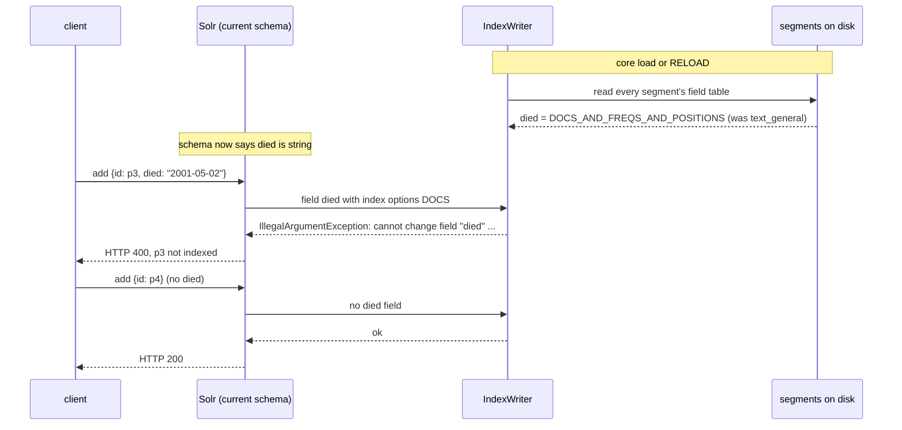
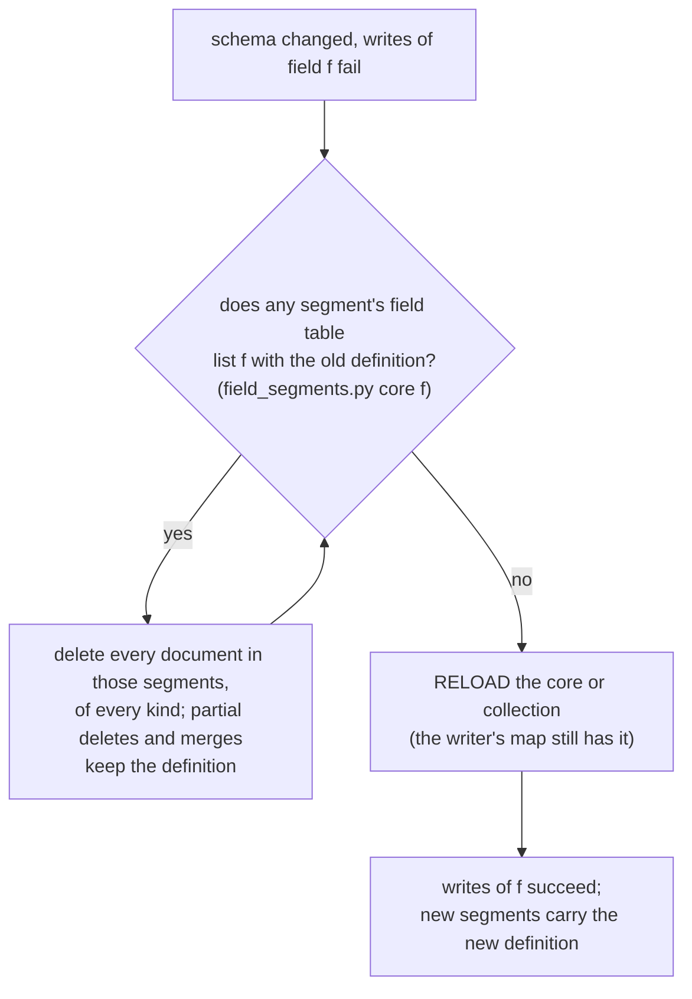
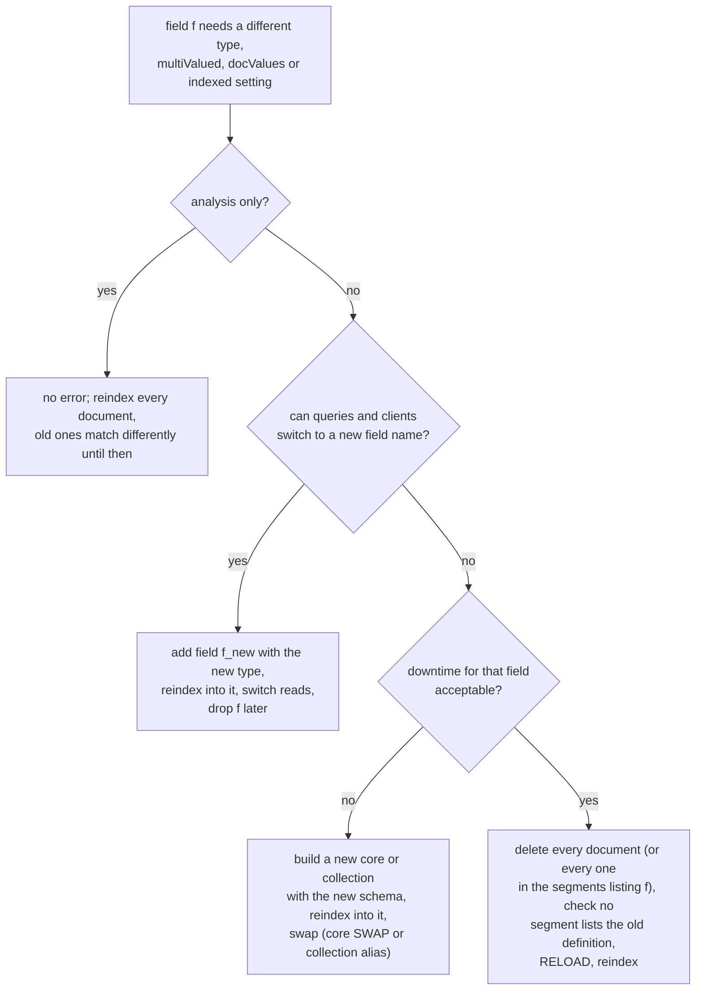

# Changing a Field's Type: `cannot change field ... to inconsistent ...`

Why Solr rejects documents after a field's type, `multiValued`, `docValues` or `indexed` setting changes in the schema, which changes do it, why deleting the affected documents does not fix it, and the two fixes that do.

Verified against Solr [9.10.1](https://github.com/apache/solr/tree/releases/solr/9.10.1) with Lucene [9.12.3](https://github.com/apache/lucene/tree/releases/lucene/9.12.3) (`FieldInfo.java`, `FieldInfos.java`, `IndexWriter.java`, `DirectUpdateHandler2.java`, `DistributedUpdateProcessor.java`, `SolrCore.java`), and by experiment on the `solr:9.10.1` and Solr [8.11.4](https://github.com/apache/lucene-solr/tree/releases/lucene-solr/8.11.4) (`solr:8`) Docker images. [Section 9](#9-reproduce-it) reproduces every result. Read `segments.md` first if segments, merges and field tables are new.

______________________________________________________________________

## Table of Contents

01. [Symptom](#1-symptom)
02. [Why: One Definition per Field Name](#2-why-one-definition-per-field-name)
03. [Which Schema Changes Fail](#3-which-schema-changes-fail)
04. [What Fails and What Still Indexes](#4-what-fails-and-what-still-indexes)
05. [Why Deleting the Affected Documents Is Not Enough](#5-why-deleting-the-affected-documents-is-not-enough)
06. [`delete *:*` Does Not Reset the Definition](#6-delete--does-not-reset-the-definition)
07. [RELOAD Rebuilds the Definitions](#7-reload-rebuilds-the-definitions)
08. [Choosing a Fix](#8-choosing-a-fix)
09. [Reproduce It](#9-reproduce-it)
10. [Quick Reference](#10-quick-reference)

______________________________________________________________________

## 1. Symptom

After a schema change, adds fail with HTTP 400:

```json
"msg":"Exception writing document id p3 to the index; possible analysis error: cannot change field \"died\" from index options=DOCS_AND_FREQS_AND_POSITIONS to inconsistent index options=DOCS",
"code":400
```

Through pysolr 3.11.0:

```text
pysolr.SolrError: Solr responded with an error (HTTP 400): [Reason: Exception writing document id p3 to the index; possible analysis error: cannot change field "died" from index options=DOCS_AND_FREQS_AND_POSITIONS to inconsistent index options=DOCS]
```

Typical surrounding facts: the schema is valid and loaded, documents **without** that field still index, and only some batches of a bulk load fail. "possible analysis error" is Solr's generic wording; nothing is wrong with the analyzer.

______________________________________________________________________

## 2. Why: One Definition per Field Name

Lucene keeps a single definition per field name for the whole index: its index options, doc values type, point dimensions and bytes, vector settings, and in indexes created by Lucene 9 or later also norms and term vectors. Analysis (tokenizer, filters) is not part of it.

The `IndexWriter` builds that definition map when it opens, from the field table of **every** segment:

Source: [`IndexWriter.java#L1273-L1285`](https://github.com/apache/lucene/blob/f965e930673c1f5cb478dc6a8907f5fc4ef7b539/lucene/core/src/java/org/apache/lucene/index/IndexWriter.java#L1273-L1285)

```java
  private FieldNumbers getFieldNumberMap() throws IOException {
    final FieldNumbers map =
        new FieldNumbers(
            config.softDeletesField,
            config.getParentField(),
            segmentInfos.getIndexCreatedVersionMajor());
    for (SegmentCommitInfo info : segmentInfos) {
      FieldInfos fis = readFieldInfos(info);
      for (FieldInfo fi : fis) {
        map.addOrGet(fi);
      }
    }
    return map;
```

Every field of every new document is checked against the map; a field name seen before must match. The check is against this index-wide map, not against the segment the document is going into, so a document headed for a brand-new, empty in-memory segment is rejected all the same:

Source: [`FieldInfos.java#L469-L476`](https://github.com/apache/lucene/blob/f965e930673c1f5cb478dc6a8907f5fc4ef7b539/lucene/core/src/java/org/apache/lucene/index/FieldInfos.java#L469-L476)

```java
    synchronized int addOrGet(FieldInfo fi) {
      String fieldName = fi.getName();
      verifySoftDeletedFieldName(fieldName, fi.isSoftDeletesField());
      verifyParentFieldName(fieldName, fi.isParentField());
      Integer fieldNumber = nameToNumber.get(fieldName);

      if (fieldNumber != null) {
        verifySameSchema(fi);
```

Source: [`FieldInfo.java#L263-L281`](https://github.com/apache/lucene/blob/f965e930673c1f5cb478dc6a8907f5fc4ef7b539/lucene/core/src/java/org/apache/lucene/index/FieldInfo.java#L263-L281)

```java
  static void verifySameIndexOptions(
      String fieldName,
      IndexOptions indexOptions1,
      IndexOptions indexOptions2,
      boolean strictlyConsistent) {
    if (strictlyConsistent == false
        && (indexOptions1 == IndexOptions.NONE || indexOptions2 == IndexOptions.NONE)) {
      return;
    }
    if (indexOptions1 != indexOptions2) {
      throw new IllegalArgumentException(
          "cannot change field \""
              + fieldName
              + "\" from index options="
              + indexOptions1
              + " to inconsistent index options="
              + indexOptions2);
    }
  }
```

"from" is what the index already holds; "to inconsistent" is what the current schema produced for the new document. The schema file decides how Solr builds each **new** document's fields. It has no say over what the map already holds.



What common Solr types produce (flags from `/admin/segments`, see `segments.md` section 9):

| Solr type (`_default`)    | Index options                  | Doc values                          | Points         |
| ------------------------- | ------------------------------ | ----------------------------------- | -------------- |
| `text_general`, `text_en` | `DOCS_AND_FREQS_AND_POSITIONS` | `NONE`                              | -              |
| `string`                  | `DOCS`                         | `SORTED` (`SORTED_SET` multiValued) | -              |
| `pint`                    | `NONE`                         | `NUMERIC`                           | 1 dim, 4 bytes |
| `plong`                   | `NONE`                         | `NUMERIC`                           | 1 dim, 8 bytes |

______________________________________________________________________

## 3. Which Schema Changes Fail

Each message below follows `Exception writing document id <id> to the index; possible analysis error: ` in Solr's response. Measured by changing an existing field with the Schema API `replace-field` and adding one document that has a value for it.

| Change on an indexed field                  | Index created by Lucene 9 (Solr 9)                                                                                                                            | Index created by Lucene 8 (Solr 8)                                     |
| ------------------------------------------- | ------------------------------------------------------------------------------------------------------------------------------------------------------------- | ---------------------------------------------------------------------- |
| `text_general` to `string`                  | `cannot change field "f" from index options=DOCS_AND_FREQS_AND_POSITIONS to inconsistent index options=DOCS`                                                  | same                                                                   |
| `string` to `string` `multiValued`          | `cannot change field "f" from doc values type=SORTED to inconsistent doc values type=SORTED_SET`                                                              | `cannot change DocValues type from SORTED to SORTED_SET for field "f"` |
| `pint` to `plong`                           | `cannot change field "f" from points dimensionCount=1, indexDimensionCount=1, numBytes=4 to inconsistent dimensionCount=1, indexDimensionCount=1, numBytes=8` | `cannot change point numBytes from 4 to 8 for field="f"`               |
| `string` to `pint`                          | `cannot change field "f" from index options=DOCS to inconsistent index options=NONE`                                                                          | `cannot change DocValues type from SORTED to NUMERIC for field "f"`    |
| `docValues` false to true                   | `cannot change field "f" from doc values type=NONE to inconsistent doc values type=SORTED`                                                                    | accepted; old segments keep no doc values for `f`                      |
| `indexed` true to false                     | `cannot change field "f" from index options=DOCS to inconsistent index options=NONE`                                                                          | accepted                                                               |
| analyzer only (`text_general` to `text_en`) | accepted                                                                                                                                                      | accepted                                                               |

**Strict or lenient is decided by the Lucene version that created the index**, not the one running it. Lucene 8 treated `NONE` (not indexed, no doc values) as compatible with anything:

Source: [`FieldInfos.java#L443`](https://github.com/apache/lucene/blob/f965e930673c1f5cb478dc6a8907f5fc4ef7b539/lucene/core/src/java/org/apache/lucene/index/FieldInfos.java#L443)

```java
      this.strictlyConsistent = indexCreatedVersionMajor >= 9;
```

The created version is stored in the commit point, so an index first written by Solr 8 keeps the lenient checks after an upgrade to Solr 9. `createdVersionMajor` in `/admin/segments` shows it, and `scripts/field_segments.py` prints `strict` or `lenient`.

**An accepted change is not a safe change.** After an analyzer change, old documents keep the tokens of the old analyzer while queries use the new one. With `body` changed from `text_general` to `text_en` (stemming), a document indexed earlier with `running` matches neither `body:running` nor `body:run`, while one indexed afterwards matches both. After a lenient `docValues` change, old segments have no doc values for the field, which `/admin/segments` reports as `nonCompliant: docValues schema=SORTED, segment=false`. Both need every document reindexed.

______________________________________________________________________

## 4. What Fails and What Still Indexes

- **Only documents with a value for the field fail.** A document without it adds no occurrence of the field, so nothing is checked. That is why a bulk load fails in some batches and not others: the failing batches contain at least one document with that field set.
- **A request stops at the first failing document.** Documents before it in the same request are written to the index; it and every document after it are not. The request's `commit=true` does not run either, so the earlier documents become visible only at the next commit (`autoSoftCommit`, `commitWithin` or an explicit commit).

```text
add [p5, p6 (has died), p7] with commit=true   → HTTP 400 on p6
search right after                              → p5 not visible, p6 and p7 not indexed
after the next commit                           → p5 visible; p6 and p7 still missing
```

- **Batching clients lose the rest of each batch.** pysolr `add()` sends one request per call. django-haystack 3.4.0 `update_index` sends one request per batch (`-b`) and, with the default `SILENTLY_FAIL`, logs `Failed to add documents to Solr` and carries on, so those documents keep their old indexed version or stay unindexed.

______________________________________________________________________

## 5. Why Deleting the Affected Documents Is Not Enough

Two places hold the old definition, and deleting documents clears neither directly:

1. **Every segment whose field table lists it.** That includes segments where no live document has the field: segments shared with other document kinds, and segments that inherited the definition through a merge (`segments.md` section 8). Any number of segments can list it, since every flush that saw the field recorded it; each one must be emptied. A segment disappears only when all its documents are deleted.
2. **The `IndexWriter`'s in-memory map.** Built when the writer opened, it keeps the definition even after every segment listing it is gone.

```text
Segment A  field table: [name, party, died (positions)]   docs: P1  P2  O1  O2
Segment B  field table: [name, died (positions)]          docs: P3  P4
Segment C  field table: [title, budget]                   docs: O3  O4
(P = person, O = organisation; only P1 and P3 ever had "died")
```

| You delete                   | Segment A                  | Segment B | Old definition               |
| ---------------------------- | -------------------------- | --------- | ---------------------------- |
| P1 and P3 (docs with `died`) | stays: P2, O1, O2 are live | stays     | on disk, in memory           |
| every person                 | stays: O1, O2 are live     | dropped   | on disk (A), in memory       |
| every document in A and B    | dropped                    | dropped   | in memory only, until RELOAD |
| everything, then RELOAD      | dropped                    | dropped   | gone                         |

Merging does not help: `optimize` and `expungeDeletes` copy the definition into the merged segment. Measured on 9.10.1 ([section 9](#9-reproduce-it), step 4): after deleting every person, merged segment `_5` holds only the organisation and still defines `died` with positions, with `docs with terms 0`.



______________________________________________________________________

## 6. `delete *:*` Does Not Reset the Definition

`IndexWriter.deleteAll()` drops every segment and clears the in-memory map, as if the index were new:

Source: [`IndexWriter.java#L2679`](https://github.com/apache/lucene/blob/f965e930673c1f5cb478dc6a8907f5fc4ef7b539/lucene/core/src/java/org/apache/lucene/index/IndexWriter.java#L2679)

```java
              globalFieldNumberMap.clear();
```

Solr calls it only when the delete query is exactly a `MatchAllDocsQuery`:

Source: [`DirectUpdateHandler2.java#L601`](https://github.com/apache/solr/blob/c135e6335c7158fa26e96b0dc386f825255b47c0/solr/core/src/java/org/apache/solr/update/DirectUpdateHandler2.java#L601), used at [`#L628-L630`](https://github.com/apache/solr/blob/c135e6335c7158fa26e96b0dc386f825255b47c0/solr/core/src/java/org/apache/solr/update/DirectUpdateHandler2.java#L628-L630)

```java
      boolean delAll = MatchAllDocsQuery.class == q.getClass();
```

With an update log (the `_default` configset, and every SolrCloud collection), the leader stamps each delete-by-query with a version:

Source: [`DistributedUpdateProcessor.java#L973-L976`](https://github.com/apache/solr/blob/c135e6335c7158fa26e96b0dc386f825255b47c0/solr/core/src/java/org/apache/solr/update/processor/DistributedUpdateProcessor.java#L973-L976)

```java
    if (versionsStored) {
      if (leaderLogic) {
        long version = vinfo.getNewClock();
        cmd.setVersion(-version);
```

and a versioned delete is wrapped so it cannot remove newer documents, which turns `*:*` into a `BooleanQuery`:

Source: [`DirectUpdateHandler2.java#L551-L565`](https://github.com/apache/solr/blob/c135e6335c7158fa26e96b0dc386f825255b47c0/solr/core/src/java/org/apache/solr/update/DirectUpdateHandler2.java#L551-L565)

```java
      // Make sure not to delete newer versions
      if (ulog != null && cmd.getVersion() != 0 && cmd.getVersion() != -Long.MAX_VALUE) {
        BooleanQuery.Builder bq = new BooleanQuery.Builder();
        bq.add(q, Occur.MUST);
        SchemaField sf = ulog.getVersionInfo().getVersionField();
        ValueSource vs = sf.getType().getValueSource(sf, null);
        ValueSourceRangeFilter filt =
            new ValueSourceRangeFilter(
                vs, Long.toString(Math.abs(cmd.getVersion())), null, true, true);
        FunctionRangeQuery range = new FunctionRangeQuery(filt);
        // formulated in the "MUST_NOT" sense so we can delete docs w/o a version (some tests depend
        // on this...)
        bq.add(range, Occur.MUST_NOT);
        q = bq.build();
      }
```

So `*:*` runs as an ordinary delete: all segments become empty and are dropped, but the map keeps the old definition and the next write with the field still fails. Measured the same on 9.10.1 and 8.11.4: zero segments, still HTTP 400, then success after RELOAD.

______________________________________________________________________

## 7. RELOAD Rebuilds the Definitions

A core RELOAD opens a new `IndexWriter`, which rebuilds the map from the segments that exist at that moment:

Source: [`SolrCore.java#L779-L780`](https://github.com/apache/solr/blob/c135e6335c7158fa26e96b0dc386f825255b47c0/solr/core/src/java/org/apache/solr/core/SolrCore.java#L779-L780)

```java
        // we open a new IndexWriter to pick up the latest config
        core.getUpdateHandler().getSolrCoreState().newIndexWriter(core, false);
```

```bash
# standalone core
curl -s 'http://localhost:8983/solr/admin/cores?action=RELOAD&core=<core>'
# SolrCloud: reloads every replica's core
curl -s 'http://localhost:8983/solr/admin/collections?action=RELOAD&name=<collection>'
```

A Solr restart has the same effect. A RELOAD while a segment still lists the old definition changes nothing: the new writer reads the definition straight back.

______________________________________________________________________

## 8. Choosing a Fix



| Fix                                 | Data loss       | Works on  | Notes                                                                                                                        |
| ----------------------------------- | --------------- | --------- | ---------------------------------------------------------------------------------------------------------------------------- |
| New field name                      | none            | any index | the new name has no definition yet, so the first write sets it; the old field's values stay until each document is reindexed |
| New core or collection, then swap   | none            | any index | an empty index has no definitions                                                                                            |
| Empty the segments, RELOAD, reindex | until reindexed | any index | in practice a full delete, because documents of every kind share segments                                                    |

**Partial delete with the same name.** If only some document kinds share the affected segments, deleting every document of those kinds empties them. The field table hints at which kinds a segment holds (fields only one kind uses); `field_segments.py` without a field name lists them per segment. Check again after the delete: a merge can have copied the definition into a segment that also holds other kinds.

**Removing a field from the schema** does not remove it from the index either. Old documents keep their values until reindexed, and the segments keep the definition, so adding the field back later with a different type fails the same way.

**Removing a stored field breaks atomic updates until every document is reindexed.** An atomic update (`{"id": "m1", "votes": {"set": 2}}`) makes Solr rebuild the whole document from its stored values. Fields the schema no longer knows are copied along unchecked:

Source: [`RealTimeGetComponent.java#L873-L880`](https://github.com/apache/solr/blob/c135e6335c7158fa26e96b0dc386f825255b47c0/solr/core/src/java/org/apache/solr/handler/component/RealTimeGetComponent.java#L873-L880)

```java
  private static SolrInputDocument toSolrInputDocument(SolrDocument doc, IndexSchema schema) {
    SolrInputDocument out = new SolrInputDocument();
    for (String fname : doc.getFieldNames()) {
      boolean fieldArrayListCreated = false;
      SchemaField sf = schema.getFieldOrNull(fname);
      if (sf != null) {
        if ((!sf.hasDocValues() && !sf.stored()) || schema.isCopyFieldTarget(sf)) continue;
      }
```

The rebuilt document then fails as if a client had sent the removed field. Measured on 9.10.1 with field guessing off (`update.autoCreateFields=false`, as in any hand-written schema), after `delete-field` on a stored `old_note`:

```text
atomic update  {"id": "m1", "votes": {"set": 2}}   → HTTP 400: ERROR: [doc=m1] unknown field 'old_note'
full re-send   {"id": "m1", "votes": 2}            → HTTP 200
atomic update again                                  → HTTP 200
```

So a stored field's definition must stay in the schema until every document has been fully re-sent without it. Deploy the indexing change first, reindex, then remove the field from the schema.

______________________________________________________________________

## 9. Reproduce It

Runs in a throwaway container on port 8983 (the same one as `segments.md` section 10, if it is still running). Run the `uv run` lines from the skill directory.

```bash
docker start solr-lab 2>/dev/null || docker run -d --name solr-lab -p 8983:8983 solr:9.10.1
until curl -sf 'http://localhost:8983/solr/admin/info/system' >/dev/null; do sleep 1; done
docker exec solr-lab solr create -c people

P=http://localhost:8983/solr/people
J='Content-Type: application/json'
curl -s "$P/schema" -H "$J" -d '{"add-field": [
  {"name": "kind", "type": "string", "stored": true},
  {"name": "died", "type": "text_general", "stored": true}]}'
curl -s "$P/update?commit=true" -H "$J" -d '[
  {"id": "p1", "kind": "person", "died": "1996-01-27"},
  {"id": "p2", "kind": "person"},
  {"id": "o1", "kind": "org"}]'

# 1. Change the type: text_general -> string
curl -s "$P/schema" -H "$J" -d '{"replace-field": {"name": "died", "type": "string", "stored": true}}'

# 2. With the field: HTTP 400. Without it: fine. A batch stops at the bad document.
curl -s "$P/update?commit=true" -H "$J" -d '[{"id": "p3", "kind": "person", "died": "2001-05-02"}]'
curl -s "$P/update?commit=true" -H "$J" -d '[{"id": "p4", "kind": "person"}]'
curl -s "$P/update?commit=true" -H "$J" -d '[
  {"id": "p5", "kind": "person"},
  {"id": "p6", "kind": "person", "died": "2010-09-30"},
  {"id": "p7", "kind": "person"}]'
curl -s "$P/select?q=*:*&fl=id&sort=id+asc&wt=csv"
uv run scripts/field_segments.py "$P" died
```

The p3 and p6 adds return `cannot change field "died" from index options=DOCS_AND_FREQS_AND_POSITIONS to inconsistent index options=DOCS`. The search returns `o1 p1 p2 p4` (p5 is indexed but waits for the next commit). The script shows the one segment that defines `died`:

```text
field "died"
  schema type now: string
segment  source  docs  deleted  docs with terms  index options                 doc values  points  schema check
_0       flush   3     0        1                DOCS_AND_FREQS_AND_POSITIONS  NONE        -       differs: omitNorms schema=true, segment=false; docValues schema=SORTED, segment=false
```

```bash
# 3. Fix A: a new field name works at once, nothing deleted
curl -s "$P/schema" -H "$J" -d '{"add-field": {"name": "died_on", "type": "string", "stored": true}}'
curl -s "$P/update?commit=true" -H "$J" -d '[{"id": "p3", "kind": "person", "died_on": "2001-05-02"}]'

# 4. Same name: deleting every person and reloading is not enough, o1 keeps the segment alive
curl -s "$P/update?commit=true" -H "$J" -d '{"delete": {"query": "kind:person"}}'
curl -s 'http://localhost:8983/solr/admin/cores?action=RELOAD&core=people'
curl -s "$P/update?commit=true" -H "$J" -d '[{"id": "p3", "kind": "person", "died": "2001-05-02"}]'
uv run scripts/field_segments.py "$P" died
```

The add fails again, and the only segment left holds o1 alone, merged, still with the old definition:

```text
segment  source  docs  deleted  docs with terms  index options                 doc values  points  schema check
_5       merge   1     0        0                DOCS_AND_FREQS_AND_POSITIONS  NONE        -       differs: omitNorms schema=true, segment=false; docValues schema=SORTED, segment=false
```

```bash
# 5. Delete everything: no segments left, the write still fails
curl -s "$P/update?commit=true" -H "$J" -d '{"delete": {"query": "*:*"}}'
curl -s "$P/update?commit=true" -H "$J" -d '[{"id": "p3", "kind": "person", "died": "2001-05-02"}]'
uv run scripts/field_segments.py "$P" died

# 6. RELOAD: the write succeeds and the new segment has the string definition
curl -s 'http://localhost:8983/solr/admin/cores?action=RELOAD&core=people'
curl -s "$P/update?commit=true" -H "$J" -d '[{"id": "p3", "kind": "person", "died": "2001-05-02"}]'
uv run scripts/field_segments.py "$P" died
docker rm -f solr-lab
```

```text
field "died"
  schema type now: string
segment  source  docs  deleted  docs with terms  index options  doc values  points  schema check
_8       flush   1     0        1                DOCS           SORTED      -       same
```

On Solr 8.11.4 (`solr:8`) steps 1 to 6 give the same results. The doc values and points rows of [section 3](#3-which-schema-changes-fail) come from the same procedure with `replace-field` set to the changed definition.

______________________________________________________________________

## 10. Quick Reference

| Question                                                                   | Answer                                                                                                               |
| -------------------------------------------------------------------------- | -------------------------------------------------------------------------------------------------------------------- |
| Which documents fail?                                                      | only ones with a value for the changed field                                                                         |
| What else in the request is lost?                                          | the failing document, every document after it, and the request's commit                                              |
| Where does the old definition live?                                        | in the field table of segments, and in the IndexWriter's map built from them                                         |
| Does deleting the documents that have the field fix it?                    | no, unless that empties every segment listing it, and then only after a RELOAD                                       |
| Does `optimize` or `expungeDeletes` fix it?                                | no; merges copy the definition                                                                                       |
| Does `delete *:*` fix it?                                                  | not with an update log; RELOAD afterwards                                                                            |
| Does RELOAD alone fix it?                                                  | only once no segment lists the old definition                                                                        |
| Cheapest fix without downtime?                                             | a new field name                                                                                                     |
| Which changes fail silently instead?                                       | analyzer changes always; `docValues` and `indexed` toggles on indexes created by Lucene 8                            |
| Why do atomic updates fail with `unknown field` after a field was removed? | Solr rebuilds the document from stored values, including the removed field; keep the definition until a full reindex |
