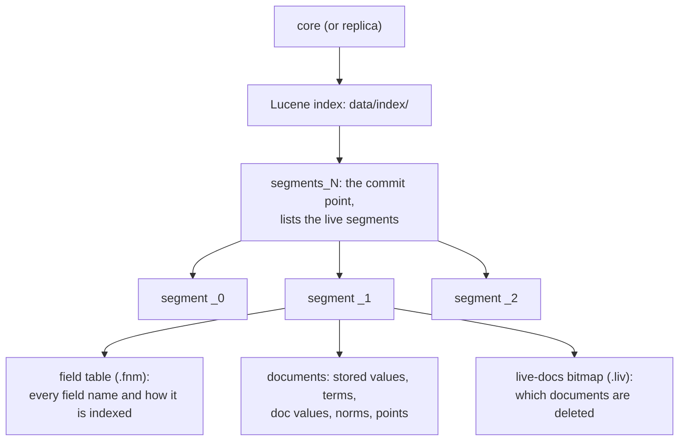
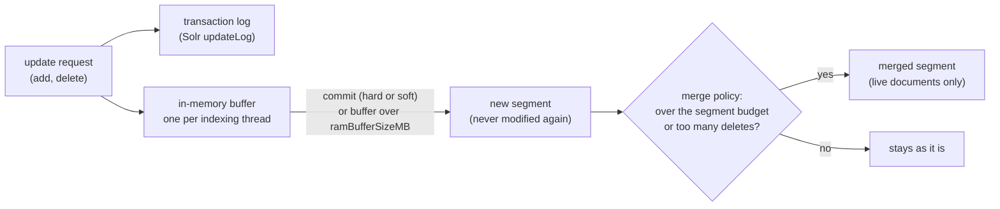
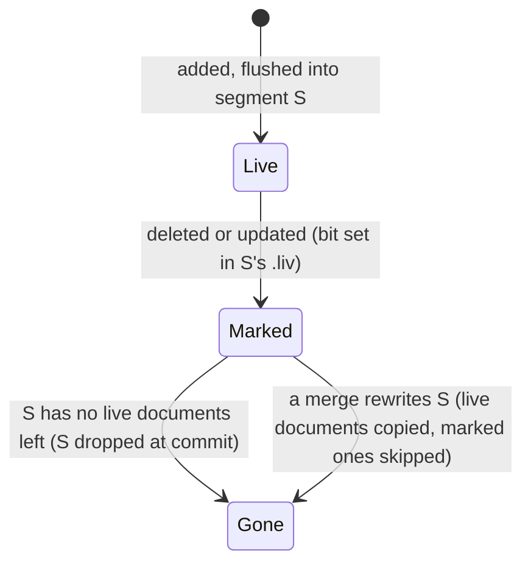
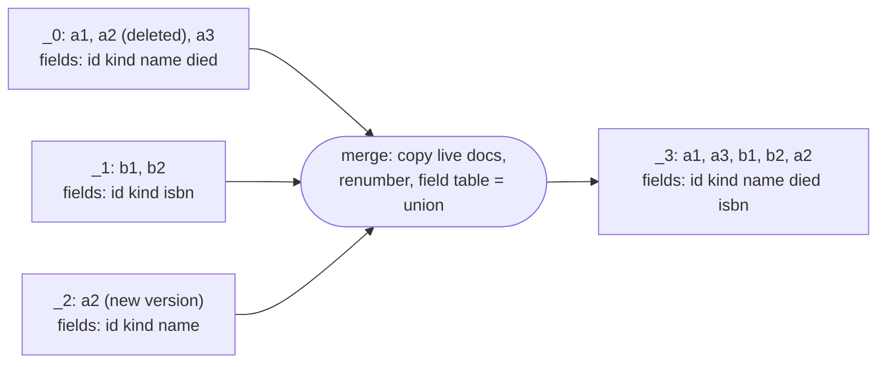
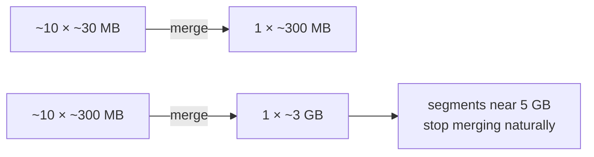

# Solr Segments: How a Core Splits Its Documents

How Solr (through Lucene) stores documents on disk: in segments that are written once, marked when documents are deleted, and merged in the background. Read this to explain a segment count, a `deletedDocs` number, why an index grows after updates, when and how merges happen, what `optimize` costs, or why a field definition outlives every document that used it.

Verified against Solr [9.10.1](https://github.com/apache/solr/tree/releases/solr/9.10.1) with Lucene [9.12.3](https://github.com/apache/lucene/tree/releases/lucene/9.12.3) (`IndexWriter.java`, `IndexingChain.java`, `SegmentMerger.java`, `MergeState.java`, `MergePolicy.java`, `TieredMergePolicy.java`, `MergeTrigger.java`, `SolrIndexConfig.java`, `DirectUpdateHandler2.java`, `GetSegmentData.java`), and by experiment on the `solr:9.10.1` Docker image: [section 10](#10-watch-it-happen), and a 400,000-document core for the size and timing figures. Solr [8.11.4](https://github.com/apache/lucene-solr/tree/releases/lucene-solr/8.11.4) behaves the same except where noted. Every `Source:` link points at the commit the release tag names.

______________________________________________________________________

## Table of Contents

01. [The Picture](#1-the-picture)
02. [Writing: Buffer, Flush, Segment](#2-writing-buffer-flush-segment)
03. [Names: Segments and Commit Points](#3-names-segments-and-commit-points)
04. [Deleting and Updating: a Mark, Not an Erase](#4-deleting-and-updating-a-mark-not-an-erase)
05. [Merging](#5-merging)
06. [How TieredMergePolicy Chooses](#6-how-tieredmergepolicy-chooses)
07. [Force Merge (`optimize`)](#7-force-merge-optimize)
08. [The Field Table](#8-the-field-table)
09. [Reading a Live Core's Segments](#9-reading-a-live-cores-segments)
10. [Watch It Happen](#10-watch-it-happen)
11. [Quick Reference](#11-quick-reference)

______________________________________________________________________

## 1. The Picture

A core (in SolrCloud, one replica of one shard) holds one Lucene index. The index is a list of **segments**. Each segment is a complete, read-only mini index with its own field table, stored values, inverted index, doc values and deleted-docs bitmap. A search runs over every segment and combines the results.



A document is stored whole in exactly one segment; its fields are never split across segments. Documents of every kind (every model, every `type` value) share the same segments, in the order they arrived. One index holds at most `IndexWriter.MAX_DOCS` = 2,147,483,519 documents, deleted ones included, so that limit applies per core or per shard ([`IndexWriter.java#L206`](https://github.com/apache/lucene/blob/f965e930673c1f5cb478dc6a8907f5fc4ef7b539/lucene/core/src/java/org/apache/lucene/index/IndexWriter.java#L206)).

All files with the same prefix belong to **one** segment; each holds a different part of it. This is segment `_4` of the core in [section 10](#10-watch-it-happen) after step 7:

```text
segments_8                 commit point (not a segment)
_4.si                      segment info: doc count, Lucene version, source (flush or merge)
_4.fnm                     field table
_4.fdt  _4.fdx  _4.fdm     stored values (what results return)
_4_Lucene912_0.tim .tip .tmd   terms dictionary   ┐
_4_Lucene912_0.doc             postings           ├ inverted index
_4_Lucene912_0.pos .psm        positions          ┘ (positions only for text fields)
_4_Lucene90_0.dvd .dvm     doc values (sorting, faceting)
_4.nvd  _4.nvm             norms (scoring)
_4_1.liv                   live docs, generation 1: written by the first delete in _4
```

The `Lucene912` and `Lucene90` infixes name the codec and change with the Lucene version (`Lucene84`, `Lucene80` on Solr 8). A segment can instead be packed into one compound file pair, `_4.cfs` and `_4.cfe`. Solr writes flushed segments uncompounded (`useCompoundFile=false`); a merged segment is compounded when it is under 10% of the index size (`TieredMergePolicy.DEFAULT_NO_CFS_RATIO = 0.1`, `MergePolicy.useCompoundFile`). It is still one segment.

______________________________________________________________________

## 2. Writing: Buffer, Flush, Segment



- Lucene buffers added documents in memory, one buffer per indexing thread (`DocumentsWriterPerThread`). Concurrent update requests fill different buffers, so one commit can flush several segments.
- A buffer is flushed into a new segment when a commit needs it (hard commit, or the near-real-time reader a soft commit opens), or when the buffers pass `ramBufferSizeMB`. Solr's default is 100 MB, not Lucene's 16 MB, and `maxBufferedDocs` is off:

Source: [`SolrIndexConfig.java#L98-L101`](https://github.com/apache/solr/blob/c135e6335c7158fa26e96b0dc386f825255b47c0/solr/core/src/java/org/apache/solr/update/SolrIndexConfig.java#L98-L101)

```java
  private SolrIndexConfig() {
    useCompoundFile = false;
    maxBufferedDocs = -1;
    ramBufferSizeMB = 100;
```

**A flush always makes a new segment; Lucene never appends to an existing one.** Documents that arrive before the same flush share a segment; documents that arrive after it get a new one, however small the old one is:

```text
10:00  add 6 docs, commit   → S1 (6 docs)          sealed, never modified again
11:00  add 4 docs, commit   → S2 (4 docs)          a new segment, not appended to S1
later  merge policy          → S3 (10 docs), S1 and S2 deleted
```

Immutability is what lets searches read a segment without locks while others are written, keeps caches valid, and makes a commit a matter of writing a new list of finished segments. The cost is many small segments, which merges clean up.

Lucene groups documents by **when** they were flushed, never by what they contain: to it a `type` or `django_ct` value is just another field. Keeping kinds of documents physically apart takes separate cores or collections.

**Measured:** 40 commits of 10,000 documents each (about 5 MB per flush) left 13 segments: 10 fresh 5 MB flush segments and 3 merged 100,000-document segments of about 50 MB each.

**One request is not one segment.** Solr parses the request body document by document, and each document goes straight into the in-memory buffer, already tokenized into postings. Whenever the buffers pass `ramBufferSizeMB`, one is flushed in the middle of the request and the request carries on; a single indexing thread is also flushed at `ramPerThreadHardLimitMB` (default 1945, `IndexWriterConfig.DEFAULT_RAM_PER_THREAD_HARD_LIMIT_MB`). Measured on 9.10.1:

| Requests                                                     | Segments written                                                       |
| ------------------------------------------------------------ | ---------------------------------------------------------------------- |
| one request of 300,000 documents (143 MB of JSON), no commit | 9 flush segments; the first five about 43,500 documents and 21 MB each |
| two requests of 2 and 3 documents, then one commit           | 1 segment of 5 documents                                               |

100 MB of buffer RAM became about 21 MB on disk. Requests sent one after another share the buffer until it is flushed; requests indexed at the same moment use separate buffers and become separate segments. `maxMergedSegmentMB` limits merges only, never flushes, so no request, however large, writes an oversized segment.

**A flush writes a segment; a commit publishes it.**

|                        | Flushed only                                                                             | After a hard commit        |
| ---------------------- | ---------------------------------------------------------------------------------------- | -------------------------- |
| segment files on disk  | yes                                                                                      | yes                        |
| listed in `segments_N` | no                                                                                       | yes                        |
| searchable             | only through a soft commit's near-real-time searcher                                     | yes, once a searcher opens |
| survives a crash       | no: unreferenced files are deleted on restart; the transaction log replays the documents | yes                        |

Measured with `autoCommit` off: after the 300,000-document request, `_0.si`, `_1.si` and `_2.si` were on disk, the commit point was still `segments_1`, and the segments API listed no segments, yet a search found 113,601 documents because the `_default` `autoSoftCommit` (3 s) had opened a searcher over them. A hard commit then wrote `segments_2` listing 4 segments and all 150,000 documents. Commit timing is in `commits.md`.

______________________________________________________________________

## 3. Names: Segments and Commit Points

A segment's name is `_` plus a counter in base 36. The counter only grows, so names are never reused, and gaps in a listing are segments that were merged away or dropped.

Source: [`IndexWriter.java#L2062`](https://github.com/apache/lucene/blob/f965e930673c1f5cb478dc6a8907f5fc4ef7b539/lucene/core/src/java/org/apache/lucene/index/IndexWriter.java#L2062)

```java
      return "_" + Long.toString(segmentInfos.counter++, Character.MAX_RADIX);
```

`Character.MAX_RADIX` is 36 (digits `0-9` then `a-z`), so `_im` is counter 18 × 36 + 22 = 670: the index had handed out 670 names before it.

**`segments_N` is not a segment.** It is the commit point: a small file listing which segments make up the index and, for each, its deletion generation and deleted-document count. Every commit writes a new one with the next generation, and Solr's default deletion policy keeps only the newest (`maxCommitsToKeep = 1`, [`SolrDeletionPolicy.java#L44`](https://github.com/apache/solr/blob/c135e6335c7158fa26e96b0dc386f825255b47c0/solr/core/src/java/org/apache/solr/core/SolrDeletionPolicy.java#L44)); older ones go once no searcher uses them. Generations in file names (`segments_N`, `_4_N.liv`) are also base 36 ([`IndexFileNames.java#L69`](https://github.com/apache/lucene/blob/f965e930673c1f5cb478dc6a8907f5fc4ef7b539/lucene/core/src/java/org/apache/lucene/index/IndexFileNames.java#L69)): generation 41 is `segments_15`.

| File                             | What it is                             | Written when                                |
| -------------------------------- | -------------------------------------- | ------------------------------------------- |
| `_z.si`, `_z.fnm`, `_z.fdt`, ... | segment `_z`                           | a flush with new documents, or a merge      |
| `_z_4.liv`                       | generation 4 of `_z`'s deletion bitmap | a commit after deletes in `_z`              |
| `segments_42`                    | the commit point                       | every commit, after adds, deletes or merges |

______________________________________________________________________

## 4. Deleting and Updating: a Mark, Not an Erase

Segment files are never edited. A delete, by id or by query, goes through these steps:

1. The delete is buffered in memory. Searches still see the document.
2. At the next flush or commit, Lucene resolves it to document numbers in each segment and writes a new generation of that segment's live-docs file (`_4_1.liv`). The data files (`.fdt`, `.tim`, `.fnm`, ...) are untouched; the document's bytes are still on disk.
3. The next searcher skips marked documents. `numDocs` drops, `maxDoc` stays, `deletedDocs` rises.
4. If every document in a segment is now marked, the segment is **dropped** at that commit, field table included.
5. Otherwise the bytes stay until a merge rewrites the segment and copies only its live documents.

```text
before:  _z.fdt _z.tim _z.doc ...   docA's bytes are here
         _z_3.liv                    docA's bit = live
         segments_41                 _z: delGen 3, delCount 12

delete docA, commit:
         _z.fdt _z.tim _z.doc ...   unchanged, docA's bytes still here
         _z_4.liv                    new bitmap, docA's bit = deleted
         segments_42                 new commit point: _z: delGen 4, delCount 13
```

A delete creates no segment: only a new `.liv` generation and a new commit point. Adds and merges create segments.



**An update is a delete plus an add.** Re-sending a document with an existing `uniqueKey` marks the old version deleted in its old segment and writes the new version into the current buffer, so into a new segment. Only one version is ever live, but the old one occupies space until its segment is merged or emptied. Solr never compares content: re-sending a byte-for-byte identical document raised `deletedDocs` and `maxDoc` by one each and gave it a new `_version_`. A full reindex therefore rewrites every document and leaves as many deleted ones behind.

**Measured:** in a one-segment core of 400,000 documents (198.8 MB), re-sending 120,000 of them left the big segment at 198.9 MB holding 120,000 deleted documents, plus 12 new 5 MB segments with the new versions: 259 MB on disk for 400,000 live documents. The deleted count in the old segment equals the document count of the new ones, a quick way to recognise reindexing in a segment listing.

______________________________________________________________________

## 5. Merging

**Who:** the `IndexWriter` inside Solr. Solr's default merge policy is `TieredMergePolicy`, and `ConcurrentMergeScheduler` runs the merges it picks on background threads, several at once if needed.

Source: [`DefaultMergePolicyFactory.java#L41-L43`](https://github.com/apache/solr/blob/c135e6335c7158fa26e96b0dc386f825255b47c0/solr/core/src/java/org/apache/solr/index/DefaultMergePolicyFactory.java#L41-L43)

```java
  public final MergePolicy getMergePolicy() {
    return new TieredMergePolicy();
  }
```

**When: only after a change to the index.** There is no timer, cron job or idle-time merging. Every call into the merge policy carries the event that caused it:

Source: [`MergeTrigger.java#L23-L48`](https://github.com/apache/lucene/blob/f965e930673c1f5cb478dc6a8907f5fc4ef7b539/lucene/core/src/java/org/apache/lucene/index/MergeTrigger.java#L23-L48)

```java
public enum MergeTrigger {
  /** Merge was triggered by a segment flush. */
  SEGMENT_FLUSH,

  /**
   * Merge was triggered by a full flush. Full flushes can be caused by a commit, NRT reader reopen
   * or a close call on the index writer.
   */
  FULL_FLUSH,

  /** Merge has been triggered explicitly by the user. */
  EXPLICIT,

  /** Merge was triggered by a successfully finished merge. */
  MERGE_FINISHED,

  /** Merge was triggered by a closing IndexWriter. */
  CLOSING,

  /** Merge was triggered on commit. */
  COMMIT,
  /** Merge was triggered on opening NRT readers. */
  GET_READER,
  /** Merge was triggered by an {@link IndexWriter#addIndexes(CodecReader...)} operation */
  ADD_INDEXES,
}
```

So an index that receives no writes keeps exactly the segments it has, for a year if need be. Searches never trigger a merge. `autoCommit` fires only when there are uncommitted changes, so it is not a merge timer either. Once picked, a merge runs in the background and can still be running after the request that triggered it has returned.

**Defaults**, which differ between the two major versions:

Source: [`TieredMergePolicy.java#L89-L95`](https://github.com/apache/lucene/blob/f965e930673c1f5cb478dc6a8907f5fc4ef7b539/lucene/core/src/java/org/apache/lucene/index/TieredMergePolicy.java#L89-L95)

```java
  private int maxMergeAtOnce = 10;
  private long maxMergedSegmentBytes = 5 * 1024 * 1024 * 1024L;

  private long floorSegmentBytes = 2 * 1024 * 1024L;
  private double segsPerTier = 10.0;
  private double forceMergeDeletesPctAllowed = 10.0;
  private double deletesPctAllowed = 20.0;
```

| Setting (`TieredMergePolicyFactory` name) | Lucene 9.12.3 (Solr 9.10.1) | Lucene 8.11.4 (Solr 8.11.4) | Effect                                                                      |
| ----------------------------------------- | --------------------------- | --------------------------- | --------------------------------------------------------------------------- |
| `segmentsPerTier`                         | 10                          | 10                          | segments allowed per size level in the budget (section 6)                   |
| `maxMergeAtOnce`                          | 10                          | 10                          | most segments one natural merge combines                                    |
| `maxMergedSegmentMB`                      | 5120                        | 5120                        | natural merges do not produce bigger segments                               |
| `floorSegmentMB`                          | 2                           | 2                           | smaller segments count as this size                                         |
| `deletesPctAllowed`                       | **20**                      | **33**                      | ceiling for deleted documents across the **whole index**, as a percentage   |
| `forceMergeDeletesPctAllowed`             | 10                          | 10                          | `expungeDeletes` rewrites only segments with more deleted documents than it |
| `maxMergeAtOnceExplicit`                  | removed                     | unlimited                   | segments per step of a force merge                                          |

The 8.11.4 values are from [`TieredMergePolicy.java`](https://github.com/apache/lucene-solr/blob/e27f44e3d78dfcec230c97e0a1240e3751daeff9/lucene/core/src/java/org/apache/lucene/index/TieredMergePolicy.java#L96-L103) in that release. The `_default` configset sets `maxMergeAtOnce` and `segmentsPerTier` explicitly in `solrconfig.xml` under `<mergePolicyFactory class="org.apache.solr.index.TieredMergePolicyFactory">`.

**How a merge runs**, for `_0` + `_1` + `_2` into `_3`:

1. A background thread reads the source segments.
2. For each source it walks document numbers `0 … maxDoc-1` and checks the live-docs bitmap. A deleted document maps to `-1` and is skipped; a live one gets the next number in `_3`:

Source: [`MergeState.java#L187-L197`](https://github.com/apache/lucene/blob/f965e930673c1f5cb478dc6a8907f5fc4ef7b539/lucene/core/src/java/org/apache/lucene/index/MergeState.java#L187-L197)

```java
      final int docBase = totalDocs;
      docMaps[i] =
          docID -> {
            if (liveDocs == null) {
              return docBase + docID;
            } else if (liveDocs.get(docID)) {
              return docBase + (int) delDocMap.get(docID);
            } else {
              return -1;
            }
          };
```

3. It builds `_3`'s field table as the **union of the source field tables** ([section 8](#8-the-field-table)).
4. Deletes that arrive while the merge runs are carried over to `_3` through the same old-to-new number map, so nothing deleted comes back:

Source: [`IndexWriter.java#L4361-L4368`](https://github.com/apache/lucene/blob/f965e930673c1f5cb478dc6a8907f5fc4ef7b539/lucene/core/src/java/org/apache/lucene/index/IndexWriter.java#L4361-L4368)

```java
  /**
   * Carefully merges deletes and updates for the segments we just merged. This is tricky because,
   * although merging will clear all deletes (compacts the documents) and compact all the updates,
   * new deletes and updates may have been flushed to the segments since the merge was started. This
   * method "carries over" such new deletes and updates onto the newly merged segment, and saves the
   * resulting deletes and updates files (incrementing the delete and DV generations for
   * merge.info). If no deletes were flushed, no new deletes file is saved.
   */
```

5. The next commit swaps `[_0, _1, _2]` for `[_3]`; the old files are deleted once no open searcher reads them. Until then old and new coexist on disk.



**Merged size is about the live size of the sources**, slightly less. Measured on 9.10.1:

| Merge                                                                | Before   | After    |
| -------------------------------------------------------------------- | -------- | -------- |
| 10 flush segments of 5.0 MB, no deletes (natural merge)              | 50.0 MB  | 49.7 MB  |
| 13 segments, 400,000 documents, no deletes (`optimize`)              | 199.4 MB | 198.8 MB |
| 13 segments, 520,000 documents of which 120,000 deleted (`optimize`) | 259.1 MB | 198.8 MB |

Without deletes a merge saves well under 1%; deleted documents are where the space comes back.

______________________________________________________________________

## 6. How TieredMergePolicy Chooses

After each triggering event the policy answers two questions: **may the index stay as it is**, and if not, **which group of segments to merge**.

**Step 1: measure each segment by its live size.** A segment's bytes are scaled down by its share of deleted documents, so a 36.9 MB segment with 31% deleted counts as about 25.5 MB. That is an estimate that assumes deleted documents are of average size. Segments under `floorSegmentMB` (2 MB) count as 2 MB.

Source: [`MergePolicy.java#L765-L773`](https://github.com/apache/lucene/blob/f965e930673c1f5cb478dc6a8907f5fc4ef7b539/lucene/core/src/java/org/apache/lucene/index/MergePolicy.java#L765-L773)

```java
  protected long size(SegmentCommitInfo info, MergeContext mergeContext) throws IOException {
    long byteSize = info.sizeInBytes();
    int delCount = mergeContext.numDeletesToMerge(info);
    assert assertDelCount(delCount, info);
    double delRatio =
        info.info.maxDoc() <= 0 ? 0d : (double) delCount / (double) info.info.maxDoc();
    assert delRatio <= 1.0;
    return (info.info.maxDoc() <= 0 ? byteSize : (long) (byteSize * (1.0 - delRatio)));
  }
```

Segments over half of `maxMergedSegmentMB` (2.5 GB) are left out of natural merging unless both the whole index and the segment itself are more than `deletesPctAllowed` deleted ([`TieredMergePolicy.java#L409-L410`](https://github.com/apache/lucene/blob/f965e930673c1f5cb478dc6a8907f5fc4ef7b539/lucene/core/src/java/org/apache/lucene/index/TieredMergePolicy.java#L409-L410)); then one can be rewritten on its own to drop its deleted documents.

**Step 2: compute a segment budget from the total size.** Starting at the smallest segment's size (at least 2 MB), each level allows `segmentsPerTier` (10) segments and is 10 times bigger than the one before; the walk stops at the level the remaining bytes cannot fill. The budget never drops below 10:

Source: [`TieredMergePolicy.java#L425-L441`](https://github.com/apache/lucene/blob/f965e930673c1f5cb478dc6a8907f5fc4ef7b539/lucene/core/src/java/org/apache/lucene/index/TieredMergePolicy.java#L425-L441)

```java
    final int mergeFactor = (int) Math.min(maxMergeAtOnce, segsPerTier);
    // Compute max allowed segments for the remainder of the index
    long levelSize = Math.max(minSegmentBytes, floorSegmentBytes);
    long bytesLeft = totIndexBytes;
    while (true) {
      final double segCountLevel = bytesLeft / (double) levelSize;
      if (segCountLevel < segsPerTier || levelSize == maxMergedSegmentBytes) {
        allowedSegCount += Math.ceil(segCountLevel);
        break;
      }
      allowedSegCount += segsPerTier;
      bytesLeft -= segsPerTier * levelSize;
      levelSize = Math.min(maxMergedSegmentBytes, levelSize * mergeFactor);
    }
    // allowedSegCount may occasionally be less than segsPerTier
    // if segment sizes are below the floor size
    allowedSegCount = Math.max(allowedSegCount, Math.max(segsPerTier, targetSearchConcurrency));
```

For a 1 GB index whose smallest segment is under 2 MB: the 2 MB level allows 10 (20 MB used), the 20 MB level allows 10 (200 MB used), and the remaining 780 MB is 3.9 segments of 200 MB, rounded up to 4. The budget is 24 segments.

The levels only produce the budget; segments are not assigned to them. "About 10 segments per tier" is therefore a target the policy keeps restoring, not a cap: an 11th segment of similar size is written normally and merged at a later check.

**Step 3: do nothing if both counts are within limits.** A natural merge happens only when the index has more segments than the budget, or more deleted documents than `deletesPctAllowed` percent of **all** documents in the index:

Source: [`TieredMergePolicy.java#L543-L547`](https://github.com/apache/lucene/blob/f965e930673c1f5cb478dc6a8907f5fc4ef7b539/lucene/core/src/java/org/apache/lucene/index/TieredMergePolicy.java#L543-L547)

```java
      if (mergeType == MERGE_TYPE.NATURAL
          && sortedEligible.size() <= allowedSegCount
          && remainingDelCount <= allowedDelCount) {
        return spec;
      }
```

Both limits are index-wide. There is no per-segment deleted-percentage trigger: a segment that is 30% deleted is rewritten because the whole index is over the limit, not because of its own share. A segment's own share matters only for segments over 2.5 GB (step 1). An index of 10 or fewer segments with few deletes is never merged, however small or uneven its segments are.

**Step 4: score candidate groups and merge the best.** Segments are sorted by size and groups of up to `maxMergeAtOnce` neighbours are scored ([`TieredMergePolicy.java#L699-L748`](https://github.com/apache/lucene/blob/f965e930673c1f5cb478dc6a8907f5fc4ef7b539/lucene/core/src/java/org/apache/lucene/index/TieredMergePolicy.java#L699-L748)). Lower is better, and the score is the product of:

| Factor                      | Meaning                                                                  | Favours                            |
| --------------------------- | ------------------------------------------------------------------------ | ---------------------------------- |
| skew                        | largest segment's floored size ÷ the group's floored total (1/10 to 1.0) | segments of similar size           |
| `totAfterMergeBytes ^ 0.05` | size of the result                                                       | smaller merges, gently             |
| `nonDelRatio ^ 2`           | live bytes after ÷ bytes before                                          | groups with many deleted documents |

Similar size is judged by how balanced a group is, not by fixed bands: 11.45 MB and 11.78 MB segments sit next to each other in the sorted list and form a balanced group; a 1 GB segment grouped with 10 MB ones scores badly.

A group is built by adding segments until it holds `maxMergeAtOnce` (10) or the next one would push the result past `maxMergedSegmentMB` (5 GB); a segment that does not fit is skipped so smaller ones can fill the space, and a segment can form a merge on its own:

Source: [`TieredMergePolicy.java#L563-L568`](https://github.com/apache/lucene/blob/f965e930673c1f5cb478dc6a8907f5fc4ef7b539/lucene/core/src/java/org/apache/lucene/index/TieredMergePolicy.java#L563-L568)

```java
        for (int idx = startIdx;
            idx < sortedEligible.size()
                && candidate.size() < mergeFactor
                && bytesThisMerge < maxMergedSegmentBytes
                && (bytesThisMerge < floorSegmentBytes || docCountThisMerge <= allowedDocCount);
            idx++) {
```

| Segments    | One merge takes  | Why                                                                             |
| ----------- | ---------------- | ------------------------------------------------------------------------------- |
| 12 × 300 MB | 10, giving 3 GB  | the 10-segment limit                                                            |
| 12 × 600 MB | 8, giving 4.8 GB | a 9th would make 5.4 GB                                                         |
| 6 × 2 GB    | 2, giving 4 GB   | a 3rd would make 6 GB; later checks merge the rest in pairs, ending at 3 × 4 GB |
| 3 × 3 GB    | none             | each is over 2.5 GB, so excluded unless heavily deleted                         |

One check can schedule several non-overlapping merges ([`TieredMergePolicy.java#L676`](https://github.com/apache/lucene/blob/f965e930673c1f5cb478dc6a8907f5fc4ef7b539/lucene/core/src/java/org/apache/lucene/index/TieredMergePolicy.java#L676), [`#L694`](https://github.com/apache/lucene/blob/f965e930673c1f5cb478dc6a8907f5fc4ef7b539/lucene/core/src/java/org/apache/lucene/index/TieredMergePolicy.java#L694)), and `ConcurrentMergeScheduler` runs them in parallel. A segment takes part in at most one running merge. A merged segment is an ordinary segment: nothing records where it came from, and it can be merged again at the next level. The policy repeats until the index is back within both limits.

The result is a staircase: about ten small segments merge into one ten times bigger, ten of those into one bigger again, up to the 5 GB cap. A large index ends up with several segments near 5 GB and smaller ones below them, never a single segment.



**Measured** on 9.10.1, starting from one 400,000-document segment and re-sending 10,000 documents per commit:

| Re-sent     | Deleted, whole index | Deleted, big segment | Segments | What happened                                    |
| ----------- | -------------------- | -------------------- | -------- | ------------------------------------------------ |
| 10k to 100k | 2% to 20%            | 2% to 25%            | 2 to 11  | nothing merged; new 5 MB segments pile up        |
| 110k        | 22%                  | 28%                  | 12       | over the 20% limit; merges run in the background |
| 120k        | 23%                  | 30%                  | 4        | small segments merged                            |
| 130k        | 5%                   | rewritten            | 4        | big segment rewritten, deletes reclaimed         |

At 25% deleted the big segment was left alone while the index stood at 20%; it was rewritten only once the whole index passed 20%.

______________________________________________________________________

## 7. Force Merge (`optimize`)

```bash
curl -s 'http://localhost:8983/solr/<core>/update?optimize=true&maxSegments=1'
```

`optimize` asks for at most `maxSegments` segments. With `maxSegments=1` the 5 GB cap is lifted, so the whole index becomes one segment:

Source: [`TieredMergePolicy.java#L810-L814`](https://github.com/apache/lucene/blob/f965e930673c1f5cb478dc6a8907f5fc4ef7b539/lucene/core/src/java/org/apache/lucene/index/TieredMergePolicy.java#L810-L814)

```java
    long maxMergeBytes = maxMergedSegmentBytes;

    // Set the maximum segment size based on how many segments have been specified.
    if (maxSegmentCount == 1) {
      maxMergeBytes = Long.MAX_VALUE;
```

Solr runs it inside a hard commit, holding the lock that lets only one hard commit proceed at a time:

Source: [`DirectUpdateHandler2.java#L737-L740`](https://github.com/apache/solr/blob/c135e6335c7158fa26e96b0dc386f825255b47c0/solr/core/src/java/org/apache/solr/update/DirectUpdateHandler2.java#L737-L740), then [`#L763-L764`](https://github.com/apache/solr/blob/c135e6335c7158fa26e96b0dc386f825255b47c0/solr/core/src/java/org/apache/solr/update/DirectUpdateHandler2.java#L763-L764)

```java
      // only allow one hard commit to proceed at once
      if (!cmd.softCommit) {
        solrCoreState.getCommitLock().lock();
      }
```

```java
        if (cmd.optimize) {
          writer.forceMerge(cmd.maxOptimizeSegments);
```

Measured on 9.10.1 with a 400,000-document, 199 MB core, sending other requests one second into the optimize:

| During the force merge           | Measured                                                |
| -------------------------------- | ------------------------------------------------------- |
| the `optimize` request           | blocks until the merge is done: 5.4 s                   |
| a search                         | 0.09 s, served by the old segments                      |
| an add without commit            | 0.03 s                                                  |
| an add with `softCommit=true`    | 0.03 s, and visible at once (soft commits take no lock) |
| an add with `commit=true` (hard) | 4.3 s: waited for the merge to finish                   |

So a batch indexer that hard-commits after every batch stalls for the whole force merge. Duration scales with the index's bytes, not its document count. Lucene asks for free disk well beyond the index size while it runs:

Source: [`IndexWriter.java#L2077-L2082`](https://github.com/apache/lucene/blob/f965e930673c1f5cb478dc6a8907f5fc4ef7b539/lucene/core/src/java/org/apache/lucene/index/IndexWriter.java#L2077-L2082)

```java
   * <p>Note that this requires free space that is proportional to the size of the index in your
   * Directory: 2X if you are not using compound file format, and 3X if you are. For example, if
   * your index size is 10 MB then you need an additional 20 MB free for this to complete (30 MB if
   * you're using compound file format). This is also affected by the {@link Codec} that is used to
   * execute the merge, and may result in even a bigger index. Also, it's best to call {@link
   * #commit()} afterwards, to allow IndexWriter to free up disk space.
```

Use it only on an index that has stopped changing, with that much free disk, while nothing hard-commits, and with a client timeout longer than the merge (curl has none unless `--max-time` is set). On an index that keeps receiving updates the segment count is back up soon after, and natural merging keeps it bounded anyway. A force merge does not remove unused field definitions either ([section 8](#8-the-field-table)).

______________________________________________________________________

## 8. The Field Table

Each segment's `.fnm` lists every field any document written into it used, with how Lucene indexes it: index options (`DOCS`, `DOCS_AND_FREQS`, `DOCS_AND_FREQS_AND_POSITIONS`, ...), doc values type, point dimensions and bytes, norms, term vectors. Four properties follow:

- **Documents are sparse.** A document stores only the fields it has values for. A field in the table can be used by one document out of thousands.
- **Tables differ between segments.** Two segments can list the same fields, or one can list fewer or more than another, depending only on which documents went into each, directly or through merges.
- **The table never shrinks.** Deleting documents does not remove entries from it.
- **A merge takes the union of the source tables, not of the surviving documents.** Lucene adds every `FieldInfo` of every source segment, whether or not any live document still has that field:

Source: [`SegmentMerger.java#L228-L235`](https://github.com/apache/lucene/blob/f965e930673c1f5cb478dc6a8907f5fc4ef7b539/lucene/core/src/java/org/apache/lucene/index/SegmentMerger.java#L228-L235)

```java
  public void mergeFieldInfos() {
    for (FieldInfos readerFieldInfos : mergeState.fieldInfos) {
      for (FieldInfo fi : readerFieldInfos) {
        fieldInfosBuilder.add(fi);
      }
    }
    mergeState.mergeFieldInfos = fieldInfosBuilder.finish();
  }
```

The union is by name: the builder keys fields by name, and every name has one global field number across the index, so a field present in several sources appears once in the result.

```text
S1: [name, party, died]
S2: [name, title, isbn]                 ← "name" in both
S3 = merge(S1, S2): [name, party, died, title, isbn]   ← "name" once
```

**Why one name must have one definition everywhere:** the merged segment keeps a single entry, and a single inverted index, per field name. If `name` were tokenized with positions in S1 and a whole-value `string` in S2, S3 could hold neither correctly. Lucene therefore refuses the conflicting document at write time, for the whole index:

Source: [`FieldInfos.java#L409-L412`](https://github.com/apache/lucene/blob/f965e930673c1f5cb478dc6a8907f5fc4ef7b539/lucene/core/src/java/org/apache/lucene/index/FieldInfos.java#L409-L412)

```java
    // We use this to enforce that a given field never
    // changes DV type, even across segments / IndexWriter
    // sessions:
    private final Map<String, DocValuesType> docValuesType;
```

The `IndexWriter` builds that index-wide map from every segment's table when it opens and checks every new document against it, not against the segment the document is going into: a brand-new segment rejects the document too. That is the `cannot change field ... to inconsistent ...` error; see `field-type-changes.md`.

So a definition travels with the segment, not with the documents. After the only author with `died` is deleted and the core is merged again ([section 10](#10-watch-it-happen), step 6), the table looks like this:

```text
_4  field table: id  kind  name  isbn  died (DOCS_AND_FREQS_AND_POSITIONS)
    a2   id kind name
    a3   id kind name
    b1   id kind isbn
    b2   id kind isbn       ← no live document has "died"; the table still lists it
```

The only ways a definition leaves the disk are for every segment listing it to lose all its documents, or a `IndexWriter.deleteAll()`. Any number of segments can list the same definition, since each flush that saw the field recorded it and merges pass it on.

### Deleting the documents that use a field does not remove the field

Deleting every document that has a value for a field, even completely, leaves the field in the table of any segment that still holds other live documents. Those documents never used the field, but they keep the segment, and its table, alive. If the field's type has changed in the schema since, writes of the field keep failing (`field-type-changes.md`) until those other documents are deleted too.

```text
Segment A  field table: [id, kind, name, died (positions)]   docs: a1  a2  b1
           only a1 has "died"

delete a1          → A: a1 (deleted)  a2  b1     table still lists died   ✗
delete a1, a2, b1  → A has no live documents → dropped with its table     ✓
```

So after deleting the documents that use the field:

1. Verify which segments still list the field: `uv run scripts/field_segments.py <core-url> <field>`. A row with `docs with terms 0` is a segment kept alive only by other documents.
2. Delete every remaining document in those segments, of every kind. Solr deletes by query, not by segment, so this usually means every kind of document those segments hold, or everything.
3. Verify again until the script reports the field in no segment; a merge between steps can have copied the definition into another segment.
4. RELOAD the core so the IndexWriter forgets its in-memory copy, then reindex.

### Two invariants

**1. A document has exactly the fields of its segment's table, or fewer; never a field the table lacks.** Before a document is indexed, each of its fields that the segment has not seen yet is added to the segment's table:

Source: [`IndexingChain.java#L592-L603`](https://github.com/apache/lucene/blob/f965e930673c1f5cb478dc6a8907f5fc4ef7b539/lucene/core/src/java/org/apache/lucene/index/IndexingChain.java#L592-L603)

```java
      // For each field, if it's the first time we see this field in this segment,
      // initialize its FieldInfo.
      // If we have already seen this field, verify that its schema
      // within the current doc matches its schema in the index.
      for (int i = 0; i < fieldCount; i++) {
        PerField pf = fields[i];
        if (pf.fieldInfo == null) {
          initializeFieldInfo(pf);
        } else {
          pf.schema.assertSameSchema(pf.fieldInfo);
        }
      }
```

A merge keeps it true, because the merged table is the union of the source tables.

```text
Segment A  field table: [id, kind, name, died, isbn]
  a1  id kind name died        ← same as the table minus isbn: fine
  b1  id kind isbn             ← fewer: fine
  x9  id kind name publisher   ← impossible: "publisher" would be in the table
```

**2. A document lives whole in one segment.** Lucene writes each document into one in-memory buffer, which flushes into one segment, and a merge copies whole documents. So if `a1` is in segment A, no copy of it and none of its fields are in segment B: `name` in A and `died` in B cannot happen.

```text
possible                               impossible
A: a1 (old version, deleted)           A: a1  id kind name
B: a1 (new version, live)              B: a1  died          ← one document split across segments
                                       A: a1 (live)  B: a1 (live)   ← two live copies
```

The one case where `a1` occupies bytes in two segments is the left column: an update marks the old version deleted in A and writes the new, complete version into a new segment B. Only B's copy is searchable, and A's disappears when A is merged or emptied ([section 10](#10-watch-it-happen), step 3: `_0` shows `deleted 1` for the old `a2`, `_2` holds the new one). Solr's `uniqueKey` guarantees one live copy.

______________________________________________________________________

## 9. Reading a Live Core's Segments

**Core status**, the quickest overview:

```bash
curl -s 'http://localhost:8983/solr/admin/cores?action=STATUS&core=<core>&wt=json'
```

Under `status.<core>.index`: `numDocs`, `maxDoc`, `deletedDocs` (`maxDoc - numDocs`, marked documents still on disk), `segmentCount` and `sizeInBytes`. The same counters, without the size, come from `/solr/<core>/admin/luke?numTerms=0&wt=json` under `index`.

**Segments API.** `fieldInfo=true` adds each segment's field table:

```bash
curl -s 'http://localhost:8983/solr/<core>/admin/segments?fieldInfo=true&wt=json'
```

Per segment: `size` (documents including deleted), `delCount`, `sizeInBytes`, `source` (`flush` or `merge`), `createdVersionMajor` (the Lucene major that created the index), and under `fields` a `flags` string per field. It lists the segments of the latest **hard** commit (`SegmentInfos.readLatestCommit`, [`GetSegmentData.java#L132`](https://github.com/apache/solr/blob/c135e6335c7158fa26e96b0dc386f825255b47c0/solr/core/src/java/org/apache/solr/handler/admin/api/GetSegmentData.java#L132)) and takes field details from the current searcher, so hard-commit first: segments that are only flushed, or visible through a soft commit, do not appear.

Source: [`GetSegmentData.java#L393-L442`](https://github.com/apache/solr/blob/c135e6335c7158fa26e96b0dc386f825255b47c0/solr/core/src/java/org/apache/solr/handler/admin/api/GetSegmentData.java#L393-L442)

| Position | Character  | Meaning                                                                                                    |
| -------- | ---------- | ---------------------------------------------------------------------------------------------------------- |
| 1        | `I` or `-` | indexed (index options not `NONE`)                                                                         |
| 2-5      | `D` + type | doc values: `num` NUMERIC, `bin` BINARY, `srt` SORTED, `srn` SORTED_NUMERIC, `srs` SORTED_SET; `----` none |
| 6        | `V`        | term vectors                                                                                               |
| 7        | `O`        | norms omitted                                                                                              |
| 8        | `F`        | index options `DOCS` (no frequencies, no positions)                                                        |
| 9        | `P`        | index options `DOCS_AND_FREQS` (no positions)                                                              |
| 10       | `H`        | index options `DOCS_AND_FREQS_AND_POSITIONS_AND_OFFSETS`                                                   |
| 11, 12   | `p`, `s`   | payloads, soft-deletes field                                                                               |
| suffix   | `:d:i:b`   | points: dimensions, index dimensions, bytes per dimension                                                  |

An indexed field with none of `F`, `P`, `H` has `DOCS_AND_FREQS_AND_POSITIONS`, the tokenized-text case. Typical strings:

| Flags                | Solr field type in `_default` | Index options                  | Doc values |
| -------------------- | ----------------------------- | ------------------------------ | ---------- |
| `I-----------`       | `text_general`, `text_en`     | `DOCS_AND_FREQS_AND_POSITIONS` | none       |
| `IDsrt-OF----`       | `string`                      | `DOCS`                         | SORTED     |
| `-Dnum-------:1:1:4` | `pint`                        | `NONE` (points instead)        | NUMERIC    |

The API also compares each segment with the current schema and adds a `nonCompliant` entry when indexed, doc values, norms, term vectors or offsets differ ([`GetSegmentData.java#L456-L494`](https://github.com/apache/solr/blob/c135e6335c7158fa26e96b0dc386f825255b47c0/solr/core/src/java/org/apache/solr/handler/admin/api/GetSegmentData.java#L456-L494)). It does not compare analysis or point sizes.

**`scripts/field_segments.py`** turns the same response into a table, decodes the flags into the names Lucene's errors use, and counts documents with terms for the field:

```bash
uv run scripts/field_segments.py http://localhost:8983/solr/<core>          # segments
uv run scripts/field_segments.py http://localhost:8983/solr/<core> <field>  # one field, per segment
```

The segment files themselves are under the core's `data/index/` directory, readable only by the `solr` user on a service install.

______________________________________________________________________

## 10. Watch It Happen

Runs in a throwaway container on port 8983. Run the `uv run` lines from the skill directory.

```bash
docker run -d --name solr-lab -p 8983:8983 solr:9.10.1
until curl -sf 'http://localhost:8983/solr/admin/info/system' >/dev/null; do sleep 1; done
docker exec solr-lab solr create -c books

S=http://localhost:8983/solr/books
curl -s "$S/schema" -H 'Content-Type: application/json' -d '{"add-field": [
  {"name": "kind", "type": "string", "stored": true},
  {"name": "name", "type": "text_general", "stored": true},
  {"name": "died", "type": "text_general", "stored": true},
  {"name": "isbn", "type": "string", "stored": true}]}'

# 1. Three authors, one commit: one segment
curl -s "$S/update?commit=true" -H 'Content-Type: application/json' -d '[
  {"id": "a1", "kind": "author", "name": "Ann", "died": "1996-01-27"},
  {"id": "a2", "kind": "author", "name": "Ben"},
  {"id": "a3", "kind": "author", "name": "Cy"}]'

# 2. Two books, another commit: a second segment
curl -s "$S/update?commit=true" -H 'Content-Type: application/json' -d '[
  {"id": "b1", "kind": "book", "isbn": "111"},
  {"id": "b2", "kind": "book", "isbn": "222"}]'

# 3. Re-send a2: the old version is marked in _0, the new one goes to a third segment
curl -s "$S/update?commit=true" -H 'Content-Type: application/json' -d '[
  {"id": "a2", "kind": "author", "name": "Ben B."}]'
uv run scripts/field_segments.py "$S"
```

```text
http://localhost:8983/solr/books: 3 segments, maxDoc 6, Lucene 9.12.3
index created by Lucene 9: strict field consistency checks
segment  source  docs  deleted  fields
_0       flush   3     1        _root_, _version_, died, id, kind, name
_1       flush   2     0        _root_, _version_, id, isbn, kind
_2       flush   1     0        _root_, _version_, id, kind, name
```

Three segments, three different field tables: `_1` has fewer fields than `_0`, and `isbn` only there. Three segments for six documents is within the budget of 10, so no natural merge runs.

```bash
# 4. Merge into one segment: deleted a2 is dropped, field tables are combined
curl -s "$S/update?optimize=true&maxSegments=1"
uv run scripts/field_segments.py "$S"
```

```text
http://localhost:8983/solr/books: 1 segments, maxDoc 5, Lucene 9.12.3
index created by Lucene 9: strict field consistency checks
segment  source  docs  deleted  fields
_3       merge   5     0        _root_, _version_, died, id, isbn, kind, name
```

```bash
# 5. Delete a1, the only document with "died"
curl -s "$S/update?commit=true" -H 'Content-Type: application/json' -d '{"delete": {"id": "a1"}}'
uv run scripts/field_segments.py "$S" died
```

```text
field "died"
  schema type now: text_general
segment  source  docs  deleted  docs with terms  index options                 doc values  points  schema check
_3       merge   5     1        1                DOCS_AND_FREQS_AND_POSITIONS  NONE        -       same
```

```bash
# 6. Merge again: a1's bytes are gone, the definition is not
curl -s "$S/update?optimize=true&maxSegments=1"
uv run scripts/field_segments.py "$S" died
```

```text
field "died"
  schema type now: text_general
segment  source  docs  deleted  docs with terms  index options                 doc values  points  schema check
_4       merge   4     0        0                DOCS_AND_FREQS_AND_POSITIONS  NONE        -       same
```

After step 6 no document has `died` (`docs with terms 0`), yet `_4` still defines it as tokenized text. `field-type-changes.md` shows what happens when the schema then changes such a field to `string`.

```bash
# 7. Re-send a3: _4 gets its first live-docs file, the new a3 goes to _5
curl -s "$S/update?commit=true" -H 'Content-Type: application/json' -d '[
  {"id": "a3", "kind": "author", "name": "Cy D."}]'
docker exec solr-lab ls /var/solr/data/books/data/index
```

The listing has `_4_1.liv` next to `_4`'s unchanged data files, a full set of `_5` files, and one commit point, `segments_8`. Remove the container with `docker rm -f solr-lab`.

______________________________________________________________________

## 11. Quick Reference

| Question                                             | Answer                                                                                                                                          |
| ---------------------------------------------------- | ----------------------------------------------------------------------------------------------------------------------------------------------- |
| When is a segment created?                           | every flush: a commit with pending documents, or the RAM buffer passing `ramBufferSizeMB` (100 MB)                                              |
| Does Lucene append to an existing segment?           | never; each flush makes a new one and merges combine them later                                                                                 |
| Is one request one segment?                          | no; it is split at every `ramBufferSizeMB` (100 MB of RAM, about 21 MB on disk measured), and sequential requests share a segment until a flush |
| Is a flushed segment part of the index?              | only after a hard commit lists it in `segments_N`; a soft commit makes it searchable meanwhile                                                  |
| Does re-sending an identical document cost anything? | yes; it is a delete plus an add like any update                                                                                                 |
| Are segments per document type?                      | no; every kind of document shares them, and merges mix them further                                                                             |
| Is `segments_N` a segment?                           | no; it is the commit point listing the segments, rewritten on every commit                                                                      |
| Can a document have a field its segment lacks?       | no; it has the table's fields or fewer                                                                                                          |
| Can one document span two segments?                  | no; one live copy, stored whole; an old deleted version may wait in another segment                                                             |
| What does a delete do on disk?                       | writes a new `.liv` generation and commit point; the segment's data files and the bytes stay                                                    |
| When do deleted bytes go away?                       | when the segment is merged, or dropped because all its documents are deleted                                                                    |
| Why does `maxDoc` exceed `numDocs`?                  | marked documents waiting for a merge; every update leaves one                                                                                   |
| Who merges, and when?                                | the IndexWriter on background threads, only after flushes, commits, deletes or an explicit request                                              |
| Does an idle index merge over time?                  | no                                                                                                                                              |
| When does a natural merge happen?                    | more segments than the budget (at least 10), or index-wide deletes over 20% (Solr 9) / 33% (Solr 8)                                             |
| How many segments does one merge combine?            | up to 10 (`maxMergeAtOnce`) of similar size, and never more than 5 GB together                                                                  |
| How big is the merged segment?                       | about the live size of the sources; deletes are where space comes back                                                                          |
| Will merging reach a single segment?                 | no; natural merges stop near 5 GB per segment, only `optimize&maxSegments=1` makes one                                                          |
| Does `optimize` block?                               | the request and other hard commits wait; searches, plain adds and soft commits do not                                                           |
| Does a merge drop unused fields?                     | no; the merged field table is the union of the source tables                                                                                    |
| How do I see a segment's fields?                     | `/admin/segments?fieldInfo=true`, or `scripts/field_segments.py`                                                                                |
