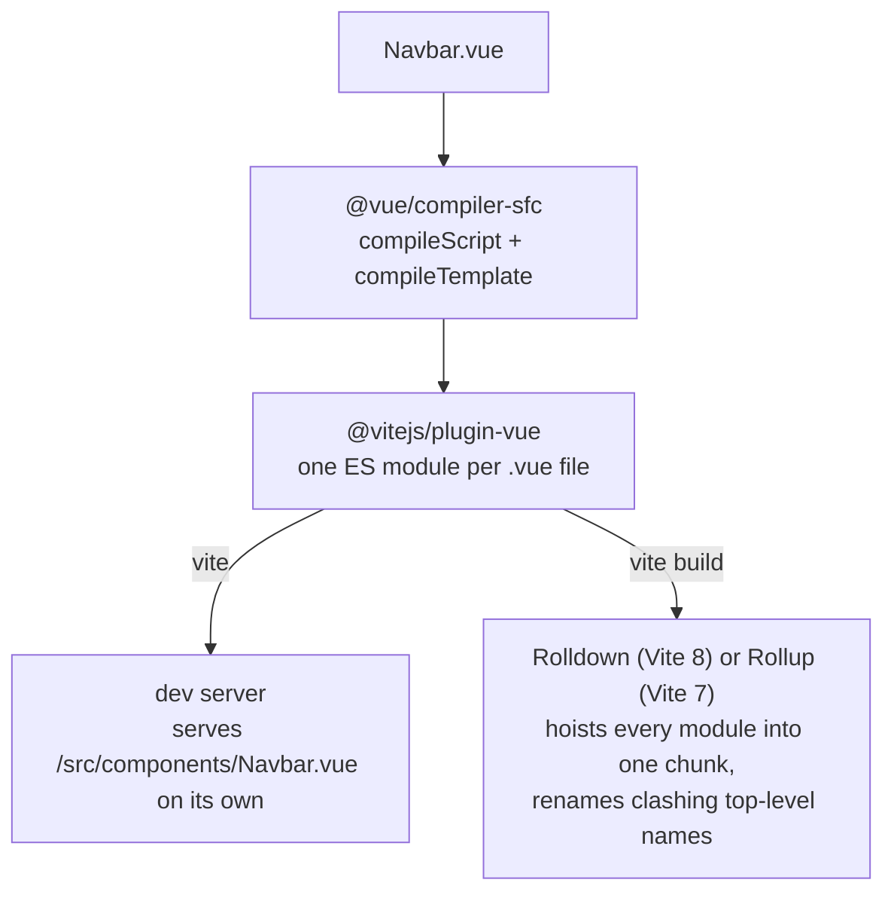

# What a .vue File Compiles To

How `@vitejs/plugin-vue` and `@vue/compiler-sfc` turn a single-file component into JavaScript in the Vite dev server and in a production build, how the bundler names the result, and which of those details reach the running app.

Verified against Vue [3.5.44](https://github.com/vuejs/core/tree/v3.5.44) and @vitejs/plugin-vue [6.0.10](https://github.com/vitejs/vite-plugin-vue/tree/plugin-vue@6.0.10) source. Every "Source:" link points at the commit the tag names, with line numbers. The outputs come from `scripts/show_sfc_output.py --demo` with Vite 8.3.4 (Rolldown 1.2.14) on Node 22.22.3; the Vite 7 rows come from the same project built with Vite 7.3.7 (Rollup 4.64.10).

______________________________________________________________________

## Table of Contents

01. [From .vue File to Bundle](#1-from-vue-file-to-bundle)
02. [The Component Object: `_sfc_main` and `__name`](#2-the-component-object-_sfc_main-and-__name)
03. [`setup()` in Dev and in a Build](#3-setup-in-dev-and-in-a-build)
04. [Hoisted Constants](#4-hoisted-constants)
05. [Plain `<script>` Blocks](#5-plain-script-blocks)
06. [`_export_sfc` and What It Attaches](#6-_export_sfc-and-what-it-attaches)
07. [Names in the Bundle](#7-names-in-the-bundle)
08. [Scoped Style Ids](#8-scoped-style-ids)
09. [Builds Without `NODE_ENV=production`](#9-builds-without-node_envproduction)
10. [Component Names at Runtime](#10-component-names-at-runtime)
11. [Common Wrong Assumptions](#11-common-wrong-assumptions)

______________________________________________________________________

## 1. From .vue File to Bundle



The dev server never merges files: the browser imports each `.vue` file as a separate native ES module, so top-level names in one file cannot see or clash with names in another. Only the production build puts modules into a shared scope, and the bundler renames whatever clashes there (section 7).

______________________________________________________________________

## 2. The Component Object: `_sfc_main` and `__name`

plugin-vue asks the compiler to emit the component as a `const` with a fixed name instead of `export default`:

Source: [`packages/plugin-vue/src/script.ts#L56`](https://github.com/vitejs/vite-plugin-vue/blob/a03675e92eb55c02a6a393e311d610ddb3603744/packages/plugin-vue/src/script.ts#L56)

```ts
export const scriptIdentifier = `_sfc_main`
```

Source: [`packages/plugin-vue/src/script.ts#L84-L87`](https://github.com/vitejs/vite-plugin-vue/blob/a03675e92eb55c02a6a393e311d610ddb3603744/packages/plugin-vue/src/script.ts#L84-L87)

```ts
    sourceMap: options.sourceMap,
    genDefaultAs: canInlineMain(descriptor, options)
      ? scriptIdentifier
      : undefined,
```

`canInlineMain` is true for JavaScript, and for TypeScript in dev. In a TypeScript build the script is a separate `?vue&type=script&setup=true&lang.ts` module that the main module imports as `_sfc_main`, so the name is the same.

The compiler then writes `const _sfc_main =` and adds `__name`, taken from the file name:

Source: [`packages/compiler-sfc/src/compileScript.ts#L1013-L1023`](https://github.com/vuejs/core/blob/bf5f0dd877dd3c23ce85c2cbc1dd771567e84c8c/packages/compiler-sfc/src/compileScript.ts#L1013-L1023)

```ts
  // 10. finalize default export
  const genDefaultAs = options.genDefaultAs
    ? `const ${options.genDefaultAs} =`
    : `export default`

  let runtimeOptions = ``
  if (!ctx.hasDefaultExportName && filename && filename !== DEFAULT_FILENAME) {
    const match = filename.match(/([^/\\]+)\.\w+$/)
    if (match) {
      runtimeOptions += `\n  __name: '${match[1]}',`
    }
```

The regex takes the last path segment without its extension, so `src/pages/profile/index.vue` is `__name: 'index'`. `defineOptions({ name: 'CustomName' })` does not remove `__name`; it adds `name` in front:

```js
const _sfc_main = /*@__PURE__*/Object.assign({ name: 'CustomName' }, {
  __name: 'Named',
  setup(__props, { expose: __expose }) {
```

______________________________________________________________________

## 3. `setup()` in Dev and in a Build

Whether the template is compiled into `setup()` depends on the dev server and on devtools:

Source: [`packages/plugin-vue/src/script.ts#L44-L54`](https://github.com/vitejs/vite-plugin-vue/blob/a03675e92eb55c02a6a393e311d610ddb3603744/packages/plugin-vue/src/script.ts#L44-L54)

```ts
export function isUseInlineTemplate(
  descriptor: SFCDescriptor,
  options: ResolvedOptions,
): boolean {
  return (
    !options.devServer &&
    !options.devToolsEnabled &&
    !!descriptor.scriptSetup &&
    !descriptor.template?.src
  )
}
```

Without an inline template, `setup()` has to hand its bindings to a separate render function, so the compiler returns them as `__returned__`:

Source: [`packages/compiler-sfc/src/compileScript.ts#L999-L1011`](https://github.com/vuejs/core/blob/bf5f0dd877dd3c23ce85c2cbc1dd771567e84c8c/packages/compiler-sfc/src/compileScript.ts#L999-L1011)

```ts
  if (!options.inlineTemplate && !__TEST__) {
    // in non-inline mode, the `__isScriptSetup: true` flag is used by
    // componentPublicInstance proxy to allow properties that start with $ or _
    ctx.s.appendRight(
      endOffset,
      `\nconst __returned__ = ${returned}\n` +
        `Object.defineProperty(__returned__, '__isScriptSetup', { enumerable: false, value: true })\n` +
        `return __returned__` +
        `\n}\n\n`,
    )
  } else {
    ctx.s.appendRight(endOffset, `\nreturn ${returned}\n}\n\n`)
  }
```

For this component:

```vue
<script setup>
const a = 'Hello from Navbar'
console.log(a)
</script>

<template>
  <nav>{{ a }}</nav>
</template>
```

the dev server sends (HMR code left out):

```js
const a = 'Hello from Navbar'

const _sfc_main = {
  __name: 'Navbar',
  setup(__props, { expose: __expose }) {
  __expose();

console.log(a)

const __returned__ = { a }
Object.defineProperty(__returned__, '__isScriptSetup', { enumerable: false, value: true })
return __returned__
}

}
import { toDisplayString as _toDisplayString, openBlock as _openBlock, createElementBlock as _createElementBlock } from "/node_modules/.vite/deps/vue.js?v=4924db2a"

function _sfc_render(_ctx, _cache, $props, $setup, $data, $options) {
  return (_openBlock(), _createElementBlock("nav", null, _toDisplayString($setup.a)))
}


import _export_sfc from "/@id/__x00__plugin-vue:export-helper"
export default /*#__PURE__*/_export_sfc(_sfc_main, [['render',_sfc_render],['__file',"/tmp/sfc-output-_imqcfay/src/components/Navbar.vue"]])
```

and the unminified production build contains:

```js
var a$1 = "Hello from Navbar";
var _sfc_main$5 = {
	__name: "Navbar",
	setup(__props) {
		console.log(a$1);
		return (_ctx, _cache) => {
			return openBlock(), createElementBlock("nav", null, toDisplayString(a$1));
		};
	}
};
```

`const a` sits above `_sfc_main` in both, outside `setup()`, because its value is a literal (section 4). The `$1` and `$5` suffixes come from the bundler (section 7).

______________________________________________________________________

## 4. Hoisted Constants

`<script setup>` code normally runs inside `setup()`, once per component instance. The compiler moves a declaration out of `setup()` to module scope when hoisting is on and every declarator is a `const` with a static initializer:

Source: [`packages/compiler-sfc/src/compileScript.ts#L181`](https://github.com/vuejs/core/blob/bf5f0dd877dd3c23ce85c2cbc1dd771567e84c8c/packages/compiler-sfc/src/compileScript.ts#L181)

```ts
  const hoistStatic = options.hoistStatic !== false && !script
```

Source: [`packages/compiler-sfc/src/compileScript.ts#L630-L633`](https://github.com/vuejs/core/blob/bf5f0dd877dd3c23ce85c2cbc1dd771567e84c8c/packages/compiler-sfc/src/compileScript.ts#L630-L633)

```ts
    // hoist literal constants
    if (hoistStatic && isAllLiteral) {
      hoistNode(node)
    }
```

Source: [`packages/compiler-sfc/src/compileScript.ts#L1146-L1152`](https://github.com/vuejs/core/blob/bf5f0dd877dd3c23ce85c2cbc1dd771567e84c8c/packages/compiler-sfc/src/compileScript.ts#L1146-L1152)

```ts
  if (node.type === 'VariableDeclaration') {
    const isConst = node.kind === 'const'
    isAllLiteral =
      isConst &&
      node.declarations.every(
        decl => decl.id.type === 'Identifier' && isStaticNode(decl.init!),
      )
```

"Static" means literals and expressions made only of literals:

Source: [`packages/compiler-sfc/src/compileScript.ts#L1343-L1378`](https://github.com/vuejs/core/blob/bf5f0dd877dd3c23ce85c2cbc1dd771567e84c8c/packages/compiler-sfc/src/compileScript.ts#L1343-L1378)

```ts
function isStaticNode(node: Node): boolean {
  node = unwrapTSNode(node)

  switch (node.type) {
    case 'UnaryExpression': // void 0, !true
      return isStaticNode(node.argument)

    case 'LogicalExpression': // 1 > 2
    case 'BinaryExpression': // 1 + 2
      return isStaticNode(node.left) && isStaticNode(node.right)

    case 'ConditionalExpression': {
      // 1 ? 2 : 3
      return (
        isStaticNode(node.test) &&
        isStaticNode(node.consequent) &&
        isStaticNode(node.alternate)
      )
    }

    case 'SequenceExpression': // (1, 2)
    case 'TemplateLiteral': // `foo${1}`
      return node.expressions.every(expr => isStaticNode(expr))

    case 'ParenthesizedExpression': // (1)
      return isStaticNode(node.expression)

    case 'StringLiteral':
    case 'NumericLiteral':
    case 'BooleanLiteral':
    case 'NullLiteral':
    case 'BigIntLiteral':
      return true
  }
  return false
}
```

An identifier is not static, so `const x = undefined` or `const y = OTHER_CONST` stays in `setup()`. Neither are objects, arrays, calls or functions. The demo's `Counter.vue`:

```vue
<script setup>
import { ref } from 'vue'

const label = 'Clicks' // literal: hoisted to module scope
const step = 1 + 1 // expression of literals: hoisted
const limits = { max: 10 } // object: stays in setup()
let renders = 0 // let: stays in setup()
const count = ref(0) // call: stays in setup()
function inc() {
  count.value += step
}
</script>
```

compiles in dev to:

```js
import { ref } from "/node_modules/.vite/deps/vue.js?v=4924db2a"

const label = 'Clicks' // literal: hoisted to module scope
const step = 1 + 1 // expression of literals: hoisted

const _sfc_main = {
  __name: 'Counter',
  setup(__props, { expose: __expose }) {
  __expose();

const limits = { max: 10 } // object: stays in setup()
let renders = 0 // let: stays in setup()
const count = ref(0) // call: stays in setup()
function inc() {
  count.value += step
}

const __returned__ = { label, step, limits, get renders() { return renders }, set renders(v) { renders = v }, count, inc, ref }
Object.defineProperty(__returned__, '__isScriptSetup', { enumerable: false, value: true })
return __returned__
}

}
```

A hoisted value is the same for every instance, which is harmless because it is a constant primitive. The `let` is exposed through a getter and setter so the template sees reassignments.

______________________________________________________________________

## 5. Plain `<script>` Blocks

`hoistStatic` is `false` whenever the file has a plain `<script>` block (`!script` above), and the plain block's own code is placed at module scope as written:

```vue
<script>
let instances = 0 // module scope: one counter shared by every <Shared>
</script>

<script setup>
const title = 'Shared' // not hoisted: a plain <script> block turns hoisting off
instances++
</script>
```

```js
let instances = 0 // module scope: one counter shared by every <Shared>

const _sfc_main = {
  __name: 'Shared',
  setup(__props, { expose: __expose }) {
  __expose();

const title = 'Shared' // not hoisted: a plain <script> block turns hoisting off
instances++

const __returned__ = { get instances() { return instances }, set instances(v) { instances = v }, title }
```

Every `<Shared>` on the page increments the same `instances`. That is the point of a plain block (module-level caches, named exports), and a bug when per-instance state is put there by mistake.

______________________________________________________________________

## 6. `_export_sfc` and What It Attaches

plugin-vue collects properties to set on the component object after it is created:

Source: [`packages/plugin-vue/src/main.ts#L150-L159`](https://github.com/vitejs/vite-plugin-vue/blob/a03675e92eb55c02a6a393e311d610ddb3603744/packages/plugin-vue/src/main.ts#L150-L159)

```ts
  if (hasScoped) {
    attachedProps.push([`__scopeId`, JSON.stringify(`data-v-${descriptor.id}`)])
  }
  if (devToolsEnabled || (devServer && !isProduction)) {
    // expose filename during serve for devtools to pickup
    attachedProps.push([
      `__file`,
      JSON.stringify(isProduction ? path.basename(filename) : filename),
    ])
  }
```

A separate `render` is added when the template is not inlined, and `__cssModules` for `<style module>`. With nothing collected, the helper is skipped:

Source: [`packages/plugin-vue/src/main.ts#L269-L278`](https://github.com/vitejs/vite-plugin-vue/blob/a03675e92eb55c02a6a393e311d610ddb3603744/packages/plugin-vue/src/main.ts#L269-L278)

```ts
  if (!attachedProps.length) {
    output.push(`export default _sfc_main`)
  } else {
    output.push(
      `import _export_sfc from '${EXPORT_HELPER_ID}'`,
      `export default /*#__PURE__*/_export_sfc(_sfc_main, [${attachedProps
        .map(([key, val]) => `['${key}',${val}]`)
        .join(',')}])`,
    )
  }
```

The helper only copies the pairs onto the object:

Source: [`packages/plugin-vue/src/helper.ts#L1-L11`](https://github.com/vitejs/vite-plugin-vue/blob/a03675e92eb55c02a6a393e311d610ddb3603744/packages/plugin-vue/src/helper.ts#L1-L11)

```ts
export const EXPORT_HELPER_ID = '\0plugin-vue:export-helper'

export const helperCode = `
export default (sfc, props) => {
  const target = sfc.__vccOpts || sfc;
  for (const [key, val] of props) {
    target[key] = val;
  }
  return target;
}
`
```

| Component                          | Dev server                             | Production build                    |
| ---------------------------------- | -------------------------------------- | ----------------------------------- |
| `<script setup>`, no scoped style  | `_export_sfc` with render, file        | `export default _sfc_main`          |
| `<script setup>`, `<style scoped>` | `_export_sfc` with render, scope, file | `_export_sfc` with `__scopeId` only |

______________________________________________________________________

## 7. Names in the Bundle

In a build, every module ends up in one scope, and each `.vue` file brought its own `_sfc_main` and possibly a hoisted `a`. The bundler keeps one of each name and appends `$N` to the others. The demo's unminified Vite 8 build:

```js
var a$1 = "Hello from Navbar";
var _sfc_main$5 = {
	__name: "Navbar",
```

```js
var a = "Hello from Login";
var _sfc_main$4 = {
	__name: "Login",
```

```js
var label = "Clicks";
var step = 2;
var Counter_default = /*#__PURE__*/ _plugin_vue_export_helper_default({
	__name: "Counter",
	setup(__props) {
		const limits = { max: 10 };
		let renders = 0;
		const count = /* @__PURE__ */ ref(0);
```

```js
var msg = "Profile";
var _sfc_main$1 = {
	__name: "index",
```

Which file keeps the bare name and which gets `$1` follows the bundler's internal order (here Navbar, imported first, got the highest number), not the file name or the import name. When `export default` is an expression (`_export_sfc(...)`, or `defineComponent(...)` from a `lang="ts"` component), the bundler has to invent a variable name, and the two bundlers pick different sources:

|                                           | Vite 8.3.4 (Rolldown 1.2.14)                       | Vite 7.3.7 (Rollup 4.64.10)                                  |
| ----------------------------------------- | -------------------------------------------------- | ------------------------------------------------------------ |
| Top-level declarations                    | `var`                                              | `const`                                                      |
| Clashing names                            | `a$1`, `_sfc_main$5`                               | `a$1`, `_sfc_main$5`                                         |
| Default export through `_export_sfc`      | after the file: `Hoist_default`, `profile_default` | after the importer's local name: `import Xyz` gives `Xyz`    |
| `lang="ts"` component                     | `Login_default`                                    | `_sfc_main$4` (plugin-vue imports the script as `_sfc_main`) |
| Root component passed once to `createApp` | object inlined into `createApp({ ... })`           | `const _sfc_main = {...}`, then `createApp(_sfc_main)`       |
| Module markers in unminified output       | `//#region src/components/Navbar.vue`              | none                                                         |
| `__name` in minified output               | `` __name:`Navbar` ``                              | `__name:"Navbar"`                                            |

`profile_default` shows that Rolldown takes the directory name for an `index` file. Both bundlers fold `'a' + 'b'` into `"ab"` and `1 + 1` into `2` in the final output. `scripts/show_sfc_output.py` prints Rollup's per-module code from before that last pass, so with `--vite 7.3.7` it still shows the unfolded expressions and single quotes.

______________________________________________________________________

## 8. Scoped Style Ids

The `data-v-<hash>` id comes from the descriptor id:

Source: [`packages/plugin-vue/src/utils/descriptorCache.ts#L41-L58`](https://github.com/vitejs/vite-plugin-vue/blob/a03675e92eb55c02a6a393e311d610ddb3603744/packages/plugin-vue/src/utils/descriptorCache.ts#L41-L58)

```ts
  // ensure the path is normalized in a way that is consistent inside
  // project (relative to root) and on different systems.
  const normalizedPath = normalizePath(path.relative(root, filename))

  const componentIdGenerator = features?.componentIdGenerator
  if (componentIdGenerator === 'filepath') {
    descriptor.id = getHash(normalizedPath)
  } else if (componentIdGenerator === 'filepath-source') {
    descriptor.id = getHash(normalizedPath + source)
  } else if (typeof componentIdGenerator === 'function') {
    descriptor.id = componentIdGenerator(
      normalizedPath,
      source,
      isProduction,
      getHash,
    )
  } else {
    descriptor.id = getHash(normalizedPath + (isProduction ? source : ''))
```

By default the production id includes the source text, so editing a comment changes `data-v-…` in the build, and the dev id never matches the build id (the demo's `Counter.vue` was `data-v-9bd91872` in dev and `data-v-00aae374` in the build). Tests or external CSS that select on `data-v-…` break on every edit unless `features.componentIdGenerator` is `'filepath'`.

______________________________________________________________________

## 9. Builds Without `NODE_ENV=production`

plugin-vue treats a build as production only when Vite's `isProduction` is true, which is `process.env.NODE_ENV === 'production'`, and turns devtools support on otherwise:

Source: [`packages/plugin-vue/src/index.ts#L341-L346`](https://github.com/vitejs/vite-plugin-vue/blob/a03675e92eb55c02a6a393e311d610ddb3603744/packages/plugin-vue/src/index.ts#L341-L346)

```ts
        isProduction: config.isProduction,
        devToolsEnabled: !!(
          options.value.features?.prodDevtools ||
          config.define!.__VUE_PROD_DEVTOOLS__ ||
          !config.isProduction
        ),
```

With `devToolsEnabled`, `isUseInlineTemplate` is false (section 3) and `__file` is attached (section 6). `NODE_ENV=development uv run scripts/show_sfc_output.py --demo --build-only` prints:

```js
var a$1 = "Hello from Navbar";
var _sfc_main$5 = {
	__name: "Navbar",
	setup(__props, { expose: __expose }) {
		__expose();
		console.log(a$1);
		const __returned__ = { a: a$1 };
		Object.defineProperty(__returned__, "__isScriptSetup", {
			enumerable: false,
			value: true
		});
		return __returned__;
	}
};
function _sfc_render$5(_ctx, _cache, $props, $setup, $data, $options) {
	return openBlock(), createElementBlock("nav", null, toDisplayString($setup.a));
}
var Navbar_default = /*#__PURE__*/ _plugin_vue_export_helper_default(_sfc_main$5, [["render", _sfc_render$5], ["__file", "/tmp/sfc-output-jc1ya9pz/src/components/Navbar.vue"]]);
```

The dev shape ships to production, and with it the absolute path of every component on the build machine. `NODE_ENV` reaches a build from the shell, from CI, or from `NODE_ENV=development` in a `.env.<mode>` file; `vite build --mode development` alone does not set it.

______________________________________________________________________

## 10. Component Names at Runtime

Vue reads `name` first and falls back to the inferred `__name`:

Source: [`packages/runtime-core/src/component.ts#L1226-L1233`](https://github.com/vuejs/core/blob/bf5f0dd877dd3c23ce85c2cbc1dd771567e84c8c/packages/runtime-core/src/component.ts#L1226-L1233)

```ts
export function getComponentName(
  Component: ConcreteComponent,
  includeInferred = true,
): string | false | undefined {
  return isFunction(Component)
    ? Component.displayName || Component.name
    : Component.name || (includeInferred && Component.__name)
}
```

`<KeepAlive>` uses that name for `include` and `exclude`:

Source: [`packages/runtime-core/src/components/KeepAlive.ts#L314-L327`](https://github.com/vuejs/core/blob/bf5f0dd877dd3c23ce85c2cbc1dd771567e84c8c/packages/runtime-core/src/components/KeepAlive.ts#L314-L327)

```ts
      // for async components, name check should be based in its loaded
      // inner component if available
      const name = getComponentName(
        isAsyncWrapper(vnode)
          ? (vnode.type as ComponentOptions).__asyncResolved || {}
          : comp,
      )

      const { include, exclude, max } = props

      if (
        (include && (!name || !matches(include, name))) ||
        (exclude && name && matches(exclude, name))
      ) {
```

Source: [`packages/runtime-core/src/components/KeepAlive.ts#L399-L410`](https://github.com/vuejs/core/blob/bf5f0dd877dd3c23ce85c2cbc1dd771567e84c8c/packages/runtime-core/src/components/KeepAlive.ts#L399-L410)

```ts
function matches(pattern: MatchPattern, name: string): boolean {
  if (isArray(pattern)) {
    return pattern.some((p: string | RegExp) => matches(p, name))
  } else if (isString(pattern)) {
    return pattern.split(',').includes(name)
  } else if (isRegExp(pattern)) {
    pattern.lastIndex = 0
    return pattern.test(name)
  }
  /* v8 ignore next */
  return false
}
```

The comparison is exact: no trimming, no case folding, no PascalCase conversion. So:

| Component file                                     | Its name  | `include="Profile"` | `include="index"` | `include="Navbar, Login"` |
| -------------------------------------------------- | --------- | ------------------- | ----------------- | ------------------------- |
| `pages/profile/index.vue`                          | `index`   | no                  | yes               | no                        |
| `components/Login.vue`                             | `Login`   | no                  | no                | no (`" Login"`)           |
| `components/Navbar.vue`                            | `Navbar`  | no                  | no                | yes                       |
| `index.vue` + `defineOptions({ name: 'Profile' })` | `Profile` | yes                 | no                | no                        |

______________________________________________________________________

## 11. Common Wrong Assumptions

| Assumption                                                 | What happens                                                                                                    |
| ---------------------------------------------------------- | --------------------------------------------------------------------------------------------------------------- |
| `Navbar.vue` compiles to `const Navbar = {...}`            | It compiles to `const _sfc_main = {...}` with `__name: 'Navbar'` inside (section 2)                             |
| Variables in `<script setup>` always live inside `setup()` | Literal `const`s are hoisted to module scope; the rest is inside `setup()` (section 4)                          |
| Same-named variables in two components need unique names   | Each file is its own module in dev; the bundler renames clashes in a build (sections 1 and 7)                   |
| All files share one scope                                  | Only a production bundle does, after renaming; the dev server serves one module per file                        |
| The bundle names a component after its import              | Rollup (Vite 7) does; Rolldown (Vite 8) uses the file name, and an unwrapped component stays `_sfc_main$N`      |
| `$1`, `$2` suffixes follow file or import order            | They follow the bundler's internal order; do not rely on them                                                   |
| A plain `<script>` block behaves like `<script setup>`     | Its code runs once per module and its state is shared by every instance; it also turns hoisting off (section 5) |
| `vite build --mode development` gives a development build  | It still sets `NODE_ENV=production`; only `NODE_ENV=development` changes how components compile (section 9)     |
